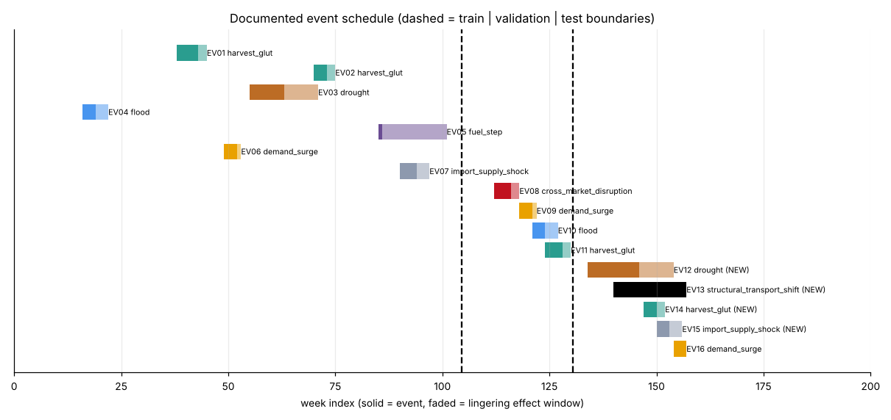

# Synthetic Data Audit (acceptance criteria, specification section 12)

Generator seed **42**, configuration `config/experiment_config.yaml`. Overall result: **FAILURES PRESENT**.

| check              | criterion                                                                      | passed   | detail                                                                                                                                                                                                                                                                  |
|:-------------------|:-------------------------------------------------------------------------------|:---------|:------------------------------------------------------------------------------------------------------------------------------------------------------------------------------------------------------------------------------------------------------------------------|
| Coverage           | Exactly 5 markets x 4 crops x 156 weeks before row-level corruption            | PASS     | 3120 rows in each of 3 scenarios                                                                                                                                                                                                                                        |
| Uniqueness         | No duplicate market_id + crop_id + week_start keys                             | PASS     | 0 duplicate keys                                                                                                                                                                                                                                                        |
| Price validity     | All prices positive; extremes explained by events or labelled errors           | PASS     | clean: latent>0=True, implausible-but-unflagged=0, labelled errors=0; realistic: latent>0=True, implausible-but-unflagged=0, labelled errors=23; stressed: latent>0=True, implausible-but-unflagged=0, labelled errors=28                                               |
| Seasonality        | At least some crops show recurring annual patterns, not identical across crops | PASS     | CRP-01: R2=0.84 amp=0.123 peak-doy=138; CRP-02: R2=0.33 amp=0.170 peak-doy=357; CRP-03: R2=0.63 amp=0.153 peak-doy=22; CRP-04: R2=0.68 amp=0.100 peak-doy=57                                                                                                            |
| Market differences | Markets have distinct price levels and volatility                              | PASS     | min across crops of log-level spread = 0.237; min vol max/min ratio = 1.22                                                                                                                                                                                              |
| Shock behaviour    | Documented shocks move the relevant variables plausibly                        | PASS     | 16/16 events pass; EV12 drought: potato arrivals in drought markets vs controls (diff-in-diff) = 0.72x, measured 8+ weeks after onset (delayed weather-to-supply effect); EV08 source disruption: Nairobi regional supply index = 0.83x baseline (1-week-lag spillover) |
| Persistence        | Prices exhibit continuity, not independent weekly draws                        | PASS     | lag-1 autocorrelation of log price: min=0.87, mean=0.94 (shuffled benchmark ~0.06)                                                                                                                                                                                      |
| Missingness        | Rates match the selected scenario                                              | PASS     | realistic: price missing 3.72% (3-5%), errors 0.74% (0.5-1%), indicator missing 5.0%-9.9% (5-10%) | clean has no missing: True; stressed price missing 6.54% > realistic: True                                                                                          |
| No hidden leakage  | All features reconstructable from information available at the forecast origin | PASS     | banned columns in feature sets: none; truncation test (cut weeks 60/100/130): handled max|diff|=0.0e+00, raw max|diff|=0.0e+00                                                                                                                                          |
| Reproducibility    | Same configuration and seed generate the same data and event schedule          | FAIL     | world identical=False, degraded panel identical=False, different seed differs=True                                                                                                                                                                                      |

## Event-by-event shock verification

Each documented event must move the variable it is meant to move.

| event_id   | event_type                 | expectation                  |   measured_ratio | passed   |
|:-----------|:---------------------------|:-----------------------------|-----------------:|:---------|
| EV01       | harvest_glut               | arrivals ratio > 1.25        |            2.105 | PASS     |
| EV02       | harvest_glut               | arrivals ratio > 1.25        |            3.740 | PASS     |
| EV03       | drought                    | rainfall ratio < 0.6         |            0.573 | PASS     |
| EV04       | flood                      | rainfall ratio > 2.0         |            8.900 | PASS     |
| EV05       | fuel_step                  | fuel index ratio > 1.12      |            1.227 | PASS     |
| EV06       | demand_surge               | demand ratio > 1.10          |            1.293 | PASS     |
| EV07       | import_supply_shock        | arrivals ratio > 1.25        |            1.798 | PASS     |
| EV08       | cross_market_disruption    | source arrivals ratio < 0.65 |            0.396 | PASS     |
| EV09       | demand_surge               | demand ratio > 1.10          |            1.367 | PASS     |
| EV10       | flood                      | rainfall ratio > 2.0         |           15.763 | PASS     |
| EV11       | harvest_glut               | arrivals ratio > 1.25        |            2.853 | PASS     |
| EV12       | drought                    | rainfall ratio < 0.6         |            0.243 | PASS     |
| EV13       | structural_transport_shift | fuel index ratio > 1.25      |            1.335 | PASS     |
| EV14       | harvest_glut               | arrivals ratio > 1.25        |            1.254 | PASS     |
| EV15       | import_supply_shock        | arrivals ratio > 1.25        |            1.803 | PASS     |
| EV16       | demand_surge               | demand ratio > 1.10          |            1.306 | PASS     |

## Scenario summary

| scenario   |   price missing % |   labelled reporting errors % |   mean indicator missing % |   late-delivered indicator rows % |   synthetic-shock rows % |
|:-----------|------------------:|------------------------------:|---------------------------:|----------------------------------:|-------------------------:|
| clean      |              0.00 |                          0.00 |                       0.00 |                              0.00 |                    31.70 |
| realistic  |              3.72 |                          0.74 |                       7.09 |                             11.86 |                    31.70 |
| stressed   |              6.54 |                          0.90 |                      12.11 |                             35.19 |                    31.70 |

Price missingness by market (realistic scenario; unequal reporting is intentional):

| market   |   price missing % (realistic) |
|:---------|------------------------------:|
| Nairobi  |                          1.92 |
| Nakuru   |                          2.56 |
| Eldoret  |                          2.72 |
| Kisumu   |                          6.09 |
| Mombasa  |                          5.29 |

## Data-quality label semantics

- `data_quality_flag = missing`: price not reported.
- `suspect`: an injected recording error (audit label - **never a model input**; used only to exclude such rows when scoring).
- `synthetic_shock`: the week lies inside a documented event window (a genuine market effect, **kept** in training and evaluation).
- `clean`: none of the above.  `corrected` appears only in the cleaned data produced by the causal pipeline (see docs).

