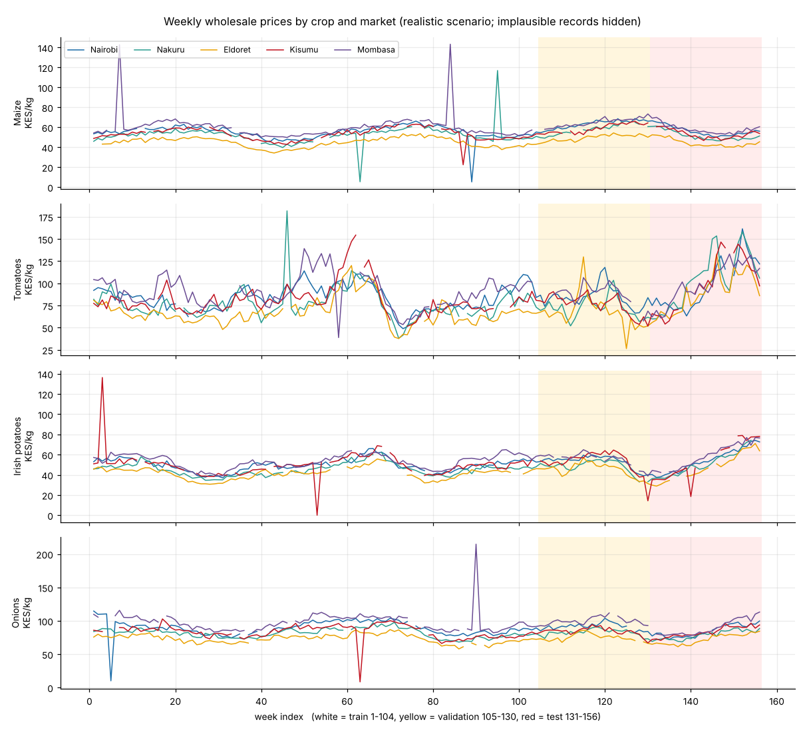
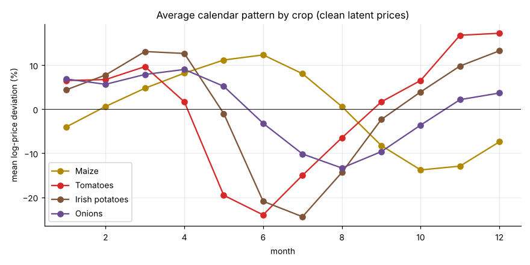
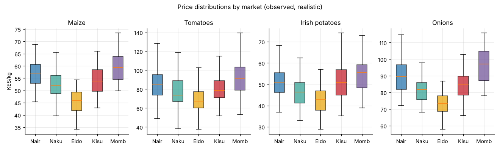
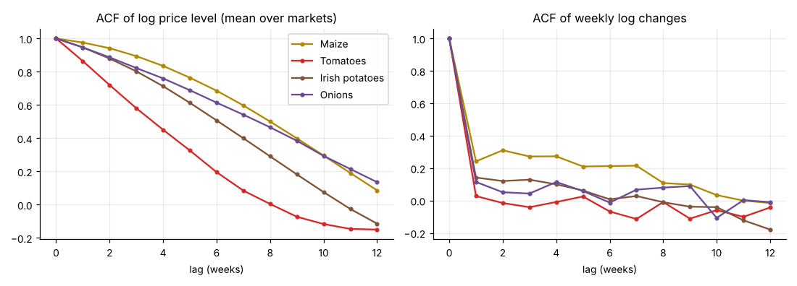
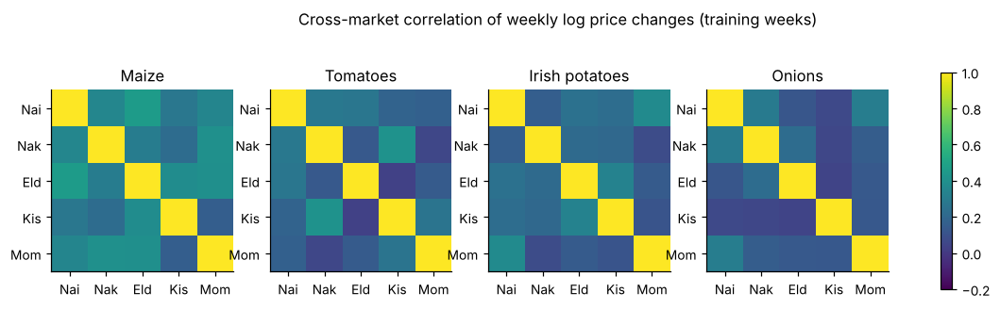
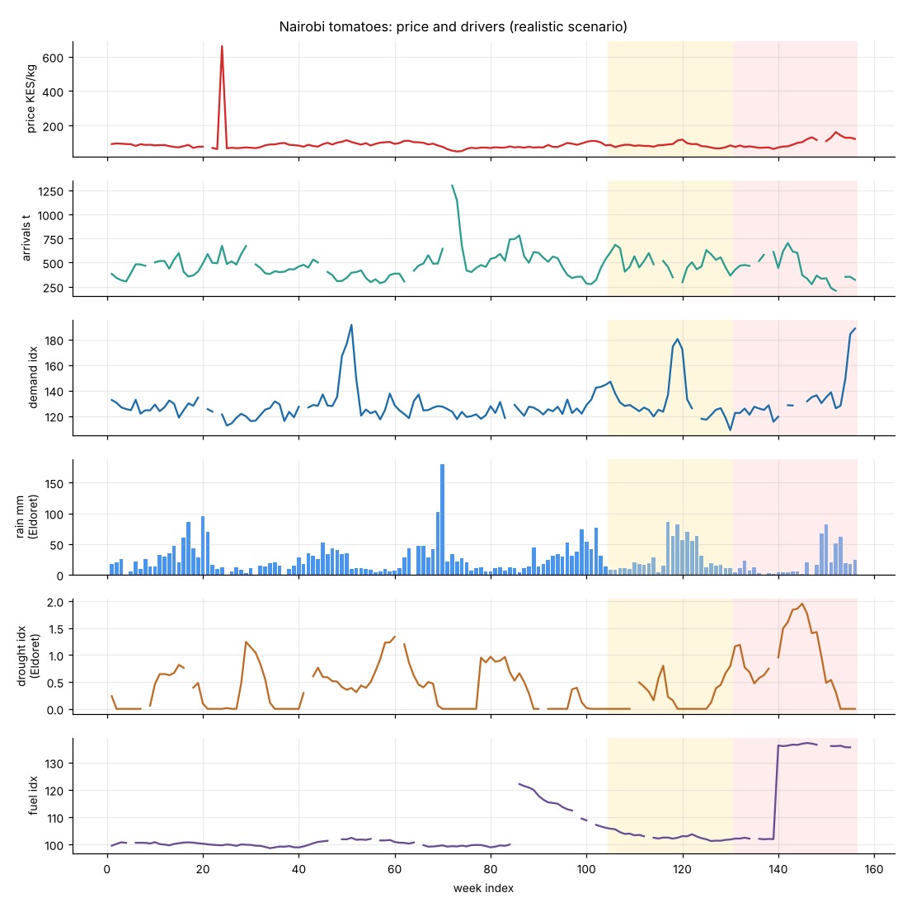
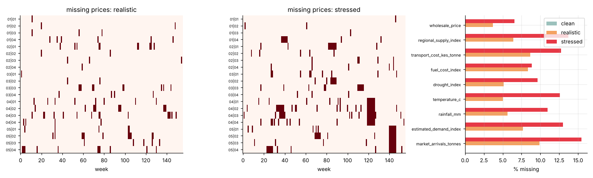
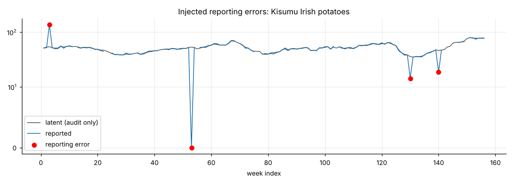
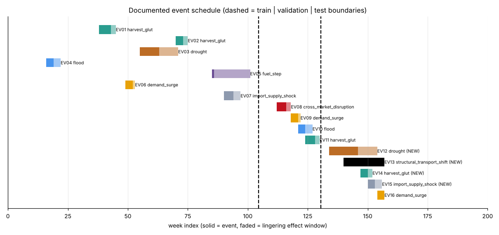

# Exploratory Data Analysis (Stage 2)

All numbers below that could drive modelling choices use **training weeks 1-104 only**. The dataset is synthetic; nothing here describes real Kenyan markets.

## Partitions

| partition   | weeks (origin)   | dates                    | use                        |   series-weeks |
|:------------|:-----------------|:-------------------------|:---------------------------|---------------:|
| train       | 1-104            | 2023-01-02 to 2024-12-23 | fit, tune (rolling-origin) |           2080 |
| validation  | 105-130          | 2024-12-30 to 2025-06-23 | model selection            |            520 |
| test        | 131-156          | 2025-06-30 to 2025-12-22 | final one-shot evaluation  |            520 |

## Price level and variability (training weeks, realistic scenario, errors excluded)

| crop           |   mean |   std |   min |   median |   max |
|:---------------|-------:|------:|------:|---------:|------:|
| Maize          |   52.7 |   6.8 |  34.2 |     53.0 |  68.3 |
| Tomatoes       |   79.7 |  17.4 |  37.7 |     76.8 | 154.4 |
| Irish potatoes |   47.9 |   7.4 |  30.7 |     47.6 |  68.8 |
| Onions         |   84.9 |  11.2 |  57.9 |     84.1 | 115.7 |

Mean price by market (KES/kg, pooled over crops): Nairobi 69.7, Nakuru 63.6, Eldoret 56.9, Kisumu 67.4, Mombasa 74.0.

Weekly log-price change volatility (latent):

| crop           |   weekly_log_change_sd |
|:---------------|-----------------------:|
| Maize          |                 0.0199 |
| Tomatoes       |                 0.0996 |
| Irish potatoes |                 0.0411 |
| Onions         |                 0.0277 |

## Seasonality

Crops peak in different months and with different strength, so a single calendar pattern would not fit all of them.

## Distributions

## Persistence and stationarity

Augmented Dickey-Fuller tests on training weeks (share of the 5 market series per crop with p<0.05):

| crop           |   share_level_stationary |   share_diff_stationary |
|:---------------|-------------------------:|------------------------:|
| Irish potatoes |                     0.20 |                    1.00 |
| Maize          |                     0.80 |                    0.40 |
| Onions         |                     0.20 |                    1.00 |
| Tomatoes       |                     0.40 |                    1.00 |

Price levels are strongly autocorrelated (persistence), which is why last-price (naive) forecasts are a hard benchmark.  Weekly changes are far less autocorrelated.

## Cross-market relationships

Mean pairwise correlation of weekly log price changes (training weeks): Maize 0.33, Tomatoes 0.19, Irish potatoes 0.21, Onions 0.15.

## Driver relationships (exploratory)

Correlation between each lagged driver anomaly and the NEXT week's log price change (training weeks, pooled over markets):

| crop           |   arrivals anomaly |   demand anomaly |   drought idx (lag 4) |   fuel 4-wk change |
|:---------------|-------------------:|-----------------:|----------------------:|-------------------:|
| Maize          |             -0.434 |           -0.145 |                -0.053 |             -0.186 |
| Tomatoes       |             -0.143 |            0.010 |                -0.001 |             -0.002 |
| Irish potatoes |             -0.321 |            0.214 |                 0.207 |              0.126 |
| Onions         |             -0.286 |            0.201 |                 0.050 |              0.035 |

Supply anomalies carry the clearest signal, with the expected negative sign (more supply, lower price), strongest for perishable tomatoes.  Weather and drought act with a delay (see `figures/eda_06_indicators.png`).

## Missingness and reporting errors

| scenario   |   price missing % |   labelled reporting errors % |   mean indicator missing % |   late-delivered indicator rows % |   synthetic-shock rows % |
|:-----------|------------------:|------------------------------:|---------------------------:|----------------------------------:|-------------------------:|
| clean      |              0.00 |                          0.00 |                       0.00 |                              0.00 |                    31.70 |
| realistic  |              3.72 |                          0.74 |                       7.09 |                             11.86 |                    31.70 |
| stressed   |              6.54 |                          0.90 |                      12.11 |                             35.19 |                    31.70 |

## Events and shocks

See `reports/DATA_AUDIT.md` for verification; schedule in `data/events_schedule.csv`.

## Implications for modelling

1. Use the latest available price as the reference and model the *change* (log ratio) rather than the level.
2. Tomatoes are the most volatile crop; scale-free metrics (skill vs naive, WAPE) are needed to compare crops.
3. Seasonality differs by crop, so any seasonal baseline must be crop-specific.
4. Drivers act with lags (supply immediately, weather with a delay), which supports lag and rolling-window features.
5. Reporting gaps and gross errors are concentrated in some markets, so data-quality handling must be causal and market-agnostic.
