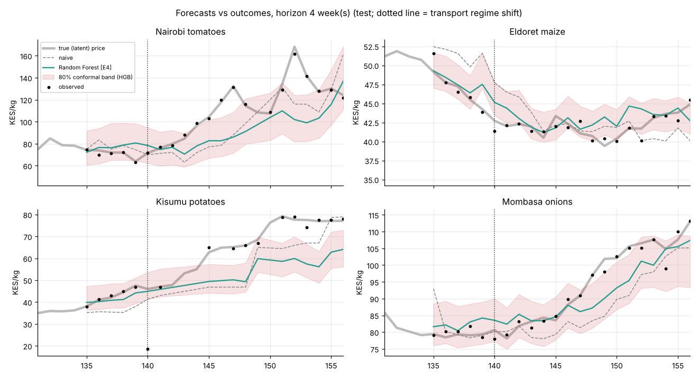
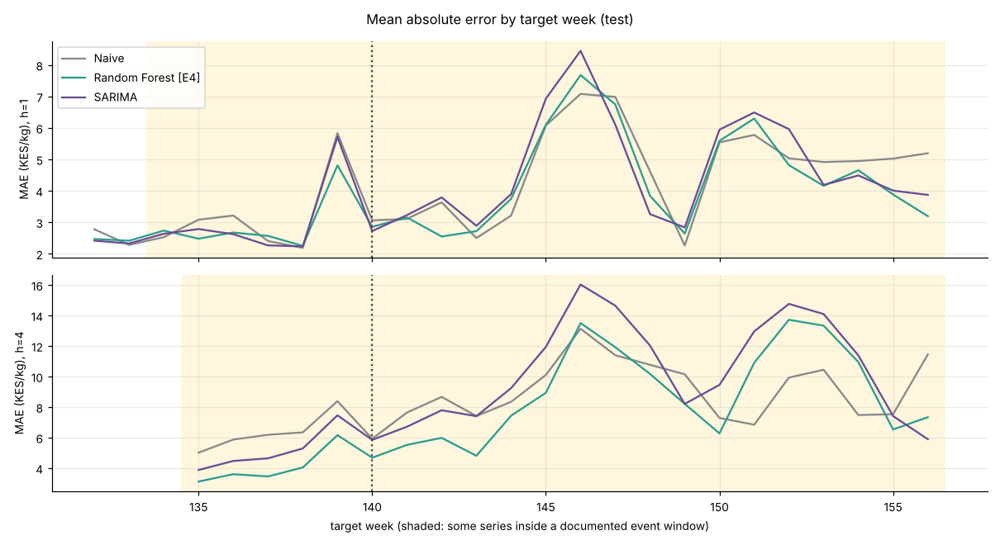

# Error Analysis

Model analysed: **Random Forest [E4]** (selected on validation among the core eight; realistic data, data-quality handling on), test window origins 131-156, with the naive last-price forecast as reference. Forecasts of rows labelled as injected reporting errors are not scored. All numbers are read from `results/predictions_main.parquet`.

## 1. Where the errors are

| group                       |   rows |   total_abs_error |   share_of_rows |   share_of_abs_error |
|:----------------------------|-------:|------------------:|----------------:|---------------------:|
| event-affected target weeks |    783 |          4841.815 |           0.573 |                0.622 |
| other target weeks          |    584 |          2948.004 |           0.427 |                0.378 |

Most of the test window is *by design* shock-affected (57.3% of scored forecasts have a target week inside a documented event window), so the error is concentrated there simply because that is where most weeks are. The informative comparison is skill: see `results/breakdown_shock_vs_ordinary_test.csv` - the model's skill versus naive is 15.9% in ordinary weeks but only 3.1% in event-affected weeks.

## 2. By crop: how often does the model beat naive, and is it biased?

| crop           |    rows |   Random Forest [E4] beats naive (share of forecasts) |   mean signed error (obs - forecast) |    MAE |
|:---------------|--------:|------------------------------------------------------:|-------------------------------------:|-------:|
| Irish potatoes | 323.000 |                                                 0.486 |                                4.035 |  4.541 |
| Maize          | 355.000 |                                                 0.690 |                               -0.713 |  1.468 |
| Onions         | 349.000 |                                                 0.587 |                                1.054 |  3.070 |
| Tomatoes       | 340.000 |                                                 0.518 |                                9.100 | 13.913 |

## 3. Systematic failure: under-predicting a rising market

After the transport-cost regime shift and the stronger drought (target weeks >= 140), prices of potatoes, tomatoes and onions rose sharply. The forecasts **lag the rise**: the share of under-predicted forecasts is 91% for potatoes, 73% for tomatoes and 67% for onions. Two mechanisms are mixed here. For **potatoes** 15% of test prices exceeded the highest price seen in training/validation, and tree ensembles cannot predict above values they have seen; for **tomatoes and onions** prices stayed inside the historical range (2% and 0% of rows above it), so the lag reflects a driver (lasting transport-cost increase) that never varied in training, not range extrapolation. The linear model with crop interactions is biased in the same direction but less so for potatoes. Signed error = observed - forecast (positive = under-predicted):

| crop           |    rows |   mean signed error (obs - forecast), KES/kg |   mean relative bias |   share under-predicted |   Ridge+crop-interactions signed error |
|:---------------|--------:|---------------------------------------------:|---------------------:|------------------------:|---------------------------------------:|
| Irish potatoes | 231.000 |                                        5.461 |                0.084 |                   0.909 |                                  3.190 |
| Maize          | 255.000 |                                       -0.669 |               -0.015 |                   0.388 |                                 -0.189 |
| Onions         | 249.000 |                                        1.592 |                0.016 |                   0.667 |                                  2.164 |
| Tomatoes       | 246.000 |                                       11.374 |                0.088 |                   0.732 |                                  9.459 |

*Kisumu potatoes (bottom left) is the clearest case: the forecast (green) stays below the outcome for the whole rise while the naive forecast catches up after a lag. The isolated black dot near 18 KES/kg at week 140 is an injected reporting error - excluded from scoring.*

## 4. The ten largest absolute errors

| crop     | market   |   origin_week |   target_week |   horizon |   observed |   latest price (naive) |   forecast |   abs error |   naive abs error | context                                                                    |
|:---------|:---------|--------------:|--------------:|----------:|-----------:|-----------------------:|-----------:|------------:|------------------:|:---------------------------------------------------------------------------|
| Tomatoes | Nakuru   |           148 |           152 |         4 |     158.14 |                  98.57 |      93.49 |       64.65 |             59.57 | event EV12|EV13; after transport regime shift; high-volatility origin      |
| Tomatoes | Kisumu   |           143 |           147 |         4 |     146.58 |                  93.50 |      86.26 |       60.32 |             53.08 | event EV12|EV13; after transport regime shift                              |
| Tomatoes | Nairobi  |           148 |           152 |         4 |     161.49 |                 115.94 |     101.94 |       59.55 |             45.55 | event EV13; after transport regime shift                                   |
| Tomatoes | Nairobi  |           150 |           152 |         2 |     161.49 |                 108.73 |     105.30 |       56.19 |             52.76 | event EV13; after transport regime shift                                   |
| Tomatoes | Nakuru   |           141 |           145 |         4 |     150.03 |                 106.74 |      94.44 |       55.59 |             43.29 | event EV12|EV13; after transport regime shift                              |
| Tomatoes | Nakuru   |           142 |           146 |         4 |     153.46 |                 110.11 |      98.69 |       54.77 |             43.35 | event EV12|EV13; after transport regime shift                              |
| Tomatoes | Nakuru   |           149 |           151 |         2 |     145.41 |                  91.47 |      91.27 |       54.14 |             53.94 | event EV12|EV13|EV14; after transport regime shift; high-volatility origin |
| Tomatoes | Nakuru   |           149 |           153 |         4 |     145.31 |                  91.47 |      93.82 |       51.49 |             53.84 | event EV12|EV13; after transport regime shift; high-volatility origin      |
| Tomatoes | Nakuru   |           150 |           152 |         2 |     158.14 |                 118.75 |     109.19 |       48.95 |             39.39 | event EV12|EV13; after transport regime shift; high-volatility origin      |
| Tomatoes | Kisumu   |           145 |           147 |         2 |     146.58 |                  95.95 |      98.16 |       48.42 |             50.63 | event EV12|EV13; after transport regime shift                              |

All ten are **tomato** forecasts (the most volatile crop), six of them four weeks ahead, in the period of the stronger drought (EV12) and the lasting transport-cost shift (EV13), when tomato prices climbed by roughly 40-60% within a few weeks. The naive forecast is wrong by almost as much in every case (naive error 39-60 vs model 48-65 KES/kg): these were upward moves that no forecaster in the comparison anticipated, and in eight of the ten the model is slightly *worse* than naive. None of the ten is a data-quality failure: the latest price was fresh in all of them.

## 5. Successful forecasts (largest gains over naive with error under 4%)

| crop     | market   |   origin_week |   target_week |   horizon |   observed |   latest price (naive) |   forecast |   abs error |   naive abs error | context                                                          |
|:---------|:---------|--------------:|--------------:|----------:|-----------:|-----------------------:|-----------:|------------:|------------------:|:-----------------------------------------------------------------|
| Tomatoes | Nakuru   |           151 |           155 |         4 |     117.01 |                 145.41 |     116.07 |        0.94 |             28.40 | event EV13; after transport regime shift; high-volatility origin |
| Tomatoes | Kisumu   |           151 |           155 |         4 |     113.27 |                 144.33 |     117.53 |        4.26 |             31.06 | event EV13; after transport regime shift                         |
| Tomatoes | Nakuru   |           152 |           154 |         2 |     133.00 |                 158.14 |     132.35 |        0.65 |             25.14 | event EV13; after transport regime shift; high-volatility origin |
| Tomatoes | Eldoret  |           152 |           156 |         4 |      86.04 |                 110.05 |      89.47 |        3.43 |             24.01 | event EV13; after transport regime shift; high-volatility origin |
| Tomatoes | Eldoret  |           153 |           155 |         2 |     102.27 |                 120.62 |     103.45 |        1.18 |             18.35 | event EV13; after transport regime shift; high-volatility origin |

All five successes are **tomato forecasts issued at the peak of the spike** (origin weeks 151-153) that correctly predicted the subsequent fall, while the naive forecast stayed at the peak. This is a mean-reversion bet: the model learned that tomato prices far above their recent average tend to fall back, consistent with the dominance of price-deviation features at longer horizons (section 9.1 of the final report). We did not attribute each case to individual features.

## 6. Cases where the model was worse than naive (horizon >= 2)

| crop     | market   |   origin_week |   target_week |   horizon |   observed |   latest price (naive) |   forecast |   abs error |   naive abs error | context                                                               |
|:---------|:---------|--------------:|--------------:|----------:|-----------:|-----------------------:|-----------:|------------:|------------------:|:----------------------------------------------------------------------|
| Tomatoes | Kisumu   |           148 |           152 |         4 |     137.82 |                 140.05 |     109.73 |       28.09 |              2.23 | event EV12|EV13; after transport regime shift                         |
| Tomatoes | Kisumu   |           147 |           151 |         4 |     144.33 |                 146.58 |     118.60 |       25.73 |              2.25 | event EV12|EV13; after transport regime shift                         |
| Tomatoes | Kisumu   |           149 |           151 |         2 |     144.33 |                 140.05 |     118.22 |       26.11 |              4.28 | event EV12|EV13; after transport regime shift; stale latest price     |
| Tomatoes | Nakuru   |           151 |           153 |         2 |     145.31 |                 145.41 |     123.88 |       21.43 |              0.10 | event EV12|EV13; after transport regime shift; high-volatility origin |
| Tomatoes | Eldoret  |           150 |           154 |         4 |     116.04 |                 118.86 |      92.44 |       23.60 |              2.82 | event EV13; after transport regime shift; high-volatility origin      |

These are the **mirror image of the successes**: tomato forecasts issued on the *plateau* of the spike (origin weeks 147-151), where the model again bet on a fall that did not yet happen (forecasts 20-30 KES/kg below the stable observed level). The same mean-reversion rule wins at the reversal and loses on the plateau; a last-value forecast makes no directional bet, so it cannot lose this way. Distinguishing a temporary spike from a regime shift is what the model cannot do - it never saw a cause like the transport shift.

## 7. Data quality and error

| stale        | variant            |        n |    MAE |   skill_vs_naive |
|:-------------|:-------------------|---------:|-------:|-----------------:|
| fresh (0 wk) | Naive              | 1321.000 |  5.922 |            0.000 |
| 1-2 wk old   | Naive              |   41.000 |  8.696 |            0.000 |
| >=3 wk old   | Naive              |    5.000 | 23.592 |            0.000 |
| fresh (0 wk) | Random Forest [E4] | 1321.000 |  5.547 |            0.063 |
| 1-2 wk old   | Random Forest [E4] |   41.000 |  8.735 |           -0.005 |
| >=3 wk old   | Random Forest [E4] |    5.000 | 20.907 |            0.114 |

When the latest price was one to two weeks old, errors were roughly 50% higher for both the naive forecast and the model, and the model's skill disappeared; only five forecasts had a reference price three or more weeks old, too few to interpret. Reporting errors are a much larger issue when not handled (see FINAL_REPORT section 8.4): one uncorrected x10 price used as a reference spoils the next forecasts of that series.

## 8. Prediction intervals fail when they matter most

| crop           |   horizon |    rows |   coverage (quantile reg.) |   coverage (conformal) |   rel_width_conformal |
|:---------------|----------:|--------:|---------------------------:|-----------------------:|----------------------:|
| Irish potatoes |         1 | 114.000 |                      0.772 |                  0.860 |                 0.150 |
| Irish potatoes |         2 | 109.000 |                      0.615 |                  0.679 |                 0.177 |
| Irish potatoes |         4 | 100.000 |                      0.500 |                  0.630 |                 0.262 |
| Maize          |         1 | 125.000 |                      0.784 |                  0.648 |                 0.069 |
| Maize          |         2 | 120.000 |                      0.750 |                  0.725 |                 0.069 |
| Maize          |         4 | 110.000 |                      0.755 |                  0.700 |                 0.095 |
| Onions         |         1 | 123.000 |                      0.707 |                  0.789 |                 0.096 |
| Onions         |         2 | 118.000 |                      0.661 |                  0.737 |                 0.108 |
| Onions         |         4 | 108.000 |                      0.676 |                  0.778 |                 0.153 |
| Tomatoes       |         1 | 120.000 |                      0.675 |                  0.725 |                 0.247 |
| Tomatoes       |         2 | 115.000 |                      0.530 |                  0.600 |                 0.299 |
| Tomatoes       |         4 | 105.000 |                      0.495 |                  0.638 |                 0.420 |

Nominal coverage was 80%. Empirical test coverage is 61-75% overall, 50-64% for tomatoes at the 4-week horizon, and for the conformal bands 65-70% inside event windows versus 71-82% in ordinary weeks: validation-based intervals assume that future errors look like past errors, which the new shocks violated. Users of such bands should treat them as *optimistic* in turbulent periods.

## 9. What this implies

1. **Unanticipated drift and unseen shocks** (and, for potatoes, prices beyond the training range) are the dominant failure mode, not noise or missing data once cleaning is applied.
2. Features about *future-relevant* supply and neighbouring markets help in ordinary weeks; they cannot help with a cause that never varied in training (the transport-cost regime shift).
3. Practical responses: retrain more often when a shock is detected, consider a trend-capable component (linear terms or a hybrid of linear model + trees; untested here), wider event-aware intervals, and report forecasts together with a warning flag when the price has left its training range.
4. A forecast service should publish the **naive forecast alongside the model**, because the model's edge is small and uncertain in shock periods.

