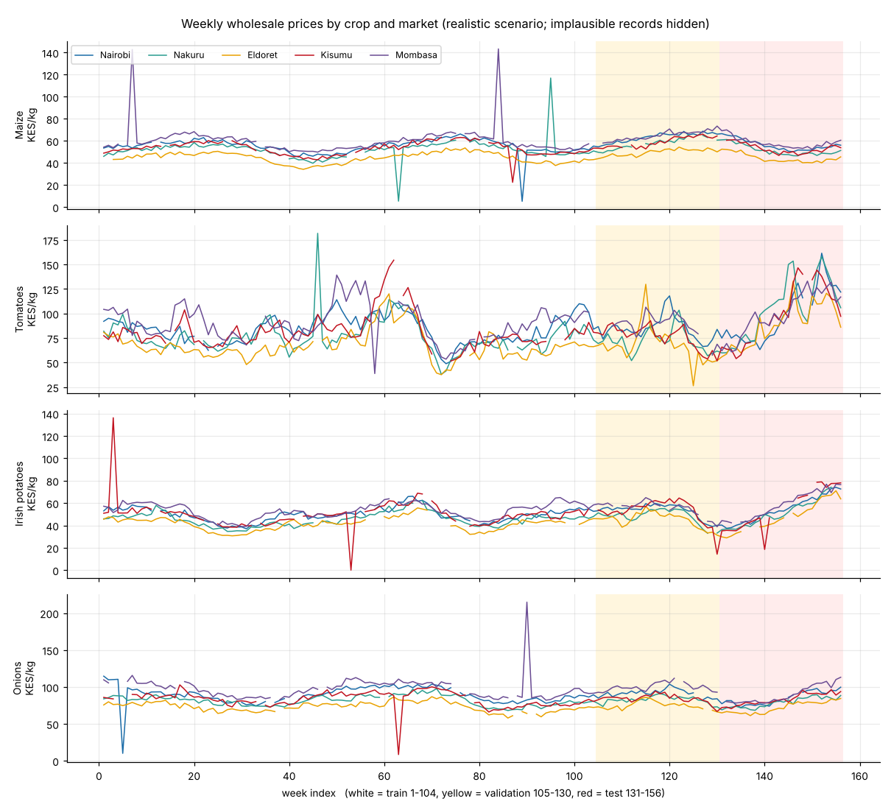
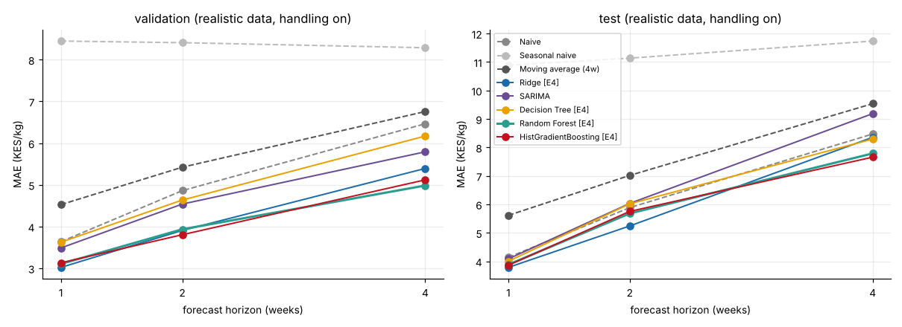
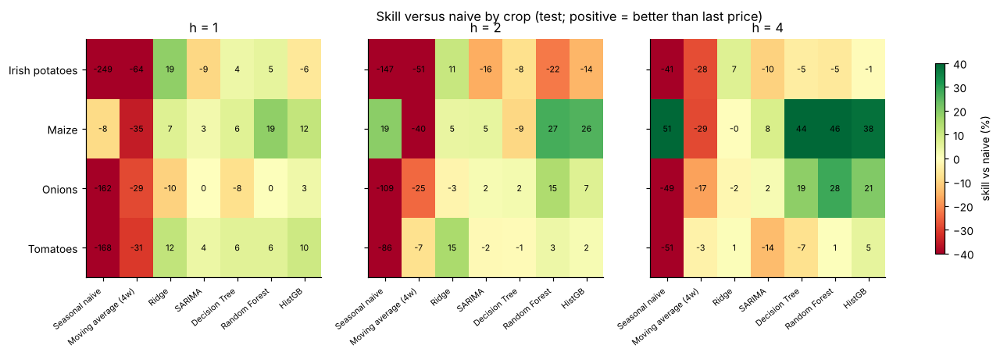
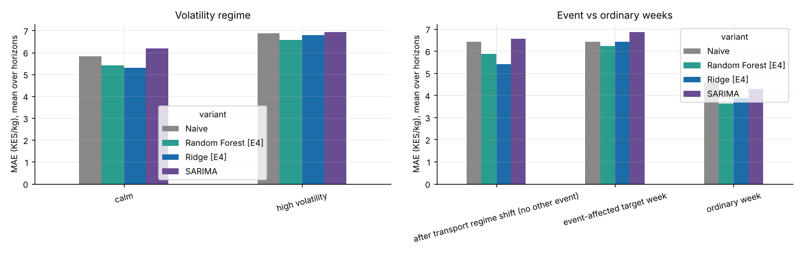
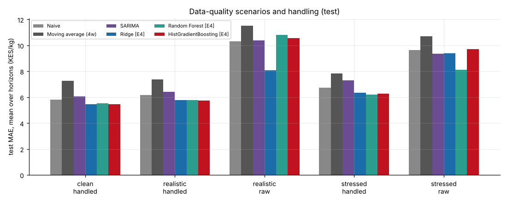
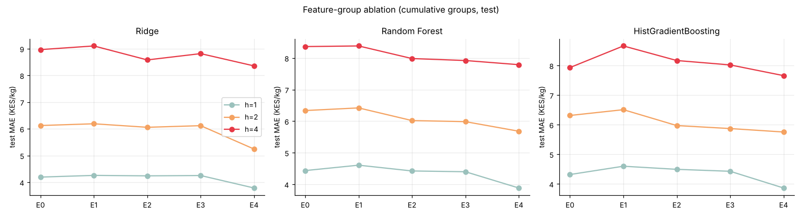
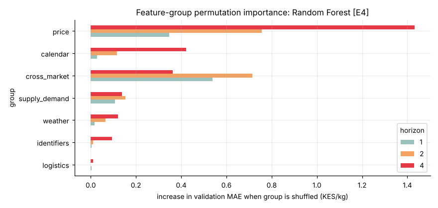
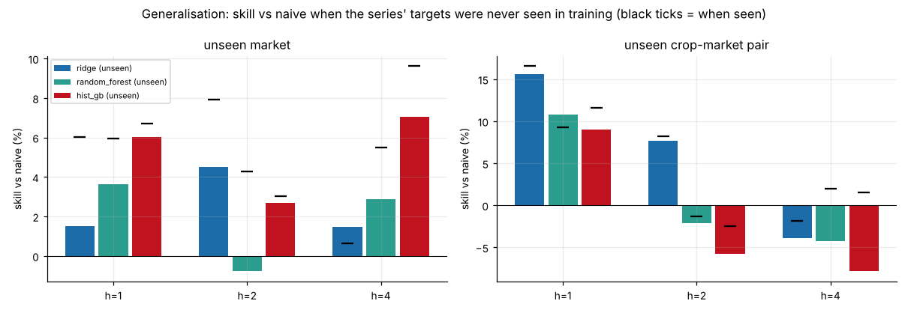
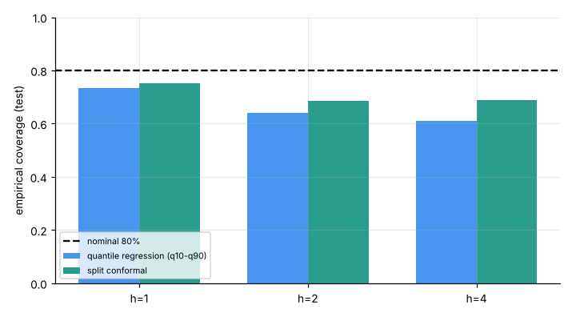
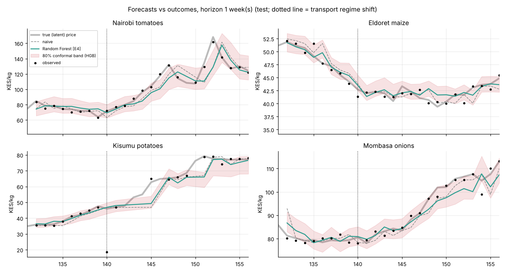

# Agricultural Market Price Prediction: Synthetic-Data Forecasting Experiment

**Final experiment report** - seed 42, 5 markets x 4 crops x 156 weeks, horizons 1/2/4 weeks.

> All data are **synthetic**. Findings describe method behaviour under the assumptions built into the generator and **do not predict real-world accuracy**. Interpretation paragraphs refer to the shipped seed-42 run.

## Summary

* **Simple baselines are strong.** The last observed price (naive) is hard to beat; the 4-week moving average is worse than naive at every horizon (test MAE 7.39 vs 6.16 KES/kg), and the seasonal-naive forecast is the worst model overall (11.25) - except for **maize**, where it is the best baseline.
* **Information helps, modestly.** Models with the full feature set (E4) beat price-history-only versions at every horizon for Ridge and Random Forest (paired bootstrap, 95% CI excludes zero). On validation, Random Forest/HistGB/Ridge beat naive by 19.7%/19.4%/17.7%; on the untouched test window the gain shrinks to 6.2%/6.6%/6.0% and is statistically clear only at the 1-week horizon.
* **No clear winner among Random Forest, HistGradientBoosting and Ridge.** Their test MAEs differ by about 1%; paired tests find no robust ordering between RF and HGB, trees beat Ridge at h=4 but lose at h=2. A Ridge model with crop-specific slopes (diagnostic, outside the core eight) was best on both validation and test (5.39 vs 5.78): crop heterogeneity mattered more than nonlinearity.
* **Shocks of a new kind erase most of the edge.** Before week 140 the tree/Ridge models were 19-23% better than naive; after the lasting transport-cost shift and the stronger drought their gain falls to 2-3%. Forecasts lag the rising prices of the shock period (under-predicted in 67-91% of potato, tomato and onion forecasts); tree models are worse than naive on potatoes, where prices left the training range.
* **Data quality matters a lot - if ignored.** With causal cleaning, MAE rises only gradually from clean to stressed data; without cleaning, a single x10 reporting error used as the latest price raises the error by roughly 30-90%.
* **Intervals are over-confident**: nominal 80% bands covered 61-75% of test outcomes.
* **Generalisation:** models trained without the target series' history keep most (not all) of their small edge for unseen markets, and are about at the naive level for unseen crop-market pairs; no collapse, but little to lose.

## 1. Introduction and problem statement

A produce-market intelligence service collects weekly wholesale prices and market indicators and wants to tell farmers, aggregators and buyers the likely wholesale price of a crop in a market 1, 2 or 4 weeks ahead. Because real data are not used here, we build a *synthetic market world* whose causal structure is known, and use it as a laboratory: Do models learn plausible patterns? Do they exploit leakage? How do they respond to documented disruptions and to degraded data?

## 2. Research question, objectives and hypotheses

**Question.** Can models trained on historical market, crop, weather, supply and cost indicators produce useful 1-, 2- and 4-week-ahead wholesale price forecasts, and under which conditions do they outperform simple baselines?

**Objectives:** (1) build and validate the generator; (2) compare the core eight models and two boosting extensions under identical leakage-safe splits; (3) quantify the value of each feature group; (4) stress-test with data corruption, shocks and unseen markets/series; (5) document failures and limits.

**Hypotheses and verdicts** (definitions from the specification, section 1.3):

| ID   | Hypothesis                                                          | Verdict                                                                                    | Key evidence (test set)                                                                                                    |
|:-----|:--------------------------------------------------------------------|:-------------------------------------------------------------------------------------------|:---------------------------------------------------------------------------------------------------------------------------|
| H1   | Exogenous variables beat price-history-only on at least some series | Supported                                                                                  | E4 beats E0 on 16 / 20 series for RF; significant at all three horizons for Ridge and RF                                   |
| H2   | Tree ensembles beat a linear model                                  | Not supported as a general claim (mixed)                                                   | RF/HGB win at h=4 (significant), Ridge wins at h=2 (significant), tie at h=1; Ridge with crop interactions is best overall |
| H3   | 4-week forecasts less accurate than 1-week                          | Supported                                                                                  | every non-seasonal model: MAE(h=4)/MAE(h=1) = 1.70-2.25                                                                    |
| H4   | Seasonal naive hard to beat for strongly seasonal series            | Partly supported (true for the one strongly seasonal crop only)                            | only Maize (seasonal R2 0.84); there seasonal naive beats naive by 28.2%                                                   |
| H5   | Corruption/missingness reduce accuracy, especially without handling | Supported (clean < realistic < stressed with handling; ignoring data quality is far worse) | mean MAE clean 5.81/5.54 -> realistic 6.16/5.78 -> stressed 6.74/6.21 (Naive/RF)                                           |

## 3. Synthetic market environment and generation assumptions

Five markets (Nairobi, Nakuru, Eldoret, Kisumu, Mombasa; names illustrative) and four crops (maize, tomatoes, Irish potatoes, onions). Weekly log price = crop base value + market premium + crop-specific seasonality + a persistent deviation that (i) mean-reverts at a crop-specific speed (tomatoes quickly, maize/onions slowly), (ii) partially transmits from connected markets with a one-week lag, (iii) adjusts to supply, demand, transport-cost, regional-supply and drought drivers - with scarcity hitting harder than glut (nonlinear) - and (iv) receives random shocks. Weather affects *future* supply with a crop-specific delay (tomatoes 3 weeks, maize 10 weeks). Sixteen documented events (gluts, droughts, floods, fuel step, demand surges, import shocks, a source-market disruption and a lasting transport-cost regime shift) are spread over train, validation and test; four test events are new or stronger than anything in training. Full equations, parameter tables and the event calendar: `docs/generator_specification.md`; provenance and intended use: `docs/provenance_statement.md`.

**Generator acceptance.** 9/10 acceptance criteria and all 16 event checks pass (`reports/DATA_AUDIT.md`): coverage, uniqueness, price validity, seasonality, market differences, shock behaviour (including the delayed drought effect and one-week spillover), persistence, missingness rates, no hidden leakage, reproducibility.

## 4. Dataset description and exploratory analysis

3,120 rows per scenario. Scenarios share one latent world and differ in the data-quality layer: **clean** (tiny noise, nothing missing), **realistic** (3.7% price missing, 5-8% indicator missing, 0.74% labelled reporting errors, late indicators for two markets), **stressed** (longer gaps, two market-wide reporting outages, 1% errors, more late data). Real shocks (`event_*`) and data-quality labels (`data_quality_flag`) are kept strictly separate. Key EDA findings (`reports/EDA_REPORT.md`): price levels are highly persistent; tomatoes are by far the most volatile crop (about 10% weekly changes versus 2% for maize); seasonality differs by crop; arrivals anomalies show the clearest, correctly-signed relation to next-week price changes; reporting gaps and errors are concentrated in some markets. Data dictionary: `docs/data_dictionary.md`.

## 5. Forecasting methodology and feature engineering

Direct forecasting, one model per horizon. ML models predict the log-change of the price against the latest available price (so a model that learns nothing reproduces naive). Features come in groups, added cumulatively for the ablation: **E0** price history (lags 1-52, rolling deviations/volatility, staleness) + calendar + market/crop IDs; **E1** + supply and demand; **E2** + weather; **E3** + fuel and transport cost; **E4** + cross-market signals (connected-market price gap and changes, regional supply index). E4 has 55 numeric features plus the market and crop identifiers (`docs/data_dictionary.md`). Data-quality handling (`handling = on`): causal outlier filter, last-observation-carried-forward with age cap, staleness feature; the *off* mode feeds raw values with gaps and errors to the models.

## 6. Temporal validation and leakage controls

Origin-based partitions: train weeks 1-104, validation 105-130, test 131-156 (used once, after all choices were fixed). Training rows are purged so their target lies inside the fitting window. Hyper-parameters were tuned on five expanding rolling-origin folds (weeks <= 130; grids widened when an optimum sat on a grid edge). Information availability is governed by `docs/forecast_time_data_contract.md` (late-delivered indicators, causal cleaning, calendar-only future knowledge). **Proofs in code:** truncating the data at week T0 leaves every feature of origins <= T0 bit-identical (handled and raw); corrupting all later data changes nothing earlier; a late record is invisible at its own origin; training rows never reach beyond the window; latent prices, quality and event labels never appear in a feature set (19 tests, all passing). Scoring excludes target rows labelled as injected reporting errors (labels used for scoring only); differences are assessed with **paired block bootstraps over origin weeks** (2,000 resamples), because 26 test weeks are few.

**Selection rule (specification section 15):** a complex model is preferred only if it improves validation MAE by at least 5% over the strongest baseline *and* wins in at least 4 of 5 rolling folds. Result: strongest baseline = Naive; best ML candidate = Random Forest [E4] with 19.7% lower validation MAE, winning 5/5 folds -> complex model justified: **True**. Note that Random Forest, HistGB and Ridge are within 3% of each other on validation MAE (4.01 / 4.02 / 4.11) and RF vs HGB shows no significant difference on test, so naming Random Forest 'best' is close to a coin-flip among three; the recommendation is the *family* (enriched ML), not the specific model.

## 7. Model configurations and baselines

Core eight: **Naive** (latest available price), **Seasonal naive** (price one year before the target week; falls back to naive when unavailable), **Moving average** (window chosen on validation: Moving average (4w)), **Ridge**, **SARIMA** (per series, seasonal period 52 with AR(1) seasonal term, order from {(1,0,0),(1,0,1),(2,0,0)} by AIC, constant trend; native multi-step), **Decision Tree**, **Random Forest** (200 trees), **HistGradientBoosting**. Extras: ARIMA (non-seasonal), Ridge + crop interactions (diagnostic), XGBoost, LightGBM. Not run: Prophet, LSTM, TFT (see Limitations). Selected hyper-parameters (E4):

| model         |   horizon | tuned parameters (E4)                                           |
|:--------------|----------:|:----------------------------------------------------------------|
| ridge         |         1 | {"alpha": 100.0}                                                |
| ridge         |         2 | {"alpha": 100.0}                                                |
| ridge         |         4 | {"alpha": 300.0}                                                |
| decision_tree |         1 | {"max_depth": 3, "min_samples_leaf": 10}                        |
| decision_tree |         2 | {"max_depth": 2, "min_samples_leaf": 10}                        |
| decision_tree |         4 | {"max_depth": 5, "min_samples_leaf": 30}                        |
| random_forest |         1 | {"max_depth": null, "max_features": 1.0, "min_samples_leaf": 3} |
| random_forest |         2 | {"max_depth": null, "max_features": 0.5, "min_samples_leaf": 3} |
| random_forest |         4 | {"max_depth": null, "max_features": 0.5, "min_samples_leaf": 3} |
| hist_gb       |         1 | {"learning_rate": 0.08, "max_depth": 3, "max_iter": 100}        |
| hist_gb       |         2 | {"learning_rate": 0.03, "max_depth": 6, "max_iter": 200}        |
| hist_gb       |         4 | {"learning_rate": 0.03, "max_depth": 3, "max_iter": 200}        |
| ridge_cropint |         1 | {"alpha": 3000.0}                                               |
| ridge_cropint |         2 | {"alpha": 3000.0}                                               |
| ridge_cropint |         4 | {"alpha": 3000.0}                                               |
| xgboost       |         1 | {"max_depth": 2}                                                |
| xgboost       |         2 | {"max_depth": 2}                                                |
| xgboost       |         4 | {"max_depth": 3}                                                |
| lightgbm      |         1 | {"num_leaves": 7}                                               |
| lightgbm      |         2 | {"num_leaves": 4}                                               |
| lightgbm      |         4 | {"num_leaves": 7}                                               |

Seed 42 everywhere. Training/prediction times (primary scenario, test fit; single CPU core):

| model variant                  |   training_rows |   fit_seconds_mean |   predict_seconds_mean |
|:-------------------------------|----------------:|-------------------:|-----------------------:|
| ARIMA (non-seasonal)           |         nan     |              0.810 |                nan     |
| Decision Tree [E0]             |        2207.333 |              0.015 |                  0.004 |
| Decision Tree [E4]             |        2207.333 |              0.033 |                  0.005 |
| HistGradientBoosting [E0]      |        2207.333 |              0.210 |                  0.009 |
| HistGradientBoosting [E1]      |        2207.333 |              0.162 |                  0.009 |
| HistGradientBoosting [E2]      |        2207.333 |              0.216 |                  0.009 |
| HistGradientBoosting [E3]      |        2207.333 |              0.263 |                  0.013 |
| HistGradientBoosting [E4]      |        2207.333 |              0.266 |                  0.010 |
| LightGBM [E0]                  |        2207.333 |              0.083 |                  0.007 |
| LightGBM [E4]                  |        2207.333 |              0.176 |                  0.009 |
| Random Forest [E0]             |        2207.333 |              1.549 |                  0.021 |
| Random Forest [E1]             |        2207.333 |              3.454 |                  0.022 |
| Random Forest [E2]             |        2207.333 |              4.350 |                  0.023 |
| Random Forest [E3]             |        2207.333 |              5.004 |                  0.022 |
| Random Forest [E4]             |        2207.333 |              5.448 |                  0.026 |
| Ridge + crop interactions [E4] |        2207.333 |              0.028 |                  0.006 |
| Ridge [E0]                     |        2207.333 |              0.012 |                  0.005 |
| Ridge [E1]                     |        2207.333 |              0.015 |                  0.005 |
| Ridge [E2]                     |        2207.333 |              0.014 |                  0.005 |
| Ridge [E3]                     |        2207.333 |              0.016 |                  0.005 |
| Ridge [E4]                     |        2207.333 |              0.016 |                  0.005 |
| SARIMA                         |         nan     |             35.026 |                nan     |
| XGBoost [E0]                   |        2207.333 |              0.099 |                  0.006 |
| XGBoost [E4]                   |        2207.333 |              0.210 |                  0.006 |

## 8. Results by horizon, crop, market and scenario

### 8.1 Core eight - horizon comparison (realistic data, data handling on)

Test MAE (KES/kg) by horizon, and validation for reference:

| model                     |   test h=1 |   test h=2 |   test h=4 |   test mean |   val h=1 |   val h=2 |   val h=4 |   val mean |
|:--------------------------|-----------:|-----------:|-----------:|------------:|----------:|----------:|----------:|-----------:|
| Naive                     |       4.14 |       5.88 |       8.47 |        6.16 |      3.64 |      4.86 |      6.46 |       4.99 |
| Seasonal naive            |      10.89 |      11.14 |      11.74 |       11.25 |      8.45 |      8.41 |      8.29 |       8.38 |
| Moving average (4w)       |       5.61 |       7.02 |       9.54 |        7.39 |      4.53 |      5.42 |      6.76 |       5.57 |
| Ridge [E4]                |       3.78 |       5.24 |       8.36 |        5.79 |      3.02 |      3.91 |      5.39 |       4.11 |
| SARIMA                    |       4.08 |       6.03 |       9.19 |        6.43 |      3.49 |      4.54 |      5.79 |       4.61 |
| Decision Tree [E4]        |       4.00 |       6.02 |       8.29 |        6.10 |      3.62 |      4.64 |      6.17 |       4.81 |
| Random Forest [E4]        |       3.88 |       5.68 |       7.79 |        5.78 |      3.10 |      3.93 |      4.98 |       4.01 |
| HistGradientBoosting [E4] |       3.86 |       5.75 |       7.66 |        5.76 |      3.13 |      3.80 |      5.12 |       4.02 |

Skill versus naive on the test window (1 - MAE/MAE_naive; positive = better than last price):

| model                     |    h=1 |   h=2 |   h=4 |   mean |
|:--------------------------|-------:|------:|------:|-------:|
| Naive                     |    0.0 |   0.0 |   0.0 |    0.0 |
| Seasonal naive            | -163.1 | -89.2 | -38.5 |  -82.5 |
| Moving average (4w)       |  -35.6 | -19.2 | -12.6 |  -19.8 |
| Ridge [E4]                |    8.6 |  10.9 |   1.4 |    6.0 |
| SARIMA                    |    1.4 |  -2.5 |  -8.4 |   -4.4 |
| Decision Tree [E4]        |    3.4 |  -2.3 |   2.1 |    1.0 |
| Random Forest [E4]        |    6.2 |   3.5 |   8.1 |    6.2 |
| HistGradientBoosting [E4] |    6.7 |   2.2 |   9.6 |    6.6 |

Other metrics on the test window (RMSE, WAPE, directional accuracy; directional accuracy is undefined for the naive forecast because it never predicts a change):

| model                     |   RMSE h=1 |   RMSE h=2 |   RMSE h=4 |   WAPE h=1 |   WAPE h=2 |   WAPE h=4 |   DirAcc h=1 |   DirAcc h=2 |   DirAcc h=4 |
|:--------------------------|-----------:|-----------:|-----------:|-----------:|-----------:|-----------:|-------------:|-------------:|-------------:|
| Naive                     |      6.997 |     10.143 |     13.240 |      0.057 |      0.081 |      0.114 |      nan     |      nan     |      nan     |
| Seasonal naive            |     18.229 |     18.565 |     19.313 |      0.151 |      0.153 |      0.159 |        0.548 |        0.573 |        0.612 |
| Moving average (4w)       |      9.166 |     10.975 |     13.647 |      0.078 |      0.096 |      0.129 |        0.470 |        0.406 |        0.384 |
| Ridge [E4]                |      6.381 |      9.249 |     13.573 |      0.052 |      0.072 |      0.113 |        0.658 |        0.660 |        0.650 |
| SARIMA                    |      7.058 |     10.646 |     14.951 |      0.056 |      0.083 |      0.124 |        0.531 |        0.516 |        0.553 |
| Decision Tree [E4]        |      6.731 |     10.292 |     13.871 |      0.055 |      0.083 |      0.112 |        0.596 |        0.556 |        0.617 |
| Random Forest [E4]        |      6.716 |     10.061 |     13.211 |      0.054 |      0.078 |      0.105 |        0.621 |        0.632 |        0.719 |
| HistGradientBoosting [E4] |      6.653 |     10.117 |     12.712 |      0.053 |      0.079 |      0.103 |        0.623 |        0.649 |        0.714 |

**Reading the table.** (H3) Error grows with horizon for every forecasting model (h=4 errors are 1.7-2.2x the 1-week errors). The enriched models' edge over naive is 6.7%/6.2% at h=1 and 9.6%/8.1% at h=4 (HGB/RF). SARIMA is competitive with naive on validation (4.61 vs 4.99) but *worse* than naive on test (6.43 vs 6.16): a per-series model with fixed parameters keeps extrapolating the old regime. Random Forest beats SARIMA significantly at all three horizons (paired bootstrap). The Decision Tree is the weakest learned model, as expected from a high-variance learner.

### 8.2 By crop and market (test)

MAE (KES/kg, mean over horizons):

| model                          |   Irish potatoes |   Maize |   Onions |   Tomatoes |
|:-------------------------------|-----------------:|--------:|---------:|-----------:|
| Naive                          |             4.30 |    2.24 |     3.74 |      14.53 |
| Seasonal naive                 |             9.07 |    1.61 |     7.28 |      27.47 |
| Moving average (4w)            |             6.08 |    2.99 |     4.57 |      16.11 |
| Ridge [E4]                     |             3.86 |    2.18 |     3.89 |      13.35 |
| SARIMA                         |             4.79 |    2.11 |     3.69 |      15.33 |
| Decision Tree [E4]             |             4.46 |    1.81 |     3.46 |      14.87 |
| Random Forest [E4]             |             4.65 |    1.48 |     3.09 |      14.13 |
| HistGradientBoosting [E4]      |             4.53 |    1.60 |     3.28 |      13.80 |
| Ridge + crop interactions [E4] |             3.33 |    1.74 |     3.31 |      13.30 |

Skill versus naive (%):

| model                          |   Irish potatoes |   Maize |   Onions |   Tomatoes |
|:-------------------------------|-----------------:|--------:|---------:|-----------:|
| Naive                          |              0.0 |     0.0 |      0.0 |        0.0 |
| Seasonal naive                 |           -145.6 |    20.8 |   -106.5 |     -101.6 |
| Moving average (4w)            |            -47.7 |   -34.6 |    -23.6 |      -13.8 |
| Ridge [E4]                     |             12.0 |     3.7 |     -4.9 |        9.2 |
| SARIMA                         |            -11.7 |     5.2 |      1.2 |       -3.7 |
| Decision Tree [E4]             |             -2.9 |    13.5 |      4.7 |       -0.9 |
| Random Forest [E4]             |             -7.5 |    30.6 |     14.5 |        3.3 |
| HistGradientBoosting [E4]      |             -7.0 |    25.3 |     10.2 |        5.5 |
| Ridge + crop interactions [E4] |             21.9 |    20.4 |     10.7 |        9.1 |

Tomatoes have 3-9x higher absolute errors than the other crops and the lowest relative skill. **Maize** is the only crop where seasonal naive beats naive (and where the tree ensembles gain most, +25-31%). **Irish potatoes**, whose price rose beyond the training range in the test window, is the one crop where the tree models are *worse* than naive; Ridge-type models, which can extrapolate beyond seen values, gain 12-22% there.

By market (skill versus naive, %, mean over horizons):

| model                          |   Eldoret |   Kisumu |   Mombasa |   Nairobi |   Nakuru |
|:-------------------------------|----------:|---------:|----------:|----------:|---------:|
| Naive                          |       0.0 |      0.0 |       0.0 |       0.0 |      0.0 |
| Seasonal naive                 |    -125.6 |   -147.5 |     -58.5 |     -64.6 |    -91.8 |
| Moving average (4w)            |     -12.0 |    -31.5 |     -28.5 |     -22.8 |    -20.5 |
| Ridge [E4]                     |       4.9 |     -3.5 |      11.1 |      13.1 |      8.2 |
| SARIMA                         |      -6.1 |     -1.2 |      -7.9 |      -4.2 |      1.4 |
| Decision Tree [E4]             |      -4.4 |      5.1 |      -3.4 |       6.3 |      1.5 |
| Random Forest [E4]             |       7.8 |     -1.2 |       7.6 |       6.5 |      7.9 |
| HistGradientBoosting [E4]      |       3.6 |      2.0 |       8.3 |       7.8 |      8.3 |
| Ridge + crop interactions [E4] |      15.0 |      8.1 |      11.5 |      13.5 |     13.5 |

Complete per-crop-per-horizon and per-market-per-horizon tables with MAE/RMSE/WAPE/sMAPE/directional accuracy: `results/breakdown_by_crop_test.csv`, `results/breakdown_by_market_test.csv`, `results/metrics_overall_all_combos.csv`. No market is consistently best or worst for the models; Nakuru has the highest naive error.

### 8.3 Volatility regimes, shocks and the regime shift (test)

Skill versus naive (%) in calm versus high-volatility origins (threshold = per-crop 75th percentile of volatility over origins <= 130):

| model                          |   calm |   high volatility |
|:-------------------------------|-------:|------------------:|
| Naive                          |    0.0 |               0.0 |
| Seasonal naive                 |  -73.2 |            -136.5 |
| Moving average (4w)            |  -21.7 |             -23.4 |
| Ridge [E4]                     |    9.7 |               2.2 |
| SARIMA                         |   -5.4 |               0.5 |
| Decision Tree [E4]             |    0.9 |               1.4 |
| Random Forest [E4]             |    6.7 |               4.5 |
| HistGradientBoosting [E4]      |    6.6 |               5.6 |
| Ridge + crop interactions [E4] |   12.7 |              12.1 |

Skill (%) by kind of target week:

| model                          |   after transport regime shift (no other event) |   event-affected target week |   ordinary week |
|:-------------------------------|------------------------------------------------:|-----------------------------:|----------------:|
| Naive                          |                                             0.0 |                          0.0 |             0.0 |
| Seasonal naive                 |                                           -88.9 |                       -116.9 |            -3.2 |
| Moving average (4w)            |                                           -27.9 |                        -19.4 |           -25.9 |
| Ridge [E4]                     |                                            18.4 |                          0.9 |            12.1 |
| SARIMA                         |                                            -0.8 |                         -5.8 |             6.3 |
| Decision Tree [E4]             |                                             7.3 |                         -1.9 |             1.6 |
| Random Forest [E4]             |                                             9.2 |                          3.1 |            15.9 |
| HistGradientBoosting [E4]      |                                            10.0 |                          3.0 |            17.3 |
| Ridge + crop interactions [E4] |                                            18.3 |                         10.1 |            10.9 |

Skill (%) before versus after the lasting transport-cost regime shift at week 140:

| model                          |   before week 140 |   from week 140 (regime shift) |
|:-------------------------------|------------------:|-------------------------------:|
| Naive                          |               0.0 |                            0.0 |
| Seasonal naive                 |             -10.0 |                         -103.5 |
| Moving average (4w)            |             -20.5 |                          -20.2 |
| Ridge [E4]                     |              19.0 |                            3.1 |
| SARIMA                         |              11.5 |                           -8.0 |
| Decision Tree [E4]             |               1.4 |                            0.9 |
| Random Forest [E4]             |              20.9 |                            2.5 |
| HistGradientBoosting [E4]      |              23.2 |                            2.4 |
| Ridge + crop interactions [E4] |              18.2 |                           11.2 |

Per test-window event (MAE, KES/kg; rows overlap between events):

| event_id   | event_type          | new_in_test   |   rows |   Naive |   Random Forest [E4] |   SARIMA |
|:-----------|:--------------------|:--------------|-------:|--------:|---------------------:|---------:|
| EV12       | drought             | True          |    675 |    6.52 |                 6.36 |     7.04 |
| EV14       | harvest_glut        | True          |     30 |   23.10 |                19.61 |    19.44 |
| EV15       | import_supply_shock | True          |     90 |    3.74 |                 3.63 |     3.78 |
| EV16       | demand_surge        | False         |     72 |    6.29 |                 5.34 |     5.99 |

Interpretation: the models' advantage is concentrated in ordinary weeks and before week 140. Under shocks of a new kind or strength (EV12-EV15) they perform about like naive. This is the generator working as intended: the transport-cost shift is an out-of-range cause that no training row contains, so no learner could have inferred its effect. The finding is a statement about *what the evaluation should include*, not just about the models.

### 8.4 Data-quality scenarios and handling (test)

Test MAE, mean over horizons (KES/kg):

| model                     |   clean|handled |   realistic|handled |   realistic|raw |   stressed|handled |   stressed|raw |
|:--------------------------|----------------:|--------------------:|----------------:|-------------------:|---------------:|
| Naive                     |            5.81 |                6.16 |           10.32 |               6.74 |           9.65 |
| Seasonal naive            |           11.20 |               11.25 |           11.70 |              11.58 |          11.48 |
| Moving average (4w)       |            7.26 |                7.39 |           11.51 |               7.82 |          10.72 |
| Ridge [E4]                |            5.47 |                5.79 |            8.07 |               6.36 |           9.40 |
| SARIMA                    |            6.07 |                6.43 |           10.40 |               7.32 |           9.37 |
| Decision Tree [E4]        |            5.71 |                6.10 |            9.84 |               6.56 |          10.51 |
| Random Forest [E4]        |            5.54 |                5.78 |           10.82 |               6.21 |           8.12 |
| HistGradientBoosting [E4] |            5.48 |                5.76 |           10.55 |               6.29 |           9.71 |

With handling on, error rises smoothly from clean to realistic to stressed (H5). With handling **off** the error jumps by roughly 30-90% depending on model and scenario (realistic: 10.3 vs 6.2 for naive). The cost is dominated by gross reporting errors: when the latest reported price is x10 or x0.1, every model that uses it as a reference is wrong by a large amount. Paired bootstrap of handling-on minus handling-off for the selected model (negative = handling helps):

| comparison                          |   horizon |   mean_diff |   ci_low |   ci_high |
|:------------------------------------|----------:|------------:|---------:|----------:|
| data handling ON vs OFF (realistic) |         1 |       -5.96 |    -8.77 |     -3.40 |
| data handling ON vs OFF (realistic) |         2 |       -4.68 |    -6.88 |     -2.72 |
| data handling ON vs OFF (realistic) |         4 |       -4.46 |    -6.54 |     -2.52 |
| data handling ON vs OFF (stressed)  |         1 |       -2.13 |    -3.23 |     -1.21 |
| data handling ON vs OFF (stressed)  |         2 |       -1.70 |    -2.70 |     -0.97 |
| data handling ON vs OFF (stressed)  |         4 |       -1.89 |    -3.07 |     -0.91 |

*Caution:* the ordering of the two raw columns (stressed raw is sometimes better than realistic raw) reflects *where the random errors happened to land* relative to the scored weeks, not a genuine benefit of stress - only one realisation of the world was run.

## 9. Ablation and robustness analysis

### 9.1 Feature groups (cumulative)

Test MAE:

| model                | feature_set   |    1 |    2 |    4 |   mean_over_horizons |
|:---------------------|:--------------|-----:|-----:|-----:|---------------------:|
| HistGradientBoosting | E0            | 4.32 | 6.31 | 7.93 |                 6.19 |
| HistGradientBoosting | E1            | 4.60 | 6.51 | 8.66 |                 6.59 |
| HistGradientBoosting | E2            | 4.49 | 5.97 | 8.17 |                 6.21 |
| HistGradientBoosting | E3            | 4.43 | 5.87 | 8.02 |                 6.11 |
| HistGradientBoosting | E4            | 3.86 | 5.75 | 7.66 |                 5.76 |
| Random Forest        | E0            | 4.43 | 6.34 | 8.36 |                 6.38 |
| Random Forest        | E1            | 4.60 | 6.42 | 8.38 |                 6.47 |
| Random Forest        | E2            | 4.42 | 6.02 | 7.98 |                 6.14 |
| Random Forest        | E3            | 4.40 | 5.98 | 7.92 |                 6.10 |
| Random Forest        | E4            | 3.88 | 5.68 | 7.79 |                 5.78 |
| Ridge                | E0            | 4.19 | 6.12 | 8.97 |                 6.43 |
| Ridge                | E1            | 4.26 | 6.19 | 9.10 |                 6.52 |
| Ridge                | E2            | 4.24 | 6.06 | 8.58 |                 6.29 |
| Ridge                | E3            | 4.25 | 6.12 | 8.82 |                 6.39 |
| Ridge                | E4            | 3.78 | 5.24 | 8.36 |                 5.79 |

Rolling-origin CV MAE (5 folds, weeks <= 130):

| model                | feature_set   |    1 |    2 |    4 |   mean_over_horizons |
|:---------------------|:--------------|-----:|-----:|-----:|---------------------:|
| HistGradientBoosting | E0            | 3.21 | 4.11 | 5.23 |                 4.18 |
| HistGradientBoosting | E1            | 3.16 | 4.01 | 5.33 |                 4.17 |
| HistGradientBoosting | E2            | 3.13 | 3.98 | 5.07 |                 4.06 |
| HistGradientBoosting | E3            | 3.14 | 4.02 | 5.21 |                 4.12 |
| HistGradientBoosting | E4            | 2.93 | 3.66 | 5.00 |                 3.87 |
| Random Forest        | E0            | 3.20 | 4.10 | 5.05 |                 4.12 |
| Random Forest        | E1            | 3.19 | 4.02 | 5.10 |                 4.11 |
| Random Forest        | E2            | 3.15 | 3.95 | 5.01 |                 4.04 |
| Random Forest        | E3            | 3.14 | 4.01 | 5.03 |                 4.06 |
| Random Forest        | E4            | 2.87 | 3.71 | 4.99 |                 3.86 |
| Ridge                | E0            | 3.17 | 4.17 | 5.35 |                 4.23 |
| Ridge                | E1            | 3.08 | 4.02 | 5.32 |                 4.14 |
| Ridge                | E2            | 3.05 | 3.98 | 5.15 |                 4.06 |
| Ridge                | E3            | 3.59 | 5.02 | 6.17 |                 4.93 |
| Ridge                | E4            | 2.95 | 3.83 | 5.01 |                 3.93 |

Tests of E4 versus E0 (paired bootstrap, MAE difference, negative = enrichment helps; star = 95% CI excludes zero):

| comparison                                          |   horizon |   mean_diff |   ci_low |   ci_high | significant   |
|:----------------------------------------------------|----------:|------------:|---------:|----------:|:--------------|
| Ridge: E4 vs E0 (feature enrichment)                |         1 |       -0.41 |    -0.73 |     -0.12 | *             |
| Ridge: E4 vs E0 (feature enrichment)                |         2 |       -0.88 |    -1.31 |     -0.51 | *             |
| Ridge: E4 vs E0 (feature enrichment)                |         4 |       -0.61 |    -1.18 |     -0.04 | *             |
| Random Forest: E4 vs E0 (feature enrichment)        |         1 |       -0.55 |    -0.82 |     -0.31 | *             |
| Random Forest: E4 vs E0 (feature enrichment)        |         2 |       -0.66 |    -0.92 |     -0.41 | *             |
| Random Forest: E4 vs E0 (feature enrichment)        |         4 |       -0.57 |    -0.92 |     -0.24 | *             |
| HistGradientBoosting: E4 vs E0 (feature enrichment) |         1 |       -0.45 |    -0.69 |     -0.23 | *             |
| HistGradientBoosting: E4 vs E0 (feature enrichment) |         2 |       -0.56 |    -0.74 |     -0.36 | *             |
| HistGradientBoosting: E4 vs E0 (feature enrichment) |         4 |       -0.27 |    -0.67 |      0.18 |               |
| Decision Tree: E4 vs E0 (feature enrichment)        |         1 |       -0.24 |    -0.44 |     -0.08 | *             |
| Decision Tree: E4 vs E0 (feature enrichment)        |         2 |        0.03 |    -0.04 |      0.11 |               |
| Decision Tree: E4 vs E0 (feature enrichment)        |         4 |       -0.02 |    -0.74 |      0.64 |               |

**Reading.** (H1) Enrichment helps consistently in rolling CV and significantly on test for Ridge and Random Forest at every horizon. The gain does **not** accrue evenly by group: cumulative steps E1 (supply/demand), E2 (weather) and E3 (logistics) give small, sometimes negative, test changes (HistGB at h=4 is *worse* with E1 than with E0), while the last step - **cross-market signals** - gives the largest single improvement at the 1- and 2-week horizons for all three models (at h=4 its step is smaller). The group permutation importance agrees:

| group         |     1 |      2 |     4 |
|:--------------|------:|-------:|------:|
| price         | 0.347 |  0.757 | 1.431 |
| calendar      | 0.029 |  0.116 | 0.422 |
| cross_market  | 0.538 |  0.715 | 0.364 |
| supply_demand | 0.108 |  0.153 | 0.139 |
| weather       | 0.017 |  0.065 | 0.120 |
| identifiers   | 0.004 |  0.011 | 0.094 |
| logistics     | 0.005 | -0.000 | 0.011 |

Plausibility check against the generator: price momentum and mean reversion dominate (more so at longer horizons, where calendar position also gains weight, consistent with seasonality); neighbouring-market prices and regional supply are the most useful *external* information at 1-2 weeks (they implement the one-week-lag transmission built into the generator); own-market supply/demand matter moderately; weather matters little *through the weather features themselves* because its effect arrives via arrivals; logistics have almost no importance on validation because transport costs barely varied before week 140 - exactly why the later transport shift could not be learned. These relationships are plausible and consistent with the data-generating process; they do **not** show that the same features would matter for real markets.

Why might E1-E3 help less than expected? In the generator, price reacts to *contemporaneous* supply, which is not known at the origin; only its persistence and delayed weather causes are forecastable. A feature's presence in the data is not the same as predictive value at a given lead time. (Per the specification's guidance for non-helpful features: data quality, lag design and availability were checked - the signal is present in-sample, but its forecastable part is small relative to price noise.)

### 9.2 Generalisation to unseen markets and crop-market pairs (test)

Protocol: the held-out series' *target rows* are excluded from training; its past prices may be used as input features at forecast time. Unseen-market models drop the `market_id` feature. Skill is versus naive on the same rows.

| model                | test                    |   horizon |   rows |   MAE_unseen |   MAE_seen |   MAE_naive |   skill_unseen |   skill_seen |   degradation_% |
|:---------------------|:------------------------|----------:|-------:|-------------:|-----------:|------------:|---------------:|-------------:|----------------:|
| Ridge                | unseen market           |         1 |    482 |        4.076 |      3.889 |       4.138 |          0.015 |        0.060 |           4.803 |
| Ridge                | unseen crop-market pair |         1 |     98 |        3.291 |      3.255 |       3.900 |          0.156 |        0.165 |           1.121 |
| Ridge                | unseen market           |         2 |    462 |        5.618 |      5.419 |       5.885 |          0.045 |        0.079 |           3.671 |
| Ridge                | unseen crop-market pair |         2 |     94 |        4.611 |      4.587 |       4.995 |          0.077 |        0.082 |           0.523 |
| Ridge                | unseen market           |         4 |    423 |        8.347 |      8.418 |       8.472 |          0.015 |        0.006 |          -0.839 |
| Ridge                | unseen crop-market pair |         4 |     87 |        7.889 |      7.730 |       7.590 |         -0.039 |       -0.018 |           2.062 |
| Random Forest        | unseen market           |         1 |    482 |        3.987 |      3.893 |       4.138 |          0.037 |        0.059 |           2.423 |
| Random Forest        | unseen crop-market pair |         1 |     98 |        3.480 |      3.538 |       3.900 |          0.108 |        0.093 |          -1.640 |
| Random Forest        | unseen market           |         2 |    462 |        5.930 |      5.634 |       5.885 |         -0.008 |        0.043 |           5.260 |
| Random Forest        | unseen crop-market pair |         2 |     94 |        5.102 |      5.059 |       4.995 |         -0.021 |       -0.013 |           0.841 |
| Random Forest        | unseen market           |         4 |    423 |        8.230 |      8.007 |       8.472 |          0.029 |        0.055 |           2.781 |
| Random Forest        | unseen crop-market pair |         4 |     87 |        7.911 |      7.444 |       7.590 |         -0.042 |        0.019 |           6.270 |
| HistGradientBoosting | unseen market           |         1 |    482 |        3.889 |      3.861 |       4.138 |          0.060 |        0.067 |           0.744 |
| HistGradientBoosting | unseen crop-market pair |         1 |     98 |        3.549 |      3.449 |       3.900 |          0.090 |        0.116 |           2.887 |
| HistGradientBoosting | unseen market           |         2 |    462 |        5.726 |      5.707 |       5.885 |          0.027 |        0.030 |           0.320 |
| HistGradientBoosting | unseen crop-market pair |         2 |     94 |        5.282 |      5.117 |       4.995 |         -0.058 |       -0.024 |           3.225 |
| HistGradientBoosting | unseen market           |         4 |    423 |        7.875 |      7.658 |       8.472 |          0.070 |        0.096 |           2.835 |
| HistGradientBoosting | unseen crop-market pair |         4 |     87 |        8.185 |      7.477 |       7.590 |         -0.078 |        0.015 |           9.469 |

Unseen-market MAE is 0-5% worse than the same model trained with the market; skill versus naive is about -1% to 7% unseen versus 1-10% seen. For the four unseen crop-market pairs (only 87-98 forecasts each per horizon) all three models are at or below the naive level at h=4, and RF/HGB also at h=2 (HGB at h=4 about 9% worse than when seen). So there is **no collapse**, but also very little skill to transfer; per-market results are noisy (Kisumu is negative for RF/Ridge): `results/generalisation_by_market.csv`.

### 9.3 Prediction intervals (extension)

|   horizon |    rows |   coverage: quantile regression |   coverage: split conformal |   median rel. width QR |   median rel. width conformal |
|----------:|--------:|--------------------------------:|----------------------------:|-----------------------:|------------------------------:|
|     1.000 | 482.000 |                           0.734 |                       0.753 |                  0.099 |                         0.096 |
|     2.000 | 462.000 |                           0.641 |                       0.686 |                  0.116 |                         0.108 |
|     4.000 | 423.000 |                           0.610 |                       0.688 |                  0.162 |                         0.153 |

Both approaches (HGB quantile q10-q90; split-conformal using validation residuals per crop) **under-cover** an 80% target. Coverage falls with horizon, is worst for tomatoes (50-64% at h=4) and is lower inside event windows (conformal 65-70% vs 71-82% in ordinary weeks). A deployable forecast would need wider, event-aware bands.

### 9.4 Additional boosting implementations

| model                     |    1 |    2 |    4 |   mean_over_horizons |
|:--------------------------|-----:|-----:|-----:|---------------------:|
| HistGradientBoosting [E4] | 3.86 | 5.75 | 7.66 |                 5.76 |
| XGBoost [E4]              | 3.90 | 5.83 | 7.64 |                 5.79 |
| LightGBM [E4]             | 3.90 | 5.78 | 7.82 |                 5.83 |
| HistGradientBoosting [E0] | 4.32 | 6.31 | 7.93 |                 6.19 |
| XGBoost [E0]              | 5.01 | 7.24 | 8.90 |                 7.05 |
| LightGBM [E0]             | 4.83 | 6.73 | 9.18 |                 6.91 |

XGBoost and LightGBM perform essentially the same as scikit-learn's HistGradientBoosting with E4 features (differences of about 1%, within noise) and are *worse* with price-only features; the algorithm matters far less than the information supplied. Prophet, LSTM and TFT were not run.

## 10. Error analysis and interpretation

Full report with ten worst forecasts, five successes, five worse-than-naive cases and bias tables: `reports/ERROR_ANALYSIS.md`. Main points:

1. The ten largest errors are all **tomato** forecasts (six at h=4) during the stronger drought and transport shift - upward moves of roughly 40-60% that the naive forecast also missed. The same mean-reversion bet produced the model's best forecasts (spike peak) and some of its worst (spike plateau).
2. Forecasts **lag rising markets** (systematic under-prediction after week 140: 91% of potato, 73% of tomato forecasts); for potatoes this is partly range extrapolation by trees (15% of test prices exceeded all earlier prices), for tomatoes and onions it is a driver that never varied in training. The linear model with crop interactions lags less on potatoes (bias 3.2 vs 5.5 KES/kg) and only slightly less on tomatoes (9.5 vs 11.4). A hybrid (linear trend + trees) is a natural next experiment, but is untested.
3. Stale reference prices raise errors by ~50% and remove the models' edge; cleaning errors causally is essential.
4. Validation overstated test skill: every model's MAE is 24-44% higher on test than on validation, and most learned models degrade *more* than naive (Ridge, RF, HGB 41-44% vs 24% on average; the Decision Tree 27%) - see the table below. A single validation window is an optimistic guide when later periods contain different shocks.

MAE increase from validation to test (%):

| model                     |   h=1 |   h=2 |   h=4 |   mean |
|:--------------------------|------:|------:|------:|-------:|
| Naive                     |    14 |    21 |    31 |     24 |
| Seasonal naive            |    29 |    32 |    42 |     34 |
| Moving average (4w)       |    24 |    29 |    41 |     33 |
| Ridge [E4]                |    25 |    34 |    55 |     41 |
| SARIMA                    |    17 |    33 |    59 |     40 |
| Decision Tree [E4]        |    10 |    30 |    34 |     27 |
| Random Forest [E4]        |    25 |    44 |    56 |     44 |
| HistGradientBoosting [E4] |    23 |    51 |    50 |     43 |

## 11. Limitations, ethical considerations and path to real data

**Limitations of this study.**
* *Synthetic by construction.* Every effect exists because we wrote it into the generator. A method that wins here may lose on real data; informal trade, quality grades, policy, trader behaviour, market closures and measurement practice are absent.
* *One world, one seed.* Differences of about 1-3% between models are within noise; only paired tests on 26 test weeks were possible. Re-run `01_generate_data.py --seed N` to test robustness.
* *Test window is unusually shock-heavy by design* (57% of scored target weeks sit inside an event window and a further 29% after the lasting regime shift; only about 14% are 'ordinary'), so test skill is deliberately a stress result, not a typical-conditions result.
* *Tuning scope.* Hyper-parameters were tuned on the realistic scenario with E0/E4 and reused for E1-E3 and other scenarios; small grids; ridge/trees tuned per horizon.
* *SARIMA* is plain (no exogenous regressors), fitted once per partition with parameters frozen, forecasts native multi-step; a refitted or SARIMAX variant might fare better.
* *Scoring* excludes labelled reporting errors; a production system could not know which targets are wrong.
* *Not implemented:* Prophet, LSTM and Temporal Fusion Transformer (deferred as optional; the specification itself cautions that 3,120 observations are too few for deep models). Elastic Net and ExtraTrees were not compared.
* *Simplifications:* no price trend/inflation, no data revisions, gross-only reporting errors, arrivals not responsive to past prices, a single national weather/fuel structure.

**Ethical considerations.** Price forecasts can move money: a forecast that is over-confident (as the intervals here are) could mislead smallholders or traders; published forecasts should always show uncertainty and the naive comparator. Names of real places and the KES unit were used only for readability - the data must not be quoted as real market statistics. Models trained on better-reported markets may serve poorly reported markets worse (the unseen-market results hint at this), which is a fairness concern for real deployment.

**Real-data migration checklist** (from the specification, section 16.1) and what this repository already provides:

| Step                                                                               | Where this repository helps                                                                                                                  |
|:-----------------------------------------------------------------------------------|:---------------------------------------------------------------------------------------------------------------------------------------------|
| Identify trustworthy sources; document price type (farm-gate / wholesale / retail) | Provenance template: `docs/provenance_statement.md`                                                                                          |
| Standardise crop names, varieties, grades, units, market IDs, dates                | Schema in `docs/data_dictionary.md`; replace `generator.py` by an ingestion step that emits the same columns                                 |
| Record source, collection time, publication time, revisions                        | Add `published_at` / `revised_at` columns; `features.py` already supports availability delays via `report_delay_weeks` - extend to revisions |
| Investigate missingness and reporting changes (do not assume random)               | Annotation table + missingness plots in the EDA; replace random masks by observed ones                                                       |
| Align weather to production catchments; account for delays                         | Weather fields are catchment-level and lag-aware in the feature builder                                                                      |
| Use only indicators available at forecast time                                     | `docs/forecast_time_data_contract.md` + truncation tests; run them on the real pipeline                                                      |
| Rebuild splits around the real collection period; keep a final untouched test      | `splits.py` partitions and purging take weeks from the config                                                                                |
| Re-evaluate across seasons, locations, grades and horizons                         | All breakdown tables are generated per crop, market, regime and event                                                                        |

## 12. Conclusion and future work

**Conclusion.** In this synthetic world, a transparent comparison shows that (i) the last observed price is a hard benchmark and seasonal structure is only exploitable for the one strongly seasonal crop; (ii) feature enrichment - above all information from connected markets - gives a real but modest improvement of roughly 6-20% over naive depending on the period, (iii) the choice among Random Forest, gradient boosting implementations and a well-specified linear model matters little compared with what information they receive; (iv) the edge largely vanishes under shocks of a new kind or strength (for example the lasting transport-cost shift), where forecasts lag rising prices; (v) ignoring data quality is more damaging than any modelling choice; and (vi) uncertainty bands need event-aware calibration. None of this should be read as evidence about real markets.

**Future work (in the order we would do it).** (1) Repeat over 20+ seeds and report the distribution of rankings. (2) Hybrid models (linear trend + trees; Ridge with crop interactions + residual trees), SARIMAX with exogenous drivers, hierarchical/pooled models. (3) Event-aware and shock-detecting retraining, and conformal intervals with adaptive widening. (4) Add Prophet (per-origin refits), then LSTM/TFT once the panel is enlarged. (5) Calibrate generator assumptions on sourced real observations and rerun the same pipeline.

## Appendix A. All model variants (test MAE, KES/kg)

| model                          |   h=1 |   h=2 |   h=4 |   mean |
|:-------------------------------|------:|------:|------:|-------:|
| Ridge + crop interactions [E4] |  3.69 |  5.03 |  7.46 |   5.39 |
| HistGradientBoosting [E4]      |  3.86 |  5.75 |  7.66 |   5.76 |
| Random Forest [E4]             |  3.88 |  5.68 |  7.79 |   5.78 |
| XGBoost [E4]                   |  3.90 |  5.83 |  7.64 |   5.79 |
| Ridge [E4]                     |  3.78 |  5.24 |  8.36 |   5.79 |
| LightGBM [E4]                  |  3.90 |  5.78 |  7.82 |   5.83 |
| Random Forest [E3]             |  4.40 |  5.98 |  7.92 |   6.10 |
| Decision Tree [E4]             |  4.00 |  6.02 |  8.29 |   6.10 |
| HistGradientBoosting [E3]      |  4.43 |  5.87 |  8.02 |   6.11 |
| Random Forest [E2]             |  4.42 |  6.02 |  7.98 |   6.14 |
| Naive                          |  4.14 |  5.88 |  8.47 |   6.16 |
| Decision Tree [E0]             |  4.24 |  5.98 |  8.31 |   6.18 |
| HistGradientBoosting [E0]      |  4.32 |  6.31 |  7.93 |   6.19 |
| HistGradientBoosting [E2]      |  4.49 |  5.97 |  8.17 |   6.21 |
| Ridge [E2]                     |  4.24 |  6.06 |  8.58 |   6.29 |
| Random Forest [E0]             |  4.43 |  6.34 |  8.36 |   6.38 |
| Ridge [E3]                     |  4.25 |  6.12 |  8.82 |   6.39 |
| Ridge [E0]                     |  4.19 |  6.12 |  8.97 |   6.43 |
| SARIMA                         |  4.08 |  6.03 |  9.19 |   6.43 |
| Random Forest [E1]             |  4.60 |  6.42 |  8.38 |   6.47 |
| Ridge [E1]                     |  4.26 |  6.19 |  9.10 |   6.52 |
| HistGradientBoosting [E1]      |  4.60 |  6.51 |  8.66 |   6.59 |
| ARIMA (non-seasonal)           |  4.34 |  6.31 |  9.43 |   6.69 |
| LightGBM [E0]                  |  4.83 |  6.73 |  9.18 |   6.91 |
| XGBoost [E0]                   |  5.01 |  7.24 |  8.90 |   7.05 |
| Moving average (4w)            |  5.61 |  7.02 |  9.54 |   7.39 |
| Moving average (8w)            |  7.51 |  8.94 | 11.57 |   9.34 |
| Seasonal naive                 | 10.89 | 11.14 | 11.74 |  11.25 |

## Appendix B. Reproducibility record

Seed 42; config `experiment_config.yaml`; data checksums in `data/manifest.json`; Python 3.12; library versions in `requirements.txt`. Forecast output example following the specification's contract: `results/forecast_contract_test.csv` (HistGradientBoosting E4 with 80% split-conformal bands, realistic scenario, test window).
