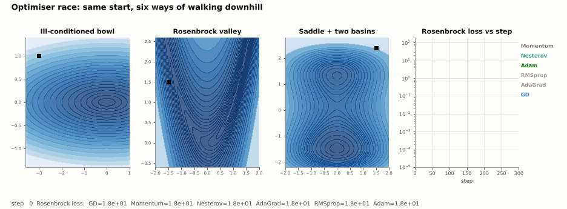
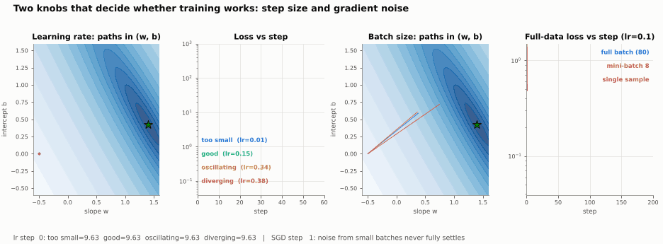

# 00 · Gradient Descent & Optimisers

> **One line:** almost every model in this course is "a loss function plus a way to walk downhill on it" - this lesson studies the walking.




## 1. Definition

**Optimisation** is the search for parameters `θ` that minimise a loss `J(θ)`. **Gradient descent (GD)** does it iteratively: the gradient `∇J(θ)` points uphill, so we step the opposite way.

```
θ ← θ − η ∇J(θ)            η = learning rate (step size)
```

An **optimiser** is a rule for turning the gradient history into the next step. Plain GD uses only the current gradient; momentum and adaptive methods also use past gradients. They are the engine inside linear/logistic regression, neural networks, boosting (functional GD) and many more.

The code races six optimisers on three 2-D landscapes, then studies the two knobs that decide whether training works in practice (learning rate and batch size) on a real small problem, linear regression on house prices.

## 2. Intuition

You are a hiker in thick fog on a hilly landscape. You can only feel the slope under your boots.

- **GD**: always step straight downhill. In a narrow canyon you bounce between the walls and crawl along the floor.
- **Momentum**: you are a heavy ball. You keep rolling in the direction you were going, so side-to-side bounces cancel and the downhill direction accumulates.
- **Nesterov**: like momentum, but you look at the slope where you are *about to be*, so you brake earlier.
- **AdaGrad / RMSprop / Adam**: each parameter gets its own step size. Directions with huge, noisy gradients get small steps; quiet directions get larger ones.

## 3. The math

Let `g_t = ∇J(θ_t)`.

| Method | Update | Idea |
|---|---|---|
| GD | `θ ← θ − η g` | follow the slope |
| Momentum | `v ← μ v − η g;  θ ← θ + v` | `v` is a running (decaying) sum of gradients; `μ≈0.9` |
| Nesterov | `g` is evaluated at `θ + μ v` (look-ahead) | corrects momentum's overshoot |
| AdaGrad | `G ← G + g²;  θ ← θ − η g/(√G + ε)` | per-coordinate step shrinks as squared gradients accumulate (never recovers) |
| RMSprop | `G ← ρ G + (1−ρ) g²;  θ ← θ − η g/(√G + ε)` | like AdaGrad but forgets old gradients |
| Adam | `m ← β₁m+(1−β₁)g;  v ← β₂v+(1−β₂)g²;  θ ← θ − η m̂/(√v̂+ε)` | momentum (`m`) + RMSprop (`v`); `m̂, v̂` are bias-corrected: `m/(1−β₁ᵗ)`, `v/(1−β₂ᵗ)` |

**Why GD zig-zags (conditioning).** For a quadratic `J = ½ θᵀHθ`, GD converges only if `η < 2/λ_max(H)`, and the speed is limited by the *condition number* `κ = λ_max/λ_min`. A valley that is 20× steeper in one direction (the "ill-conditioned bowl", `κ = 20`) forces a tiny `η` that makes progress along the flat direction painfully slow. In the code, the house-price problem has Hessian eigenvalues `[0.18, 5.84]`, so GD is stable only for `η < 0.342`, and the animation shows exactly that threshold: `lr = 0.34` oscillates, `lr = 0.38` explodes (loss ~10¹¹).

**Newton's method** uses curvature: `θ ← θ − H⁻¹ g`. On a quadratic it lands on the minimum in one step (the code shows `[-3, 1] → [0, 0]`). Too expensive for large models (`H` has `d²` entries), hence L-BFGS (low-memory approximation; our SciPy cross-check solves Rosenbrock in 27 iterations) and the diagonal approximations in AdaGrad/RMSprop/Adam.

**Stochastic / mini-batch GD.** Replace the full-data gradient by the gradient on a random batch of `B` samples. It is an unbiased but noisy estimate; the noise variance scales like `1/B`. Cheaper steps, and the noise helps escape saddles, but it never fully settles at a fixed `η`.

## 4. Algorithm (generic loop)

1. Initialise `θ` (random or zeros). Choose `η` and the optimiser.
2. Draw a batch (or use all data); compute the gradient `g`.
3. (Optional) clip `g` if its norm exceeds a limit `c`: `g ← g · min(1, c/‖g‖)`.
4. Apply the optimiser's update rule.
5. (Optional) decay `η` by a schedule. Repeat until the loss stops improving.

## 5. Reading the animation

**`optimizer_race.gif`** - all six start from the same black square.

| Panel | What to watch | What it means |
|---|---|---|
| Ill-conditioned bowl | GD slides along the valley floor slowly; momentum methods overshoot then spiral in; AdaGrad/RMSprop rescale the steep axis | conditioning and per-coordinate scaling |
| Rosenbrock valley | everyone finds the curved valley quickly, then crawls along it toward (1,1) | the hard part of non-convex problems is the long flat curved valley, not the descent |
| Saddle + two basins | most methods fall into the shallow upper basin (final `y ≈ 1.33`); only momentum and Nesterov roll through into the deep basin (`y ≈ -1.48`) | inertia can carry you past shallow local minima; there is no guarantee |
| Loss vs step | after 300 steps momentum/Nesterov are lowest on Rosenbrock, plain GD highest; RMSprop jitters | adaptive methods are not always the fastest on a given problem |

**`lr_and_batch.gif`**

| Panel | What to watch |
|---|---|
| Learning rate paths | too small (blue) barely moves; good (green) glides to the star; oscillating (orange) bounces across the valley without decaying; diverging (red) shoots out of the plot |
| Loss vs step (log) | the four regimes as curves |
| Batch size paths | full batch is a straight line; mini-batch (8) a slightly wobbly one; a single sample is a jittery cloud around the optimum |
| Full-data loss | single-sample SGD plateaus above the optimum (0.058 vs 0.049); mini-batch 8 almost matches full batch (0.0488) |

## 6. Hyper-parameters & knobs

- **Learning rate `η`** - the most important number in deep learning. Too small: slow. Too large: oscillation, then divergence. Typical grid: `10⁻⁴ … 10⁻¹`, log-spaced.
- **Momentum `μ`** (0.9) - higher means more inertia (smoother, but can overshoot).
- **Adam `β₁, β₂, ε`** (0.9, 0.999, 1e-8) - rarely tuned.
- **Batch size** - small: noisy, cheap, regularising. Large: stable, hardware-efficient, may need larger `η`.
- **Schedules** (in the code): step decay `η·0.5^⌊t/50⌋`, cosine `½η(1+cos(πt/T))`, linear warm-up. Big `η` early to explore, small `η` late to settle.
- **Gradient clipping** - caps the step size in exploding-gradient situations (RNNs). The code clips `(300,−400)` to norm 5 → `(3,−4)`.

## 7. Variants & relatives

- **AdamW** - Adam with decoupled weight decay; the default for transformers.
- **Nadam, RAdam, Lion, Adafactor** - Adam relatives with variations on warm-up, sign updates or memory use.
- **Second-order**: Newton, Gauss-Newton, L-BFGS, natural gradient (K-FAC). Not implemented here except Newton on the bowl and an L-BFGS cross-check.
- **Coordinate descent** - used for lasso (lesson 05). **Line search / conjugate gradient** - classical numerical optimisation.
- **Derivative-free** (evolution strategies, Bayesian optimisation - lesson 06) when gradients are unavailable.

## 8. Assumptions, strengths, weaknesses

GD needs a differentiable loss. On convex losses it finds the global minimum; on non-convex ones (neural nets) it finds *a* minimum or saddle, which usually works well enough in practice. SGD+momentum often generalises slightly better; Adam is faster and more forgiving. There is no best optimiser for all problems - the race shows each one winning somewhere.

## 9. Metrics

Training loss vs step (log axis), the full-data loss even when training on mini-batches, gradient norm (→ 0 at a stationary point), and validation loss to catch overfitting (lesson 01).

## 10. Code tour (`optimizers.py`)

- `bowl, rosen, saddle` (+ gradients, `bowl_h` Hessian) - the three landscapes.
- `Optimizer` base class and `GD, Momentum, Nesterov, AdaGrad, RMSprop, Adam` - each implements `step(grad)`.
- `run`, `clip_norm`, `step_decay`, `cosine`, `warmup` - loop and schedule helpers.
- `LinReg`, `sgd_path` - house-price problem used for the learning-rate and batch-size study.
- `race_gif()`, `lr_batch_gif()` - the animations.

Run: `python optimizers.py` (about 20 s).

## 11. Experiments

1. Change the Rosenbrock learning rate of GD to 3× its value. At what point does it blow up?
2. Make the bowl more ill-conditioned (change 20 to 200 in `bowl`). Which optimisers degrade most?
3. Set momentum to 0.99. What happens on the saddle?
4. Use the cosine schedule for the single-sample SGD run. Does it get closer to the optimum?
5. Remove Adam's bias correction and compare the first 10 steps.

## 12. Pitfalls

- Un-normalised features create ill-conditioned bowls. Standardise first.
- Judging an optimiser by one run or one learning rate; always tune `η` per method.
- Looking only at the mini-batch loss, which is noisy; track the full or validation loss.
- Adam's `ε` and weight decay interplay (use AdamW for weight decay).
- Assuming a flat loss means convergence: it may be a saddle or a plateau.

**Next:** [01 Bias, variance & overfitting](../01_bias_variance_overfitting/lesson.md)
