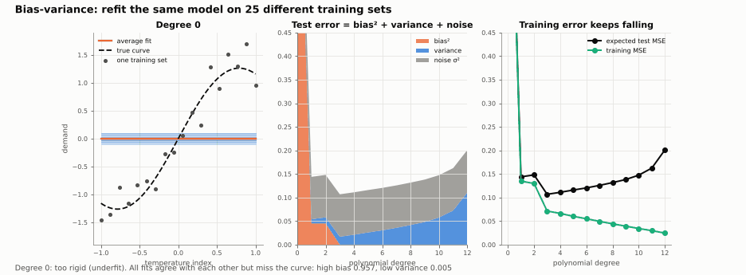
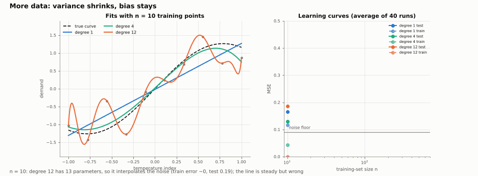

# 01 · Bias, Variance, Underfitting and Overfitting

> **One line:** a model's error on new data is the sum of three parts: a **systematic miss** (bias), **how much the fit wobbles when the training data change** (variance), and **noise nobody can predict**; every model in this course is a position on that trade-off.




## 1. Definition

Suppose `y = f(x) + ε` with noise `ε` of mean 0 and variance `σ²`, and a learning algorithm that produces a fitted function `f̂` from a random training set. At a fixed input `x₀`, the expected squared prediction error (over training sets *and* noise) is

```
E[(y − f̂(x₀))²] = (E[f̂(x₀)] − f(x₀))²  +  Var[f̂(x₀)]  +  σ²
                  └──── bias² ────────┘     └ variance ┘    └ irreducible ┘
```

- **Bias**: the error from the model family being unable to represent the truth (a line cannot be a sine). Persists no matter how much data you have.
- **Variance**: the error from the fit depending on the particular sample. A very flexible model fitted to 18 noisy points draws a different wiggle each time.
- **Irreducible noise**: the floor; no model can beat `σ²`.
- **Underfitting**: high bias (training error is already high). **Overfitting**: high variance (training error is small, test error is much larger).

**Story in the code.** A bakery predicts demand for a seasonal product from a (scaled) temperature index `x ∈ [-1, 1]`. The true relationship is a smooth S-shaped curve; daily sales carry noise `σ = 0.3` (so the best achievable MSE is 0.09). Models are polynomials of degree 0 to 12. Because we invented the data, we know the truth, and can do what a real analyst cannot: **re-draw the training set 300 times** and measure bias and variance directly.

## 2. Intuition

Four archers shoot at a target. *High bias, low variance*: tight cluster, off-centre. *Low bias, high variance*: scattered around the bullseye. The first is a stiff model, the second a floppy model. You want the cluster to be both centred and tight. Fewer wrinkles means more repeatability but less capacity to follow the truth; more wrinkles follow the truth but also the noise. More **data** tightens the scatter (variance falls as `1/n`) but does nothing for aim (bias).

## 3. The math

**Derivation.** Write `f̂ = f̂(x₀)`, `f = f(x₀)`, `ē = E[f̂]`. Then

```
E[(y − f̂)²] = E[(f + ε − f̂)²] = σ² + E[(f − f̂)²]                       (ε independent of f̂)
E[(f − f̂)²] = (f − ē)² + E[(ē − f̂)²]                                    (add and subtract ē; the cross term vanishes)
            = bias² + Var(f̂)
```

**Linear models.** For least squares with `p` parameters on `n` points at fixed `x`, the average variance over the design points is exactly `σ² p / n`. That is why the variance panel grows roughly linearly with the polynomial degree (`p = degree + 1`) and halves if you double `n`. In the code: degree 12, `n = 18`: `0.09 × 13/18 = 0.065` on the design points, 0.111 over the whole interval (it is larger between and beyond the end points).

**Training error is optimistic.** For least squares, `E[train MSE] = σ²(1 − p/n) + bias-ish terms`, which falls as `p` grows, while test error is `σ²(1 + p/n) + bias²`. The gap `2σ² p / n` is the **optimism**; criteria such as AIC, Mallows' Cp and BIC are corrections that add it back.

**Complexity is not just the parameter count.** Ridge/lasso (lesson 5), early stopping, dropout, tree depth, kernel width, `k` in k-NN, the number of boosting rounds are all dials on the same trade-off: they limit how flexible the fit may be.

**Interpolation threshold.** When the number of parameters reaches the number of data points the fit passes through every point, and test error can spike (here: degree 12 with `n = 14` points, test MSE 1.64). Modern over-parameterised networks sometimes show a "double descent" beyond that spike; the classical U-shape is the picture for moderate model sizes.

## 4. Algorithm (how to diagnose and act)

1. Split the data into train/validation (or use cross-validation, lesson 2).
2. Compare **training error** and **validation error**:
   - both high and close → **high bias**: use a richer model, add features, reduce regularisation;
   - training low, validation much higher → **high variance**: more data, simpler model, more regularisation, bagging, early stopping;
   - both low and close → good.
3. Plot a **validation curve** (error vs. complexity) and a **learning curve** (error vs. training-set size) to see which regime you are in.
4. Pick the complexity at the validation minimum; confirm on a final untouched test set.

## 5. Reading the animations

**`bias_variance.gif`** (`n = 18` training points, 25 refits drawn on the left)

| Panel | What to watch | What it means |
|---|---|---|
| Left | thin blue = fits from 25 independent training sets; orange = their average; dashed = truth. Degree 0 is a flat line: all fits agree and all are wrong. Degree 3: the bundle hugs the truth. Degree 12: the bundle fans out and the individual fits swing wildly at the ends | bias is the gap between the orange and dashed lines; variance is the width of the bundle |
| Middle | stacked area `bias² + variance + noise`: the orange wall collapses after degree 2, the blue variance grows steadily | the trade-off made visible |
| Right | training MSE (green) falls monotonically from 1.06 to 0.025, expected test MSE (black) is U-shaped with its minimum at **degree 3 (0.107)** and rises to **0.201 at degree 12** | training error cannot choose the model; test error can |

| degree | bias² | variance | noise | expected test MSE | training MSE |
|---|---|---|---|---|---|
| 0 | 0.957 | 0.005 | 0.09 | 1.052 | 1.060 |
| 1 | 0.045 | 0.009 | 0.09 | 0.144 | 0.135 |
| 3 | 0.0002 | 0.017 | 0.09 | **0.107** | 0.071 |
| 6 | 0.0001 | 0.030 | 0.09 | 0.121 | 0.055 |
| 12 | 0.0003 | 0.111 | 0.09 | 0.201 | 0.025 |

Note degree 2 is no better than degree 1: the true curve is odd-symmetric, so even-degree terms do not help.

**Verification.** An independent simulation of test error (fresh noisy labels) agrees with `bias² + variance + σ²`: degree 1: 0.1435 vs 0.1439; degree 4: 0.1117 vs 0.1111; degree 12: 0.2004 vs 0.2010.

**`learning_curves.gif`** (average of 40 runs; solid = test, dashed = training)

| Observation | Meaning |
|---|---|
| Degree 1: train and test meet quickly at **0.13** and never reach the noise floor 0.09 | **bias**: a line cannot become a sine, and more data does not help |
| Degree 12: with `n = 10-14` training error ≈ 0 and test error 0.19-1.64; the gap closes by `n ≈ 80` and test error reaches 0.092 at `n = 600` | **variance**: more data cures overfitting; at `n = 600` the 13-parameter model is as good as the correct one |
| Degree 4: always the best compromise (test 0.105 at `n = 30`, 0.091 at `n = 600`) | the right capacity is the cheapest in data |

Practical rule: if the learning curves have converged and are high, get a better model/features; if there is a gap, get more data or regularise.

## 6. Hyper-parameters & knobs

Everything that changes capacity: polynomial degree, tree depth, `k` (smaller `k` = more variance), network width/depth, regularisation strength `λ`, kernel bandwidth, number of boosting rounds, dropout, early-stopping epoch; and everything that changes sample size: more data, augmentation, bagging.

## 7. Variants & relatives

- **Regularisation** (lesson 5), **ensembles**: bagging/forests reduce variance (lesson 15), boosting reduces bias (lessons 16-17).
- **Cross-validation** and **information criteria** to estimate test error (lesson 2). **Structural risk minimisation / VC theory** (generalisation bounds in terms of capacity), **PAC-Bayes**, **Rademacher complexity**.
- **Double descent** and benign overfitting in over-parameterised models; **classification** bias-variance decompositions (0-1 loss is not additive, but the idea carries over).
- *Not implemented:* VC bounds, double-descent experiments beyond the interpolation spike shown.

## 8. Assumptions, strengths & weaknesses

The decomposition needs squared error, a fixed `x₀`, and an expectation over many training sets: a *conceptual* tool. We never observe bias or variance directly on one data set; we estimate generalisation error with held-out data.

**+** Explains why complex models can be worse; guides which remedy to try; unifies regularisation, ensembling and data collection.
**−** Exact only for squared loss; in practice the trade-off is blurred (some ML models are accurate far past interpolation); bias and variance can't be separated from one data set.

## 9. Metrics

Training vs validation/test error, the generalisation gap, validation and learning curves, cross-validated error, AIC/BIC, and (for simulations like this lesson) the decomposition itself.

## 10. Code tour (`bias_variance.py`)

- `f_true`, `draw` (fixed design, random noise), `fit_poly` (Legendre basis, minimum-norm least squares), `predict`.
- `decomposition` (Monte-Carlo bias², variance, train error for one degree), `bias_variance_gif`, `learning_gif`, `main` (the independent verification).

Run: `python bias_variance.py` (about 5 s).

## 11. Experiments

1. Change `SIGMA` to 0.1 and 0.6. How does the best degree move?
2. Set `n = 60`: where is the new minimum? Does variance at degree 12 match `σ² p / n`?
3. Replace the polynomial by k-NN regression with `k = 1…30`; draw the same decomposition (small `k` = high variance).
4. Add ridge regularisation `λ` to `fit_poly` and trace the curve at degree 12 as `λ` grows.
5. Generate `x` at random instead of on a grid and watch the variance explode at high degree (rare gaps), then explain.

## 12. Pitfalls

- Choosing a model by training error; or tuning on the test set (then it is no longer a test set).
- Believing "more complex = better" or "simpler = safer": both ends are failure modes.
- Expecting more data to fix a bias problem.
- Comparing models on one random split (the variance of the *estimate* is itself high).
- Forgetting that irreducible noise sets a floor: chasing a validation error below it means leakage.

**Next:** [02 Evaluation metrics and cross-validation](../02_evaluation_metrics_crossval/lesson.md)
