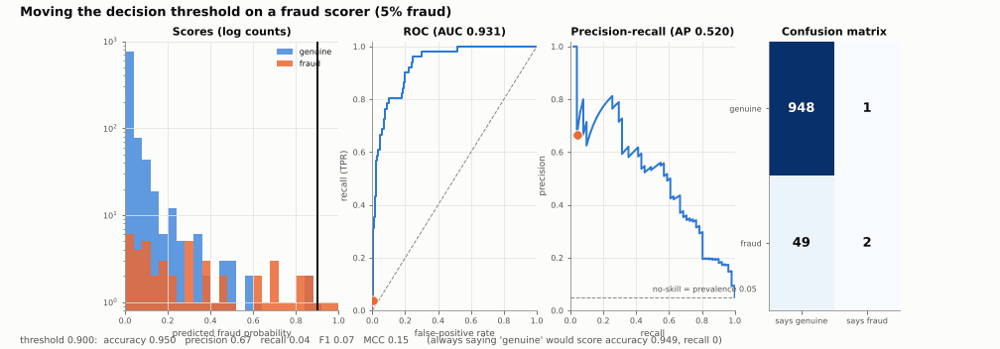
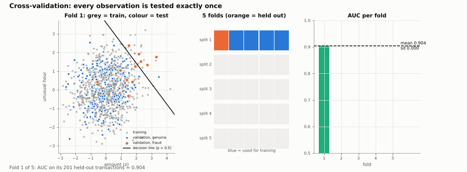

# 02 · Evaluating Models: Metrics, Thresholds and Cross-Validation

> **One line:** a model is only as good as your ability to measure it: choose a metric that matches the cost of mistakes, choose a threshold that matches the business, and estimate the score on data the model has never seen, more than once.

## 1. Definition

**Evaluation** answers two questions: *how well does the model do?* (metrics) and *how much should I trust that number?* (validation protocol).

- A **metric** turns predictions and truth into a number: accuracy, precision, recall, F1, ROC-AUC, MSE, R², log-loss...
- A **validation protocol** decides which data the metric is computed on: a hold-out split, **k-fold cross-validation**, a time-ordered split, a nested loop for tuning.

**Story in the code.** A bank scores card transactions for fraud. 1000 transactions, 51 fraudulent (5.1%), two features (amount, unusual-hour score) and a logistic-regression scorer written with Newton's method. Rare positives make this the standard case where the obvious metric (accuracy) lies.

## 2. Intuition

A smoke detector that never rings is 99.9% "accurate" (most days have no fire) and useless. What matters are the two kinds of error and their costs: a **missed fire** (false negative) versus a **false alarm** (false positive). A score threshold is a dial between them: lower it and you catch more fraud but annoy more customers. Metrics summarise that trade-off; cross-validation tells you whether the number you read off would survive a new sample.

## 3. The math

**Confusion matrix** for a threshold `t` (predict fraud when score ≥ `t`): `TP, FP, FN, TN`.

| metric | formula | answers |
|---|---|---|
| accuracy | `(TP+TN)/N` | share correct; misleading with imbalance |
| precision | `TP/(TP+FP)` | of the alarms, how many were real? |
| recall (TPR, sensitivity) | `TP/(TP+FN)` | of the real frauds, how many caught? |
| specificity | `TN/(TN+FP)`; FPR = `1 − specificity` | of the genuine ones, how many left alone? |
| F1 | `2PR/(P+R)` | harmonic mean of precision and recall (`Fβ` weights recall β× more) |
| MCC | `(TP·TN − FP·FN)/√((TP+FP)(TP+FN)(TN+FP)(TN+FN))` | balanced correlation in [-1, 1]; robust to imbalance |

**Threshold-free curves.**

- **ROC curve**: TPR vs FPR as `t` sweeps from 1 to 0. **AUC** = area under it = `P(score of a random fraud > score of a random genuine)` (the Mann-Whitney statistic; the code computes both the trapezoid area and the rank formula and gets the same number). 0.5 = guessing, 1 = perfect. AUC is insensitive to class balance, which can hide poor precision.
- **Precision-recall curve** and **average precision (AP)**: preferred when positives are rare, because precision reacts to the number of false positives relative to the few positives. The no-skill line is the prevalence (0.05), not the diagonal.

**Probabilistic quality.** **Log-loss** `−mean[y log p + (1−y) log(1−p)]` punishes confident mistakes; **Brier score** `mean (p − y)²`; **calibration**: among transactions given probability ≈ 0.2, are ≈ 20% fraudulent? (A reliability table is in the code.)

**Regression metrics.** MSE/RMSE (penalise large errors), MAE (robust), `R² = 1 − SS_res/SS_tot` (fraction of variance explained; can be negative on test data), MAPE (relative error; unstable near zero).

**Cross-validation.** Split the data into `k` folds; for each fold `i` train on the other `k−1`, score on fold `i`; report the mean and standard deviation of the `k` scores. Every observation is validated exactly once. Variants: **stratified** (keeps the class ratio in every fold; essential with rare positives), **repeated**, **leave-one-out** (`k = n`; low bias, high variance, costly), **group k-fold** (all rows of one customer stay together), **time-series split** (always train on the past, test on the future), **nested CV** (an inner loop tunes hyper-parameters, an outer loop estimates performance).

**Why more than one split.** A single 80/20 hold-out is a lottery: the estimate depends on which few positives land in the test set.

## 4. Algorithm (a sound evaluation recipe)

1. Decide the metric(s) from the cost of errors (before looking at results).
2. Put a **test set** aside and do not touch it until the end.
3. On the rest, use stratified k-fold (grouped or time-aware when the data demand it) to compare models and tune hyper-parameters; do all pre-processing and feature selection **inside** each training fold.
4. Choose the threshold from the cost trade-off (or max F1 / fixed recall) using validation data.
5. Refit on all training data, score once on the test set; report the metric with its spread.

## 5. Reading the animations

**`threshold_sweep.gif`** (out-of-fold scores of all 1000 transactions; AUC 0.931, AP 0.520)

| Panel | What to watch | What it means |
|---|---|---|
| Score histogram (log counts) | the black line is the threshold; fraud (orange) concentrates on the right but overlaps | separation is imperfect: any threshold makes both error types |
| ROC | the orange dot slides up and right as the threshold falls | each threshold is one operating point |
| Precision-recall | the dot slides from high precision/low recall to low precision/high recall | the trade-off: precision pays for recall |
| Confusion matrix | counts shift from the bottom-left to the right column | what the business actually experiences |

| threshold | TP / FP / FN / TN | accuracy | precision | recall | F1 |
|---|---|---|---|---|---|
| 0.90 | 2 / 1 / 49 / 948 | 0.95 | 0.67 | 0.04 | 0.07 |
| 0.50 | 16 / 7 / 35 / 942 | 0.96 | 0.70 | 0.31 | 0.43 |
| 0.30 | 26 / 22 / 25 / 927 | 0.95 | 0.54 | 0.51 | 0.53 |
| 0.16 | 34 / 45 / 17 / 904 | 0.94 | 0.43 | 0.67 | 0.52 |
| 0.09 | 41 / 97 / 10 / 852 | 0.89 | 0.30 | 0.80 | 0.43 |
| 0.015 | 50 / 323 / 1 / 626 | 0.68 | 0.13 | 0.98 | 0.24 |

Accuracy is 0.95-0.96 across the useful range while recall swings from 4% to 67%; always answering "genuine" gets accuracy 0.949 and recall 0. Maximum F1 is near threshold 0.2-0.3. The *right* threshold depends on costs: if a missed fraud costs 50× a false alarm you operate near 0.09, not 0.5.

**`cross_validation.gif`**

| Panel | What to watch | What it means |
|---|---|---|
| Left | the grey points train the model, coloured points are the held-out fold; the black line is that fold's decision boundary | each fold gets a slightly different model |
| Middle | the orange block moves down the rows; blue blocks train | every observation is validated once |
| Right | AUC per fold: 0.904, 0.924, 0.938, 0.956, 0.938; mean **0.933**, sd 0.017 | the spread is the honest uncertainty |

Final frame: 60 random 80/20 hold-outs give AUC anywhere from **0.83 to 0.99** (sd 0.034); the 5-fold *averages* (60 repetitions with different fold assignments) lie in 0.925-0.935 (sd 0.002). The second spread is smaller because it averages five test sets of the same data, but note that it measures only the variability caused by *how we cut the data*, not the variability due to which transactions we happened to collect; the per-fold sd (0.017) is the more honest uncertainty.

**Other numbers printed** (hold-out of 300 with 14 frauds): accuracy 0.960 with recall 0.29 at threshold 0.5; AUC 0.953 (trapezoid = rank formula = scikit-learn); log-loss 0.100 and Brier 0.0285 vs 0.0445 for a base-rate-only model; the calibration table is close to the diagonal (predicted 0.177 vs observed 0.173 in the top quartile). **Plain k-fold** put 9, 9, 14, 9, 10 frauds in the folds, **stratified** put 11, 10, 10, 10, 10.

**The leakage trap** (printed): 100 samples, 2000 columns of pure noise and random labels (true AUC 0.5). Selecting the 20 "most correlated" columns *using all the data* and then cross-validating reports AUC **0.871**; selecting inside each training fold reports **0.531**. Any step that learns from the data (scaling, imputation, feature selection, target encoding, over-sampling) belongs inside the fold.

## 6. Hyper-parameters & knobs

- **Metric**, **threshold** (or cost matrix), `β` of `Fβ`, averaging for multi-class (macro = every class equal; micro = every sample equal; weighted).
- **`k`** (5 or 10 typical), stratification, grouping, repetitions, random seed, time-aware splitting.
- **Calibration method** (Platt scaling, isotonic regression).

## 7. Variants & relatives

- **Multi-class**: confusion matrix `K×K`, one-vs-rest AUC, macro/micro F1, top-k accuracy, Cohen's κ. **Ranking**: NDCG, MAP, MRR. **Regression**: quantile/pinball loss, interval coverage. **Clustering**: ARI, silhouette. **Generative** models: FID, perplexity.
- **Resampling**: bootstrap (and the .632 bootstrap), leave-one-out, Monte-Carlo CV, out-of-bag error for bagging (lesson 15).
- **Statistical comparison**: paired t-test / Wilcoxon on fold scores, McNemar's test, DeLong's test for AUCs; **A/B testing** online.
- **Fairness and robustness metrics**, calibration error (ECE), cost curves, lift/gain charts.
- *Not implemented:* multi-class metrics, bootstrap intervals, significance tests, time-series splits.

## 8. Assumptions, strengths & weaknesses

Assumes the validation data resemble the future data (same distribution, independent rows).

**+** Cheap, general, model-agnostic; cross-validation uses all the data for both training and testing; curves expose the trade-offs.
**−** k-fold is `k` times the cost; random splits break for temporal, grouped or duplicated data (leakage); CV estimates are slightly pessimistic (train on `(k−1)/k` of the data) and have their own variance; tuning on the same CV scores you report is optimistic (use nested CV); metrics are blind to costs unless you encode them.

## 9. Metrics

(This lesson is about them.) Always report the mean **and** the spread, a baseline (prevalence, "predict the mean", last-value forecast), and more than one view: a threshold metric, a curve, a probability metric.

## 10. Code tour (`evaluation.py`)

- `fit_logistic` (IRLS), `score`, `transactions` (data).
- Metrics: `confusion`, `prf`, `roc_curve`, `auc_trapezoid`, `auc_rank`, `pr_curve`, `average_precision`, `log_loss`, `brier`, `calibration_table`.
- Protocols: `kfold_indices(stratified=...)`, `cv_scores`, `leakage_demo`.
- `threshold_gif`, `cv_gif`, `main` (all checks, including scikit-learn).

Run: `python evaluation.py` (about 5 s).

## 11. Experiments

1. Raise the fraud rate to 30% and to 1%: how do accuracy, ROC-AUC and AP react?
2. Choose the threshold that minimises `50·FN + 1·FP` using out-of-fold scores; compare with max-F1.
3. Implement `GroupKFold` with 100 customers who each have 10 transactions and show the leakage you get from a plain split when customers have personal habits.
4. Add `repeated stratified 5×5` CV and compare its standard error with the single 5-fold run.
5. Build **nested CV** to choose `lam` for `fit_logistic` and compare the nested estimate with the biased "best inner score".

## 12. Pitfalls

- Accuracy on imbalanced data; ROC-AUC alone when positives are rare (look at precision-recall).
- Leakage: pre-processing on all data, duplicates across folds, future information in features, same customer in train and test.
- Tuning hyper-parameters and reporting the same CV score; repeatedly peeking at the test set.
- Choosing the threshold on the test set.
- Reading small differences in a noisy metric as real (compare to the fold spread).
- Evaluating probabilities with threshold metrics only (check calibration and log-loss).

**Next:** [03 Linear regression](../03_linear_regression/lesson.md) (the course continues there; this lesson is the toolkit you will use throughout)
