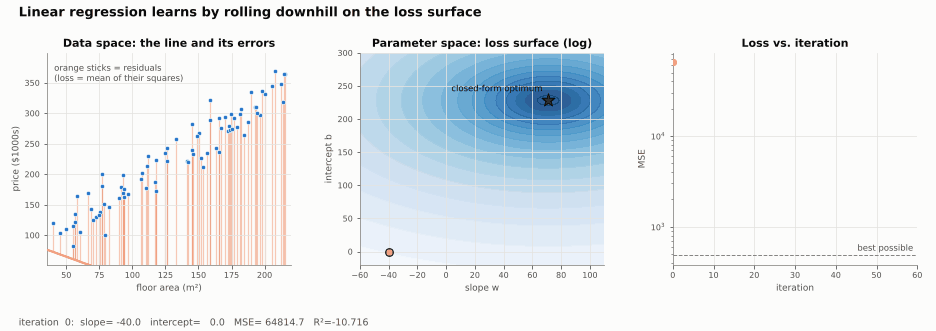

# 03 · Linear Regression

> **One line:** fit a straight line (or plane) through data by choosing the slope and intercept that make the squared prediction errors as small as possible.



## 1. Definition

**Linear regression** is a *supervised* model for predicting a **continuous number** `y` from inputs `x`. It assumes the target is a weighted sum of the inputs plus a constant:

```
ŷ = b + w₁x₁ + w₂x₂ + … + w_d x_d  =  θᵀ x̃        (x̃ = [1, x₁, …, x_d])
```

- `w` are the **weights** (slopes): how much `ŷ` changes when that feature increases by 1.
- `b` is the **bias / intercept**: the prediction when all features are 0.
- "Linear" means linear **in the parameters**, not necessarily in the raw features (see lesson 04: polynomial regression is still linear regression).

**Practical example used in the code:** predict a house's price (in $1000s) from its floor area (m²).

## 2. Intuition

Imagine hanging a rigid stick over a scatter of points, with a rubber band from every point to the stick. The bands pull the stick until the total *squared* stretch is smallest. The orange vertical sticks in the animation are those errors, called **residuals**: `rᵢ = yᵢ − ŷᵢ`.

Squaring does three things: positive and negative errors don't cancel, big misses are punished much more than small ones, and the loss becomes a smooth bowl-shaped function that is easy to minimise.

## 3. The math

**Loss (Mean Squared Error):**

```
J(θ) = (1/n) Σᵢ (ŷᵢ − yᵢ)²  =  (1/n) ‖Aθ − y‖²        (A = n×(d+1) design matrix)
```

`J` is a **convex quadratic** in `θ` → exactly one minimum, no local traps. Its picture in `(w, b)` space is an elliptical bowl, which is the middle panel of the animation.

**Gradient:**

```
∇J(θ) = (2/n) Aᵀ (Aθ − y)
```

**Two ways to the minimum**

| Method | Update | Cost | Notes |
|---|---|---|---|
| Normal equation | `θ* = (AᵀA)⁻¹ Aᵀ y` | O(nd² + d³) | exact, one shot; fails if `AᵀA` is singular (collinear features) |
| Gradient descent | `θ ← θ − η ∇J(θ)` | O(nd) per step | scales to huge data; needs a learning rate `η` |

Setting `∇J = 0` gives the normal equation. Gradient descent walks downhill following `−∇J`; the learning rate `η` is the step size.

**Why standardise features?** If `x` is in the hundreds and the intercept's "feature" is 1, the bowl is a long thin valley and GD zig-zags. Subtracting the mean and dividing by the standard deviation makes it round. The code does this.

## 4. Algorithm (gradient descent version)

1. Standardise features. Initialise `θ` (zeros or anything).
2. Compute predictions `ŷ = Aθ`.
3. Compute residuals `ŷ − y` and the gradient `(2/n) Aᵀ residual`.
4. Update `θ ← θ − η·gradient`.
5. Repeat until the loss stops improving.

## 5. Reading the animation

| Panel | What to watch |
|---|---|
| **Left – data space** | The orange line rotates and shifts; the residual sticks shrink. Early on the line sits far below the data (large errors). |
| **Middle – parameter space** | Each point is a *different line*. The orange dot rolls from the start to the ★ closed-form optimum. The path first moves fast (steep slope), then slows near the bottom (gradient → 0). |
| **Right – loss curve** | MSE drops steeply, then flattens toward the dashed "best possible" line. The log axis shows that progress is geometric. |

Bottom caption: live slope, intercept, MSE and R².

## 6. Hyper-parameters & knobs

- **Learning rate `η`** – too small: slow. Too large: overshoots and *diverges*. Try `lr=0.6` in the script and watch the path explode.
- **Iterations** – more steps get closer to the optimum.
- **Regularisation** (lesson 05) – adds a penalty on `‖w‖` to fight overfitting.
- **Feature scaling** – affects GD speed, not the final answer.

## 7. Assumptions (when the classical statistics hold)

1. Linear relationship between features and target.
2. Residuals independent, with constant variance (homoscedastic).
3. Residuals roughly Gaussian (needed for confidence intervals, not for fitting).
4. Features not perfectly collinear.

Violations to look for: curved residual plots (need non-linear features), fan-shaped residuals (need a transform), outliers (squared loss is *very* sensitive; consider Huber loss).

## 8. Strengths & weaknesses

**+** Fast, interpretable (each weight has a meaning), convex (unique optimum), strong baseline.
**−** Can't capture curves/interactions unless you engineer features; outlier-sensitive; unstable with correlated features.

## 9. Metrics

- **MSE / RMSE** – error in squared / original units.
- **MAE** – average absolute error, more robust to outliers.
- **R²** = `1 − SS_res / SS_tot` – fraction of variance explained (1 = perfect, 0 = no better than predicting the mean).

## 10. Code tour (`linear_regression.py`)

- `LinearRegression.fit_normal_equation` – closed form via `np.linalg.lstsq`.
- `LinearRegression.fit_gradient_descent` – the 5-step loop above; returns the whole path of `θ` so the animation can replay it.
- `main()` – builds the loss surface on a grid and draws the three panels per frame. Output: `linear_regression.gif`.

Run it: `python linear_regression.py`

## 11. Experiments

1. Set `lr` to `0.5`, then `1.2`. What happens to the path?
2. Remove the standardisation step. How many iterations does GD now need?
3. Add one extreme outlier (e.g. price 900 at area 60). How far does the line move? Why?
4. Add a second feature (number of rooms) by changing `X` to two columns – the code already supports `d` features.

## 12. Pitfalls

- Evaluating only on training data – always keep a test set.
- Extrapolating far beyond the training range.
- Reading weights as causal effects when features are correlated.
- Forgetting to apply the *training* mean/std to new data.

**Next:** [04 Polynomial regression](../04_polynomial_regression/lesson.md) – bending the line.
