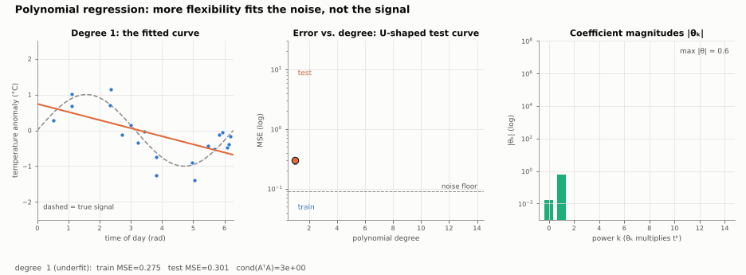

# 04 · Polynomial Regression

> **One line:** keep linear regression, but feed it powers of the input (`x, x², x³, …`) so the model can bend; the degree controls the flexibility, and too much flexibility fits the noise.



## 1. Definition

**Polynomial regression** is a *supervised* model for predicting a continuous number `y` from an input `x` (here a single number, but the idea works for many inputs). It first applies a **feature expansion** and then fits ordinary linear regression (lesson 03):

```
x  ->  φ(x) = [1, x, x², …, x^d]          (d = the degree)
ŷ  =  θ₀ + θ₁x + θ₂x² + … + θ_d x^d  =  θᵀ φ(x)
```

The curve is non-linear in `x`, but the model is still **linear in the parameters `θ`** - so everything from lesson 03 (squared loss, convex bowl, normal equation) carries over unchanged. Only the design matrix changes.

**Practical example in the code:** a sensor records the temperature anomaly over one daily cycle (time of day mapped to `0 … 2π`). The truth is a smooth S-shaped cycle `sin(t)`, but we only have **20 noisy readings** (noise std 0.30, so the best possible MSE is `0.30² = 0.09`). We compare degrees 1 to 14 on a large fresh test set of 300 readings.

## 2. Intuition

Think of a flexible metal ruler pinned to the data. A degree-1 ruler is perfectly stiff: a straight stick that cannot follow a wave (**underfitting** / high *bias*). Each extra degree makes the ruler more bendable. At degree 3 it can follow the S-shape. At degree 12 with only 20 points the ruler is so floppy that it threads through every noisy dot, and between the dots (especially near the ends) it swings wildly, because nothing pins it down there. That is **overfitting** / high *variance*: the curve describes this particular sample of noise rather than the signal.

## 3. The math

**Design matrix** (a *Vandermonde* matrix) for `n` points and degree `d`:

```
A = [ 1  x₁  x₁²  …  x₁^d ]          ŷ = A θ
    [ 1  x₂  x₂²  …  x₂^d ]
    [ …                    ]
    [ 1  xₙ  xₙ²  …  xₙ^d ]
```

**Loss and solution** (same as lesson 03):

```
J(θ) = (1/n) ‖Aθ − y‖²        ∇J = (2/n) Aᵀ(Aθ − y) = 0   ⇒   AᵀA θ = Aᵀ y     (normal equation)
```

**Conditioning - why polynomials are numerically nasty.** The columns `x^k` and `x^(k+1)` look very alike on `[0, 1]`: they become nearly collinear, so `AᵀA` is *ill-conditioned*. The **condition number** `cond(M) = σ_max / σ_min` (ratio of largest to smallest singular value) measures how much a tiny change in the data is amplified in the solution. Forming `AᵀA` **squares** it: `cond(AᵀA) = cond(A)²`. The script prints, for degree 12 on the raw `x ∈ [0, 6.28]`, `cond(AᵀA) ≈ 5e25` (hopeless in float64, which has ~16 digits) versus `≈ 2e10` after mapping the input to `[-1, 1]`. Two cures, both used in the code:

1. **Rescale the input** to `[-1, 1]` before expanding (cheap and always worth it).
2. **Solve by SVD / QR** (`np.linalg.lstsq`) instead of forming `AᵀA`; this works with `cond(A)` instead of `cond(A)²`. The script also keeps the explicit normal-equation path (`method="normal"`) and shows both agree to ~1e-13 at degree 5.

**Degree vs error** (the bias-variance picture, lesson 01):

```
train MSE   -> decreases monotonically with d (a larger model class can never fit the train set worse)
test MSE    -> falls while bias dominates, rises once variance dominates (U-shape)
```

With `d + 1 = n` parameters the polynomial **interpolates** the training points exactly (train error 0). Here `n = 20`, so degrees near 19 are the extreme.

**Why do the coefficients explode?** To make a high-degree curve wiggle through noisy points, large positive and negative powers must cancel one another almost exactly. The right panel shows `|θₖ|` growing from ~1 to ~10⁴ and beyond (degree 14: ~8·10⁴). Large coefficients are a symptom of an unstable fit; **penalising them is exactly what ridge regression does** (lesson 05).

## 4. Algorithm

1. Choose a degree `d`.
2. Rescale `x` to `[-1, 1]` using the training min/max (remember them for new data).
3. Build the Vandermonde matrix `A` from the rescaled `x`.
4. Solve the least-squares problem for `θ` (SVD-based `lstsq`; or the normal equation for teaching).
5. Predict with `φ(x_new) θ` using the **same** rescaling.
6. Repeat for several `d` and pick the one with the lowest **validation/test** error (or use cross-validation, lesson 02).

## 5. Reading the animation

| Panel | What to watch | What it means |
|---|---|---|
| **Left - data space** | Orange curve vs dashed true signal as the degree goes 1 -> 14. Then: degree 12 re-fitted on 6 fresh samples, old fits left as faint "spaghetti". | Degree 1-2 is too stiff. Degree 3 hugs the truth. Beyond ~8 the ends explode (Runge effect). The spaghetti shows the model's *variance*: each new sample gives a totally different curve. |
| **Middle - error curves** (log y) | Blue train error only goes down; orange test error dips at degree 3 near the noise floor (0.09), then shoots up. | Underfit -> good -> overfit. Train error alone would have chosen degree 14. |
| **Right - coefficient magnitudes** (log y) | Bars grow by orders of magnitude with degree. | Wild curves need huge cancelling coefficients. |

Observed numbers (seed 4): degree 1 test MSE 0.30; **degree 3 test MSE 0.104** (train 0.100); degree 5: 0.146; degree 8: 10; degree 12: 2.8·10³; degree 14: 1.4·10⁷. The caption on each frame also prints `cond(AᵀA)`, which climbs from ~3 to ~4·10¹².

## 6. Hyper-parameters & knobs

- **Degree `d`** - the main knob. Too low: bias. Too high: variance. Choose by validation or CV, never by training error.
- **Input scaling** - doesn't change the model class, but decides whether the numerics survive.
- **Number of samples `n`** - more data makes a given degree safer; the safe degree grows with `n`.
- **Noise level** - the noisier the data, the lower the optimal degree.
- **Regularisation strength** (lesson 05) - a softer alternative to choosing the degree: use a high degree with a penalty.

## 7. Variants & relatives

- **Orthogonal polynomial bases** (Chebyshev, Legendre) - much better conditioned than raw powers, because the basis functions are nearly orthogonal on `[-1, 1]`. Not implemented; `np.polynomial.chebyshev.chebvander` would be a drop-in replacement for `np.vander`.
- **Splines** (piecewise low-degree polynomials joined smoothly at *knots*) - local flexibility without global wiggles; a cubic spline fixes the Runge effect because a change in one region doesn't swing the other. Natural cubic splines are linear beyond the boundary knots, which tames the edges. Not implemented.
- **Radial basis functions (RBF)** - features `exp(−(x − cⱼ)²/2s²)` centred on a grid; local bumps instead of global powers. **Fourier bases** `sin(kx), cos(kx)` suit periodic signals (like this daily cycle, where just `sin(x)` would be perfect - choosing the right basis is knowledge about the problem).
- **Interactions and multiple inputs** - with `x₁, x₂`, a degree-2 expansion is `[1, x₁, x₂, x₁², x₁x₂, x₂²]`. The number of features grows like `C(p + d, d)`, so it explodes quickly with many inputs (use the kernel trick - lesson 13 - or regularisation).
- **Kernel ridge / Gaussian processes** (lesson 06) - the infinite-feature limit of the same idea.
- **Generalised additive models (GAMs)** - a sum of one spline per feature.

## 8. Assumptions, strengths & weaknesses

**Assumptions:** the signal is smooth and well approximated by a low-degree polynomial in the chosen range; noise is roughly independent with constant variance.

**+** Simple, convex, closed-form, interpretable for low degree; shows the whole bias-variance story in one picture; the template for "feature engineering + linear model".
**−** Global basis: one point influences the curve everywhere; terrible extrapolation (powers explode outside the data range); ill-conditioned for high degree; feature count explodes with many inputs.

**Use** it for smooth low-dimensional trends and as a teaching model. **Avoid** it for extrapolation, many inputs, or when the data has regime changes (use splines, trees, or GPs).

## 9. Metrics / how to evaluate it

- **Held-out MSE / RMSE** vs degree (the U-curve in the middle panel); compare to the noise floor `σ²` if known.
- **k-fold cross-validation** to pick the degree when you can't spare a big test set (lesson 02).
- **Coefficient magnitudes** and **condition number** as diagnostic warning lights.
- **Residual plots** - structure in the residuals means too low a degree.
- Adjusted R², AIC and BIC penalise the parameter count and are cheap alternatives to CV.

## 10. Code tour (`polynomial_regression.py`)

- `poly_features(t, degree)` - the Vandermonde expansion.
- `PolynomialRegression` - `fit` (rescale, expand, solve by `lstsq` or by the normal equation, record `cond(AᵀA)`) and `predict`.
- `mse` - test/train error.
- `main()` - fits degrees 1-14, prints the checks (best degree, conditioning raw vs scaled, normal equation vs lstsq, agreement with `np.polynomial.polynomial.polyfit` in a `try/except` cross-check), then draws three panels per frame: curve, error curves, coefficient bars. The second phase re-samples the data at degree 12.

Run it: `python polynomial_regression.py` (about 5 s).

## 11. Experiments

1. Set `PolynomialRegression(12, scale=False)` in the animation. How bad do the coefficients and curve become? Compare the printed condition numbers.
2. Increase `n` from 20 to 100 in `make_sine`. Where does the test-error minimum move, and how much later does the curve explode?
3. Raise `noise` to 0.6, then lower it to 0.05. How does the best degree change?
4. Replace `poly_features` with Fourier features `[1, sin t, cos t, sin 2t, cos 2t]` and fit with `lstsq`. How few parameters are needed? (A *good* basis beats a high degree.)
5. Fit using `method="normal"` for degrees 10-14 and compare to `lstsq`: when does the squared condition number start to hurt?

## 12. Pitfalls

- Choosing the degree on training error (it always prefers the largest degree).
- Forgetting to apply the **training** rescaling to new inputs.
- Extrapolating: outside the training range a polynomial diverges like `x^d`.
- Reading individual coefficients as meaningful: the columns are highly correlated.
- Using `np.linalg.inv(A.T @ A)` for high degree - use `lstsq` or QR.
- Running the same noisy dataset through many degrees and *then* reporting the test score you picked from: the test set is no longer unseen (use a separate validation split).

**Next:** [05 Regularization: ridge & lasso](../05_regularization_ridge_lasso/lesson.md) - keeping the flexibility but taming the coefficients.
