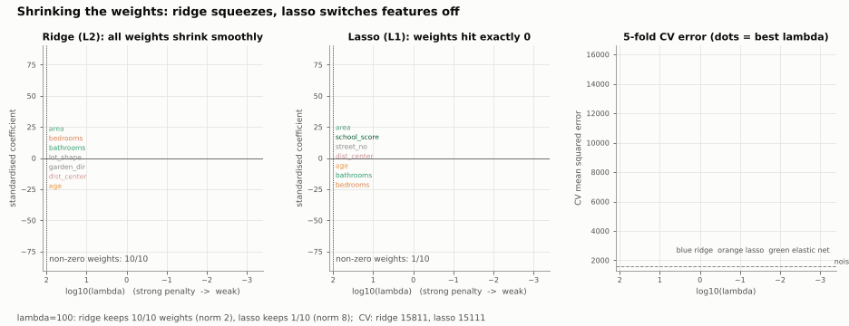
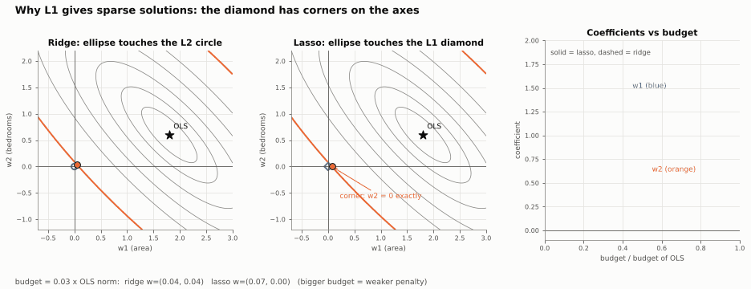

# 05 · Regularisation: Ridge, Lasso & Elastic Net

> **One line:** add a penalty on the size of the weights so the model cannot chase noise; the shape of the penalty decides whether weights merely shrink (ridge) or switch off completely (lasso).




## 1. Definition

**Regularisation** modifies the training objective to prefer simpler models. For linear regression:

```
J(w) = 1/(2n) ||y − Xw||²  +  λ · [ α ||w||₁ + (1−α)/2 · ||w||₂² ]
        └── data fit ──┘       └────────── penalty ──────────────┘
```

| α | Name | Penalty | Solver in the code |
|---|---|---|---|
| 0 | **Ridge** (L2, Tikhonov) | `λ/2 Σ wⱼ²` | closed form |
| 1 | **Lasso** (L1) | `λ Σ |wⱼ|` | coordinate descent |
| 0<α<1 | **Elastic Net** | mix | coordinate descent |

It is a *supervised* technique used with regression (and, as weight decay, with nearly every model, including neural networks and logistic regression).

**Story in the code:** predict house price ($1000s) from 10 features measured on only **30** houses. Six features carry real signal; three of them (area, bedrooms, bathrooms) are strongly correlated; four are pure noise. With so few houses and so many features, ordinary least squares (OLS) overfits.

## 2. Intuition

OLS is a student who memorises the practice exam, noise included. Regularisation gives the student a **budget**: "you may spend only this much total weight". With a limited budget the model spends it on the features that matter most.

- **Ridge** squeezes all weights smoothly toward zero; correlated features share the weight.
- **Lasso** is more ruthless: weak features are cut to *exactly* zero, so it also performs **feature selection**.

## 3. The math

**Ridge closed form.** Setting the gradient of `½n⁻¹‖y−Xw‖² + (λ/2)‖w‖²` to zero:

```
w = (XᵀX + n λ I)⁻¹ Xᵀ y
```

Adding `nλI` makes the matrix always invertible (fixes collinearity) and shrinks directions with small variance the most. In the SVD `X = UΣVᵀ`, OLS keeps each component fully; ridge multiplies it by `σᵢ²/(σᵢ² + nλ)`, a smooth shrink factor in [0,1).

**Lasso has no closed form** (the L1 term is not differentiable at 0). Coordinate descent updates one weight at a time with the **soft-threshold** operator:

```
wⱼ ← S( ρⱼ , λα ) / (zⱼ + λ(1−α))      S(a, g) = sign(a)·max(|a| − g, 0)
zⱼ = 1/n Σᵢ xᵢⱼ²  (=1 for standardised features)
ρⱼ = 1/n Σᵢ xᵢⱼ ( yᵢ − Σ_{k≠j} xᵢₖ wₖ )   (partial residual correlation)
```

Whenever `|ρⱼ| ≤ λα` the weight is set to exactly 0 - the source of sparsity.

**Geometry (second animation).** Equivalent constrained form: minimise the data-fit loss subject to `‖w‖ ≤ t`. The loss contours are ellipses centred at the OLS solution; the constraint region is a circle (L2) or a diamond (L1). The solution is where the growing ellipse first touches the region. A circle has no corners, so contact is almost never on an axis; the diamond has corners **on the axes**, and an ellipse typically hits a corner, setting some weight to 0. In higher dimensions the L1 ball has many more corners and edges, so many weights vanish.

**Bayesian view.** Ridge = MAP estimate with a Gaussian prior `w ~ N(0, τ²)`; lasso = MAP with a Laplace prior (sharp peak at 0, heavy tails); `λ ∝ σ²/τ²`.

**Bias-variance link (lesson 01).** The penalty adds a little bias but removes a lot of variance. Total error falls until `λ` becomes too large.

## 4. Algorithm

*Ridge:* standardise `X`, centre `y`, solve the linear system.
*Lasso / Elastic Net (coordinate descent):*
1. Standardise features (the penalty treats all weights alike, so scales must be equal). Start with `w = 0`.
2. For each feature `j`: compute `ρⱼ` from the current residual, apply soft-thresholding, update `wⱼ`.
3. Sweep all features until the largest weight change is below a tolerance.
4. Repeat over a grid of `λ` values (warm-start from the previous solution) to get the **regularisation path**.
5. Pick `λ` by k-fold cross-validation.

## 5. Reading the animations

**`regularization_paths.gif`** - `λ` sweeps from huge (left) to tiny (right).

| Panel | What to watch | What it means |
|---|---|---|
| Ridge paths | all coefficients start at 0 and grow together, smoothly, never exactly zero ("non-zero weights: 10/10") | shrinkage, no selection |
| Lasso paths | coefficients switch on one at a time: area first, then the others; the noise features stay at 0 for a long time | automatic feature selection |
| CV error | a U-shape: too much penalty underfits, too little overfits; dots mark each method's best `λ` | choose `λ` at the dot |

Results from the run (test set of 1000 houses; noise floor = 1600):
OLS 3061, ridge 2264, elastic net 2200, **lasso 1983 with 7 of 10 weights non-zero**. Regularisation removes most of the overfit.

**`regularization_geometry.gif`** - two correlated features, true weights (1.8, 0.6).

| Panel | What to watch |
|---|---|
| Ridge | ellipse touches the circle at a generic point; both weights shrink smoothly as the budget falls |
| Lasso | ellipse touches the diamond **at a corner on the w₁ axis** while `w₂` stays exactly 0 for budgets up to ~47% of OLS's |
| Coefficient vs budget | solid (lasso) `w₂` is flat at 0 then lifts off; dashed (ridge) `w₂` shrinks smoothly and never reaches 0 (smallest value 0.039 in the run) |

## 6. Hyper-parameters & knobs

- **`λ`** (`alpha` in scikit-learn): `0` = OLS; huge = all weights 0. Choose by CV on a log grid.
- **`α` (l1_ratio)** for Elastic Net: 1 = lasso, 0 = ridge; try 0.1, 0.5, 0.9.
- **Standardisation**: mandatory. Do not penalise the intercept.
- **Tolerance / max sweeps** in coordinate descent.

## 7. Variants & relatives

- **Elastic Net** (implemented): groups correlated features and keeps them together (lasso alone arbitrarily picks one).
- **Adaptive lasso / relaxed lasso**: re-fit after selection to reduce lasso's bias on large weights.
- **Group lasso, fused lasso**: penalties for groups of features or neighbouring coefficients. *Not implemented.*
- **Weight decay** in neural nets ≈ L2 (exactly equal for SGD; use AdamW for Adam). **Dropout, early stopping, data augmentation** are other regularisers.
- **L0 / best-subset**: ideal sparsity, but combinatorial. **SCAD / MCP**: non-convex penalties with less bias.

## 8. Assumptions, strengths & weaknesses

**+** Prevents overfitting with few samples / many features; handles collinearity (ridge); gives sparse interpretable models (lasso); cheap.
**−** Introduces bias; weights are no longer unbiased estimates; lasso picks arbitrarily among correlated features and selects at most `n` features; needs standardisation and a tuned `λ`; still a linear model.

**Use** when `p` is large relative to `n`, features are correlated, or you want feature selection. **Not** when the relationship is strongly non-linear (combine with feature engineering) or `n ≫ p` with clean data (OLS is fine).

## 9. Metrics

Cross-validated MSE (never the training MSE, which always prefers `λ=0`), test MSE against the **noise floor** (the irreducible error), the number of non-zero coefficients, and stability of the selected set across resamples.

## 10. Code tour (`regularization.py`)

- `make_housing` - synthetic data with correlated and irrelevant features.
- `Ridge` (closed form) and `ElasticNet` (coordinate descent, `soft_threshold`); lasso is `α=1`.
- `path`, `cv_curve` - regularisation path and k-fold CV error over a `λ` grid.
- `exact_two_feature_problem`, `lam_for_budget` - the 2-D constraint-geometry demo.
- `animate_paths`, `animate_geometry` - the two GIFs. A scikit-learn cross-check prints the max coefficient difference (ridge 7e-15, lasso 1.5e-6).

Run: `python regularization.py` (about 20 s).

## 11. Experiments

1. Set the training size to 100 in `make_housing`. How much does the gap between OLS and the regularised models shrink?
2. Add more irrelevant features (e.g. 20). Does lasso's advantage over ridge grow?
3. Raise the correlation between area and bedrooms to 0.99. Compare how ridge and lasso split weight between them; then try elastic net.
4. Compare the `λ` chosen by CV with the "one-standard-error rule" (the largest `λ` within 1 SE of the best).

## 12. Pitfalls

- Forgetting to standardise (a feature measured in large units is penalised less).
- Standardising on the full data before cross-validation (leakage: compute mean/std inside each fold).
- Reading lasso's selected set as "the true causes"; it is unstable under correlation.
- Using the training error to choose `λ`.

**Next:** [06 Gaussian process regression](../06_gaussian_process_regression/lesson.md)
