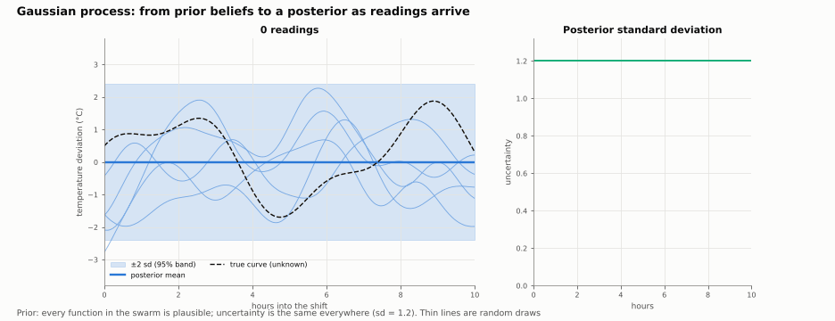
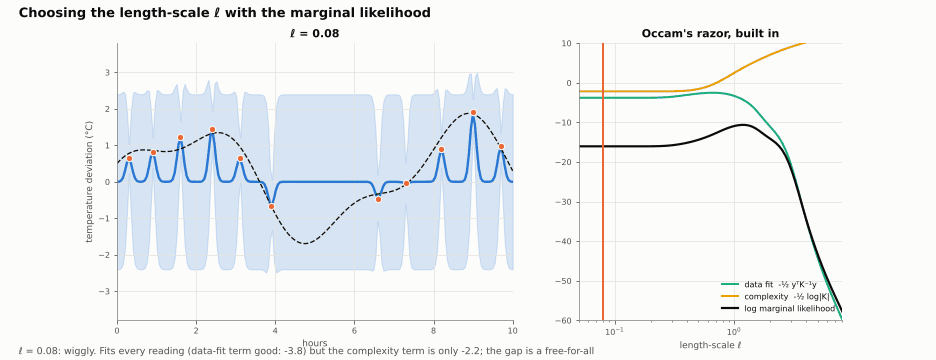
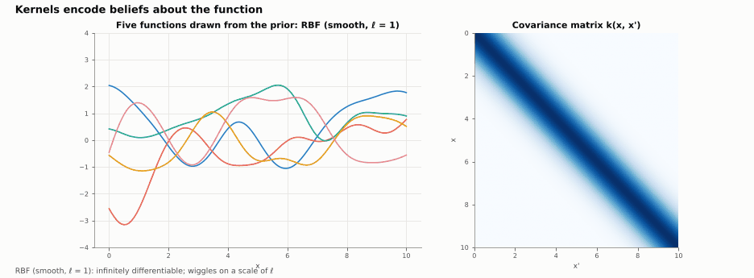

# 06 · Gaussian-Process Regression

> **One line:** instead of choosing one function, keep a probability distribution over *all* smooth functions; observing data simply removes the functions that disagree with it, leaving a prediction with an honest error bar at every point.





## 1. Definition

A **Gaussian process** is a collection of random variables, any finite subset of which is jointly Gaussian. Written `f ~ GP(m, k)`, it is a distribution over functions fully specified by a **mean function** `m(x)` (usually 0) and a **covariance (kernel) function** `k(x, x')` saying how strongly the function values at `x` and `x'` move together.

**GP regression** is *supervised* and *non-parametric*: with noisy observations `y_i = f(x_i) + ε_i`, `ε ~ N(0, σ_n²)`, the posterior over `f` is again a GP with closed-form mean and covariance. The prediction at a new point is a Gaussian: a mean *and* a variance.

**Story in the code.** A greenhouse sensor is read 11 times over a 10-hour shift (irregular times, noise sd 0.2 °C, a long gap between hours 4.2 and 6.6). The grower wants the temperature curve and a statement of how sure we are, in particular inside the gap.

## 2. Intuition

Imagine drawing every smooth curve you can think of, a swarm of wiggly lines (the **prior**, first frame of the animation). Now someone shows you a reading at hour 2.4: throw away or down-weight every curve that does not pass near it. The swarm pinches at that hour. With more readings the swarm is pinned down near the data, but stays free wherever there is no data: the band is wide in the gap. The *kernel* decides what "smooth" means: how far a reading's influence reaches (length-scale) and what the curves look like (rough, periodic, trending).

A GP is also a **lazy, probabilistic cousin of k-NN / kernel regression**: the prediction is a weighted average of the observed values with weights from the kernel, plus an uncertainty.

## 3. The math

**Prior.** For inputs `X` the function values are `f ~ N(0, K)`, with `K_ij = k(x_i, x_j)`.
Common kernels (all in the code):

| kernel | `k(x, x')` | the function is |
|---|---|---|
| RBF / squared exponential | `σ_f² exp(−(x−x')² / 2ℓ²)` | infinitely smooth; wiggles on scale `ℓ` |
| Matérn-3/2 | `σ_f² (1 + √3 r/ℓ) exp(−√3 r/ℓ)`, `r = |x−x'|` | once differentiable: rougher |
| periodic | `σ_f² exp(−2 sin²(π r/p) / ℓ²)` | repeats with period `p` |
| linear | `σ_f² x x'` | a straight line (Bayesian linear regression) |

Kernels can be **added** (trend + wiggle), **multiplied** (a periodic pattern whose shape slowly drifts) and composed; they must be positive semi-definite.

**Posterior.** With training inputs `X`, noisy targets `y` and test inputs `X*`:

```
mean(X*) = K(X*, X) [K + σ_n² I]⁻¹ y
cov(X*)  = K(X*, X*) − K(X*, X) [K + σ_n² I]⁻¹ K(X, X*)
```

The mean is a linear combination of kernels centred on the training points; the covariance does not depend on `y` at all: **uncertainty depends only on where you measured**, not on what you measured (for fixed hyper-parameters). Computation uses a **Cholesky factorisation** `K + σ_n² I = L Lᵀ` instead of an explicit inverse (the code does).

**Sampling.** Draw `z ~ N(0, I)` and set `f = mean + L_c z` where `L_c L_cᵀ` is the covariance: that is how the thin lines in the animation are made.

**Marginal likelihood (the learning objective).** Integrating out `f`:

```
log p(y | X, θ) = − ½ yᵀ (K + σ_n² I)⁻¹ y   −   ½ log |K + σ_n² I|   −   (n/2) log 2π
                  └──── data fit ────────┘      └─ complexity penalty ┘
```

The first term rewards explaining the data, the second penalises flexible models (large `|K|`): **Occam's razor is built in**, no validation set needed. Hyper-parameters `θ = (ℓ, σ_f, σ_n)` are chosen by maximising it (gradient-based or, as here, Nelder-Mead on the logs).

**Cost.** `O(n³)` time (Cholesky), `O(n²)` memory: fine up to a few thousand points. Sparse / inducing-point GPs, structured kernels and GPU solvers push this to millions.

**Connections.** A GP with a linear kernel is Bayesian linear regression; with an RBF kernel it equals Bayesian regression with infinitely many Gaussian basis functions; it is the limit of infinitely wide neural networks; kernel ridge regression (and the SVM, lesson 13) share the same kernels but give only the mean; the GP posterior mean equals the kernel-ridge solution.

## 4. Algorithm

1. Choose a kernel family (what smoothness / periodicity / trend do you believe?) and a noise model.
2. Pick hyper-parameters `ℓ, σ_f, σ_n` by maximising the log marginal likelihood (restart from several initial values: it is non-convex).
3. Factorise `K + σ_n² I = L Lᵀ`; compute `α = (K + σ_n² I)⁻¹ y` via two triangular solves.
4. For test inputs: mean `K* α`; variance from `L⁻¹ Kᵀ*` (above).
5. Report mean ± 2 sd; optionally draw posterior sample paths.
6. Use for downstream decisions: acquisition functions for **Bayesian optimisation**, active learning (measure where the sd is largest).

## 5. Reading the animations

**`gp_posterior.gif`** (RBF kernel, ℓ = 0.9, σ_f = 1.2, σ_n = 0.2; readings added in irregular order)

| Panel | What to watch | What it means |
|---|---|---|
| Left | frame 0: five random prior functions, a flat mean, a wide band. Each new reading (orange) pins the mean and pinches the band; the thin posterior samples all pass near the readings but disagree in between | learning = conditioning |
| Right | posterior sd: 1.2 everywhere at the start; dips to about 0.19 at every reading; a hill of uncertainty (about 0.98) forms in the gap from hour 4.2 to 6.6 | uncertainty is a property of where data are |
| Caption | the sd near the data vs in the gap | the model knows what it does not know |

Numbers: RMSE to the true curve 0.327; mean sd 0.194 near readings (≈ the noise sd 0.2) and **0.849 inside the gap**; the true curve lies inside the 95% band at **every** grid point (coverage 1.00). Note the posterior mean in the gap is smooth but wrong in detail (the true curve dips lower around hour 4.2); the wide band is the warning.

**`gp_lengthscale.gif`** (σ_f = 1.2, σ_n = 0.2 fixed; ℓ from 0.08 to 6)

| ℓ | log marginal likelihood (data-fit / complexity / constant) | what you see |
|---|---|---|
| 0.08 | −16.0 (−3.8 / −2.2 / −10.1) | needle-like spikes at each reading, mean collapses to 0 in between |
| 0.3 | −15.8 (−3.5 / −2.1 / −10.1) | still bumpy |
| 0.8 | −11.9 (−2.7 / +0.8 / −10.1) | follows the curve; wide band in the gap |
| **1.16** | **−10.6** (−4.1 / +3.6 / −10.1) | **the maximum** |
| 3.0 | −22.0 (−21.0 / +9.1 / −10.1) | nearly straight line; cannot explain the readings |

The orange curve (data fit) gets worse as ℓ grows, the yellow curve (complexity, higher = simpler) gets better, and their sum has a peak: the bias-variance trade-off (lesson 1) turned into a single smooth objective. Maximising over all three hyper-parameters gives ℓ = 0.94, σ_f = 0.98 and σ_n ≈ 0.00 (log marginal likelihood −10.1, better than the fixed setting's −11.3; RMSE to the truth 0.272). **Caveat:** with only 11 points the optimiser decided the readings are noise-free, even though the true noise is 0.2: maximum likelihood with few points can be over-confident about the noise. Remedies: priors on the hyper-parameters (MAP / full Bayes), a lower bound on `σ_n`, or measured noise levels.

**`gp_kernels.gif`**: prior samples and covariance matrices for RBF, Matérn-3/2, periodic, linear and RBF + linear. The covariance matrix is a picture of the belief: a narrow diagonal band (RBF) means only near neighbours are related; diagonal stripes (periodic) mean "similar after one period"; a corner glow (linear) means large `x` values are strongly correlated.

**Verification.** Against scikit-learn's `GaussianProcessRegressor` with the same fixed kernel: posterior mean and standard deviation agree to 2e-9 and the log marginal likelihood is identical (−11.3269).

## 6. Hyper-parameters & knobs

- **Kernel family and its parameters**: length-scale `ℓ` (reach), signal sd `σ_f` (vertical scale), period, smoothness `ν` (Matérn).
- **Noise level `σ_n`** (separates measurement noise from signal; set to 0 for noise-free interpolation, keep a tiny jitter 1e-6 for numerical stability).
- **Mean function** (0, constant, linear trend), **input scaling/ARD** (one length-scale per input dimension: automatic relevance determination).
- **Optimiser** and restarts; **priors** on hyper-parameters.

## 7. Variants & relatives

- **GP classification** (a latent GP squashed by a sigmoid; approximate inference: Laplace, EP, variational), **heteroscedastic GPs**, **student-t** likelihoods for outliers, **multi-output / co-kriging**, **warped GPs**.
- **Scalable GPs**: sparse inducing points (FITC, SVGP), Kronecker/Toeplitz structure, random Fourier features, GPyTorch conjugate-gradient solvers.
- **Bayesian optimisation** (expected improvement, UCB) for hyper-parameter tuning and experiments; **kriging** in geostatistics; **Gaussian-process latent variable model**, **deep GPs**, **neural processes**.
- **Related**: kernel ridge regression, SVR (lesson 13), RBF networks, Bayesian linear regression (lesson 3 with priors).
- *Not implemented:* classification, sparse approximations, gradient-based hyper-parameter optimisation, ARD.

## 8. Assumptions, strengths & weaknesses

Assumes the function is a sample from the GP prior (smoothness set by the kernel), Gaussian noise, and a stationary kernel (the same behaviour everywhere) unless you build otherwise.

**+** Principled uncertainty; excellent with small data; few hyper-parameters, tuned by the marginal likelihood; flexible kernels encode prior knowledge; closed-form inference; interpolates smoothly; extrapolation reverts to the prior mean with growing uncertainty (a safe failure).
**−** `O(n³)` cost; kernel choice matters, and a bad one gives confident but wrong answers; Gaussian noise assumption; high-dimensional inputs need ARD or feature learning; the marginal likelihood can have local optima and, with few points, overfit the noise (see above).

**Use** for small/medium regression where error bars matter: calibration of instruments, surrogate models for expensive simulations, Bayesian optimisation, spatial interpolation, time series with clear structure. **Avoid** for huge data without approximations, for images/text (use deep nets), and when a sharp discontinuity is the signal (use trees or a non-stationary kernel).

## 9. Metrics

RMSE / MAE of the mean; **negative log predictive density** (rewards good uncertainty); **coverage** of the 95% interval (should be about 95%); calibration plots; log marginal likelihood (model comparison); cross-validated predictive performance (leave-one-out has a closed form for GPs).

## 10. Code tour (`gaussian_process.py`)

- Kernels: `rbf`, `matern32`, `periodic`, `linear`.
- `GP` - `fit` (Cholesky), `predict` (mean, sd or full covariance), `lml_terms` / `lml`, `sample` (prior or posterior draws).
- `optimise` (Nelder-Mead on log-hyper-parameters, three starts), `greenhouse` (the data).
- `posterior_gif`, `lengthscale_gif`, `kernels_gif`, `main` (scikit-learn check).

Run: `python gaussian_process.py` (about 6 s).

## 11. Experiments

1. Replace RBF by Matérn-3/2 in `posterior_gif`; how does the band in the gap change?
2. Fix `σ_n = 0.2` in `optimise` and compare with the free fit; then add a log-normal prior on `σ_n`.
3. Use the periodic kernel on data from `sin(2.1 t)` and extrapolate beyond hour 10; compare with RBF.
4. Implement expected improvement and run five Bayesian-optimisation steps to find the maximum of the greenhouse curve.
5. Compute leave-one-out predictions in closed form (`μ_i = y_i − [K⁻¹y]_i / [K⁻¹]_ii`) and compare with refitting.

## 12. Pitfalls

- Trusting the error bars when the kernel is wrong (the band is conditional on the model).
- Unscaled inputs (one length-scale cannot serve inputs on very different scales).
- Over-fitting `σ_n → 0` or `ℓ → 0` with the marginal likelihood on tiny data sets; singular `K` without jitter.
- Expecting extrapolation beyond the data: the mean returns to the prior mean and the band grows.
- Running exact GPs on 100,000 points.

**Next:** [07 Time-series models: AR and ARIMA](../07_time_series_ar_arima/lesson.md)
