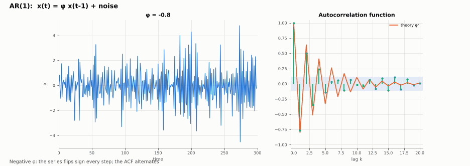
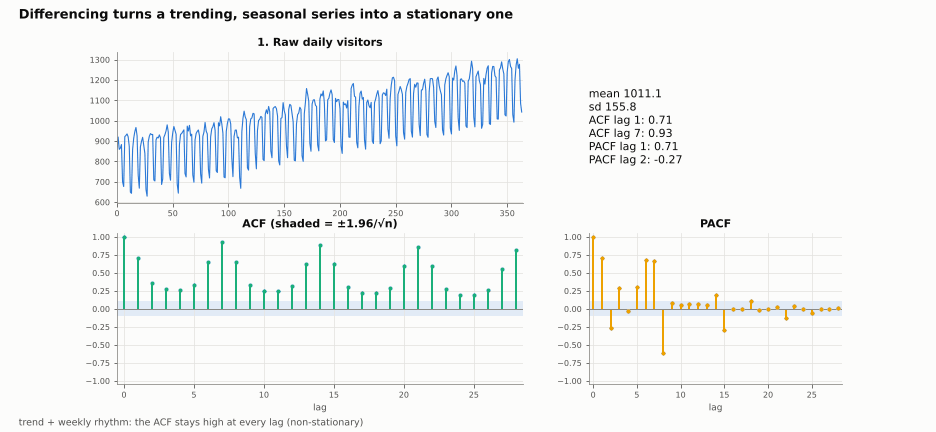
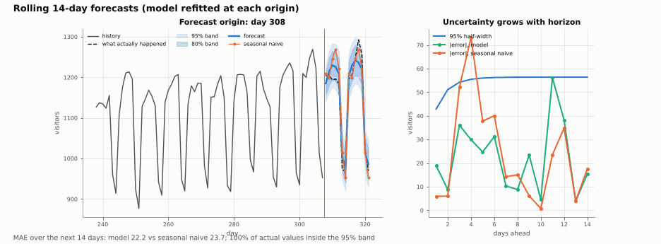

# 07 · Time Series: Autocorrelation, AR, ARMA and ARIMA

> **One line:** in a time series, today's value tells you about tomorrow's; model that memory (autoregression), remove trend and seasonality first (differencing or regression), and forecast with bands that widen the further you look.

## 1. Definition

A **time series** is a sequence of observations ordered in time. The usual random-sample assumption (independent rows) fails: neighbouring values are correlated, so shuffling is illegal and validation must respect time order.

The classical (Box-Jenkins) family models a **stationary** series (constant mean and variance, correlation depending only on the lag):

- **AR(p)** autoregressive: `x_t = c + φ₁x_{t−1} + … + φ_p x_{t−p} + ε_t`
- **MA(q)** moving average: `x_t = c + ε_t + θ₁ε_{t−1} + … + θ_q ε_{t−q}`
- **ARMA(p, q)**: both; **ARIMA(p, d, q)**: ARMA applied after differencing `d` times; **SARIMA(p,d,q)(P,D,Q)ₛ**: plus seasonal terms with period `s`.

Here `ε_t` is **white noise** (independent, mean 0, variance σ²).

**Story in the code.** A news site's daily visitors for 364 days: a steady upward trend (about +1.1 visitors per day), a strong weekly rhythm (weekends are 140-165 below average) and day-to-day momentum (AR(1) noise with `φ = 0.6`, innovation sd 22). The editor wants a 14-day forecast with honest uncertainty to plan servers and ad sales.

## 2. Intuition

Think of a pendulum being nudged randomly: where it is now depends on where it was a moment ago plus a small random push. **AR** captures the inertia. A **moving average** captures the echo of *recent shocks* (a one-off promotion affects today and tomorrow, then vanishes). A series with a trend or season is not "at rest" so we first remove those: **differencing** (`y_t − y_{t−1}`, or `y_t − y_{t−7}`) subtracts the previous period, or we fit them explicitly by regression. What remains should look like stationary noise with some memory, and that is what AR/MA terms describe.

## 3. The math

**Autocorrelation function (ACF).** `ρ_k = Corr(x_t, x_{t−k})`, estimated by `r_k = Σ (x_t − x̄)(x_{t+k} − x̄) / Σ (x_t − x̄)²`. Under white noise `r_k` lies within `±1.96/√n` about 95% of the time (the shaded band).

**Partial ACF (PACF).** The correlation at lag `k` *after* removing the effect of lags 1…k−1 (the last coefficient of an AR(k) fit; computed with the Durbin-Levinson recursion). Identification rules:

| model | ACF | PACF |
|---|---|---|
| AR(p) | decays (geometrically / oscillating) | **cuts off** after lag p |
| MA(q) | **cuts off** after lag q | decays |
| ARMA | decays | decays |

**AR(1).** `x_t = φ x_{t−1} + ε_t`: stationary iff `|φ| < 1`, variance `σ²/(1−φ²)`, `ρ_k = φᵏ` (the orange curve in the first animation). `φ = 1` is a **random walk** (non-stationary; variance grows with `t`; the ACF stays near 1). In general AR(p) is stationary iff the roots of `1 − φ₁z − … − φ_p z^p` lie outside the unit circle.

**Differencing.** Let `B` be the back-shift operator (`B x_t = x_{t−1}`). First difference `(1−B)`, seasonal difference `(1−Bˢ)`. A linear trend becomes a constant after one difference; a stable weekly pattern vanishes after a lag-7 difference. ARIMA(p,d,q): `φ(B)(1−B)ᵈ y_t = c + θ(B) ε_t`.

**Estimation.** AR(p): ordinary least squares of `x_t` on its lags (conditional likelihood) or Yule-Walker. ARMA with MA terms: the errors `ε_t` are unobserved, so compute them recursively and minimise the **conditional sum of squares** `Σ ε_t²` numerically (maximum likelihood is the refined version). **Order selection**: ACF/PACF patterns, then AIC `= n log σ̂² + 2k` or BIC; diagnose the residuals (should be white: no ACF spikes, Ljung-Box test).

**Forecasting.** Multi-step forecasts iterate the model, replacing unknown future shocks by 0. Writing the model as `y_t = Σ ψ_j ε_{t−j}` (the **ψ-weights**, found by a simple recursion), the `h`-step forecast error variance is `σ² Σ_{j<h} ψ_j²`, so the prediction interval `ŷ ± 1.96 sd_h` **widens with the horizon** and, for a stationary model, saturates at the series' own spread; for integrated models (`d ≥ 1`) it keeps growing like `√h`.

**Regression with ARMA errors.** `y_t = (trend + seasonal dummies)·β + u_t`, with `u_t` an ARMA process. Appropriate when the trend and seasonal pattern are stable; seasonal differencing is appropriate when they drift.

## 4. Algorithm (Box-Jenkins workflow)

1. Plot the series; look for trend, seasonality, outliers, level shifts, changing variance (consider a log transform).
2. Make it stationary: difference (and seasonally difference), or regress out trend and season.
3. Inspect ACF and PACF; propose `p` and `q`.
4. Estimate the models, compare AIC/BIC, keep the simplest adequate one.
5. Check residuals are white noise (ACF within the band).
6. Forecast with prediction intervals; **evaluate with rolling origin** (train on days 1..t, forecast `t+1..t+h`, advance `t`) against simple benchmarks such as the seasonal-naive forecast.

## 5. Reading the animations

**`ts_ar1.gif`** (one simulated series per `φ`, sample ACF as stems, theory `φᵏ` in orange)

| φ | what you see | meaning |
|---|---|---|
| −0.8 | zig-zag; the ACF alternates sign | negative feedback |
| 0 | jitter; no ACF outside the shaded band | white noise: no memory |
| 0.8 | smooth wandering; ACF decays like `0.8ᵏ`, matching theory | stationary with memory |
| 1.0 | drifts away (to about −35 within 300 steps); ACF ≈ 1 at every lag | random walk: not stationary |

Check on a long sample (n = 5000, `φ = 0.6`): sample ACF at lags 1-3 `= 0.596, 0.359, 0.218` vs theory `0.6, 0.36, 0.216`; the PACF is `0.596` at lag 1 and about `0.006` afterwards (the AR(1) cut-off).

**`ts_stationary.gif`** (the news-site data)

| Stage | What it shows |
|---|---|
| 1. Raw | trend + weekly cycle: the ACF stays high at every lag (0.71 at lag 1, **0.93 at lag 7**) |
| 2. Seasonal difference `y_t − y_{t−7}` | trend and weekly pattern are gone and the mean is a constant (7.5), but the ACF dips to **−0.57 at lag 7**: a fingerprint of *over*-differencing. Our weekly pattern is stable, so subtracting last week's value also subtracts last week's noise |
| 3. Residuals of trend + day-of-week regression | ACF 0.63, 0.37, 0.22 (geometric decay) and PACF **0.63 at lag 1, then ≈ 0** (−0.03, 0.01, −0.03): a clean **AR(1)** signature, true `φ = 0.6` |

Stage 3's fit: `φ̂ = 0.627`, innovation sd `22.1` (true 22), slope 1.07 (true 1.10). AIC across orders 0-4: 2436.6, **2258.2**, 2258.3, 2252.9, 2255.7: a huge drop from 0 to 1 then a plateau, so AR(1) is the parsimonious choice (differences of 1-6 AIC units among p ≥ 1 are within noise). The differenced route needs a more complicated model (AR order keeps rising: AIC 2485, 2481, 2477, 2479, 2465 for p = 1-5, plus an MA part in a real SARIMA).

**`ts_forecast.gif`** (refit at five forecast origins, 14-day horizon)

| Panel | What to watch | What it means |
|---|---|---|
| Left | grey = history, dashed = what really happened, blue = forecast with 80% and 95% bands, orange = seasonal naive (repeat last week) | the forecast reproduces the weekly shape and trend, with a band that contains the truth |
| Right | the 95% half-width grows with the horizon, from 43 at day 1 to about 56 and flattens (AR(1) is stationary); absolute errors of the model (green) stay below it and are usually below the naive method's (orange) | uncertainty is horizon-dependent; the naive forecast inherits last week's noise |

**Rolling-origin evaluation** (22 origins, 14-day horizon): mean absolute error **22.1** for regression + AR(1), 32.0 for seasonal differencing + AR(2), 32.7 for seasonal naive. The 95% bands contain **95%** of the actual values. Remember a lower error here is partly *because* we know the data are generated with a stable season; on data with an evolving season the ranking can reverse. Always benchmark.

**Verification.** The MA fit recovers `θ = 0.6` as 0.588 from 3000 simulated points; the sample ACF/PACF match theory (above). (statsmodels is not installed in the build environment, so there is no library cross-check for the ARIMA forecasts; these checks use known ground truth instead.)

## 6. Hyper-parameters & knobs

- **Orders `p, d, q`** (and seasonal `P, D, Q, s`): from ACF/PACF and AIC/BIC.
- **Differencing** vs **deterministic trend/season** (regression) vs **log transform** (stabilise the variance).
- **Constant / drift** term, **exogenous regressors** (holidays, promotions: ARIMAX), **forecast horizon**, interval level, **rolling window vs expanding window** for refitting.

## 7. Variants & relatives

- **Exponential smoothing** (simple, Holt, Holt-Winters; ETS state-space form), **STL decomposition**, **Prophet** (trend + seasonality + holidays as a regression), **TBATS** (multiple/complex seasonality).
- **State-space models and the Kalman filter** (local level, local linear trend; ARIMA is a special case), **hidden Markov models** (lesson 30), **GARCH** (changing variance), **VAR / VECM** (several series), **cointegration**.
- **Machine-learning forecasters**: lag features + gradient boosting (lesson 17), RNNs/LSTMs (lesson 20), transformers (lesson 21), Gaussian processes with periodic kernels (lesson 6).
- *Not implemented:* seasonal MA, full maximum likelihood, Kalman filtering, exponential smoothing, exogenous variables.

## 8. Assumptions, strengths & weaknesses

Assumes (after transformation) a stationary, linear, Gaussian-noise process with constant parameters and no structural breaks.

**+** Few parameters, fast, interpretable; honest prediction intervals; strong baseline that is hard to beat on short, regular series; handles trend and seasonality via differencing.
**−** Linear and univariate by default; sensitive to outliers, level shifts and changing variance; seasonal and differencing choices are partly judgement; long horizons collapse to the mean/trend; parameter uncertainty is usually ignored in intervals (they are slightly too narrow in small samples).

**Use** as the first baseline for any forecasting problem with limited history. **Avoid** as the only tool for series with many drivers, non-linear regime changes or thousands of related series (use global ML models).

## 9. Metrics

MAE, RMSE, **MASE** (error relative to the seasonal-naive forecast: < 1 beats the baseline), sMAPE/MAPE (careful near 0), interval **coverage** and width, **pinball loss** for quantiles, residual diagnostics (ACF of residuals, Ljung-Box), all computed with **rolling-origin** (time-series) cross-validation: never random folds.

## 10. Code tour (`arima.py`)

- `acf`, `pacf` (Durbin-Levinson), `diff`, `visitors` (data), `sim_ar1`.
- `fit_ar` (least squares), `aic`, `fit_arma_css` (MA terms by conditional sum of squares).
- `RegAR` - trend + day-of-week regression with AR errors; `SeasonalAR` - seasonal difference + AR with ψ-weight prediction intervals; `seasonal_naive`.
- `ar1_gif`, `stationary_gif`, `forecast_gif`, `main` (rolling evaluation and checks).

Run: `python arima.py` (about 4 s).

## 11. Experiments

1. Make the weekly pattern drift (add a random walk to each weekday effect). Which model wins now: `RegAR` or `SeasonalAR`?
2. Add a level shift of +200 at day 250. How do the forecasts and intervals behave? What does differencing do to a shift?
3. Make the series multiplicative (noise grows with level) and take logs before modelling.
4. Replace AR(1) noise by MA(1) noise and use the ACF/PACF to identify it; then fit `fit_arma_css(…, p=0, q=1)`.
5. Compute the Ljung-Box statistic of the residuals from `RegAR(1)` and from `RegAR(0)`.

## 12. Pitfalls

- Fitting on non-stationary data (spurious correlations, absurd forecasts); **over-differencing** (the ACF dip at lag `s`) is the mirror error.
- Random train/test splits or random k-fold on time series (leakage from the future).
- Reading ACF spikes at high lags as real when 5% will exceed the band by chance.
- Trusting the intervals when parameters, orders and the model itself were chosen on the same data.
- Forgetting benchmarks: a seasonal-naive forecast is often hard to beat by much.
- Extrapolating trends far beyond the data.

**Next:** [08 Logistic regression](../08_logistic_regression/lesson.md) (done) · [20 RNN and LSTM](../20_rnn_lstm/lesson.md) for neural sequence models
