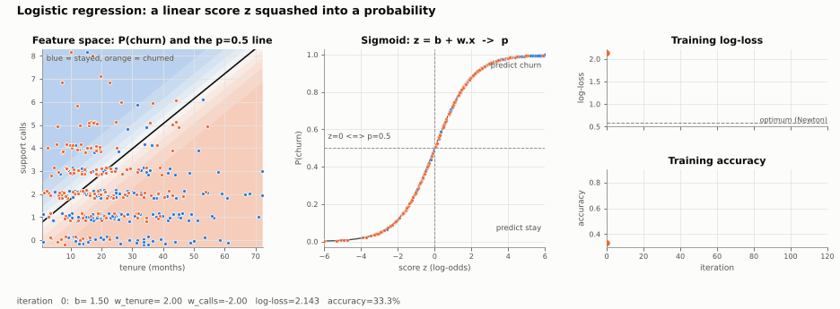
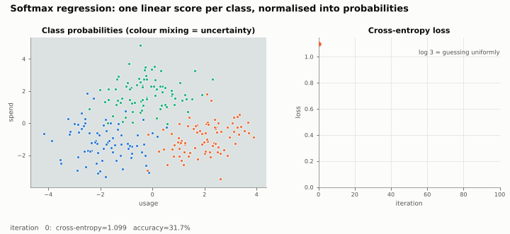

# 08 · Logistic Regression

> **One line:** take a linear score, squash it through a sigmoid to get a probability, and train it with log-loss so that confident mistakes are punished hard.




## 1. Definition

**Logistic regression** is a *supervised* model for **classification**: it outputs the probability that an input belongs to class 1.

```
z = b + w₁x₁ + … + w_d x_d           (the "logit" or log-odds: a linear score)
p = σ(z) = 1 / (1 + e^(−z))          P(y = 1 | x)
ŷ = 1 if p ≥ 0.5 (i.e. z ≥ 0) else 0
```

Despite the name it is a classifier; "regression" refers to the regression on the log-odds: `log(p/(1−p)) = z`. Each weight is the change in log-odds per unit of that feature (`e^w` is an odds ratio).

**Story in the code:** a telecom wants to predict **customer churn** (y=1: customer leaves) from tenure (months) and support calls in the last quarter. The data is deliberately noisy, as in real life, so accuracy tops out around 67%; the model's value lies in its calibrated probabilities. The 3-class extension (**softmax regression**) segments customers by usage and spend.

## 2. Intuition

A linear model draws a line through feature space; the score `z` is a signed, scaled distance from that line. The sigmoid turns distance into confidence: right on the line (`z=0`) is a coin flip (`p=0.5`); far on one side is nearly certain. Training tilts and shifts the line, and makes it "steeper" (larger weights = more confident) only as far as the data justifies.

## 3. The math

**Likelihood.** Treat each label as a Bernoulli draw: `P(yᵢ|xᵢ) = pᵢ^yᵢ (1−pᵢ)^(1−yᵢ)`. Maximising the product over the data is the same as minimising the negative log:

```
J(θ) = −(1/n) Σ [ yᵢ log pᵢ + (1−yᵢ) log(1−pᵢ) ]        (log-loss / binary cross-entropy)
```

**Gradient** (a famous, tidy result - the sigmoid's derivative `σ' = σ(1−σ)` cancels):

```
∂J/∂θ = (1/n) Aᵀ (p − y)           (A = design matrix with a column of ones)
```

Identical in form to linear regression's gradient, but with `p = σ(Aθ)` in place of `Aθ`. The error `pᵢ − yᵢ` is the signed probability miss.

**Why not MSE?** With MSE, the gradient with respect to the score is `2(p−y)·p(1−p)`. For a confidently wrong example (`y=1`, `z=−6`) the factor `p(1−p)≈0.0025` kills the gradient: the code prints `dMSE/dz = −0.005` against `dLogLoss/dz = −0.9975`. Log-loss keeps a strong gradient exactly where the model is most wrong; MSE would also make the loss surface non-convex. **Log-loss is convex**, so there is a single global optimum.

**Newton / IRLS (second order).** The Hessian is `Aᵀ S A / n` with `S = diag(pᵢ(1−pᵢ))`. The update `θ ← θ − H⁻¹ ∇J` converges in a handful of iterations. The code runs both gradient descent and Newton and they agree to 3 decimals (θ = [−0.071, −0.778, 0.847]), which also matches scikit-learn.

**L2 regularisation.** Add `λ‖w‖²/2` (not on the intercept). Needed when the classes are perfectly separable (otherwise weights grow without bound). In the code `|w|` falls from 1.15 (λ=0) to 0.96 (λ=10) to 0.45 (λ=100).

**Softmax regression (k classes).** One score per class `zₖ = wₖ·x + bₖ`; probabilities `pₖ = e^zₖ / Σⱼ e^zⱼ`; loss = cross-entropy `−Σ log p_{true class}`; gradient `Aᵀ(P − Y)/n` with `Y` one-hot. Binary logistic regression is the k=2 special case.

## 4. Algorithm (batch gradient descent)

1. Standardise features; initialise `θ` (zeros).
2. Compute scores `z = Aθ` and probabilities `p = σ(z)`.
3. Compute log-loss and the gradient `Aᵀ(p−y)/n` (+ `λθ` if regularised).
4. Update `θ ← θ − η·gradient`. Repeat until the loss plateaus.
5. Choose a decision threshold for the business need (see section 9).

## 5. Reading the animation

**`logistic_regression.gif`**

| Panel | What to watch | What it means |
|---|---|---|
| Left: feature space | the heat-map (blue = stay, orange = churn) and the black 0.5-line swing from a wrong start into the diagonal that separates short-tenure/high-call customers | the boundary is where `z=0`; colour fades gradually because the model gives probabilities |
| Middle: sigmoid | customers sit on the S-curve at their `z`; early on the cloud is mixed, later churners cluster right, stayers left | training pushes classes to opposite sides of `z=0` |
| Right: log-loss & accuracy | loss falls quickly and flattens at the Newton optimum (dashed line); accuracy jumps then stays ~67% | after that no weights can reduce loss further: the noise is irreducible |

**`softmax_regression.gif`**: three half-planes meet at a point; colours blend near the borders (uncertainty). Final accuracy 92.5%, cross-entropy 0.174 (`log 3 = 1.099` is the loss of guessing uniformly, where the loss starts).

## 6. Hyper-parameters & knobs

- **Learning rate** (gradient descent): too big → loss oscillates; Newton needs none.
- **Iterations / tolerance**, **L2 strength `λ`** (bigger = smoother, smaller weights, less confident).
- **Decision threshold** (not a training parameter): move it away from 0.5 to trade precision for recall.
- **Class weights** for imbalanced data. **Feature scaling** for faster, more stable optimisation.

## 7. Variants & relatives

- **Multinomial vs one-vs-rest**: softmax (implemented) vs training k binary models.
- **Ordinal logistic regression** for ordered classes; **Poisson / Tweedie GLMs** for counts and positive amounts (same family: *generalised linear models* with different link functions).
- **L1-regularised logistic regression** for sparse feature selection; **polynomial/interaction features** for curved boundaries; **kernel logistic regression**.
- A neural network's output layer is a (softmax) logistic regression on learned features (lesson 18).
- **Probit** model: same idea with the Gaussian CDF instead of the sigmoid.

## 8. Assumptions, strengths & weaknesses

Assumes a linear log-odds boundary, independent observations, little multicollinearity, and enough samples per feature.

**+** Fast, convex (unique optimum), calibrated probabilities, interpretable (odds ratios), strong baseline, works with regularisation in high dimensions.
**−** Only linear boundaries unless features are engineered; sensitive to outliers in features; separable data → infinite weights without regularisation; probabilities can be miscalibrated if the model is misspecified.

**Use** for risk scoring, churn, click-through, medical triage. **Avoid** as the final model when the boundary is highly non-linear (use trees, SVM, neural networks).

## 9. Metrics

- **Log-loss** (the training objective; evaluates the probabilities themselves).
- **Accuracy** - misleading with imbalance (see lesson 02).
- **Precision / recall / F1** at a threshold. Code table: threshold 0.3 → precision 0.52, recall 0.81; 0.5 → 0.66 / 0.58; 0.7 → 0.85 / 0.30. Lower thresholds catch more churners (recall) at the cost of false alarms.
- **ROC-AUC, PR-AUC**, **calibration curve** (when predicted 30% really means 30%).

## 10. Code tour (`logistic_regression.py`)

- `log_loss` - numerically safe cross-entropy.
- `LogisticRegression` - `decision_function`, `predict_proba`, `predict(threshold)`, `fit_gd`, `fit_newton`, optional `l2`.
- `SoftmaxRegression` - multi-class version.
- `precision_recall` - threshold table.
- `churn_animation`, `softmax_animation`, `main` (also prints the scikit-learn check).

Run: `python logistic_regression.py` (about 10 s).

## 11. Experiments

1. Use `lr=5` in `fit_gd`. What does the loss curve do?
2. Make the classes perfectly separable (increase the cluster gap) and watch `|w|` grow without bound at `l2=0`; then add `l2=1`.
3. Duplicate a feature column and observe the weights split (collinearity) without changing the loss.
4. Move the threshold to 0.2 and compute the confusion matrix. Which business cost makes that the right choice?
5. Fit with MSE loss instead of log-loss on data with a few mislabelled points; compare convergence.

## 12. Pitfalls

- Reporting accuracy on imbalanced data; always check the base rate (here churn is 49%, so 67% beats the baseline but modestly).
- Interpreting weights as causal, or comparing them across unscaled features.
- Perfect separation → exploding weights.
- Using 0.5 as the threshold by default.
- Treating the output as a calibrated probability after heavy regularisation or class re-weighting without checking.

**Next:** [09 k-nearest neighbours](../09_knn/lesson.md)
