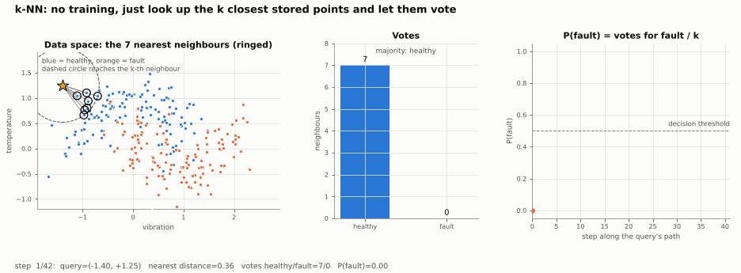
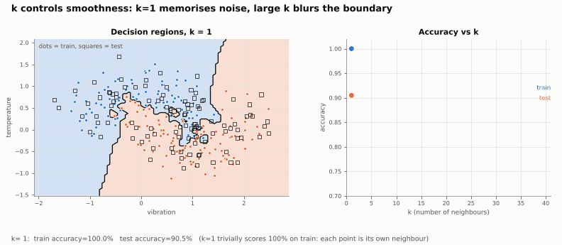
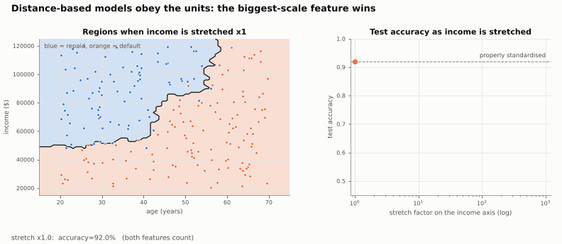

# 09 · k-Nearest Neighbours (kNN)

> **One line:** to classify a new point, find the k most similar stored points and let them vote; there is no training, the data *is* the model.





## 1. Definition

**k-nearest neighbours** is a *supervised*, **non-parametric**, **instance-based** (lazy) learner for classification and regression. Given a query `x`:

1. compute the distance from `x` to every stored training point,
2. take the `k` closest,
3. **classification**: return the majority class (or class probabilities = vote fractions); **regression**: return the (weighted) mean of their targets.

**Story in the code:** a factory machine has two sensors (vibration, temperature); every past reading is labelled *healthy* or *fault*. A new reading is judged by the 7 most similar past readings. A second dataset (age in years, income in dollars → default / regular) shows why scaling matters.

## 2. Intuition

"Tell me who your neighbours are and I'll tell you who you are." A doctor who diagnoses a patient by recalling the most similar past patients is doing kNN. The decision boundary is not drawn by an equation; it emerges from where the labelled points lie.

## 3. The math

**Distances** (for `x, x' ∈ ℝᵈ`):

```
Euclidean (L2):  √Σ (xⱼ − x'ⱼ)²           Manhattan (L1): Σ |xⱼ − x'ⱼ|
Chebyshev (L∞):  maxⱼ |xⱼ − x'ⱼ|          Minkowski(p):  (Σ |xⱼ − x'ⱼ|ᵖ)^(1/p)
```

**Classification rule:** `ŷ(x) = argmax_c Σ_{i ∈ N_k(x)} wᵢ · 1[yᵢ = c]`, with `wᵢ = 1` (uniform) or `wᵢ = 1/dᵢ` (distance-weighted). `P̂(c|x)` = normalised weighted vote.

**Regression:** `ŷ(x) = Σ wᵢ yᵢ / Σ wᵢ`.

**Why it works (Cover-Hart, 1967):** as `n → ∞` the 1-NN error is at most twice the Bayes error (the best possible); with `k → ∞` and `k/n → 0`, kNN approaches the Bayes error. It is a "local averaging" estimator.

**Bias-variance of `k`:** `k = 1` has zero bias on training data but huge variance (every noisy point carves its own island). Large `k` averages more points (low variance) but blurs real structure (high bias); `k = n` predicts the global majority.

**Curse of dimensionality.** In high dimensions all points become almost equally far apart. The code measures the contrast `(d_max − d_min)/d_min` from a random query among 1000 uniform points: 2575 at d=1, 7.5 at d=5, 0.76 at d=50, 0.12 at d=1000. When the nearest and farthest neighbours are almost the same distance, "nearest" stops being meaningful.

**Cost.** Training is free (store data, `O(nd)` memory). Brute-force prediction costs `O(nd)` per query. A **kd-tree** recursively splits space along one coordinate so whole regions can be skipped: in the code, d=2 needs 27 distance evaluations instead of 20000, d=5 about 265, but d=12 needs 19064 (almost brute force), another face of the curse.

## 4. Algorithm

1. Choose `k`, a distance, and a weighting. **Scale features** (see below).
2. Store the training set (optionally build a kd-tree / ball-tree).
3. For a query: compute distances, select the `k` smallest.
4. Vote (classification) or average (regression); break ties by distance or smaller `k`.
5. Choose `k` and the metric by cross-validation, never by training accuracy.

## 5. Reading the animations

**`knn_query.gif`**

| Panel | What to watch | What it means |
|---|---|---|
| Data space | a query (star) travels across the sensor map; its 7 nearest neighbours are ringed and the dashed circle shows the radius that reaches the k-th neighbour | the circle is small in dense regions, large in sparse ones: kNN adapts locally |
| Votes | a bar chart of healthy vs fault votes (7/0 → 3/4 → 0/7) | the prediction is the taller bar |
| P(fault) along the path | a staircase rising from 0 to 1, crossing the 0.5 threshold near the class border | probabilities are quantised in steps of 1/k |

**`knn_k_sweep.gif`**: boundary for `k = 1 … 40`. At `k=1` the regions are ragged islands, train accuracy 100% (each point is its own neighbour) but test 90.5%. Test accuracy peaks at **k=4 (94.3%)**; by `k=40` the boundary is smooth but too simple and train accuracy has dropped to 90.8%.

**`knn_scaling.gif`**: stretching the income axis (e.g. dollars → thousandths of dollars) changes nothing about the people, but accuracy falls from **92.0% to 64.3%** because income dominates the distance and age is effectively ignored (horizontal stripes appear in the regions). Distance-based models obey the units.

## 6. Hyper-parameters & knobs

- **`k`**: small = flexible/noisy; large = smooth/biased. Rule of thumb: start near `√n`, use odd `k` for binary problems, tune by CV.
- **Distance metric**: euclidean 0.938, manhattan 0.938, chebyshev 0.925 on the demo. Use Manhattan for many sparse features, cosine for text/embeddings, Mahalanobis for correlated features.
- **Weights**: with `k=15` distance weighting scored 0.938 vs 0.931 uniform; with `k=40` 0.925 vs 0.906. Weighting helps most when `k` is large.
- **Feature scaling** (standardise or min-max) and **feature selection** (irrelevant features add distance noise).
- **Search structure**: brute force, kd-tree, ball-tree, or approximate (HNSW, FAISS) for millions of points.

## 7. Variants & relatives

- **Radius neighbours**: vote among all points within distance `r` instead of a fixed `k`.
- **Nearest centroid** and **learning vector quantisation**: keep a few prototypes instead of all points.
- **Condensed / edited nearest neighbour**: prune redundant or noisy stored points.
- **Metric learning** (LMNN, NCA): learn the distance so neighbours share labels.
- **kNN regression** (in the code): MSE vs the true sine is 0.097 at `k=1`, **0.012 at k=5**, 0.042 at `k=20`: the same bias-variance U-shape.
- **Kernel regression / Nadaraya-Watson** is the smooth cousin of weighted kNN; **kNN imputation**, **kNN anomaly scores** and **LOF** (lesson 29) reuse the same idea.

## 8. Assumptions, strengths & weaknesses

Assumes that nearby points tend to share labels (smoothness) and that the distance is meaningful.

**+** No training; trivially handles multiclass; very flexible boundaries; few hyper-parameters; easy to explain ("these are the 7 most similar cases").
**−** Slow prediction and large memory for big data; useless in high dimensions or with many irrelevant features; sensitive to scaling; sensitive to class imbalance (the majority dominates votes); no insight into feature importance.

**Use** with small/medium, low-dimensional, well-scaled data, as a baseline, or for recommenders/embedding search. **Avoid** with hundreds of raw features or strict latency requirements without an index.

## 9. Metrics

Test accuracy / F1 / log-loss for classification (probabilities are coarse: multiples of 1/k), MSE/MAE for regression, always with cross-validation over `k`. Look at train-vs-test gap: `k=1` → 100% vs 90.5% shows overfitting.

## 10. Code tour (`knn.py`)

- `KNN` - `fit` (stores data), `predict`, `predict_proba`, regression mode, three metrics, uniform/distance weights.
- `KDTree` - small kd-tree with nearest-neighbour search that counts distance evaluations.
- `machine_data`, `scaling_data` - synthetic datasets.
- `query_animation`, `k_sweep_animation`, `scaling_animation` - the three GIFs; `demos()` prints the numeric experiments and a scikit-learn agreement check (100%).

Run: `python knn.py` (about 20 s).

## 11. Experiments

1. Add 20 pure-noise features to the machine data and plot accuracy vs number of noise features.
2. Change the class balance to 95/5 and watch the votes; try distance weighting and a lower decision threshold.
3. Replace Euclidean with Mahalanobis distance on strongly correlated features.
4. Time brute force vs kd-tree for `n = 10⁴, 10⁵` at `d = 3` and `d = 15`.
5. Use `k` chosen by 5-fold CV and compare to the best test `k=4`.

## 12. Pitfalls

- Forgetting to scale features, or fitting the scaler on test data.
- Selecting `k` using the test set or with leave-one-out including the point itself (`k=1` looks perfect).
- High dimensions without dimensionality reduction (lesson 26).
- Ties in voting and class imbalance.
- Serving cost: every prediction touches the whole data set.

**Next:** [10 Naive Bayes](../10_naive_bayes/lesson.md)
