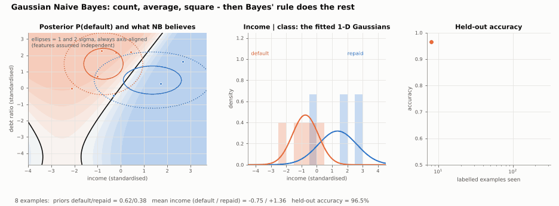
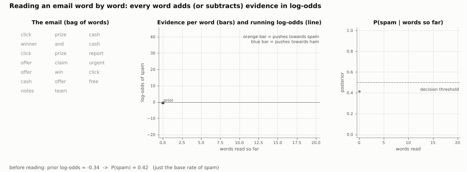

# 10 · Naive Bayes

> **One line:** apply Bayes' rule, and assume features are independent *given the class*, so the model reduces to counting and multiplying simple per-feature probabilities.




## 1. Definition

**Naive Bayes (NB)** is a *supervised* **generative** classifier. It models how each class generates data, `P(x | class)`, and then inverts it with Bayes' theorem to get `P(class | x)`.

```
P(c | x)  =  P(c) · P(x | c) / P(x)          (Bayes' rule)
          ∝  P(c) · Π_j P(x_j | c)           (the "naive" independence assumption)
ŷ = argmax_c [ log P(c) + Σ_j log P(x_j | c) ]
```

Two flavours are implemented:

1. **Gaussian NB** - continuous features, each modelled by a per-class normal distribution. *Story:* a bank scores loan applicants from (income, debt-to-income ratio) into *repay* / *default*.
2. **Multinomial NB** - word counts. *Story:* a spam filter on a small synthetic vocabulary: each email is a bag of words drawn from a "spam" or "ham" word distribution.

## 2. Intuition

A detective weighing evidence. Each clue (a word, a measurement) independently nudges the odds toward one suspect. The word "win" multiplies the odds of spam; "deadline" multiplies the odds of ham. The final belief is the prior odds times the product of all clue likelihood ratios. The email animation draws exactly this: each word adds a bar to the running log-odds.

"Naive" because clues are rarely truly independent ("free" and "win" often appear together), but the classifier needs only the *ranking* of the class scores to be right, not the probabilities to be exact.

## 3. The math

**Training = counting.**

```
Prior:                 P(c) = n_c / n
Gaussian NB:           μ_cj = mean of feature j in class c,   σ²_cj = its variance
                       P(x_j | c) = 1/√(2πσ²_cj) · exp( −(x_j − μ_cj)² / (2σ²_cj) )
Multinomial NB:        P(word w | c) = (count of w in class-c mail + α) / (total words in class c + α·V)
```

`V` is the vocabulary size and `α` is **Laplace (additive) smoothing**. Without it a word never seen in a class gets probability 0 and wipes out the whole product. The code shows it: "deadline" occurs 0 times in spam mails, so with `α=0` the log-probability of a spam mail containing it is `−1.8e308` (impossible); with `α=1` it is `−37.7`.

**Log space.** Multiplying hundreds of small probabilities underflows (the code: a product of 400 word probabilities prints `0.0`, while the sum of logs is `−1193.2`). So scores are summed logs, and probabilities are recovered with a **log-sum-exp / softmax**.

**Decision boundary.** For Gaussian NB with *equal* variances across classes the boundary is linear (like LDA with diagonal covariance); with unequal variances it is quadratic, as in the animation's curved line. Multinomial NB is a linear classifier in the word counts: the log-odds equal `b + Σ_w count_w · log(P(w|spam)/P(w|ham))`.

**Why it works despite being wrong.** Independence makes the density estimate poor, but classification only needs the correct class to have the highest score. Dependence mostly makes probabilities overconfident; the ordering often survives. The code demonstrates the overconfidence: duplicating the income feature 3 times (pure redundancy, counted three times) lowers accuracy from **94.0% to 91.5%**, raises mean confidence from 0.874 to 0.937 and worsens log-loss from 0.179 to 0.245.

## 4. Algorithm

1. For each class: compute the prior and per-feature statistics (mean/variance, or smoothed word frequencies).
2. For a new `x`: compute `log P(c) + Σ_j log P(x_j | c)` for every class.
3. Predict the class with the largest score; convert to probabilities with softmax if needed.

Training is a single pass over the data: `O(n·d)`. Prediction is `O(d·k)`.

## 5. Reading the animations

**`naive_bayes.gif`** - labelled applicants arrive and the model is refitted after each batch.

| Panel | What to watch | What it means |
|---|---|---|
| Posterior map | orange/blue ellipses (1 and 2 σ) are *axis-aligned* and shift and settle as data arrive; the black line is `P(default)=0.5` | independence → no tilted ellipses; the boundary is curved because class variances differ |
| Marginal densities | the fitted 1-D Gaussians over income histograms | each class's "story" for one feature |
| Held-out accuracy | jumps within the first dozen examples, ends at **94.0%** with 300 | counting needs very little data: a low-variance model |

**`naive_bayes_email.gif`** - an email is read word by word.

| Panel | What to watch |
|---|---|
| Email | the current word is boxed; orange words push toward spam, blue words toward ham |
| Evidence bars + running line | bar = `log P(word|spam) − log P(word|ham)`; the black line is the running log-odds (starting at the prior, −0.34) |
| P(spam) | climbs from 0.42 to ~1.0 after a few words ("click", "prize", "cash"); the final ham-ish words ("team", "notes") cannot undo the evidence |

Honest caveat: the synthetic vocabularies are well separated, so the test accuracy is 100% for every `α` from 0.01 to 20. Smoothing matters in the zero-count case above, not in this accuracy table; real mail needs larger vocabularies and has overlapping word distributions.

## 6. Hyper-parameters & knobs

- **`α`** (Laplace smoothing): 0 = trust counts blindly (zeros are fatal); 1 = standard; larger = flatter, closer to the prior. Tune by CV.
- **`var_smoothing`** (Gaussian NB): a small value added to variances so a near-constant feature does not give an infinite density.
- **Priors**: learned from class frequencies, or set by hand to reflect deployment base rates or costs.
- **Feature type**: binary (Bernoulli NB) vs counts vs TF-IDF; continuous features may be binned or transformed to look Gaussian.

## 7. Variants & relatives

- **Bernoulli NB** - word present/absent; **Complement NB** - good for imbalanced text; **Categorical NB** for discrete features. (Only Gaussian and Multinomial are implemented here.)
- **Tree-augmented NB, AODE, Bayesian networks** - relax independence by adding dependencies.
- **Generative vs discriminative**: logistic regression models `P(c|x)` directly and typically wins with lots of data; NB reaches its (higher) error faster with little data (Ng & Jordan, 2001).
- **LDA/QDA** (lesson 11) model joint Gaussians with full covariance.

## 8. Assumptions, strengths & weaknesses

Assumes conditional independence of features given the class and a suitable per-feature distribution.

**+** Extremely fast to train and predict; works with tiny data and huge dimensionality (text); handles missing features by skipping them; naturally multiclass; easy to update online; interpretable per-feature evidence.
**−** Probabilities are poorly calibrated (over-confident, 0/1); correlated features are double counted; cannot learn feature interactions; Gaussian marginals can be a poor fit.

**Use** for text classification (spam, topics, sentiment), quick baselines, small-data diagnosis. **Avoid** when you need calibrated probabilities from heavily correlated features (add calibration or use logistic regression).

## 9. Metrics

Accuracy/F1 for decisions, **log-loss and calibration curves** for probabilities (NB is where they disagree most), ROC/PR-AUC for ranking, per-class precision/recall for imbalanced mail.

## 10. Code tour (`naive_bayes.py`)

- `GaussianNB`, `MultinomialNB` - `fit`, `log_joint`, `predict_proba`, `predict`.
- `loan_data`, `make_emails` - the synthetic datasets.
- `gaussian_animation`, `email_animation` - the GIFs. `demos` prints the smoothing, underflow and duplicated-feature experiments and a scikit-learn agreement check (100% for both models).

Run: `python naive_bayes.py` (about 10 s).

## 11. Experiments

1. Make the spam/ham word distributions overlap (mix 30% of ham probabilities into spam) and re-run the `α` table.
2. Duplicate a feature 10 times and watch the confidence saturate.
3. Replace the Gaussian assumption with a log-transform of income. Does accuracy change?
4. Set a prior of 0.01 for spam and see how many spam mails slip through. What threshold would restore recall?
5. Remove Laplace smoothing and classify a mail containing a word unseen in training.

## 12. Pitfalls

- Zero probabilities (no smoothing) and floating-point underflow (no logs).
- Trusting NB's probabilities; use them for ranking or calibrate them.
- Highly redundant features (many near-duplicate columns) inflate confidence.
- Using Gaussian NB on skewed or discrete features without transformation.
- A mismatch between training class frequencies and deployment frequencies.

**Next:** [11 LDA & QDA](../11_lda_qda/lesson.md)
