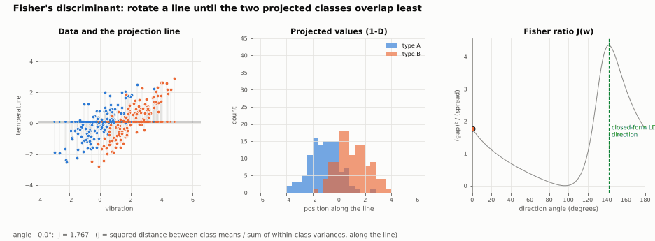
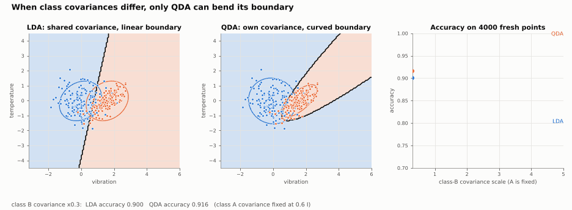

# 11 · Linear & Quadratic Discriminant Analysis (LDA / QDA)

> **One line:** model each class as a Gaussian, then let Bayes' rule decide; sharing one covariance gives a straight boundary (LDA), giving each class its own gives a curved one (QDA). LDA is also Fisher's "best separating direction".




## 1. Definition

Both are *supervised*, **generative** classifiers (they model `P(x | class)`), and LDA is additionally a *dimensionality-reduction* method.

```
P(x | class k) = N(x; μ_k, Σ_k)             P(k | x) ∝ π_k · N(x; μ_k, Σ_k)
LDA:  Σ_k = Σ  (same for all classes)       QDA:  every Σ_k is free
```

**Story in the code.** A plant has two machine types, each described by two sensor readings (vibration, temperature) that move together (correlated). We (a) find the 1-D direction that best separates the types, and (b) classify new machines.

## 2. Intuition

*Fisher's view:* shine a light on the 2-D cloud and look at the shadow on a line. Rotate the line until the two classes' shadows overlap the least: far-apart means, narrow spreads. *Bayes' view:* each class is an elliptical cloud; assign a point to the cloud under which it is most probable (after weighting by how common the class is). If the clouds have the same shape (LDA) the dividing curve is a line; if they differ in size/orientation (QDA) it bends around the tighter cloud.

## 3. The math

**Gaussian log-score** (the class with the largest wins):

```
δ_k(x) = log π_k − ½ log|Σ_k| − ½ (x − μ_k)ᵀ Σ_k⁻¹ (x − μ_k)           (QDA: quadratic in x)
```

With a common `Σ`, the terms `xᵀΣ⁻¹x` and `log|Σ|` are identical for all classes and cancel, leaving a **linear** score:

```
δ_k(x) = xᵀ Σ⁻¹ μ_k − ½ μ_kᵀ Σ⁻¹ μ_k + log π_k
```

The LDA boundary between two classes is the hyperplane `wᵀx + b = 0` with `w = Σ⁻¹(μ₁ − μ₀)`.

**Estimation.** Priors `π_k = n_k/n`; means = class averages; QDA: per-class sample covariance; LDA: pooled within-class covariance `Σ_w = Σ_k (n_k−1) S_k / (n − K)`.

**Fisher's criterion.** For a projection direction `w`, maximise

```
J(w) = (wᵀ(μ₁ − μ₀))² / (wᵀ S_w w) = (between-class gap)² / (within-class spread)
```

Setting the derivative to zero gives `w* ∝ S_w⁻¹(μ₁ − μ₀)` - *exactly* the LDA boundary normal, so Fisher's geometric idea and the Gaussian-Bayes idea coincide. In the run, the closed-form direction (142.0°) equals the maximum of a brute-force scan over 361 angles; `J = 4.36` there, against `1.52` when projecting on the naive mean-difference direction (which ignores that the sensors are correlated).

**K classes.** The directions are the top eigenvectors of `S_w⁻¹ S_b` (`S_b` = between-class scatter): at most `K − 1` useful components. `LDA.transform` implements this (the demo projects a 4-D, 3-class set to 2-D).

**Parameter count.** LDA: `K·d` means + `d(d+1)/2` covariance. QDA: `K·d` + `K·d(d+1)/2`. QDA needs far more data in high dimensions.

**Regularised discriminant analysis (RDA).** Shrink each covariance toward a scaled identity: `Σ_reg = (1−γ)Σ + γ·(tr Σ / d)·I`; interpolating between QDA, LDA and nearest-centroid. Implemented via `reg`.

## 4. Algorithm

1. Estimate priors, class means, and the (pooled or per-class) covariance(s).
2. For a new `x` compute each class's score `δ_k(x)` (use `slogdet` and linear solves, not explicit determinants).
3. Predict `argmax_k δ_k`; probabilities = softmax of the scores.
4. (LDA as reducer) project onto the top eigenvectors of `S_w⁻¹S_b`.

No iteration: training is a single pass of averaging and a matrix inverse.

## 5. Reading the animations

**`lda_fisher.gif`**

| Panel | What to watch | What it means |
|---|---|---|
| Data and projection line | the black line rotates; each point is projected onto it (thin grey connectors) | the 1-D "shadow" of the 2-D data |
| Histograms | at 0° the classes overlap a lot; at ~93° they are on top of each other (J≈0); at 142° they are cleanly separated | separation depends entirely on the direction |
| Fisher ratio J(w) | the curve is traced out by the rotation: low at 93°, a tall peak at 142° where the dashed green line (closed form) lands | the analytic LDA direction is the optimum |

**`lda_vs_qda.gif`** - class A fixed (spherical); class B's covariance grows from ×0.3 to ×5.

| Panel | What to watch |
|---|---|
| LDA | the boundary remains a straight line whatever happens; the fitted ellipses (identical shape) cannot match the data |
| QDA | the boundary curves around the small class A; ellipses match each class |
| Accuracy | both start about equal (0.900 vs 0.916 at ×0.3), LDA falls to **0.759**, QDA stays at **0.861** at ×5 |

On the original machine data (equal covariances by construction) the two reach the same test accuracy (0.916): QDA's extra flexibility costs nothing but also gains nothing. With only 30 training points, heavy shrinkage hurt (0.908 → 0.797), so the right amount of regularisation is a tuning question.

Our LDA and QDA agree with scikit-learn on 100% of test predictions.

## 6. Hyper-parameters & knobs

- **LDA vs QDA** - decided by CV, or by comparing covariance matrices (Box's M test).
- **Shrinkage `reg`** - essential when `n` is small relative to `d` or features are collinear.
- **Priors** - set to class frequencies, or tuned to shift the decision threshold.
- **Number of discriminant components** (≤ `K − 1`).

## 7. Variants & relatives

- **RDA** (implemented as `reg`), **Gaussian naive Bayes** (diagonal covariances, lesson 10), **nearest centroid** (identity covariance).
- **Logistic regression** gives the *same form* of linear boundary but fits it discriminatively; LDA is more efficient when the Gaussian assumption is true, logistic regression is more robust when it is not.
- **Mixture discriminant analysis** (a GMM per class, lesson 25), **kernel / flexible discriminant analysis**, **sparse LDA**.
- **PCA** (lesson 26) maximises variance without labels; **LDA** maximises class separation with labels; the best PCA direction can be useless for classification.
- **Canonical correlation analysis** is the cousin for two sets of variables. *Not implemented: kernel/sparse LDA.*

## 8. Assumptions, strengths & weaknesses

Assumes Gaussian classes (LDA: with equal covariance) and enough samples to estimate the covariance(s).

**+** Closed form, no tuning, fast; works with small data; gives both a classifier and a supervised projection; multiclass natively; probabilistic output.
**−** Sensitive to outliers and non-Gaussian features; LDA cannot model different class shapes; QDA has many parameters; covariance estimates fail when `d > n` unless regularised.

**Use** as a baseline classifier, for visualising labelled data in 2-D (`K−1` components), for small, well-behaved data. **Avoid** with heavy-tailed, categorical or multimodal-per-class features.

## 9. Metrics

Accuracy/F1 and log-loss on held-out data; confusion matrix; ratio of between- to within-class scatter in the projected space; per-class covariance comparison (diagnose LDA vs QDA).

## 10. Code tour (`lda_qda.py`)

- `QDA` - `fit`, `scores`, `predict`, `predict_proba`, `reg` (RDA-style shrinkage).
- `LDA(QDA)` - pooled covariance, `fisher_direction`, `transform` (multi-class projection).
- `fisher_J` - Fisher ratio of a direction.
- `machine_types`, `fisher_animation`, `lda_vs_qda_animation`, `main` (also runs the scikit-learn check).

Run: `python lda_qda.py` (about 10 s).

## 11. Experiments

1. Change the machine data so classes have *different* covariances; confirm QDA overtakes LDA on the test set.
2. Use `d = 20` with `n = 30`: what happens to QDA and to LDA with `reg = 0` and `reg = 0.5`?
3. Add an outlier far from both classes. How far does the LDA boundary move?
4. Compare the LDA direction with PCA's first direction on data where the high-variance axis is *not* the discriminative one.
5. Shift the priors to 90/10 and watch the boundary move toward the rare class.

## 12. Pitfalls

- Using LDA when class covariances differ greatly (it silently underfits).
- Inverting a singular covariance (use shrinkage or a pseudo-inverse).
- Reading discriminant directions as "importance" when features are correlated.
- Fitting the projection on all data before cross-validating (leakage).

**Next:** [12 Perceptron](../12_perceptron/lesson.md)
