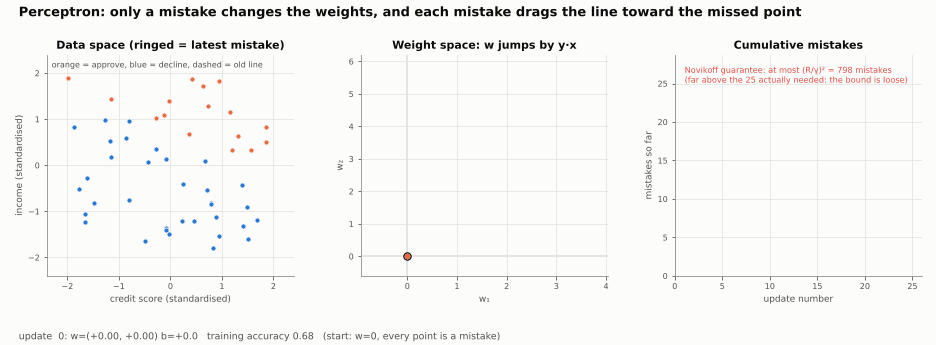
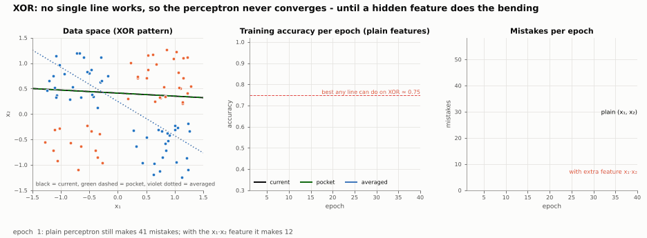

# 12 · The Perceptron

> **One line:** the oldest learning machine: look at one example, and only if you get it wrong, add (or subtract) that example to the weights. On separable data it provably stops.




## 1. Definition

The **perceptron** (Rosenblatt, 1958) is a *supervised* **linear binary classifier**:

```
ŷ = sign(w·x + b)            labels y ∈ {+1, −1}
```

It is a single artificial neuron with a hard threshold. Training is **online and mistake-driven**:

```
if y_i (w·x_i + b) ≤ 0:        # misclassified (or exactly on the line)
        w ← w + y_i x_i
        b ← b + y_i
```

**Story in the code.** A bank screens loan requests from two standardised scores (credit score, income); past decisions are approve (+1) / decline (−1). The true rule is linear but does *not* pass through the origin, so the bias matters.

## 2. Intuition

The weight vector `w` is the normal (perpendicular) of the decision line. If a point `x` with label `+1` lies on the wrong side, adding `x` to `w` rotates the line so that `x` is pointing more *along* `w` (its score `w·x` rises by `‖x‖² > 0`). For a `−1` point we subtract. Correct points are left alone. Every mistake pulls the line toward the point it got wrong; it is like nudging a seesaw each time a kid is on the wrong side.

## 3. The math

**Effect of an update on the offending point.** After `w' = w + y x`: `y·(w'·x) = y(w·x) + ‖x‖²`: the margin of that point strictly improves (though other points may get worse).

**Perceptron convergence theorem (Novikoff, 1962).** Suppose the data are linearly separable with margin `γ`: there is a unit vector `w*` (bias absorbed by appending a constant 1 to every `x`) such that `y_i (w*·x_i) ≥ γ` for all `i`, and `‖x_i‖ ≤ R`. Then the perceptron makes at most

```
(R / γ)²
```

mistakes, regardless of the order of the data or the number of samples. Proof sketch: each mistake increases `w·w*` by at least `γ`, so after `k` mistakes `w·w* ≥ kγ`; but it increases `‖w‖²` by at most `R²` (the cross term `2y w·x ≤ 0` on a mistake), so `‖w‖² ≤ kR²`. Cauchy-Schwarz gives `kγ ≤ w·w* ≤ ‖w‖ ≤ √k R`, hence `k ≤ (R/γ)²`.

In the run: `R = 2.93`, the true rule has margin `γ = 0.104`, so the guaranteed bound is 798 mistakes; the perceptron actually needed **25**. The bound is loose but holds, and it shows that the *margin* (not the number of points or dimensions) controls difficulty; this idea reappears in SVMs (lesson 13).

**Loss view.** The update is stochastic sub-gradient descent on the *perceptron loss* `max(0, −y(w·x+b))` with learning rate 1 (the learning rate can be set to 1 without loss of generality because only the direction of `w` matters).

**Non-separable data.** The theorem does not apply. The weights keep changing forever. Three remedies (implemented):

- **Pocket**: remember the weights with the best *training accuracy* seen so far.
- **Averaged**: predict with the average of all weight vectors visited (a cheap, strongly stabilising trick; related to voting by every past hypothesis).
- **Feature expansion**: make the data separable by adding features (e.g. `x₁·x₂`), the motivation for multi-layer networks (lesson 18).

**XOR.** `y = sign(x₁·x₂)` (positive in quadrants I and III) cannot be separated by any line: Minsky and Papert (1969) used this to show single-layer perceptrons are limited.

## 4. Algorithm

1. Initialise `w = 0, b = 0`.
2. Loop over the training points (in order, or shuffled each epoch).
3. For each point, compute `y(w·x + b)`. If `≤ 0`, update `w ← w + yx`, `b ← b + y`.
4. Stop when a full epoch makes no mistakes (separable data) or after a fixed number of epochs.
5. Optionally return the pocket or averaged weights.

## 5. Reading the animations

**`perceptron_learning.gif`** - one frame per update (25 of them).

| Panel | What to watch | What it means |
|---|---|---|
| Data space | the black line jumps after each update; the dashed grey line is the previous one; the ringed point is the mistake just fixed | each update tilts/shifts the line toward the missed case; correct points never trigger a change |
| Weight space | the blue path of `w` zig-zags; each orange segment is the vector `y·x` just added | learning is an additive walk in weight space; `w` is literally a signed sum of training points |
| Cumulative mistakes | rises steadily, then stops at 25 (final accuracy 1.00) | the convergence theorem in action; the red text gives the (loose) guarantee of 798 |

Test accuracy on 300 fresh loans is 0.993, not 1.0, because the perceptron stops at *some* separator, not the most central one (a max-margin separator would be more robust: SVM, lesson 13).

**`perceptron_xor.gif`** - 40 epochs on noisy XOR (100 points).

| Panel | What to watch |
|---|---|
| Data space | the black line (current weights) swings wildly; the green dashed (pocket) and violet dotted (averaged) lines are steadier |
| Accuracy per epoch | the current weights oscillate between about 0.3 and 0.7 (final 0.61); pocket and averaged reach 0.76 and 0.78, close to the best a line can do (≈0.75 on balanced XOR) |
| Mistakes per epoch | the plain perceptron keeps making 35-55 mistakes per epoch forever; with the single extra feature `x₁·x₂` the mistakes fall to **0 from the 4th epoch on** |

## 6. Hyper-parameters & knobs

- **Epochs** (cap on passes). **Shuffling** (reduces order effects; the bound still holds).
- **Learning rate** `η`: irrelevant when `w` starts at 0 (scales all weights equally); matters with non-zero initialisation or the averaged variant.
- **Bias handling** (append a constant 1 feature), **feature scaling** (affects `R`, hence the bound and the speed).
- **Variant choice** (last / pocket / averaged) for noisy data.

## 7. Variants & relatives

- **Margin perceptron / Passive-Aggressive** (update also when the margin is small, with step size set by the margin), **voted perceptron**, **kernel perceptron** (replace `w·x` by a kernel sum over mistakes; sets up the kernel SVM).
- **Multiclass perceptron** (one weight vector per class, update the true and the wrongly predicted class), **structured perceptron** (sequence labelling, parsing).
- **Adaline / delta rule** (gradient descent on squared error of the *linear* output) and **logistic regression** (lesson 08: smooth sigmoid, probabilistic) are the soft cousins.
- **Multi-layer perceptrons** stack many perceptron-like units with differentiable activations and train them by backpropagation (lesson 18).
- *Not implemented:* kernel, multiclass and structured versions.

## 8. Assumptions, strengths & weaknesses

Assumes (for the convergence guarantee) linear separability.

**+** Tiny, fast, online (streams data), no learning rate to tune, a clean theoretical guarantee, easy to implement, sparse updates.
**−** No probabilities; the solution is arbitrary among separators (depends on order); fails to converge on non-separable data; sensitive to noisy labels and outliers; only linear boundaries.

**Use** as a teaching tool, baseline, or in large-scale online linear learning (in its averaged / passive-aggressive forms). **Avoid** when you need calibrated probabilities (logistic regression) or large margins (SVM).

## 9. Metrics

Number of mistakes per epoch (the natural training curve), training/test accuracy, margin of the final separator, and for streaming use the *online mistake rate* (cumulative mistakes divided by examples seen).

## 10. Code tour (`perceptron.py`)

- `Perceptron` - `fit` (with `record=True` to log every update), `predict(kind="last" | "pocket" | "avg")`, `epoch_mistakes`.
- `loan_data` (margin-guaranteed separable loans), `make_xor_points`, `novikoff` (the bound), `draw_line`.
- `learning_animation`, `xor_animation`, `main` (includes a scikit-learn comparison: both reach training accuracy 1.0).

Run: `python perceptron.py` (about 10 s).

## 11. Experiments

1. Shrink `gap` in `loan_data` from 0.1 to 0.03. How do the number of updates and the bound change?
2. Multiply all features by 10. Does the number of mistakes change? (Think: `R/γ` is scale-invariant.)
3. Shuffle each epoch and run 20 seeds: how variable is the number of mistakes?
4. Flip 3 labels (noise). Compare last / pocket / averaged accuracy.
5. On XOR, add `x₁²` and `x₂²` instead of `x₁x₂`. Does that work? Why or why not?

## 12. Pitfalls

- Forgetting the bias term (or the constant feature).
- Expecting convergence on non-separable data, or a unique solution on separable data.
- Using the final weights on noisy data rather than pocket/averaged.
- Interpreting `|w·x + b|` as a confidence; it is not a probability.
- Unscaled features inflating `R` and slowing learning.

**Next:** [13 Support Vector Machines](../13_svm/lesson.md)
