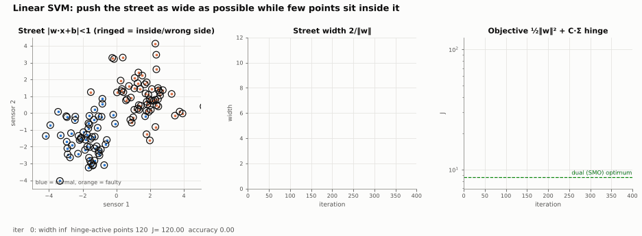
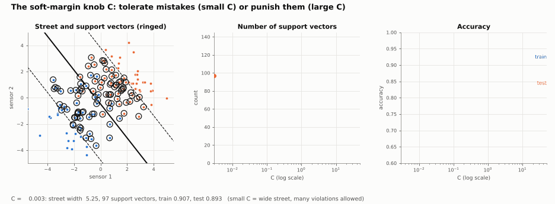
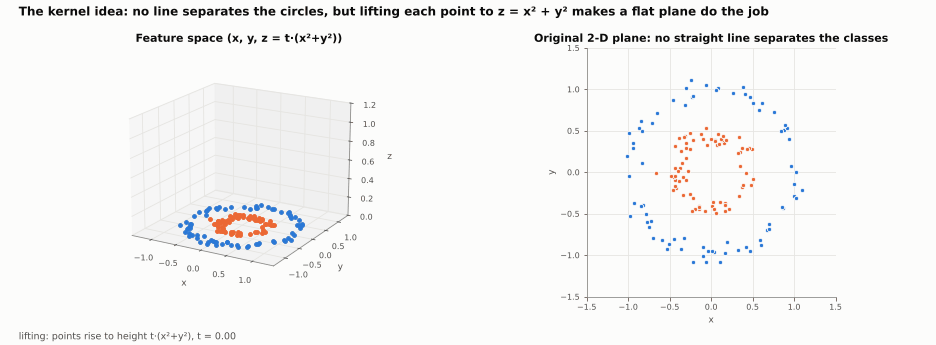
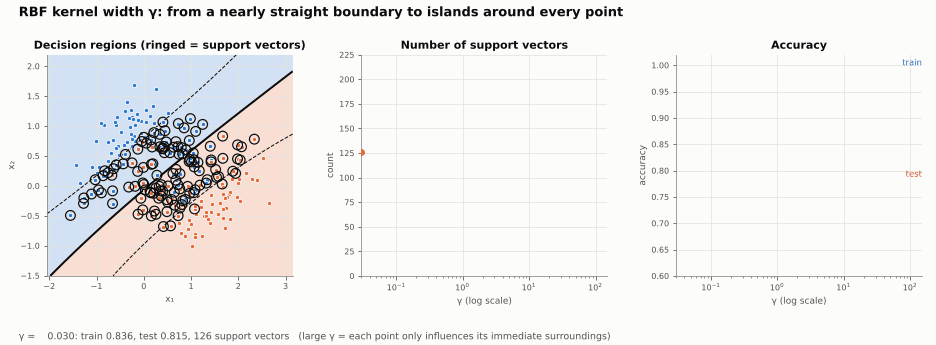

# 13 · Support Vector Machines (SVM)

> **One line:** choose the boundary with the widest empty "street" between the classes; only the points on the street's edges (the support vectors) decide it, and kernels let the same idea draw curved boundaries.






## 1. Definition

An **SVM** is a *supervised* classifier (also usable for regression, **SVR**) that finds the hyperplane `w·x + b = 0` maximising the **margin**, the distance to the closest training points of each class. Labels are `y ∈ {−1, +1}`; prediction is `sign(w·x + b)`.

- **Hard margin**: requires perfect separation. Breaks with overlap or noise.
- **Soft margin** (the standard SVM): allows violations, paying a price `C` per unit of violation.
- **Kernel SVM**: replaces dot products by a kernel `K(x, x')`, which implicitly works in a richer feature space.

**Story in the code.** A lab classifies sensor readings as *normal* (−1) or *faulty* (+1). Two sensor values per reading, with overlapping classes (the realistic soft-margin case), and later ring- and moon-shaped data that need kernels.

## 2. Intuition

Many lines separate two classes. Picture laying a wide road between them: the best line is the centre of the widest road you can fit. A wide road is robust (small shifts of the data do not change the verdict). Only the readings touching the road's edges, the **support vectors**, hold the road in place; delete any other point and nothing changes. For overlapping classes, you let some points trespass on the road, but each trespass is charged.

## 3. The math

**Margin.** The distance from a point to the hyperplane is `y(w·x+b)/‖w‖`. Scaling `w, b` so that the closest points satisfy `y(w·x+b) = 1`, the street width is `2/‖w‖`. Maximising the width = minimising `½‖w‖²`.

**Soft-margin primal** (slack `ξᵢ ≥ 0` for violations):

```
min   ½‖w‖² + C Σ ξᵢ      s.t.  yᵢ(w·xᵢ + b) ≥ 1 − ξᵢ,   ξᵢ ≥ 0
   =  ½‖w‖² + C Σ max(0, 1 − yᵢ(w·xᵢ + b))              (unconstrained, "hinge loss" form)
```

The **hinge loss** `max(0, 1 − m)` (`m = y·f(x)` is the margin) is zero for points safely outside the street, linear inside. Compare logistic loss (smooth everywhere) and the 0-1 loss (not differentiable). Because the hinge is not differentiable at `m = 1`, we use a **sub-gradient**: for points with `m < 1`, `∇w = w − C yᵢ xᵢ`; for others `∇w = w`. The code's `LinearSVM_Primal` does exactly this, with a decaying step.

**Dual (Lagrangian).** Introduce multipliers `αᵢ` and eliminate `w, b`:

```
max   Σ αᵢ − ½ Σᵢⱼ αᵢ αⱼ yᵢ yⱼ K(xᵢ, xⱼ)       s.t.  0 ≤ αᵢ ≤ C,   Σ αᵢ yᵢ = 0
w = Σ αᵢ yᵢ xᵢ                                  f(x) = Σ αᵢ yᵢ K(xᵢ, x) + b
```

KKT conditions give the three kinds of points:

| `αᵢ` | position | meaning |
|---|---|---|
| 0 | `yf ≥ 1` | outside the street: irrelevant |
| `0 < αᵢ < C` | `yf = 1` | exactly on the street's edge (**margin** support vector) |
| `C` | `yf ≤ 1` | inside the street or misclassified (**bound** support vector) |

Only data appear through `K(xᵢ, xⱼ)`: this is the **kernel trick**. For `K(x, x') = φ(x)·φ(x')` we never compute `φ`.

**Kernels.**

```
linear:  x·x'                          polynomial:  (γ x·x' + r)^d
RBF:     exp(−γ ‖x − x'‖²)             (infinite-dimensional φ; γ = 1/(2σ²))
```

Example from the code: circles. The explicit map `φ(x, y) = (x, y, x² + y²)` lifts the ring and the inner disc to different heights; a flat plane separates them (training accuracy 0.62 → **1.00**). A degree-2 polynomial kernel does the same implicitly (circles accuracy 0.635 linear vs 1.000 poly or RBF).

**Solving the dual: SMO.** The constraint `Σ αy = 0` means you cannot move one `α` alone. Sequential Minimal Optimisation updates **two** multipliers at a time, where the sub-problem has a closed form:

```
αⱼ ← clip( αⱼ − yⱼ(Eᵢ − Eⱼ)/η ,  L, H ),    η = 2Kᵢⱼ − Kᵢᵢ − Kⱼⱼ,    Eᵢ = f(xᵢ) − yᵢ
αᵢ ← αᵢ + yᵢyⱼ(αⱼ_old − αⱼ)
```

`L, H` are the box limits implied by `0 ≤ α ≤ C` and the equality constraint. The code implements Platt's simplified version (random second index).

**Weak duality check.** The dual value is always ≤ the primal optimum. In the run: dual objective 8.37, primal values 8.61 (sub-gradient) and 8.69 (from SMO weights), consistent.

## 4. Algorithm (kernel SVM with SMO)

1. Standardise features. Pick kernel, `C`, kernel parameters. Precompute the kernel matrix `K`.
2. Start with all `αᵢ = 0, b = 0`.
3. Sweep over points; for each that violates the KKT conditions (within tolerance) choose a partner `j`, solve the two-variable problem analytically, update `α`, `b`.
4. Stop after a full pass without changes (or a cap).
5. Support vectors = points with `α > 0`. Predict with `f(x) = Σ_SV αᵢyᵢK(xᵢ, x) + b`.

## 5. Reading the animations

**`svm_linear_training.gif`** (primal)

| Panel | What to watch | What it means |
|---|---|---|
| Data space | at `w = 0` every point is "inside the street" (ringed); the line then appears and the street narrows around the gap; ringed points drop from 120 to about 10 | only points inside/on the street keep a non-zero sub-gradient |
| Street width `2/‖w‖` | grows from 0, then levels at ~1.2 | `‖w‖` balances margin and violations |
| Objective | falls steeply to the dashed green line (the SMO dual solution) | two completely different solvers reach the same answer: accuracy 0.983 for both, 14 support vectors |

**`svm_C.gif`** (heavily overlapping classes)

| Panel | What to watch |
|---|---|
| Street | tiny `C` (0.003): width 5.25, nearly every point (97) is a support vector, a very tolerant street; `C = 50`: width 0.92, only 39 SVs, a strict narrow street |
| #SVs | falls and then rises slightly again (more violators matter as `C` grows) |
| Accuracy | very flat here (~0.89-0.90 test); the best test value (0.901) occurs at `C ≈ 0.3`. A one-off dip near `C ≈ 8` is a solver-tolerance artefact of the simplified SMO, a reminder to validate rather than trust one run |

**`svm_lift.gif`**: points rise to height `x² + y²`; the 3-D view rotates and a green plane appears; the right panel shows the plane's cut projected back to a circle.

**`svm_rbf_gamma.gif`** (moons with noise, `C = 1`)

| Panel | What to watch |
|---|---|
| Regions | `γ = 0.03`: nearly straight boundary (underfit: train 0.84, test 0.82). `γ ≈ 1.3-2.5`: smooth S-curve (test **0.92**, the best). `γ = 150`: tiny islands around each point (train 0.995 / test 0.83, 215 of 220 points are support vectors) |
| #SVs | U-shaped: more points needed both when the model is too simple and when it memorises |
| Accuracy | train keeps rising, test peaks then falls: the classic overfitting picture (lesson 01) |

Our SMO agrees with scikit-learn's `SVC` on 100% of 2000 random test points (57 vs 57 support vectors).

## 6. Hyper-parameters & knobs

- **`C`**: large = low bias, high variance (strict), small = wide tolerant margin (more regularisation). Search on a log grid (`10⁻³ … 10³`).
- **Kernel and its parameters**: RBF `γ` (large = local, wiggly; small = smooth, near linear), polynomial degree and `γ, r`.
- **Feature scaling**: essential. Kernels are built on distances/dot products.
- **Tolerance, max passes** (SMO), **class weights** for imbalanced data, **probability calibration** (Platt scaling) if probabilities are needed.

## 7. Variants & relatives

- **SVR** (ε-insensitive regression): minimise `½‖w‖² + C Σ max(0, |y − f(x)| − ε)`; points inside an `ε`-tube cost nothing; support vectors are points on/outside the tube. *Not implemented.*
- **Multiclass**: one-vs-rest (implemented: 3 blobs, training accuracy 0.996) or one-vs-one (`K(K−1)/2` models, used by LIBSVM).
- **One-class SVM / SVDD** for anomaly detection (lesson 29); **Least-squares SVM**; **Structured SVM**; **Linear SVMs at scale** (LIBLINEAR, Pegasos SGD).
- **Kernel methods in general**: kernel ridge regression, kernel PCA (lesson 26), Gaussian processes (lesson 06: the same kernels as covariances).
- Related margin ideas: perceptron with margin (lesson 12), boosting margins (lesson 16).

## 8. Assumptions, strengths & weaknesses

Assumes that a large-margin boundary generalises well and that the kernel encodes a sensible similarity.

**+** Convex problem with a global optimum; effective in high dimensions and with `n` small/medium; sparse solution (support vectors only); flexible via kernels; strong theory (margin bounds).
**−** Training scales between `O(n²)` and `O(n³)` (large `n` is slow; use linear SVMs or approximations); needs scaling and tuning of `C, γ`; no native probabilities; less interpretable with kernels; sensitive to class imbalance and label noise (many bound SVs).

**Use** for medium-size, high-dimensional problems (text, bioinformatics, small image features) and strong baselines. **Avoid** for millions of samples without linear/approximate kernels.

## 9. Metrics

Cross-validated accuracy/F1/ROC-AUC (decision values rank points, even without probabilities); the number of support vectors (a quick complexity/overfitting proxy: a high fraction signals memorisation or noise); margin width; hinge loss on validation data.

## 10. Code tour (`svm.py`)

- `kernel_matrix` - linear / polynomial / RBF kernels.
- `LinearSVM_Primal` - sub-gradient descent on hinge + L2, with the whole path recorded.
- `SVM` - dual solver (simplified SMO), `decision_function`, `predict`, `dual_objective`, `sv` mask, `w` (linear kernel).
- `OneVsRestSVM` - multiclass wrapper.
- `linear_training_gif`, `C_gif`, `lift_gif`, `rbf_gif`, `main` (prints all numbers and the scikit-learn check).

Run: `python svm.py` (about 30 s).

## 11. Experiments

1. In `C_gif` use data with *less* overlap (`noise=0.8`). Does the optimal `C` move?
2. In `rbf_gif`, fix `γ = 150` and sweep `C`: can a small `C` rescue the overfitting?
3. Scale one feature by 100 before training the RBF SVM and watch accuracy collapse (as in kNN, lesson 09).
4. Print `αᵢ` for the circles with an RBF kernel; verify that `Σ αᵢyᵢ ≈ 0` and `0 ≤ αᵢ ≤ C`.
5. Replace the sub-gradient step schedule by a constant step and see the oscillation near the optimum.

## 12. Pitfalls

- Not scaling features, or fitting the scaler on the test set.
- Tuning `C, γ` on the test set; use nested or at least plain cross-validation.
- Treating decision values as probabilities.
- Using a kernel SVM on very large `n`.
- Forgetting that `C` and `γ` interact (a large `γ` needs a smaller `C`, and vice versa).

**Next:** [14 Decision trees](../14_decision_tree/lesson.md)
