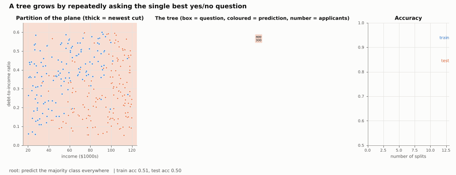
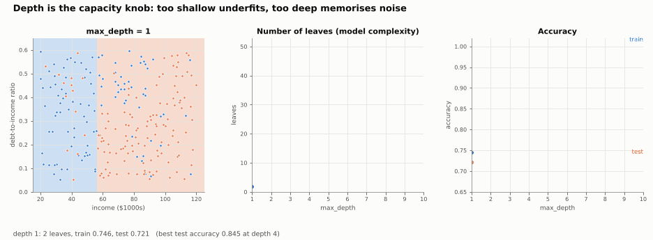

# 14 · Decision Trees (CART)

> **One line:** repeatedly split the data with the single yes/no question on one feature that makes the groups purest; the result is a flowchart of if-then rules.




## 1. Definition

A **decision tree** is a *supervised* model for classification and regression that partitions feature space into axis-aligned rectangles and predicts a constant in each one (the majority class, or the mean). It is a binary tree: each internal node tests `x_j ≤ t`, each leaf holds a prediction. We implement **CART** (Breiman et al., 1984) in `cart.py`.

**Story in the code.** A lender approves or declines loans from `income` ($1000s) and `debt_ratio`. The hidden policy is a union of rectangles; 8% of decisions are randomly flipped, as in real, noisy human decisions. The tree has to rediscover the policy from 300 examples.

## 2. Intuition

"Twenty questions". Ask the most informative question first (is income ≤ 94?), then, in each answer-branch, ask the next most informative question for *that* subgroup. After a few questions, each group is nearly pure. Because every question looks at one feature at a time, the decision regions are boxes; this is also why the tree can read like a rule book a loan officer can audit.

## 3. The math

**Impurity** measures how mixed a node is. With class proportions `p_k`:

```
Gini:      G = 1 − Σ_k p_k²                    (0 = pure; 0.5 = 50/50 for two classes)
Entropy:   H = − Σ_k p_k log₂ p_k              (0 = pure; 1 bit = 50/50)
Variance (regression):  V = mean (y − ȳ)²
```

**Split quality.** A split of a node (with `n` weighted samples) into left/right children with `n_L, n_R` gives the **impurity decrease (gain)**

```
Gain = I(node) − [ (n_L/n) I(left) + (n_R/n) I(right) ]
```

For regression with `I = variance` this is exactly the *reduction in squared error*.

**Search.** For each feature, sort the samples; the only thresholds worth testing are midpoints between consecutive *distinct* values. With cumulative class counts (or cumulative sums of `y, y²` for regression) the impurity of every candidate split is computed in one vectorised pass: `O(m log m)` per feature for a node of `m` samples (the sort dominates). Pick the (feature, threshold) with the largest gain.

**Recursion and stopping.** Split children recursively until: the node is pure, `max_depth` reached, fewer than `min_samples_split` samples, or no split gives positive gain / respects `min_samples_leaf`. A leaf predicts the (weighted) majority class (probabilities = class fractions) or the mean of `y`.

**Greediness.** Each split is optimal *locally*; the tree as a whole is not guaranteed optimal (finding the optimal tree is NP-hard). XOR shows the weakness: no single split helps, but two together do (the self-test in `cart.py` solves noise-free XOR with exactly 4 leaves).

**Cost-complexity (weakest-link) pruning.** Grow a large tree `T`, then minimise `R(T) + α·|leaves(T)|` where `R` is training error. For each internal node `t` with subtree `T_t`:

```
g(t) = ( R(t) − R(T_t) ) / ( |leaves(T_t)| − 1 )
```

collapse the node with the smallest `g`, repeat. This yields a nested sequence of smaller trees indexed by `α`; choose `α` by cross-validation.

**Feature importance** = total impurity decrease contributed by splits on that feature (weighted by the node's sample count), normalised to sum to 1. (Biased toward features with many distinct values; permutation importance is more reliable.)

## 4. Algorithm (CART)

1. Start with all training samples in the root.
2. For the current node: if a stopping rule applies, make a leaf. Otherwise search all features and thresholds for the highest-gain split.
3. Send samples to the left (`x_j ≤ t`) or right child; recurse (the code does this breadth-first, so shallow splits appear first).
4. (Optional) prune with cost-complexity pruning using held-out data.
5. Predict by following the splits down to a leaf.

## 5. Reading the animations

**`tree_growth.gif`** - 13 splits for a depth-4 tree.

| Panel | What to watch | What it means |
|---|---|---|
| Partition (left) | the plane starts as one colour; each new thick line cuts one existing rectangle into two; the caption gives that split's feature, threshold and Gini decrease | each step adds one axis-parallel boundary inside one region |
| Tree (middle) | the same split appears as a new box with two children; the newest has a bold outline; leaves are shaded by class (orange = approve) and show how many applicants they hold | the diagram and the partition are two views of one object |
| Accuracy (right) | train and test accuracy jump in the first ~4 splits (0.51 → 0.89 test) and then flatten | the first splits capture the policy; later ones chase noise |

Final depth-4 tree: 14 leaves, train 0.923, test **0.873**. Income carries 80% of the importance and debt ratio 20%.

**`tree_depth.gif`** (12% label noise, 240 training loans)

| depth | leaves | train | test |
|---|---|---|---|
| 1 | 2 | 0.75 | 0.72 |
| 3 | 7 | 0.86 | 0.84 |
| 4 | 13 | 0.87 | **0.85** |
| 6 | 29 | 0.94 | 0.81 |
| 10 | 49 | 1.00 | 0.77 |

The regions become fragmented slivers around individual noisy points at large depth. Train accuracy keeps climbing to 1.00 while test accuracy falls: the signature of overfitting (lesson 01).

**Printed extras**

- *Rules*: the depth-3 tree prints as nested if/else text (the first question is `income ≤ 94.42`). Note the odd nearby split `income ≤ 101.34` that isolates a single point: that is the tree fitting noise.
- *Gini vs entropy*: almost identical (test 0.889 vs 0.899); the choice rarely matters.
- *Pruning*: the unpruned tree has 38 leaves and test accuracy 0.845. Pruning with `α ≈ 0.004-0.009` leaves **6 leaves with test accuracy 0.910**; too much pruning (2 leaves) falls to 0.719. A simpler tree generalises *better*.
- *Regression tree on a noisy sine*: error against the true curve is 0.093 (depth 1), 0.034 (3), 0.030 (6) and 0.064 (12); piecewise-constant fits are staircases and overfit at depth 12.
- Our tree agrees with scikit-learn's `DecisionTreeClassifier` on 100% of 2000 test points (21 vs 21 leaves).

## 6. Hyper-parameters & knobs

- **`max_depth`**: the main complexity control (depth `d` allows up to `2^d` leaves).
- **`min_samples_leaf` / `min_samples_split`**: stop splitting tiny groups (smooths the model).
- **`criterion`**: gini / entropy (classification), squared error (regression).
- **`max_features`**: features examined per split (all for a single tree; a random subset in forests, lesson 15).
- **`ccp_alpha`** (pruning strength), **class weights / sample weights** for imbalance.
- **`min_impurity_decrease`**: demands a minimum gain per split.

## 7. Variants & relatives

- **ID3 / C4.5 / C5.0**: use information gain / gain ratio, multiway splits on categorical features. **CHAID**: statistical tests for splitting. **Oblique trees**: splits on linear combinations of features. **Model trees** (linear models in leaves). **Conditional inference trees** (unbiased feature selection).
- **Ensembles of trees**: random forests (lesson 15), AdaBoost (16), gradient boosting (17), isolation forests (29), extra-trees (random thresholds).
- **Handling missing values / categoricals**: surrogate splits (CART), native support in modern boosting libraries. *Not implemented here: categorical splits and missing-value handling.*

## 8. Assumptions, strengths & weaknesses

No distributional assumptions; features may be on any scale (monotone transformations change nothing).

**+** Interpretable (rules), handles mixed feature types and interactions automatically, no scaling needed, fast prediction, non-linear.
**−** High variance (a small change in data can change the whole tree), axis-aligned boundaries approximate diagonal ones poorly (staircases), greedy splits, piecewise-constant predictions cannot extrapolate, overfits unless constrained, biased toward high-cardinality features.

**Use** when you need explainable rules or a base learner for ensembles. **Avoid** as a standalone high-accuracy model on noisy data (use ensembles).

## 9. Metrics

Accuracy / F1 / AUC (classification) or MSE / MAE (regression) on held-out data or cross-validation; leaves count and depth as complexity measures; impurity-based and permutation feature importances; stability across bootstrap resamples.

## 10. Code tour

- `cart.py` - `DecisionTree`: `fit` (weighted samples, Gini/entropy/variance, vectorised split search, breadth-first growth recording each split's `order`, bounding boxes), `predict / predict_proba / apply` (with `max_splits=k` for partial trees), `pruned`, `alpha_path` (cost-complexity), `feature_importances`, `export_text`.
- `decision_tree.py` - `loan_data`, `tree_layout / draw_tree` (static layout so the diagram does not jump), `growth_gif`, `depth_gif`, `main` (rules, criteria, pruning table, regression demo, scikit-learn check).

Run: `python decision_tree.py` (about 5 s).

## 11. Experiments

1. Set `flip=0` in `loan_data`. How deep must the tree be to reach 100% test accuracy, and what do the rules look like?
2. Add a pure-noise third feature and compare its importance with that of the real features.
3. Rotate the data by 45° before fitting and see how many more leaves the same accuracy requires.
4. Use `min_samples_leaf = 10` instead of `max_depth` and compare with the pruning table.
5. Resample the training set 5 times (bootstrap) and print the root split each time: how stable is it?

## 12. Pitfalls

- Reading the importance of correlated features as independent effects.
- Using training accuracy to choose depth.
- Expecting extrapolation (a regression tree is flat outside the training range).
- Assuming the tree is stable: tiny data changes produce different trees (the motivation for bagging).
- Ignoring class imbalance: a majority-class leaf may never predict the rare class unless weights or thresholds are adjusted.

**Next:** [15 Random forests](../15_random_forest/lesson.md)
