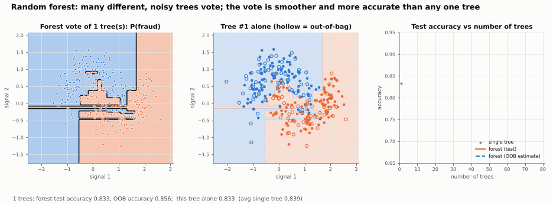
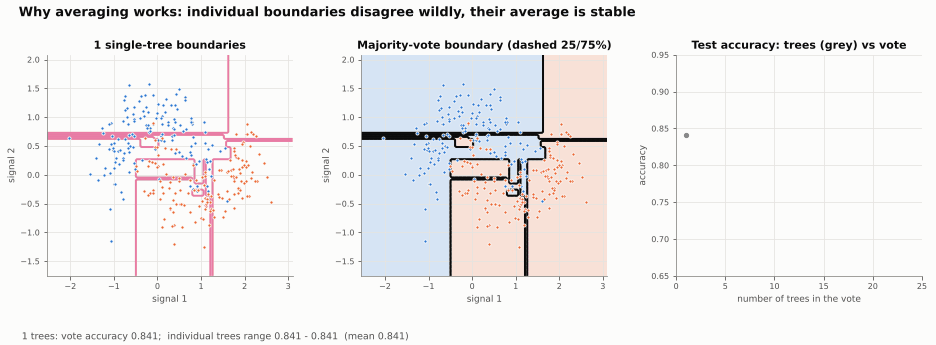

# 15 · Random Forests

> **One line:** train many deep, deliberately different decision trees, each on a bootstrap sample and with random feature choices, then let them vote; the noise each tree memorises cancels out.




## 1. Definition

A **random forest** (Breiman, 2001) is a *supervised* ensemble of decision trees (lesson 14) for classification and regression. Two sources of randomness make the trees diverse:

1. **Bagging** (bootstrap aggregation): each tree trains on `n` rows drawn *with replacement* from the `n` training rows (about 63% unique rows; the rest are **out-of-bag**, OOB).
2. **Random feature subsets**: at every split only `m` randomly chosen features (typically `√d` for classification, `d/3` for regression) are candidates.

Prediction: average the trees' class probabilities (or numeric predictions) and take the argmax.

**Story in the code.** A payments company separates fraudulent from normal transactions using two engineered signals with overlapping classes (noisy "moons"). With `max_features = 1` of 2, every split picks one random feature, so trees differ a lot.

## 2. Intuition

*Wisdom of crowds.* One expert (a deep tree) is brilliant but jumpy: given a slightly different case file, they change their mind. A committee of such experts, each shown a different random subset of cases and told to look at random aspects, disagrees on idiosyncratic details but agrees on the real pattern. Averaging cancels the idiosyncratic errors (variance) while keeping the pattern, so you can use *deep, low-bias* trees without paying the usual overfitting price.

## 3. The math

**Variance of an average.** For `B` identically distributed predictors, each with variance `σ²` and pairwise correlation `ρ`:

```
Var( (1/B) Σ f_b ) = ρ σ²  +  (1 − ρ) σ² / B
```

As `B → ∞` the second term vanishes and the variance falls to `ρσ²`. Bagging lowers `ρ` (different data), random feature subsets lower it further (different questions). Bias is unchanged (each deep tree is nearly unbiased), so the **total error falls**. Adding trees never overfits in the sense of increasing variance; it only has diminishing returns.

**Bootstrap facts.** The chance a given row is *not* picked in `n` draws is `(1 − 1/n)ⁿ → e⁻¹ ≈ 0.368`.

**Out-of-bag (OOB) estimate.** For each training row, average only the trees whose bootstrap did not contain it; compare with its label. This is a nearly free cross-validation estimate: 0.907 OOB vs 0.882 test accuracy for 80 trees in the run (a slightly optimistic estimate on a small sample; OOB uses fewer trees per row than the full forest).

**Feature importance.**

- *Impurity importance*: mean over trees of the impurity decrease contributed by each feature (fast but biased toward continuous or high-cardinality features).
- *Permutation importance*: shuffle one feature in held-out data and measure the drop in accuracy (model-agnostic, more reliable). In the churn demo the impurity ranking gives pure-noise columns 0.14-0.17 importance (the ID-like column 0.144), while permutation importance correctly says `support_calls` (+0.107) and `tenure_months` (+0.063) matter and `customer_id` does not (+0.001).

**Proximity & probabilities.** The vote fraction is a probability-like score (often under-confident near 0/1; calibrate if you need real probabilities).

## 4. Algorithm

1. For `b = 1..B`:
   a. draw a bootstrap sample of the training rows;
   b. grow a tree (usually unpruned, `min_samples_leaf` 1-5) where each split considers only a random subset of `m` features;
   c. record which rows were OOB.
2. Predict by averaging (classification: average class probabilities, equivalent to soft voting).
3. Estimate performance with OOB predictions; compute importances; tune `m`, `min_samples_leaf`, `B`.

## 5. Reading the animations

**`forest_growth.gif`** - 1 to 80 trees.

| Panel | What to watch | What it means |
|---|---|---|
| Left: forest vote | with 1 tree the map is blocky; as trees are added the colour fades gradually (P(fraud) between 0 and 1) and the 0.5 boundary becomes more stable | the vote turns hard 0/1 predictions into a smoother probability surface |
| Middle: newest tree | its own jagged boundary, trained on the filled points; hollow points are rows it never saw (OOB) | each tree is a noisy individual; the OOB rows give a free validation set |
| Right: accuracy vs trees | grey dots (single trees, mean 0.839, range 0.786 - 0.873) vs the orange forest curve rising to **0.882**; the dashed blue OOB estimate tracks it (0.907) | the forest beats almost every individual tree after ~10 trees and then plateaus |

**`forest_vs_trees.gif`** - 24 trees.

| Panel | What to watch |
|---|---|
| Left | the individual 0.5-boundaries (grey; newest in pink) wander all over the place |
| Middle | the majority-vote boundary (black) is much more stable, with dashed 25%/75% contours showing where the committee is split |
| Right | each grey dot is one tree's test accuracy; the orange vote line sits above the whole cloud |

**Variance reduction measured** (40 independent training sets of 300 transactions, one fixed test set): single tree test accuracy 0.857 ± 0.016, forest 0.886 ± 0.009; the variance of predicted probabilities across training sets falls from 0.0729 to 0.0157, **4.6× lower**. scikit-learn's forest scores 0.878 against our 0.885 on the same data (different random draws).

## 6. Hyper-parameters & knobs

- **`n_trees` `B`**: more is better until the curve flattens (100-500 typical); cost grows linearly.
- **`max_features` `m`**: smaller = more diverse trees (lower `ρ`) but each is weaker; tune it, it is the most important knob.
- **`max_depth` / `min_samples_leaf`**: controls individual-tree capacity; larger leaves smooth the model and speed it up (the churn demo uses 3).
- **`bootstrap` size**, **class weights** (imbalance), **`oob_score`** for validation, **`n_jobs`** (trees are independent: embarrassingly parallel).

## 7. Variants & relatives

- **Extra-Trees**: random split *thresholds* too (even more variance reduction, faster). **Bagging** of any base model; **Pasting** (without replacement); **Random patches / subspaces**.
- **Quantile regression forests** (keep all leaf samples to estimate conditional quantiles), **survival forests**, **isolation forests** (lesson 29), **random rotation forests**, **balanced random forests**.
- **Boosting** (lessons 16-17) combines *many weak* trees sequentially to reduce *bias*; forests combine *many strong* trees in parallel to reduce *variance*.
- *Not implemented:* Extra-Trees, quantile forests, proximity matrices.

## 8. Assumptions, strengths & weaknesses

No distributional assumptions; handles non-linearity and interactions; scale-free.

**+** Excellent out-of-the-box accuracy, robust to noise and outliers, few tuning needs, built-in OOB validation, parallel, handles many features and mixed types, gives importances.
**−** Less interpretable than one tree; larger and slower to predict; cannot extrapolate beyond the training range; probabilities are often poorly calibrated; impurity importances are biased; can be outperformed by well-tuned gradient boosting.

**Use** as a strong default on tabular data. **Avoid** for tasks that need extrapolation, very low-latency prediction on tiny devices, or sparse high-dimensional text (linear models are better).

## 9. Metrics

OOB accuracy / error (free), cross-validated AUC / F1 / log-loss, calibration curves, permutation importance on held-out data, and the stability of predictions across seeds.

## 10. Code tour (`random_forest.py`, with `cart.py` copied from lesson 14)

- `RandomForest` - `fit` (bootstrap, random feature subsets via `max_features`, records `inbag`), `predict_proba`, `oob_curve` (OOB accuracy for 1..B trees), `feature_importances`, `permutation_importance`.
- `fraud_data`, `growth_gif`, `spaghetti_gif`, `variance_experiment`, `importance_demo`, `main` (scikit-learn comparison).

Run: `python random_forest.py` (about 20 s).

## 11. Experiments

1. Set `max_features=2` (all features) and compare with `1`: how does the single-tree correlation (spaghetti) and the forest accuracy change?
2. Limit trees to `max_depth=3`: does the forest still beat a single tree? Why is the gain smaller?
3. Increase the label noise (`noise=0.5`) and watch OOB vs test accuracy.
4. Add 20 noise features. How much does `max_features` matter now?
5. Fit the churn forest with and without `customer_id` and compare permutation importances.

## 12. Pitfalls

- Trusting impurity importance with high-cardinality or noise features; check permutation importance.
- Evaluating on data that leaks across bootstrap copies (duplicated rows can make OOB look too good).
- Expecting predictions outside the training target range (regression forests clip to it).
- Using the vote fraction as a calibrated probability.
- Highly correlated features share importance, so each looks weaker than it is.

**Next:** [16 AdaBoost](../16_adaboost/lesson.md)
