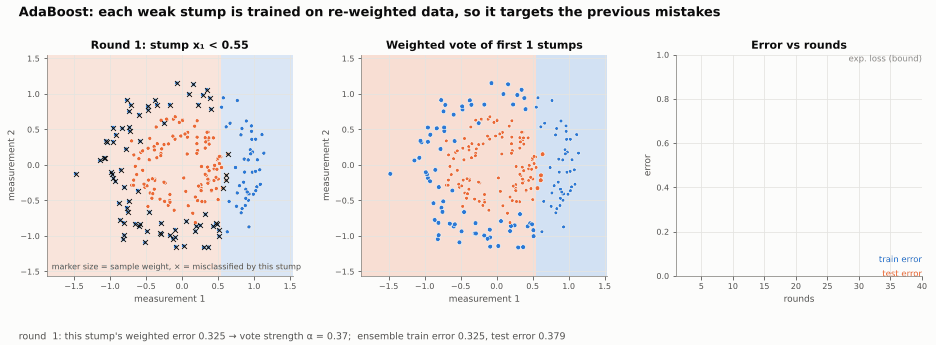

# 16 · AdaBoost

> **One line:** build a strong classifier from many weak ones, one after another, each trained to fix the mistakes of the ones before by up-weighting the examples they got wrong.



## 1. Definition

**AdaBoost** (Adaptive Boosting; Freund & Schapire, 1997) is a *supervised* **boosting** algorithm. It builds an additive model

```
F_T(x) = Σ_{t=1..T} α_t h_t(x)           prediction = sign( F_T(x) )          (labels y ∈ {−1, +1})
```

where each `h_t` is a **weak learner** (slightly better than chance), here a **decision stump**: a one-question tree `h(x) = ± sign(x_j − θ)`. The weights `α_t` say how much each stump's vote counts.

**Story in the code.** A camera inspects parts on a belt with two measurements per part; defective parts form a *ring* around good ones. No single threshold (the best stump has 32.5% error) can separate them, yet 40 stumps reach **3.7% training and 6.7% test error**.

## 2. Intuition

A tutoring session. Start with a quick rule that gets most students right. Look at who it got wrong, and tell the next tutor, "concentrate on these". That tutor makes a new rule that handles the hard cases well, perhaps messing up easy ones, and the next tutor is told about the *new* hard cases. At the end, every tutor votes, with more say for the more accurate ones. The animation shows this: big markers are heavy, hard-to-classify points; the stump of each round is a straight line, but the vote becomes a box-like ring.

## 3. The math

Start with uniform weights `w_i = 1/n`. For each round `t`:

```
1. fit h_t to minimise the WEIGHTED error     err_t = Σ_i w_i · 1[h_t(x_i) ≠ y_i]       (weights sum to 1)
2. stage weight                               α_t = ½ ln( (1 − err_t) / err_t )
3. re-weight the data                         w_i ← w_i · exp( −α_t y_i h_t(x_i) ) / Z_t
```

`Z_t` normalises the weights to sum to 1. Correctly classified points (`y h = +1`) are multiplied by `e^{−α}` (< 1), mistakes by `e^{+α}` (> 1). After re-weighting, the *just-used* stump has weighted error exactly 0.5 on the new weights, so the next stump must find something new.

**Why that `α`?** It minimises the normaliser. With `err` the weighted error, `Z(α) = (1 − err)e^{−α} + err·e^{α}`; setting `dZ/dα = 0` gives `α = ½ ln((1−err)/err)` and `Z = 2√(err(1−err)) < 1` whenever `err < ½`.

**Training-error bound.** The 0-1 training error is at most the **exponential loss** `(1/n) Σ e^{−y_i F(x_i)} = Π_t Z_t = Π_t 2√(err_t(1−err_t))`. Since each factor is below 1, the bound decays geometrically with the number of rounds *as long as every weak learner beats chance*. The code checks this identity numerically: after 40 rounds the product is 0.3323 and the exponential loss measured directly is also 0.3323 (the bound is loose: actual error is 0.037).

**Statistical view (Friedman, Hastie, Tibshirani 2000).** AdaBoost is *forward stagewise additive modelling* that minimises the exponential loss `L(y, F) = e^{−yF}` by greedy steps: given `F_{t−1}`, find `(α_t, h_t)` minimising `Σ exp(−y_i[F_{t−1}(x_i) + α h(x_i)])`. The weights are `w_i ∝ exp(−y_i F_{t−1}(x_i))`: a point's weight measures how *badly* the current ensemble classifies it. This connects AdaBoost to gradient boosting (lesson 17) with a different loss. The population minimiser of exponential loss is `F*(x) = ½ log( P(y=1|x) / P(y=−1|x) )`, i.e. half the log-odds, so `F` can be turned into a probability `σ(2F)` (roughly; usually needs calibration).

**Margins.** `y F(x) / Σα` is the normalised margin. Boosting keeps pushing the margins of training points up even after training error is zero; that is one explanation for why test error often keeps *decreasing* with more rounds.

**Multi-class (SAMME).** With `K` classes, `α_t = ln((1 − err)/err) + ln(K − 1)` and the vote is the class with the largest total `α` among learners predicting it (needs `err < 1 − 1/K`). *Not implemented here.*

## 4. Algorithm

1. Initialise `w_i = 1/n`.
2. For `t = 1..T`: fit a weak learner on the weighted data; compute `err_t`; stop if `err_t ≥ 0.5`; set `α_t`; update and normalise the weights.
3. Predict with `sign(Σ α_t h_t(x))`.
4. Choose `T` (and the base learner's strength) by validation.

**Weighted stump search** (`Stump.fit`): for each feature, sort the points; cumulative weights of each class on the left give the weighted error of every possible threshold at once; polarity `−1` simply flips all predictions (error `1 − err`).

## 5. Reading the animation

| Panel | What to watch | What it means |
|---|---|---|
| Left: this round's stump | a half-plane (blue/orange) over the points; marker size = weight *before* this round; × marks mistakes; title gives the stump's rule | each learner is a crude straight cut; its weighted error is only 0.33-0.41 |
| Middle: ensemble vote | the decision region starts as the first half-plane and becomes a box-shaped ring around the centre; marker size = weight *after* this round | the vote of many stumps builds a non-linear boundary; heavy points sit along the ring's edge where errors persist |
| Right: errors | train (blue) and test (orange) error fall from 0.33/0.38 at round 1 to 0.037/0.067 at round 40; the dashed exponential loss (an upper bound) is much higher but also falls | boosting reduces training error geometrically; the test error follows without a large gap |

Numbers: round 1 stump error 0.325 (α = 0.37); round 10 stump error 0.392 (α = 0.22); round 40 stump error 0.407 (α = 0.19). Later stumps are *worse* on the weighted data (each task is harder), so their votes are weaker, yet they still add up.

**Comparison with scikit-learn.** `AdaBoostClassifier` reaches test error 0.042 on the same data; its stumps choose splits by Gini impurity instead of weighted error and its defaults differ, so the numbers are in the same ballpark but not identical.

**Label noise (printed).** With 10% of the training labels flipped, 300 rounds give train error 0.071 and test error 0.117, whereas the best test error (0.076) occurred at round 69: continuing to boost makes the model chase mislabelled points. The heaviest sample ends up with 5× the average weight. This sensitivity is AdaBoost's classic weakness; early stopping or a robust loss (lesson 17) helps.

## 6. Hyper-parameters & knobs

- **`T` (rounds)**: more rounds = lower bias; with noise, too many overfit. Use a validation curve or early stopping.
- **Weak-learner strength**: stumps (depth 1) give additive models in the features; depth-2/3 trees allow interactions and need fewer rounds.
- **Learning rate / shrinkage `ν`**: use `α_t ← ν α_t` (with `ν < 1`) with more rounds; a standard regulariser.
- **Resampling vs reweighting**: if the base learner cannot take weights, draw a weighted bootstrap each round.

## 7. Variants & relatives

- **Real AdaBoost (SAMME.R)** uses class probabilities from the weak learner; **LogitBoost** (logistic loss, smoother), **GentleBoost** (Newton steps), **BrownBoost / MadaBoost / RobustBoost** (limit the influence of outliers), **AdaBoost.R2** for regression.
- **Gradient boosting** (lesson 17) generalises the idea to any differentiable loss; **XGBoost / LightGBM** are its modern high-performance versions.
- **Bagging / random forests** (lesson 15) also combine trees but in parallel, to cut variance rather than bias.
- **Viola-Jones face detector**: a classic cascade of boosted stumps over Haar features.

## 8. Assumptions, strengths & weaknesses

Assumes weak learners that beat chance on every re-weighted problem (the "weak learning" condition).

**+** Simple, few parameters, little tuning, powerful with tiny base learners, built-in feature selection (stumps pick informative features), resists overfitting surprisingly well on clean data, strong theory.
**−** Sensitive to label noise and outliers (exponential loss puts huge weight on them); sequential (no parallel training); probabilities are poorly calibrated; usually beaten by modern gradient boosting on tabular data.

**Use** for clean medium-size problems, as a first boosting baseline, and as an instructive model. **Avoid** with very noisy labels (try logistic-loss boosting or bagging).

## 9. Metrics

Training/validation error vs rounds (choose the round where validation error bottoms out), exponential loss, margin distribution, ROC-AUC and log-loss (after calibration), and the distribution of `α_t` and sample weights (diagnose noise: a few points with huge weights).

## 10. Code tour (`adaboost.py`)

- `Stump` - weighted best split with polarity, via cumulative weights.
- `AdaBoost` - `fit` (stores each round's stump, `α`, weights before the round, errors), `decision_function`, `staged_decision`, `predict`.
- `parts_data` (ring data, optional label flips); `main` builds the GIF, checks the `Π Z_t` identity, runs the noise experiment and a scikit-learn comparison.

Run: `python adaboost.py` (about 5 s).

## 11. Experiments

1. Plot `α_t` and `err_t` against `t`. Does `err_t` creep toward 0.5?
2. Replace stumps by depth-2 trees (use `cart.py` from lesson 14 with sample weights) and compare the number of rounds needed.
3. Use `flip = 0.2` and add shrinkage `ν = 0.1`. Does early stopping now matter less?
4. Cap each weight at `10/n` after the update (a crude robust boost) and re-run the noise experiment.
5. Track the minimum margin over training points as rounds increase.

## 12. Pitfalls

- Boosting on noisy labels without early stopping.
- Using weak learners that cannot beat 0.5 on the weighted data (the loop stops).
- Forgetting to normalise weights (breaks the `err` formula).
- Interpreting `F(x)` as a calibrated probability.
- Tuning `T` on the test set.

**Next:** [17 Gradient boosting](../17_gradient_boosting/lesson.md)
