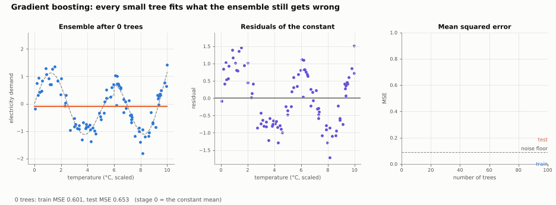
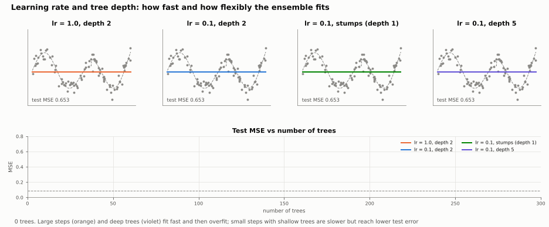
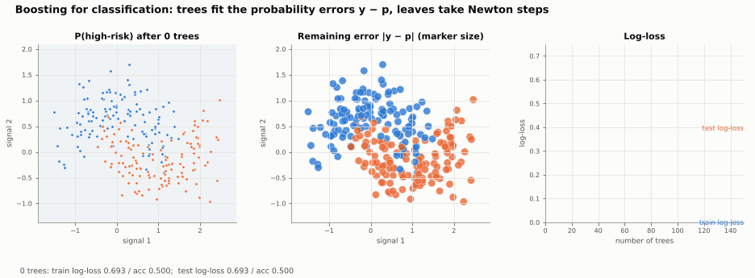

# 17 · Gradient Boosting

> **One line:** add small trees one at a time, each fitted to the direction (the negative gradient of the loss) in which the current ensemble's predictions should move: gradient descent, but in the space of functions.





## 1. Definition

**Gradient boosting** (Friedman, 2001) is a *supervised* ensemble method that builds an additive model

```
F_M(x) = F_0 + ν Σ_{m=1..M} h_m(x)
```

from small regression trees `h_m`, shrunk by a learning rate `ν`. Stage `m` fits `h_m` to the **pseudo-residuals**, the negative gradient of the loss with respect to the current predictions. It works for regression, classification and ranking by choosing the loss; **XGBoost, LightGBM and CatBoost** are engineering-heavy versions and dominate tabular-data competitions.

**Stories in the code.** (1) A power company forecasts electricity demand from a (scaled) temperature variable: a curved, noisy relationship (noise σ = 0.3, so the best possible MSE is 0.09). (2) A two-signal "high-risk hour" classifier on noisy moons.

## 2. Intuition

A golfer approaching the hole. The first shot (the constant `F_0`) gets near the average. Each next stroke aims at the *remaining gap* between ball and hole, but only goes a fraction `ν` of the way, so a bad stroke does little harm. After many short corrective strokes the ball is in the hole. In the animation the middle panel shows the remaining gap (residuals) and the small staircase tree that tries to cancel it.

## 3. The math

**Functional gradient descent.** We want `F` minimising `Σ L(y_i, F(x_i))`. Treat the vector of predictions `(F(x_1), …, F(x_n))` as the parameters. Gradient descent would move each by `−η ∂L/∂F(x_i)`. But we need a function defined everywhere, so we **fit a tree** to those negative gradients and use its output as the step.

```
r_im = − ∂L(y_i, F)/∂F |_{F = F_{m−1}(x_i)}            pseudo-residuals
h_m  = regression tree fitted to {(x_i, r_im)}
F_m  = F_{m−1} + ν h_m
```

**Squared loss** `L = ½(y − F)²`: `r = y − F`, the plain residual. The leaf value is the mean residual. The initial `F_0` is the mean of `y`.

**Logistic loss** (`y ∈ {0,1}`, `p = σ(F)`): `L = −y log p − (1−y) log(1−p)`, `r = y − p`. A tree fitted to `r` with mean leaf values is a first-order step; the standard improvement is a **Newton step** per leaf `R_j`:

```
γ_j = Σ_{i∈R_j} (y_i − p_i) / Σ_{i∈R_j} p_i (1 − p_i)          (gradient / Hessian in that leaf)
```

which is what the code does; `F_0 = log(p̄/(1−p̄))` (the log-odds of the base rate).

**Other losses.** Absolute error (median regression, robust), Huber (robust but smooth), quantile loss (prediction intervals), Poisson/Gamma (counts and positive amounts), exponential loss (recovers AdaBoost, lesson 16), pairwise ranking losses.

**Regularisation toolbox.**

- **Shrinkage** `ν` (0.01-0.3): smaller steps need more trees but generalise better. Empirically `ν < 0.1` nearly always wins given enough trees.
- **Tree size**: depth 1 (stumps) gives an additive model of the features; depth `d` allows interactions up to order `d`.
- **Subsampling** (stochastic gradient boosting): each tree uses a random fraction (e.g. 50%) of the rows (implemented: test MSE 0.141 vs 0.154 without).
- **Early stopping** on a validation set; leaf-size limits; L2 penalties on leaf values (XGBoost).

**Relation to AdaBoost.** With exponential loss the pseudo-residuals are the AdaBoost weights `∝ exp(−yF)`; gradient boosting generalises this to any differentiable loss.

## 4. Algorithm (generic)

1. Initialise `F_0` as the best constant for the loss.
2. For `m = 1..M`: compute pseudo-residuals at the current predictions; (optionally subsample rows); fit a small tree; (for non-squared losses, set leaf values by a line search / Newton step); update `F_m = F_{m−1} + ν h_m`.
3. Predict with `F_M` (apply `σ` for probabilities).
4. Choose `M` (or stop early), `ν`, depth and subsample by validation.

## 5. Reading the animations

**`gb_regression.gif`** (90 training points, 4-leaf trees, `ν = 0.3`)

| Panel | What to watch | What it means |
|---|---|---|
| Left | the orange prediction starts as a flat line (the mean) and bends into the sine-like demand curve; grey dashed = the true curve | functions are built additively |
| Middle | dots are the residuals before the current tree; the green staircase is the tree fitted to them; the residual cloud flattens toward zero as stages pass | each tree only needs to model what is left |
| Right | train MSE (blue) keeps falling to 0.020; test MSE (orange) bottoms at **0.140 at tree 26** (noise floor 0.090) and then creeps up to 0.161 at 100 trees | overfitting after the optimum; early stopping picks stage ≈ 26 |

**`gb_lr_depth.gif`** (four settings over 300 trees)

| setting | best test MSE (stage) | at 300 trees |
|---|---|---|
| `ν = 1.0`, depth 2 | 0.162 (8) | train 0.008 / test 0.205 |
| `ν = 0.1`, depth 2 | **0.139 (71)** | train 0.021 / test 0.160 |
| `ν = 0.1`, stumps | 0.157 (300) | train 0.070 / test 0.157 |
| `ν = 0.1`, depth 5 | 0.146 (24) | train 0.011 / test 0.189 |

Large steps fit instantly and then memorise noise; small steps are slower but better. Stumps are too inflexible to follow the curve with sharp corners (staircase fit, still improving at 300). Deep trees fit noise fast.

**`gb_classification.gif`** (250 training points)

| Panel | What to watch |
|---|---|
| Left | the probability map starts flat at 0.5 and develops an S-shaped boundary; later it becomes ragged around individual points |
| Middle | marker size = remaining error `|y − p|`; large markers (uncertain or misclassified points) shrink as stages pass |
| Right | train log-loss keeps falling (0.014 at 150 trees, 100% training accuracy); **test log-loss is best at tree 26 (0.248) and then rises to 0.368** while test accuracy stays about 0.89: the model becomes over-confident |

Our implementation matches scikit-learn's `GradientBoostingRegressor` (same settings): test MSE 0.161 vs 0.161.

## 6. Hyper-parameters & knobs

- **`n_stages M`** with **`ν`**: trade-off (`ν ↓` ⇒ `M ↑`). Prefer small `ν` plus early stopping.
- **`max_depth`** (1-8, usually 3-6) or number of leaves; **`min_samples_leaf`**.
- **`subsample`** (0.5-0.8) and **column subsampling** (as in random forests).
- **Loss function** and its parameters (Huber `δ`, quantile `α`).
- **L1/L2 leaf regularisation, minimum gain, histogram bins** (XGBoost/LightGBM).

## 7. Variants & relatives

- **XGBoost**: second-order Taylor expansion of the loss, regularised leaf weights (`γ` per leaf, `λ‖w‖²`), exact/approximate split search, sparsity-aware, column blocks for speed.
- **LightGBM**: histogram-based splits, leaf-wise (best-first) growth, gradient-based one-side sampling (GOSS), exclusive feature bundling.
- **CatBoost**: ordered boosting to avoid target leakage, built-in categorical encodings, symmetric (oblivious) trees.
- **Random forests** (lesson 15) vs boosting: parallel variance reduction vs sequential bias reduction. **AdaBoost** (lesson 16): the exponential-loss special case. **Neural boosting, linear boosting (`L2Boost`), boosted GAMs**.
- *Not implemented:* second-order tree growth, histogram binning, categorical handling, ranking losses.

## 8. Assumptions, strengths & weaknesses

No distributional assumptions; a differentiable loss; enough data to fit small trees.

**+** State-of-the-art accuracy on tabular data; flexible losses; handles mixed feature types, missing values (in modern libraries), non-linearities and interactions; feature importances; works well with default settings.
**−** Sequential (slower to train than forests, though histogram methods are fast); many hyper-parameters; prone to overfitting if run too long; sensitive to noisy labels (less than AdaBoost, more with exponential loss); cannot extrapolate; probabilities may need calibration.

**Use** as the first serious model for tabular problems. **Avoid** for images/audio/text raw inputs (use neural networks) and when you must extrapolate trends (combine with linear/time-series terms).

## 9. Metrics

Validation curve vs number of trees (choose the minimum); task metrics (MSE/MAE, AUC, log-loss, NDCG); calibration; SHAP values or permutation importance for interpretation; train-vs-validation gap.

## 10. Code tour (`gradient_boosting.py`, with `cart.py` copied from lesson 14)

- `GradientBoosting` - `loss="squared" | "logistic"`; `fit` (pseudo-residuals, tree fit, Newton leaf values, subsampling), `decision_function`, `staged`, `predict`, `predict_proba`.
- `demand_data`, `true_demand`; `regression_gif`, `lr_depth_gif`, `classification_gif`; `main` (subsample experiment and scikit-learn check).

Run: `python gradient_boosting.py` (about 10 s).

## 11. Experiments

1. Implement `loss="absolute"` (residual → `sign(y − F)`, leaf value → median residual) and add outliers to the demand data. Compare with squared loss.
2. Early stopping: stop when test MSE has not improved for 15 stages. How many trees survive for each learning rate?
3. Change the logistic leaf update to the plain mean residual; compare convergence speed.
4. Add `subsample=0.5` to the classification run and examine the log-loss curve.
5. Add 10 irrelevant features and compare depth-1 vs depth-5 trees.

## 12. Pitfalls

- Choosing `M` by training error (it always keeps improving).
- Large `ν` with many trees (rapid overfitting; see the orange panel).
- Target leakage in categorical encodings (what CatBoost's ordered scheme fixes).
- Ignoring over-confidence: accuracy can stay flat while log-loss deteriorates (right panel above).
- Hyper-parameter tuning on a single split; use cross-validation or a time-aware split for temporal data.

**Next:** [18 Multi-layer perceptron and backpropagation](../18_mlp_backprop/lesson.md)
