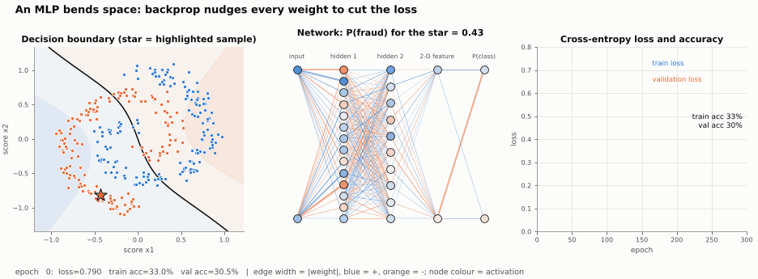
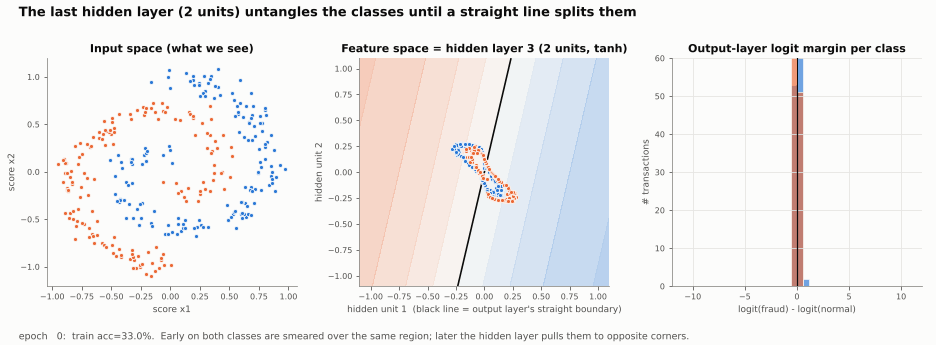

# 18 · Multi-Layer Perceptron & Backpropagation

> **One line:** stack layers of "weighted sum then bend" units, and use the chain rule (backpropagation) to compute how every single weight should change to reduce the loss.





## 1. Definition

A **multi-layer perceptron (MLP)**, also called a feed-forward or fully-connected neural network, is a *supervised* model that maps an input vector `x` to an output (here: class probabilities) by alternating **linear maps** and **non-linear activation functions**:

```
a₀ = x
zₗ = aₗ₋₁ Wₗ + bₗ         (pre-activation: a weighted sum, one per neuron)
aₗ = f(zₗ)                 (activation: a fixed non-linear "bend", e.g. tanh or ReLU)
output: p = softmax(z_L)   (probabilities that sum to 1)
```

- `Wₗ` (weights) and `bₗ` (biases) are the **parameters** learned from data.
- **Backpropagation** is *not* a different model; it is the algorithm that computes the gradient `∂J/∂W` for all layers efficiently, so that gradient descent (lesson 00) can train the network.

**Practical example in the code:** card transactions summarised by two engineered scores `(x₁, x₂)`. Normal (blue) and fraud (orange) transactions wind around each other like two interleaved spirals; no straight line separates them. The network is `2 → 14 → 10 → 2 → 2` with tanh hidden units. The last hidden layer has only **2 units on purpose**, so we can draw it (second GIF).

## 2. Intuition

Think of a sheet of rubber with the two classes printed on it. A single linear layer can only rotate, stretch and shift the sheet; a straight cut is still a straight cut. A **non-linear** activation lets each layer *fold* the sheet. After a few folds, the two spirals that were tangled in the original sheet lie on opposite sides of the fabric, and the last layer cuts them apart with one straight line.

Backprop is the blame-assignment system. The output is wrong by some amount; each weight in the last layer gets blame in proportion to how much it contributed; that blame is pushed back through the network to the layer below, again split in proportion to the contribution, and so on. Every weight ends up with the answer to: "if I increase you a tiny bit, does the loss go up or down, and how fast?"

## 3. The math

### Loss: softmax + cross-entropy

For a class label `y` (integer) and logits `z = z_L`:

```
pₖ = exp(zₖ) / Σⱼ exp(zⱼ)                 softmax
J  = -(1/n) Σᵢ log p_{i, yᵢ}  +  (λ/2) Σₗ ‖Wₗ‖²    cross-entropy + weight decay
```

Cross-entropy is the negative log-likelihood of the correct class: a confident correct answer costs ≈ 0, a confident wrong one costs a lot.

### Backprop, derived layer by layer

We use the chain rule `∂J/∂W = ∂J/∂z · ∂z/∂W` repeatedly. Write `δₗ = ∂J/∂zₗ` ("the error signal at layer l", shape n × units).

**Step 1: output layer.** For one sample with one-hot target `t`:

```
∂J/∂zₖ = Σⱼ (∂J/∂pⱼ)(∂pⱼ/∂zₖ)
       with ∂J/∂pⱼ = -tⱼ/pⱼ  and  ∂pⱼ/∂zₖ = pⱼ(δⱼₖ - pₖ)
       = -tₖ + pₖ Σⱼ tⱼ  =  pₖ - tₖ
```

The messy softmax Jacobian and the log cancel into the beautifully simple `δ_L = (p - t)/n` (the `1/n` is from the batch mean). This is why softmax and cross-entropy are always paired.

**Step 2: gradients of one layer's parameters** (since `zₗ = aₗ₋₁ Wₗ + bₗ`):

```
∂J/∂Wₗ = aₗ₋₁ᵀ δₗ  +  λ Wₗ        (outer product of the input with the error; + weight-decay term)
∂J/∂bₗ = Σ_rows δₗ
```

**Step 3: send the error to the layer below.**

```
∂J/∂aₗ₋₁ = δₗ Wₗᵀ                          (the weights route the blame backwards)
δₗ₋₁     = (δₗ Wₗᵀ) ⊙ f'(zₗ₋₁)             (⊙ = element-wise; pass through the activation)
```

with `tanh'(z) = 1 - tanh²(z)` and `ReLU'(z) = 1 if z > 0 else 0`. Repeat steps 2-3 from the last layer to the first. Cost of the backward pass ≈ cost of the forward pass, which is why backprop makes deep nets practical (the alternative, finite differences, needs one forward pass *per weight*).

### Initialisation: keep signals alive

If each weight has variance `v` and a layer has `m` inputs, the output variance is about `m·v·Var(input)`. To keep the variance constant from layer to layer:

```
tanh / sigmoid  → Xavier/Glorot:  Var(W) = 1/m          (code: act="tanh")
ReLU            → He:             Var(W) = 2/m          (ReLU zeroes half the units, so double)
```

### Optimisers

```
SGD + momentum:  v ← μ v - η g ;      θ ← θ + v                      (a heavy ball)
Adam:            m ← β₁ m + (1-β₁) g ; s ← β₂ s + (1-β₂) g² ;
                 θ ← θ - η · m̂ / (√ŝ + ε)       (m̂, ŝ = bias-corrected)
```

"Mini-batch" means `g` is computed from a random subset of ~48 samples: noisy but cheap, and the noise helps escape bad spots.

### Numerical gradient check

For any weight `w`: `∂J/∂w ≈ (J(w+ε) - J(w-ε)) / 2ε`. The script compares this with backprop for every weight of a small net. Observed relative error is ~`1e-8` for both tanh and ReLU: the derivation above is correctly implemented. (For ReLU an unlucky weight can sit within `ε` of a kink and give a spurious mismatch; try `seed=0` in `gradient_check`.)

## 4. Algorithm

1. Initialise weights (Xavier/He), biases 0.
2. Pick a mini-batch. **Forward pass:** compute and *cache* every `zₗ` and `aₗ`.
3. Compute the loss; set `δ_L = (p - t)/n`.
4. **Backward pass:** for `l = L … 1`: `dWₗ = aₗ₋₁ᵀδₗ + λWₗ`, `dbₗ = Σδₗ`, `δₗ₋₁ = (δₗWₗᵀ) ⊙ f'(zₗ₋₁)`.
5. Optimiser step (momentum or Adam).
6. Repeat over mini-batches (an **epoch** = one pass over the data); monitor validation loss; stop early if it rises.

## 5. Reading the animation

| Panel | What to watch | What it means |
|---|---|---|
| **GIF 1 left: decision boundary** | The black P(fraud) = 0.5 contour starts as a near-straight cut, then bends and wraps around the spiral arms. | The network is composing folds; capacity is used only as far as the loss demands. |
| **GIF 1 middle: network** | Edge width = `|w|`, blue = positive, orange = negative. Node colour = activation for the starred transaction. | Weights grow where useful; the last two nodes saturate (±1) so the output layer is confident. |
| **GIF 1 right: curves** | Loss plateaus (a nearly linear solution), then drops quickly when the boundary starts to curve. Train and validation stay together. | No overfitting here (420 points, small net). |
| **GIF 2 left/middle** | Input space stays tangled; the 2-unit hidden layer starts as a squashed line where both classes overlap and ends as two separated clusters at opposite corners. | The hidden layers learned a *representation* in which the problem is linearly separable. |
| **GIF 2 right: logit margin** | Histograms of `logit(fraud) - logit(normal)` pull apart from 0. | Confidence grows; the overlap near 0 are the errors. |

## 6. Hyper-parameters & knobs

- **Depth / width:** more capacity = can fit more complex boundaries, but overfits more and costs more.
- **Activation:** tanh (smooth, zero-centred, saturates); ReLU (cheap, no saturation for `z > 0`, but "dead" units whose `z` is always negative get zero gradient forever). Variants: leaky ReLU, GELU.
- **Learning rate:** the most important knob. Too big: loss spikes/NaN (in the first run of the script, `lr = 0.02` with Adam made the loss jitter); too small: crawling.
- **Batch size:** small = noisy but regularising; large = smooth but needs larger lr.
- **Weight decay `λ`:** shrinks weights toward 0 → smoother boundary.
- **Dropout `p`:** randomly zero units in training (see below).
- **Initialisation scale:** see vanishing/exploding gradients.
- **Epochs / early stopping patience.**

## 7. Variants & relatives

**Universal approximation.** A network with *one* hidden layer and enough units can approximate any continuous function on a bounded region to any accuracy (Cybenko 1989, Hornik 1991). This says a good network *exists*, not that gradient descent will find it, nor how many units are needed. In practice depth is far more parameter-efficient than width: each layer re-uses the folds of the previous one.

**Vanishing / exploding gradients.** `δₗ₋₁ = (δₗ Wₗᵀ) ⊙ f'(zₗ₋₁)`: the error is multiplied by a matrix and a derivative at every layer. If those factors are typically `< 1` (tanh/sigmoid derivatives ≤ 1, small weights) the gradient shrinks exponentially with depth; if `> 1`, it explodes. The script prints the per-layer gradient norm in a 12-layer tanh net: with Xavier init the first-layer gradient is `~3e-2` vs `~7e-2` in the last layer (healthy), but with weights scaled by 0.3 it is `~4e-8` vs `~3e-7`, which is basically no learning signal at all. Remedies: proper init, ReLU-type activations, normalisation, residual connections (lesson 19), gradient clipping (lesson 20), LSTMs.

**Dropout** (implemented, `dropout=` argument). During training each hidden unit is zeroed with probability `p` and survivors are scaled by `1/(1-p)` ("inverted" dropout, so no change at test time). It stops units from co-adapting and acts like averaging an ensemble of thinned networks. The backward pass simply multiplies by the same mask.

**Weight decay / L2** (implemented, `weight_decay=`). Adds `λW` to every weight gradient. Same idea as ridge regression (lesson 05).

**Early stopping** (implemented, `patience=`). Watch validation loss; keep the weights from its minimum. Training longer than that only fits noise. See the overfitting experiment below.

**Batch normalisation** (not implemented). For each unit, normalise `z` over the mini-batch to mean 0 / variance 1, then rescale with learned `γ, β`. It stabilises the scale of every layer's input, permits higher learning rates, and mildly regularises. Layer norm (lesson 21) does the same per sample and is used in transformers.

**Other relatives:** CNNs (19) share weights across image positions, RNNs/LSTMs (20) share them across time, transformers (21) use attention; autoencoders (31) train an MLP to reproduce its input. Also not covered: learning-rate schedules, second-order optimisers, automatic differentiation frameworks (they perform exactly this backward pass automatically).

## 8. Assumptions, strengths & weaknesses

**+** Very flexible, learns its own features, scales to large data (with GPUs), the same machinery underlies every deep-learning model.
**−** Non-convex loss (many local minima/saddles; the result depends on the seed), needs tuning (lr, size, regularisation), data-hungry, a black box, sensitive to feature scaling. On small tabular data, gradient boosting (17) is usually as good or better with less effort.
**Use** when the signal is a complex non-linear function and you have enough data. **Avoid** when interpretability is paramount or the data are small and tabular.

## 9. Metrics

- **Cross-entropy / log-loss** (the training objective): also measures how well-calibrated the probabilities are.
- **Accuracy** on a held-out set. For real fraud (rare class!) use precision/recall/PR-AUC instead (lesson 02).
- **Train vs validation curves:** a growing gap = overfitting.

Observed in the script: train accuracy 0.987, validation accuracy 0.990, final loss 0.047 (scikit-learn's `MLPClassifier` with the same shape: 0.952).

## 10. Code tour (`mlp_backprop.py`)

- `MLP.__init__`: Xavier/He init. `MLP.forward` (caches `z`, `a`, dropout masks), `MLP.loss`, `MLP.backward` (the chain rule from section 3, line for line).
- `SGDMomentum`, `Adam`: optimisers acting on the lists `W`, `b`.
- `train`: mini-batch loop, history, parameter snapshots for the GIF, early stopping.
- `gradient_check`: centred finite differences vs backprop. `vanishing_gradient_demo`: per-layer gradient norms.
- `regularisation_experiment`: 70 noisy training points, 2-64-64-2 net, four remedies compared.
- `draw_network`, `main`: draw the frames. Outputs `mlp_backprop.gif` and `mlp_feature_space.gif`. Runs in ~13 s.

Run it: `python mlp_backprop.py`

## 11. Experiments

1. In `main`, change `act="tanh"` to `"relu"` (and lower `lr`). Does the boundary look different (piecewise-linear corners instead of smooth curves)?
2. Replace the 2-unit layer by 3 units. Does the untangling still work? (Then GIF 2 no longer applies; why?)
3. Set `lr=0.05` and watch the loss jitter; then use `SGDMomentum(net, lr=0.05, mu=0.9)` and compare with Adam.
4. In `regularisation_experiment` the validation *accuracy* differences between remedies are within noise (only 30 validation points matter at the margin), but validation *loss* drops from `1.46` (none) to `0.97` (dropout), `0.63` (weight decay), `0.52` (early stopping): the unregularised net is overconfident when wrong. Try other seeds.
5. Scale the initial weights by `0.3`, 1 and 3 in `vanishing_gradient_demo` and compare per-layer gradient norms.

## 12. Pitfalls

- Forgetting to scale input features.
- Initialising all weights to 0 (every unit in a layer then receives identical gradients: symmetry is never broken).
- Not running a gradient check on hand-written backprop.
- Using accuracy on imbalanced data.
- Applying dropout at test time, or forgetting to scale by `1/(1-p)`.
- Early stopping on the *test* set (use a separate validation set).
- Judging a network from one random seed.

**Next:** [19 CNN](../19_cnn/lesson.md): sharing weights across image positions.
