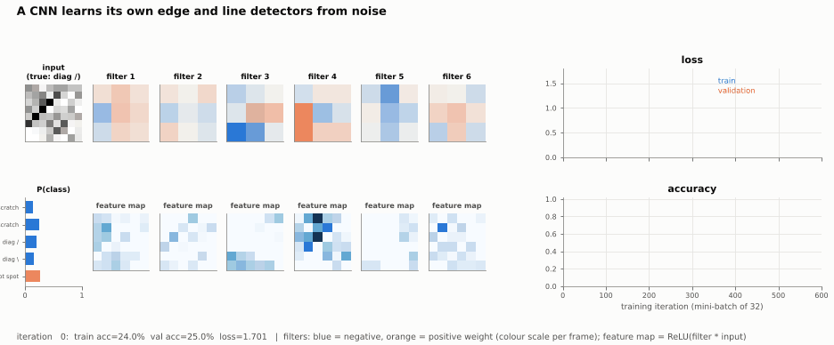

# 19 · Convolutional Neural Networks (CNN)

> **One line:** slide a small learned filter over an image so the same pattern detector is reused at every position; stack detectors to build features from edges to objects.



## 1. Definition

A **convolutional neural network** is a *supervised* neural network for grid-like data (images, spectrograms, sensor tiles, 1-D signals). Its key layer, **convolution**, replaces "every neuron looks at every pixel" with "a small filter looks at a local patch, and the same filter is applied everywhere".

**Story in the code - sensor defect inspection.** An 8×8 thermal sensor tile is imaged with heavy noise; classify the defect:
`0` horizontal scratch, `1` vertical scratch, `2` diagonal crack "/", `3` diagonal crack "\", `4` hot-pixel blob. Each defect appears at a random position with random length.

Network implemented fully by hand (forward **and** backward):

```
image 1×8×8 → Conv(6 filters, 3×3, stride 1) → ReLU → MaxPool 2×2 → Flatten → Dense(5) → softmax
```

## 2. Intuition

Think of a stencil that lights up when it sees a short vertical line. You slide it across the picture; wherever the picture matches, the output map glows. A bank of stencils (filters) gives a bank of maps: "where are the vertical bits, where are the horizontal bits, where are the diagonals". The final layer reads those maps and decides which defect it is. The remarkable part is that **the stencils are learned from the labels**: the animation starts with random-noise filters and ends with line and edge detectors.

## 3. The math

**Convolution (really cross-correlation, as in every deep-learning library).** For an input `x` (channels `C_in`), filter `W` (`C_out × C_in × k × k`) and bias `b`:

```
out[o, i, j] = b[o] + Σ_c Σ_u Σ_v  W[o, c, u, v] · x[c, i·s + u − p, j·s + v − p]
```

`s` = stride, `p` = zero padding. Output size per side: `⌊(n + 2p − k)/s⌋ + 1`. Here `(8 − 3)/1 + 1 = 6`, then pooling halves it to 3, so Flatten gives `6 × 3 × 3 = 54` numbers.

**Implementation trick (im2col).** Unroll each `k×k` patch into a row; the whole convolution becomes one matrix product `patches @ Wᵀ`, which NumPy does fast.

**Backward pass.** With `dout = ∂L/∂out`:

```
∂L/∂W  = Σ over positions  dout · patch            (correlate the input with the upstream gradient)
∂L/∂b  = Σ over positions  dout
∂L/∂x  = "full" convolution of dout with the 180°-rotated filter (scatter-add patch gradients back)
```

**Max-pool backward:** the gradient is routed only to the arg-max location in each window; other locations get 0. **ReLU backward:** pass the gradient where the pre-activation was > 0.

**Loss:** softmax cross-entropy `L = −log p_true`, gradient `P − Y` at the logits. Optimiser: Adam.

**Why convolutions?**

1. **Weight sharing** → far fewer parameters. Our CNN has **335** parameters versus **3785** for a dense `64-54-5` MLP on the same pixels.
2. **Locality**: neighbouring pixels are strongly related, distant ones weakly.
3. **Translation equivariance**: shifting the input shifts the feature map by the same amount. Pooling adds a little local invariance.
4. **Receptive field** grows with depth: after two 3×3 layers each output sees 5×5 input pixels, so deeper layers see larger structures.

**Gradient check.** The script compares analytic and numerical derivatives: worst relative error `1.5e-7` for a stride-2, padded, 2-channel convolution and `1.2e-7` for the entire network: the backward pass is correct.

## 4. Algorithm (training)

1. Generate / load images, scale, split train/validation.
2. Initialise filters with small random values (He-style scale) and zero biases.
3. For each mini-batch of 32: forward pass → loss → backward pass → Adam step.
4. Track train/validation loss and accuracy; keep the snapshot with the best validation score if stopping early.
5. Evaluate on held-out data (and on shifted data to test robustness).

## 5. Reading the animation

| Panel | What to watch | What it means |
|---|---|---|
| Top-left: the 6 filters (blue = negative, orange = positive weight) | random speckle at iteration 0 → clear structured patterns: stripes (line detectors), light-dark steps (edge detectors) | the network discovers features by itself |
| Middle-left: input and class probabilities | the same fixed input (a "/" diagonal) at every frame; the probability bar for the true class rises from 20% (uniform guess) to nearly 100% | prediction confidence grows as the filters mature |
| Feature maps (one per filter) | at the start, uninformative blotches; at the end, the diagonal filters light up along the crack and the others stay dark | each filter answers "is *my* pattern here?" |
| Loss and accuracy | train and validation loss fall together from 1.70 to 0.22 (train) / 0.46 (val); accuracy 24% → **91.7% train / 83.3% val** | a small gap = mild overfitting, as expected with 600 noisy images |

**Honest checks printed by the script:**
- scikit-learn's dense MLP on the raw pixels reaches only 67.7% validation accuracy: the convolutional structure is a genuinely better inductive bias.
- But shifting every validation image by 2 pixels (`np.roll`) drops our CNN to 54.3%. Convolution is *equivariant*, not fully *invariant*: this tiny net has one pooling stage and a dense layer reading fixed positions, so it still depends on where the pattern is. Deeper stacks, global pooling and data augmentation (random shifts during training) are how real networks gain invariance.

## 6. Hyper-parameters & knobs

- **Number of filters** (6 here) - capacity vs cost. **Kernel size** (3×3 is the default; larger kernels = larger receptive field but more parameters; stacking 3×3 layers is usually better).
- **Stride** (downsamples) and **padding** (`same` keeps size; `valid` shrinks it).
- **Pooling** (max, average, global average) - reduces size, adds local invariance.
- **Depth / width**, **learning rate**, **batch size**, **weight decay**, **dropout**.
- **Data augmentation**: shifts, flips, noise, crops. It is often worth more than extra layers.

## 7. Variants & relatives

- **Deep CNN families**: LeNet → AlexNet → VGG → **ResNet** (skip connections `y = x + F(x)` that make very deep nets trainable) → EfficientNet / ConvNeXt. *Not implemented here; the layer maths is the same.*
- **Batch normalisation / layer norm**, **dropout** and **global average pooling** for stability and regularisation.
- **1-D CNNs** for time series and audio, **3-D CNNs** for video/volumes, **dilated / depthwise-separable / transposed convolutions** (segmentation, generative models), **U-Net** for pixel-wise tasks, **object detectors** (YOLO, Faster R-CNN).
- **Vision Transformers** replace local convolutions by attention over patches (lesson 21) but need more data.

## 8. Assumptions, strengths & weaknesses

Assumes local, stationary structure: the same kind of feature is meaningful anywhere.

**+** Parameter efficient; learns features automatically; state of the art for vision-like data; hardware friendly.
**−** Needs substantial labelled data (or pre-training); limited invariance to rotation/scale unless augmented; not interpretable by default; sensitive to adversarial perturbations; fixed input geometry.

**Use** for images, spectrograms, spatial sensor data, 1-D signals. **Avoid** for tabular data with no spatial structure (use trees/boosting).

## 9. Metrics

Accuracy, per-class precision/recall and confusion matrix, cross-entropy loss, top-k accuracy for many classes, mIoU / mAP for segmentation and detection. Always track **validation** metrics and a **robustness** check (shifted, noisier or rotated inputs).

## 10. Code tour (`cnn.py`)

- `make_defect_images` - the synthetic noisy defect tiles.
- `Conv2D` (`forward`, `backward`, stride/padding), `MaxPool2`, `CNN` (stacking, softmax loss, parameter count), `Adam`.
- `conv_gradient_check` - numerical vs analytic gradient comparison.
- `train` - mini-batch loop with snapshots for the animation; `shift_test` - robustness probe.
- `main` - builds the GIF and prints the numbers; `sklearn_check` compares with a dense MLP.

Run: `python cnn.py` (under a minute).

## 11. Experiments

1. Train with random shifts as augmentation, then re-run `shift_test`. How much invariance appears?
2. Use 2 filters, then 12. When does accuracy stop improving?
3. Increase noise to 0.7 in `make_defect_images`. Which defect type is confused first?
4. Replace max-pool by average-pool, or remove pooling entirely, and compare parameter counts.
5. Visualise the filters for the diagonal classes and check that "/" and "\" use mirrored patterns.

## 12. Pitfalls

- Treating equivariance as invariance (see the shift test).
- Not shuffling / leaking augmented copies of the same image into both train and validation.
- Forgetting that cross-correlation (not flipped convolution) is what libraries compute.
- Dead filters (all-zero ReLU outputs) from too-large learning rates.
- Judging by training accuracy on a few hundred images.

**Next:** [20 RNN & LSTM](../20_rnn_lstm/lesson.md)
