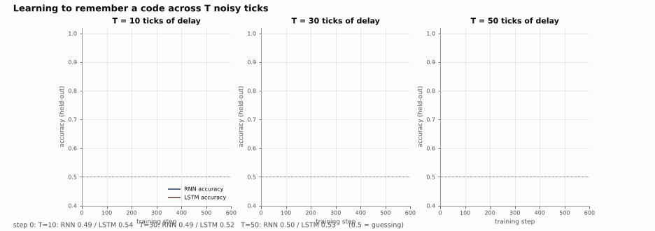
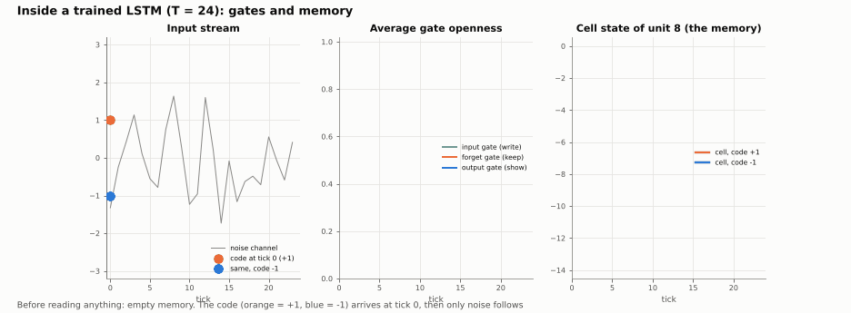
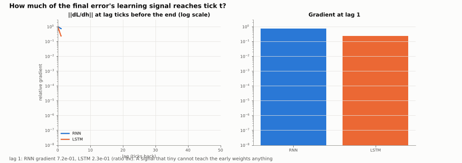

# 20 · Recurrent Neural Networks and LSTMs

> **One line:** a network that reads a sequence one element at a time while carrying a hidden "memory" vector from step to step; the plain version forgets quickly because learning signals shrink as they travel back in time, and the LSTM fixes that with gated, additive memory.





## 1. Definition

A **recurrent neural network (RNN)** processes a sequence `x₁, …, x_T` with the *same* weights at every step, keeping a hidden state `h_t` that summarises what has been seen so far:

```
h_t = tanh(W_x x_t + W_h h_{t−1} + b)          (vanilla RNN)
```

The output can be read at every step (sequence labelling, forecasting) or only at the end (sequence classification, as here). Training uses **back-propagation through time (BPTT)**: unroll the loop into a deep network with shared weights and apply the chain rule.

The **LSTM** (long short-term memory, Hochreiter & Schmidhuber, 1997) adds a **cell state** `c_t`, a conveyor belt of memory modified only by gated, mostly additive updates:

```
[i, f, o] = σ(W [x_t, h_{t−1}] + b)        input, forget, output gates in (0, 1)
g          = tanh(W_g [x_t, h_{t−1}] + b_g) candidate memory
c_t = f ⊙ c_{t−1} + i ⊙ g                   forget part of the old, write part of the new
h_t = o ⊙ tanh(c_t)                         reveal part of the memory
```

**Story in the code.** A factory sensor emits a trigger code (+1 or −1) at the first tick of a production run and then streams `T` ticks of pure noise. At the end of the run the controller must say which code started it. Without a memory the task is a coin flip; with an unbroken memory it is trivial. By increasing `T` we stretch how long the code has to be remembered.

## 2. Intuition

*Vanilla RNN*: whispers passed along a line of `T` people; each person rewrites the message in their own words (`tanh` of a mix), so after 40 people the original is gone. *LSTM*: a notebook passed along the line, with a rule for each person: "erase only a little (`f` near 1), write only what matters (`i`), and show only what's asked (`o`)". The message is copied almost unchanged unless someone decides to alter it. Learning follows the same path in reverse: the error at the end has to travel back to the tick where the code was read; through the whispers it is shrunk at every step, through the notebook it is not.

## 3. The math

**Forward pass** as above, `h₀ = 0`. For classification at the last tick: `logit = w_oᵀ h_T + b_o`, loss `ℓ = −[y log σ(logit) + (1−y) log(1−σ(logit))]`.

**BPTT for the vanilla RNN.** With `z_t = W_x x_t + W_h h_{t−1} + b`, the gradient arriving at `h_t` is `δ_t = ∂ℓ/∂h_t`. Then

```
δ_{t−1} = W_hᵀ ( (1 − h_t²) ⊙ δ_t )
∂ℓ/∂W_h = Σ_t  h_{t−1}ᵀ ((1 − h_t²) ⊙ δ_t)           (summed over all time steps: shared weights)
```

**Vanishing and exploding gradients.** Unrolling, `∂h_T/∂h_t = Π_{k=t+1..T} diag(1 − h_k²) W_h`. A product of many matrices has norm that tends to shrink exponentially when the largest singular value of `diag(·)W_h` is below 1 (`tanh'` ≤ 1 helps it shrink) and to blow up when above 1. Consequences: **vanishing** means the early inputs cannot influence learning (long-range dependencies are not learned); **exploding** means unstable updates. Cures: **gradient clipping** (rescale if `‖g‖ > c`; used here), orthogonal initialisation, ReLU/identity recurrences, truncated BPTT, and above all **gated architectures**.

**Why the LSTM helps.** Along the cell path `∂c_t/∂c_{t−1} = f_t` (element-wise), so the gradient through the cell is multiplied by gates close to 1 instead of by a weight matrix and a saturating `tanh'`: the **constant error carousel**. Initialising the forget-gate bias to +1 (done here) makes "remember" the default.

**LSTM BPTT** (what the code implements), with `tc = tanh(c_t)`:

```
dc  += dh ⊙ o ⊙ (1 − tc²)
d(a_i) = dc ⊙ g ⊙ i(1−i)        d(a_f) = dc ⊙ c_{t−1} ⊙ f(1−f)
d(a_o) = dh ⊙ tc ⊙ o(1−o)       d(a_g) = dc ⊙ i ⊙ (1 − g²)
dc_{t−1} = dc ⊙ f                dh_{t−1} = (d(a) Wᵀ)[hidden part]
```

**Verification.** Finite-difference gradient checks on random weight entries: worst relative error **7e-10 (RNN)** and **1.6e-8 (LSTM)**.

**Parameter counts.** RNN `n_x n_h + n_h² + n_h`; LSTM four times the weights of one RNN layer: `4(n_x + n_h) n_h + 4 n_h`. **GRU** merges the cell and hidden state with two gates (about 3/4 of the LSTM size).

## 4. Algorithm

1. Initialise weights (small random; LSTM forget bias +1); choose hidden size, learning rate, clipping threshold.
2. For each mini-batch of sequences: run the forward pass, store hidden states and gates.
3. Compute the loss at the output step(s); run BPTT backward from the last step to the first, accumulating gradients for the shared weights.
4. Clip the global gradient norm; take an Adam step.
5. Evaluate on held-out sequences; for long sequences use truncated BPTT (backprop through windows of ~100 steps, carry the state forward).

## 5. Reading the animations

**`memory_race.gif`** (hidden size 16, Adam lr 0.01, clipping at 1, batch 64; held-out accuracy over 600 training steps, 0.5 = guessing)

| delay T | vanilla RNN | LSTM |
|---|---|---|
| 10 | 100% after 10 steps | 100% after 10 steps |
| 30 | stuck at chance for ~300 steps, then suddenly learns (90% at step **320**) | 90% at step **30** |
| **50** | **never learns: 53% after 600 steps (loss 0.692 = ln 2)** | 90% at step **20**, 100% final |

The RNN's plateau-then-jump at T = 30 is typical: until a path through the weights carries the code, the gradient says nothing about it. At T = 50 it never finds that path in the budget. (With Adam and clipping the vanilla RNN does better than textbooks suggest; with plain SGD or longer delays it fails sooner. A failure within a budget is not a proof that the RNN cannot represent the solution, only that it cannot *learn* it.)

**`gradient_flow.gif`** (untrained networks, T = 50; size of `∂ℓ/∂h_t` relative to the last tick)

| lag (ticks back) | RNN | LSTM | ratio |
|---|---|---|---|
| 1 | 7.2e-1 | 2.3e-1 | |
| 10 | 4.2e-2 | 4.4e-2 | 1x |
| 20 | 1.6e-3 | 1.2e-2 | 8x |
| 30 | 5.3e-5 | 2.9e-3 | 55x |
| 50 | **1.3e-7** | **1.8e-4** | **≈1400x** |

On a log axis the RNN's signal is a steep straight line down (exponential decay, about a factor 5 per 5 ticks beyond lag 10), the LSTM decays much more slowly. A signal of 1e-7 relative size is lost among the noise of the other terms and cannot teach the first-tick weights.

**`lstm_gates.gif`** (trained LSTM, T = 24; two sequences differ only in the code at tick 0)

| Panel | What to watch | What it means |
|---|---|---|
| Input stream | the grey noise and the two codes at tick 0 | the only information about the answer is at the left edge |
| Gates | forget gate stays around **0.8-0.9**, input and output gates about 0.6-0.7 | the network keeps most of its memory each tick instead of overwriting it |
| Cell of one unit (unit 8) | after the code, the cell trace for code +1 drifts to **−13.2** while code −1 stays near **+0.4** and the noise does not erase the difference | the code is stored as a persistent level; the output layer reads it at the end (logits +9.5 and −9.2) |

Note what we found: the LSTM did *not* learn a "write once, then lock" gate pattern; it stores the answer as a drifting level that is robust to noise. Gates are learned, not hand-set, and the solutions are not always the tidy picture of the textbook.

## 6. Hyper-parameters & knobs

- **Hidden size** (16 here), **number of layers** (stacked RNNs), **bidirectional** (read the sequence both ways), **cell type** (RNN, LSTM, GRU).
- **Learning rate**, **gradient-clipping threshold** (1-5), **batch size**, **sequence length / truncation window**.
- **Initialisation**: orthogonal recurrent weights, forget-gate bias +1.
- **Regularisation**: dropout on non-recurrent connections (or variational dropout), weight decay, early stopping, layer normalisation.
- **Teacher forcing** (feeding true previous outputs during training of generators) and scheduled sampling.

## 7. Variants & relatives

- **GRU** (update and reset gates), **peephole LSTM**, **bidirectional RNN**, **deep / residual RNNs**, **IndRNN**, **Echo-state networks** (fixed random recurrence, train only the readout).
- **Seq2seq encoder-decoder**, **attention** (lesson 21) which lets the decoder look back at every encoder state and removes the memory bottleneck, **transformers** (lesson 21) which replace recurrence by attention and parallelise over time.
- **State-space sequence models** (S4, Mamba): linear recurrences with structured updates, long memory and fast training.
- **Classical alternatives**: ARIMA (lesson 7), hidden Markov models (lesson 30), Kalman filters.
- *Not implemented:* GRU, stacking, bidirectional processing, character-level language modelling, truncated BPTT.

## 8. Assumptions, strengths & weaknesses

Assumes that order matters, that the same transition rule applies at every time step (stationarity of the mechanism), and that a fixed-size state can summarise the past.

**+** Handles variable-length sequences with a fixed number of parameters; models temporal dependencies and state; natural for streaming (constant memory per step); LSTM/GRU long-range memory far beyond the vanilla RNN.
**−** Sequential computation (cannot be parallelised over time); vanishing/exploding gradients; fixed-size memory bottleneck for very long contexts; sensitive to hyper-parameters; transformers usually win with abundant data and compute; hard to interpret.

**Use** for streaming/online prediction, small-to-medium sequence datasets, sensor and control tasks, speech/handwriting where latency matters. **Avoid** when long-range direct access is required (use attention) or when a simple model (lag features + gradient boosting, ARIMA) suffices.

## 9. Metrics

Task metrics (accuracy, F1, MSE/MAE for forecasting, perplexity for language models, BLEU/ROUGE for generation), training and validation loss curves, gradient-norm monitoring (clipping frequency), accuracy as a function of dependency length (like the table above), and **rolling-origin** evaluation for time series.

## 10. Code tour (`rnn_lstm.py`)

- `make_runs` (the delayed-recall data), `RNN` and `LSTM` with `forward` and manual `backward` (BPTT; also records gradient flow `‖δ_t‖`).
- `Adam` (with global-norm clipping), `train`, `bce`, `grad_check`.
- `race_gif`, `gates_gif`, `flow_gif`, `main`.

Run: `python rnn_lstm.py` (about 30 s).

## 11. Experiments

1. Set the clipping threshold to a huge number (no clipping) and `lr = 0.05`; watch the RNN's training become unstable.
2. Change the forget-gate bias initialisation from +1 to −1 and repeat the T = 50 race.
3. Add a GRU cell (two gates) and compare with the LSTM on T = 30, 50, 80.
4. Make the answer depend on *two* codes at ticks 0 and 10 (XOR of the two); how does the required hidden size change?
5. Train on T = 20 and test on T = 40: does the network generalise to longer sequences?

## 12. Pitfalls

- Forgetting to clip gradients (sudden NaN losses).
- Evaluating on randomly shuffled time steps (leakage); ignoring the order of the data in time-series validation.
- Padding variable-length sequences without masking the loss and the state update.
- Initialising the hidden state with garbage between unrelated sequences (reset it, or deliberately carry it in stateful training).
- Expecting the LSTM to remember forever: its memory is long, not infinite (in a side run with T = 100 the LSTM also stayed at chance within 600 steps; that run is not in the script, try it).
- Interpreting individual gate activations as clean, human-readable rules.

**Next:** [21 Attention and the transformer](../21_attention_transformer/lesson.md)
