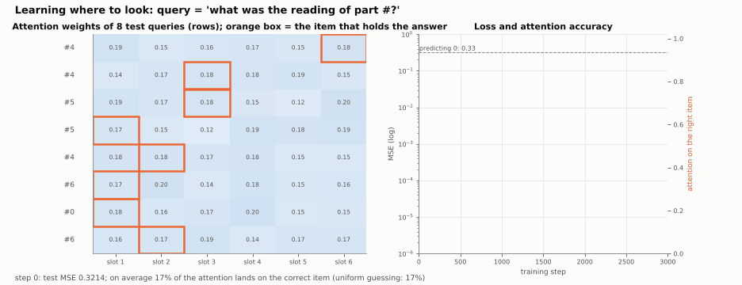
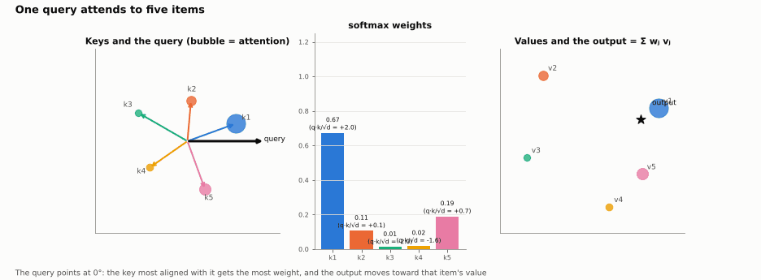
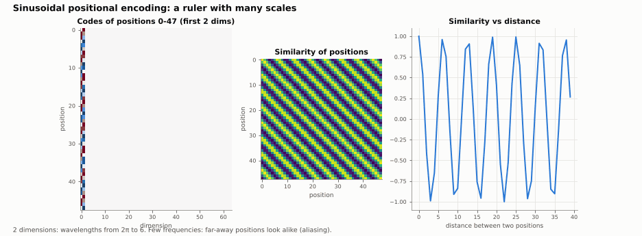

# 21 · Attention and the Transformer

> **One line:** let every element of a sequence look at every other element directly: compare a *query* with all *keys*, turn the comparison scores into weights with a softmax, and return the weighted mix of the *values*; stack that with feed-forward layers and you have the transformer.





## 1. Definition

**Attention** is a differentiable look-up. Given a query vector `q`, a set of key vectors `k_j` and value vectors `v_j`:

```
Attention(q, K, V) = Σ_j  softmax_j( q · k_j / √d ) · v_j
```

In **self-attention** the queries, keys and values are all linear projections of the same sequence `X`: `Q = X W_Q`, `K = X W_K`, `V = X W_V`, so every position can gather information from every other position in a single step (path length 1, unlike an RNN's `T` steps, lesson 20). **Multi-head attention** runs `h` attentions in parallel on different projections and concatenates the results. A **transformer block** (Vaswani et al., 2017) is multi-head self-attention plus a position-wise feed-forward network, each wrapped in a residual connection and layer normalisation; stacks of these blocks are the basis of modern language, vision and speech models.

**Story in the code.** A warehouse scanner reads a tray of 6 items. Each has a part number (one of 10) and a weight reading, shuffled, so *position carries no information*. Then a query arrives: "what was the reading of part #7?" The model must find the matching part by content and return its reading. A model that cannot attend can at best average all the readings.

## 2. Intuition

A library: your **query** is what you are looking for; each book has a **key** (its catalogue entry) and a **value** (its contents). You compare your query with every catalogue entry (dot products), decide how much to read each book (softmax weights that sum to 1), and walk away with a blend of the contents, mostly from the best matches. Unlike a database, the blend is soft and everything is differentiable, so the network *learns* what to ask and what to put in the catalogue.

In a sentence like "the animal didn't cross the street because *it* was tired", the query of "it" should have a high dot product with the key of "animal": attention lets the representation of "it" import information from "animal" directly.

## 3. The math

**Scaled dot-product attention.** With `Q ∈ R^{n_q×d_k}`, `K ∈ R^{n_k×d_k}`, `V ∈ R^{n_k×d_v}`:

```
Attention(Q, K, V) = softmax( Q Kᵀ / √d_k ) V
```

Why divide by `√d_k`: if the components of `q` and `k` have unit variance, `q·k` has variance `d_k`; large scores push the softmax into saturation (almost one-hot, tiny gradients). Dividing restores unit variance. The temperature phase of the mechanics animation shows the same effect: scaling the scores up makes attention a hard lookup, scaling down makes it a plain average.

**Masks.** A boolean mask sets disallowed scores to `−∞` before the softmax. The **causal mask** (lower-triangular) stops a position from seeing the future, which is required for language models that predict the next token. The code verifies exactly zero attention on future positions.

**Multi-head.** `MHA(X) = concat(head₁, …, head_h) W_O`, `head_i = Attention(X W_Q^i, X W_K^i, X W_V^i)`. Different heads can specialise (neighbour, same-topic, syntax...).

**Positional encoding.** Self-attention is **permutation-equivariant**: shuffle the tokens and the outputs are shuffled the same way, so it is blind to order. Order is injected by adding position codes, e.g. the sinusoidal one

```
PE(pos, 2i) = sin(pos / 10000^{2i/d}),    PE(pos, 2i+1) = cos(pos / 10000^{2i/d})
```

(different wavelengths from 2π to 10000·2π like the digits of a clock; the dot product `PE(p)·PE(p+k)` depends only on the offset `k`), or learned position embeddings, or relative/rotary encodings.

**Transformer block (pre-norm).**

```
X ← X + MHA(LN(X))
X ← X + FFN(LN(X)),     FFN(x) = max(0, x W₁ + b₁) W₂ + b₂
```

Residual connections let gradients flow through deep stacks; layer norm stabilises activations; the FFN adds per-position non-linear capacity (typically `d_ff = 4d`).

**Complexity.** Self-attention costs `O(n² d)` time and `O(n²)` memory for sequence length `n` (RNNs: `O(n d²)` but sequential). Hence long contexts need sparse, linear or memory-efficient (FlashAttention) variants.

**Gradient of attention** (what the code back-propagates). With scores `s`, weights `a = softmax(s)` and `da` the gradient arriving at the weights: `ds = a ⊙ (da − Σ_j a_j da_j)`, then `dq = Σ_j ds_j k_j/√d`, `dk_j = ds_j q/√d`, and `dv_j = a_j dctx`. A finite-difference check gives a worst relative error of **1.3e-7**.

## 4. Algorithm

*Inference through one block:*

1. Add positional codes to the token embeddings.
2. For each head: project to `Q, K, V`; compute scores `QKᵀ/√d_k`; apply the mask; softmax each row; multiply by `V`.
3. Concatenate the heads, project with `W_O`, add to the input (residual).
4. Layer-normalise, apply the feed-forward network, add (residual).
5. Repeat for `L` layers; read out the representation(s) needed by the task.

*Training* is ordinary gradient descent (Adam, warm-up and decay of the learning rate) on a task loss, e.g. next-token cross-entropy.

## 5. Reading the animations

**`attention_learning.gif`** (single-head lookup model; manual back-prop; Adam; learns from scratch)

| Panel | What to watch | What it means |
|---|---|---|
| Attention maps | each row is one test query; columns are the 6 item slots; the orange box marks the slot that holds the answer. At step 0 every cell is ≈ 1/6 (0.17). By step 200 the weight in the box is 0.93, and at step 3000 it is ≈ 1.00 | the model discovered *content-based addressing* without being told where to look |
| Loss | test MSE falls from 0.32 to below 1e-4 | the answer is read out almost exactly |

| step | test MSE | attention on the correct item |
|---|---|---|
| 0 | 0.321 | 0.172 |
| 50 | 0.187 | 0.392 |
| 100 | 0.050 | 0.717 |
| 200 | 0.0015 | 0.932 |
| 800 | 0.0001 | 0.985 |
| 3000 | 0.0000 | 0.996 |

Baselines: always predicting 0 gives MSE 0.328; the average of the 6 readings (what uniform attention does) 0.265. Positions are random, so only content-based attention can solve the task.

**`attention_mechanics.gif`** (hand-made 2-D keys and values so everything can be seen)

| Phase | What to watch | What it means |
|---|---|---|
| Rotating query | the bubble of the key best aligned with the query is largest; the bar chart shows its weight (e.g. 0.67 when the query points at k1), and the starred output moves toward that item's value | dot product = similarity of direction; softmax = soft arg-max |
| Temperature | longer queries (larger scores) make the weights nearly one-hot, short ones make them nearly uniform (entropy approaches ln 5 = 1.61) | the `1/√d` scale and learned norms set how "sharp" a head is |

**`positional_encoding.gif`**: the first 2, 4, 8, 16, 32 and 64 dimensions of the sinusoidal codes for positions 0-47. With two dimensions the code is a single clock and positions repeat every ~6 steps (aliasing); with more dimensions the codes become unique, and the similarity of two positions (middle panel, right panel) depends on their *distance*: a diagonal band that fades with distance.

**Property tests** (printed):

| test | result |
|---|---|
| a 4-head pre-norm block on 7 tokens, `d = 16`: output shape and attention weights | (7, 16) and (4, 7, 7); each row sums to 1.000 |
| permute the tokens (no positions) | outputs are permuted identically: max error **4.4e-16** (equivariance) |
| add positional codes, shuffle the tokens but keep the positions | outputs differ by up to 2.0: order now matters |
| causal mask | attention weight on future positions = **0.0**; first token attends 100% to itself |

## 6. Hyper-parameters & knobs

- **Model width `d`**, **heads `h`** (`d_k = d/h`), **layers `L`**, **FFN width** (4d), **context length**, **vocabulary size**.
- **Positional scheme** (sinusoidal, learned, relative, rotary/RoPE, ALiBi), **normalisation** (pre-norm vs post-norm, RMSNorm), **activation** (ReLU, GELU, SwiGLU).
- **Optimisation**: Adam(W), warm-up + cosine decay, dropout, weight decay, gradient clipping, mixed precision.
- **Attention pattern**: dense, causal, sliding-window, sparse, grouped-query/multi-query attention for fast inference.

## 7. Variants & relatives

- **Architectures**: encoder-only (BERT: masked language modelling, classification), decoder-only (GPT family: next-token prediction, generation), encoder-decoder (original transformer, T5: translation, summarisation).
- **Domains**: Vision Transformer (patches as tokens), speech (Whisper), protein structure, multimodal models, time series.
- **Efficiency**: FlashAttention, linear attention, Performer, Longformer / BigBird (sparse), Mixture-of-Experts, KV caching, quantisation.
- **Alternatives**: RNN/LSTM (lesson 20), convolutions (lesson 19), state-space models (Mamba), memory networks.
- **Cross-attention**: queries from one sequence (the decoder), keys and values from another (the encoder): the lookup model in this lesson is exactly a cross-attention layer.
- *Not implemented:* training a deep transformer, tokenisation, language modelling, back-propagation through multi-head blocks (the block is forward-only; the trainable part is single-head attention with full manual gradients).

## 8. Assumptions, strengths & weaknesses

Assumes that relevant relationships can be found by comparing learned projections of elements (content-based interactions), with order supplied separately.

**+** Direct long-range interactions (path length 1); fully parallel training over positions; scales well with data and compute; flexible (text, images, audio, graphs); attention weights give a partial view of what the model uses.
**−** Quadratic cost in sequence length; needs a lot of data and compute; no built-in notion of order or locality (must be supplied); attention weights are *not* a faithful explanation of the model's decisions; sensitive to the learning-rate schedule and initialisation; long-context recall can degrade.

**Use** for large-scale sequence and set modelling. **Avoid** (or use smaller recurrent/convolutional/tree models) for small tabular data, tiny datasets and strict latency/memory budgets.

## 9. Metrics

Task metrics (accuracy, F1, perplexity, BLEU/ROUGE, retrieval recall@k), training/validation loss curves, attention-pattern diagnostics (entropy, mass on the correct token as printed above), long-context recall tests, throughput and memory.

## 10. Code tour (`attention.py`)

- `attention`, `multi_head`, `sinusoidal_pe`, `layer_norm`, `init_block`, `transformer_block` (forward, with masks).
- `Retriever` - single-head lookup model with manual `backward` through the softmax; `Adam`, `grad_check`, `train_retriever`.
- `learning_gif`, `mechanics_gif`, `pe_gif`, `main` (property tests and baselines).

Run: `python attention.py` (about 10 s).

## 11. Experiments

1. Remove the `√d` scaling in `Retriever` (replace by 1). Does learning get slower or faster? Try a larger `D`.
2. Make two items share the same part number: what does the trained attention do (split its weight, pick one)?
3. Add a second head (concatenate two attention outputs) and look at whether the heads specialise.
4. Implement the backward pass of `multi_head` and verify it by finite differences.
5. Increase `N_ITEMS` to 30: how many steps does it take for the attention to become sharp?

## 12. Pitfalls

- Forgetting the causal mask in autoregressive training (the model "cheats" by looking at the answer).
- Forgetting positional information (the model is a bag of tokens).
- Treating attention weights as explanations.
- Padding tokens that are not masked out of the softmax.
- Numerical overflow in softmax (subtract the row maximum, as the code does).
- Quadratic memory on long sequences.

**Next:** [22 k-means clustering](../22_kmeans/lesson.md)
