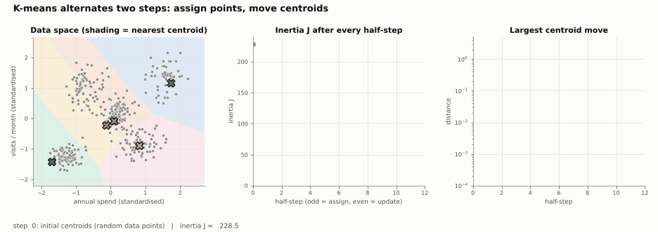
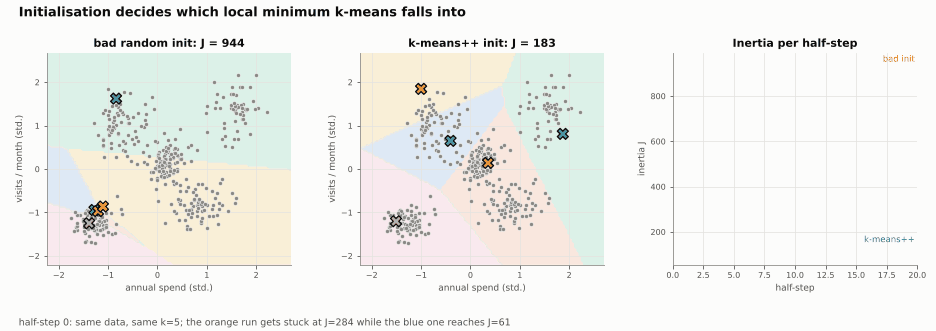

# 22 · K-Means Clustering

> **One line:** split unlabeled data into `k` groups by alternating two simple steps - give every point to its nearest centre, then move every centre to the mean of its points - until nothing changes.





## 1. Definition

**K-means** is an *unsupervised* algorithm: it receives only feature vectors `x₁ … xₙ` (no labels) and returns
`k` **centroids** `c₁ … c_k` and a **cluster label** for every point. Each cluster is summarised by its mean ("centroid").

**Practical example used in the code:** a shop has 400 customers described by *annual spend ($k)* and *store visits per month*
(both standardised). Marketing wants segments such as "bargain browsers", "loyal regulars", "big spenders". The data hide five
real segments; the algorithm is not told that.

## 2. Intuition

Place `k` post offices in a town. Every house is served by the closest post office (assign). Then each post office relocates to
the centre of the houses it serves (update). After the move some houses are now closer to a different office, so they switch,
the offices move again ... Each move strictly reduces the total walking distance, so this must settle down.
The shaded regions in the animation (**Voronoi cells**) are exactly "which post office is closest here".

## 3. The math

**Objective - inertia** (also called within-cluster sum of squares, WCSS, or distortion):

```
J(C, z) = Σᵢ ‖xᵢ − c_{zᵢ}‖²          zᵢ ∈ {1..k} is the cluster of point i, c_j the centroid of cluster j
```

K-means minimises `J` over both the assignments `z` and the centroids `C`. That joint problem is NP-hard, but each half is easy:

**Assign step** (centroids fixed): `zᵢ = argmin_j ‖xᵢ − c_j‖²` - each term of `J` is minimised separately by the nearest centroid.

**Update step** (assignments fixed): for cluster `S_j` set the derivative to zero:

```
∂/∂c_j  Σ_{i∈S_j} ‖xᵢ − c_j‖²  =  −2 Σ_{i∈S_j} (xᵢ − c_j)  =  0   ⇒   c_j = (1/|S_j|) Σ_{i∈S_j} xᵢ
```

The mean is the unique minimiser of summed *squared* distances (this is why the algorithm uses means, and why it is tied to Euclidean distance).

**Why it converges:** both steps can only lower `J` (or keep it); `J ≥ 0`; there are finitely many partitions. So `J` decreases monotonically
(right panel of GIF 1) and Lloyd's algorithm stops in finitely many steps. But it only reaches a **local minimum** - GIF 2 shows
a bad start getting stuck at `J = 284` while a good start reaches `J = 61` on identical data.

**k-means++ initialisation** (Arthur & Vassilvitskii, 2007):

```
1. c₁ = a uniformly random data point
2. for the next centres: D(x)² = squared distance from x to the nearest centre chosen so far
   pick a new centre x with probability  D(x)² / Σ D(x')²
```

Far-away points are likelier to be picked, so the seeds spread out. This gives an `O(log k)`-competitive guarantee in expectation versus the optimal `J`.

**Choosing k.** `J` always falls as `k` grows (`k = n` gives `J = 0`), so we look for structure:

```
Elbow:        plot J(k); choose k where the curve bends (diminishing returns)
Silhouette:   for point i, a = mean distance to its own cluster, b = mean distance to the nearest other cluster
              s(i) = (b − a) / max(a, b)  ∈ [−1, 1];  choose k maximising the mean s
```

`s ≈ 1`: well inside its cluster; `s ≈ 0`: on a border; `s < 0`: probably in the wrong cluster.

## 4. Algorithm (Lloyd's)

1. Standardise features (distances must treat features equally).
2. Initialise `k` centroids (k-means++ recommended).
3. **Assign** every point to its nearest centroid.
4. **Update** every centroid to the mean of its assigned points (re-seed a centroid that lost all its points).
5. Repeat 3-4 until centroids stop moving (or max iterations).
6. Run several restarts (`n_init`) and keep the lowest `J`.

Cost: `O(n·k·d)` per iteration for `n` points in `d` dimensions.

## 5. Reading the animation

| Panel | What to watch | What it means |
|---|---|---|
| **GIF 1 left** - data space | Odd steps: points change colour; even steps: X-markers jump to the cluster means and leave black trails; the shading follows the markers | Assign = Voronoi partition by current centres; update = centres chase their points |
| **GIF 1 middle** - inertia | Staircase going down, one stair per half-step | Each half-step never increases `J`; the curve flattens at a local minimum |
| **GIF 1 right** - centroid move | Bars shrink by orders of magnitude | Convergence: when the largest move is ~0 the assignment is stable |
| **GIF 2 phase 1** - two runs | Orange (random) run leaves two centres inside one blob and merges two other blobs; blue (k-means++) covers all five blobs | Same data, different local minima: `J = 284` vs `61` |
| **GIF 2 phase 2** - elbow / silhouette | Inertia bends at `k = 4-5`; silhouette peaks at `k = 5` | Heuristics to choose `k`; the true count is 5 here |

## 6. Hyper-parameters & knobs

- **`k`** - the number of clusters; the most important choice. Too small merges segments, too large splits them (see k = 8 frame).
- **`init`** - `"random"` vs `"kmeans++"`. Try `"random"` in `KMeans(...)` with several seeds.
- **`n_init`** - restarts; cheap insurance against bad local minima (10 is the usual default).
- **`max_iter` / tolerance** - convergence is typically a handful to a few dozen iterations.
- **Feature scaling** - changes the answer: a feature with a large range dominates the distance.

## 7. Variants & relatives

- **Mini-batch k-means** (implemented: `minibatch_kmeans`) - each step draws a small random batch, assigns it, and nudges each centroid by `1/count` towards its batch points (a running mean). Far cheaper per step on millions of rows; `J` is slightly worse (68 vs 61 here).
- **k-medoids / PAM** (implemented: `kmedoids`) - centres must be actual data points and the cost uses plain distances, so outliers pull far less than in k-means; works with any distance matrix. Costs `O(n²)` memory/time.
- **k-means++ / k-means||** - seeding strategies (the latter is the parallel version used in big-data libraries).
- **Fuzzy c-means and GMM** (lesson 25) - soft assignments; k-means is the "hard, equal spherical variance" limit of a Gaussian mixture.
- **Spherical k-means** - cosine distance for text vectors. **Bisecting k-means** - repeatedly split the worst cluster.
- **Kernel k-means / spectral clustering** - handle non-convex shapes (not implemented).

## 8. Assumptions, strengths & weaknesses

Implicit assumptions: clusters are **convex, roughly spherical, similar size and variance**, and Euclidean distance is meaningful.

**+** Simple, fast (`O(nkd)`), scales to huge data (mini-batch), centroids are interpretable "typical customers", easy to predict new points.
**−** Must choose `k`; local minima; sensitive to scale and outliers (a mean is dragged by extremes); fails on moons, rings, very different densities or sizes (lesson 24 DBSCAN, lesson 25 GMM); hard assignments hide uncertainty.

**Use when** groups are blob-like and you need a fast, explainable segmentation or a vector-quantisation codebook. **Avoid when** clusters are curved/nested, include lots of noise, or `k` is unknowable.

## 9. Metrics / how to evaluate it

- **Inertia** `J` - compare only for the *same* `k` and data.
- **Silhouette** (above) - label-free; `0.64` at `k = 5` here (strong structure is `> 0.5`).
- **Davies-Bouldin / Calinski-Harabasz** - other internal indices.
- **Stability** - re-cluster bootstrap samples; segments that keep appearing are real.
- **External** (only if true labels exist): adjusted Rand index, normalised mutual information.
- **Business check** - are the segments actionable and distinguishable?

## 10. Code tour (`kmeans.py`)

- `make_customers` - five segments in (spend, visits).
- `sqdist` - vectorised squared distances via `‖x‖² − 2x·c + ‖c‖²`.
- `KMeans` - `_init_centroids` (random / k-means++), `fit` (Lloyd loop; stores `history` of half-steps for the animation), `predict`.
- `best_of` - restarts; `silhouette` - from scratch; `inertia`.
- `minibatch_kmeans`, `kmedoids` - relatives.
- `animate_lloyd` → `kmeans.gif`; `animate_init_and_k` → `kmeans_init_k.gif`.
- `main` - runs everything and cross-checks inertia with scikit-learn if installed (it matches: 60.8).

Run it: `python kmeans.py` (about 15 s).

## 11. Experiments

1. In `main` pick `demo = max(cands, key=...)` (worst random run) and watch GIF 1 get stuck in a bad optimum.
2. Remove `standardize` and re-run: which feature dominates the clusters, and how does silhouette change?
3. Add 20 outliers far away (e.g. `X[:20] += 8`) and compare k-means with `kmedoids` centres.
4. Change `make_customers` stds to `1.0` so segments overlap; does the elbow still show a clear bend? What does silhouette say?
5. Compare `minibatch_kmeans` with `batch=10` vs `batch=200`: inertia versus work.

## 12. Pitfalls

- Reading the elbow as truth: it is often ambiguous; combine with silhouette and domain knowledge.
- Forgetting to scale features, or clustering raw one-hot categorical data (use k-modes / other distances).
- Trusting a single run: always restart.
- Empty clusters (handle by re-seeding) and `k > number of distinct points`.
- High dimensions: distances concentrate, so reduce dimension first (lesson 26 PCA).
- Treating labels as stable: cluster `3` in one run is cluster `1` in another.

**Next:** [23 Hierarchical clustering](../23_hierarchical_clustering/lesson.md) - clustering without choosing `k` in advance.
