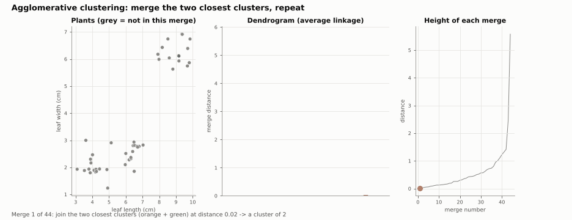
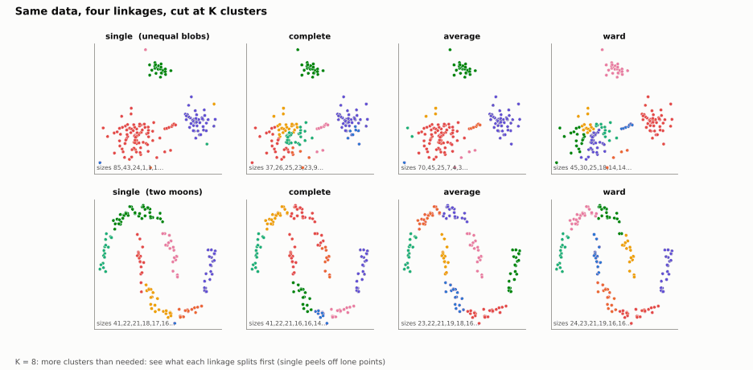

# 23 · Hierarchical (Agglomerative) Clustering

> **One line:** start with every point as its own cluster, repeatedly merge the two closest clusters, and record the order and distances of the merges as a tree (dendrogram); cut the tree wherever you like to get any number of clusters.




## 1. Definition

**Hierarchical clustering** is an *unsupervised* method that outputs a nested family of partitions rather than one. The common **agglomerative** (bottom-up) version:

1. Begin with `n` singleton clusters.
2. Merge the closest pair; repeat until one cluster remains (`n − 1` merges).
3. The result is a **dendrogram**: leaves are points, each U-shaped join is a merge, and its height is the distance at which the merge happened.

"Closest" needs a **linkage** rule that says how to measure the distance between two *sets* of points. The opposite direction (**divisive**, top-down: split one big cluster recursively) exists but is rarer.

**Story in the code.** A botanist measured leaf length and width on 45 plants from three species; two species are close relatives. She wants a family tree, not a fixed number of groups.

## 2. Intuition

Imagine merging towns on a map. Neighbouring houses join into hamlets, hamlets into villages, villages into regions, regions into one country. The dendrogram records *at what scale* each join happened: a long vertical line means two clusters were far apart when they finally joined, i.e. a natural boundary. Cutting the tree with a horizontal line at height `h` gives the clusters that are separated by more than `h`.

## 3. The math

**Linkage** = distance between clusters `A` and `B`, with point distance `d`:

| linkage | `D(A, B)` | behaviour |
|---|---|---|
| **single** | `min d(a, b)` | nearest neighbours; follows chains and curves; **chaining** (a thin bridge of points merges clusters) |
| **complete** | `max d(a, b)` | farthest members; compact, similar-diameter clusters; sensitive to outliers |
| **average** (UPGMA) | `mean d(a, b)` | a compromise |
| **Ward** | increase in within-cluster sum of squares caused by merging | compact spherical clusters of similar size; the k-means criterion, so results resemble k-means |
| centroid / median | distance between centres | can produce *inversions* (a merge lower than a previous one), so non-monotone dendrograms |

**Lance-Williams update.** All the above update cheaply after merging clusters `i` and `j` into `i∪j`, for any other cluster `k`:

```
D(k, i∪j) = αᵢ D(k,i) + αⱼ D(k,j) + β D(i,j) + γ |D(k,i) − D(k,j)|
```

For example single: `αᵢ = αⱼ = ½, β = 0, γ = −½` which equals `min`; complete: `γ = +½` giving `max`; average: `αᵢ = nᵢ/(nᵢ+nⱼ)`; Ward (on *squared* distances): `αᵢ = (nᵢ+n_k)/(nᵢ+nⱼ+n_k)`, `β = −n_k/(nᵢ+nⱼ+n_k)`. The code uses this so raw points are never revisited after the first distance matrix.

**Ward's merge cost:** `Δ = (nᵢ nⱼ)/(nᵢ + nⱼ) ‖cᵢ − cⱼ‖²`: merging far-apart or large clusters costs more, which is why Ward prefers balanced clusters. (The code reports heights in the same convention as scipy: `√(2Δ)`.)

**Cutting.** Cut at height `h` or ask for `K` clusters (undo the last `K−1` merges). A heuristic for `K`: look for the **largest gap between consecutive merge heights**.

**Cophenetic distance.** For two points, the height of the first merge that puts them in the same cluster. The **cophenetic correlation** between these and the original distances measures how faithfully the tree represents the data (0.92-0.93 for all four linkages here).

**Cost.** The naive algorithm is `O(n³)` time and `O(n²)` memory (the distance matrix); nearest-neighbour chain gives `O(n²)` for reducible linkages (single, complete, average, Ward). Hence hierarchical clustering suits thousands, not millions, of points.

## 4. Algorithm

1. Compute the pairwise distance matrix (Euclidean unless you have a reason; **square it for Ward**).
2. Find the pair of active clusters with the smallest linkage distance `h`.
3. Record the merge `[a, b, h, size]`; replace the two rows with one using the Lance-Williams formula.
4. Repeat `n − 1` times.
5. Draw the dendrogram (order the leaves so branches do not cross); cut at a height or at `K` clusters.

## 5. Reading the animations

**`hier_merge.gif`** (average linkage, 45 plants; the algorithm sees only the numbers, not the species)

| Panel | What to watch | What it means |
|---|---|---|
| Left | the two clusters being merged are orange and green; grey spokes join each cluster's members to its centroid | the first merges join near-identical plants (distance 0.02); later ones join whole groups |
| Middle | the dendrogram grows from the leaves upward; the newest merge is orange. At the end the three species are coloured and a dashed line cuts the tree at 1.93 | tall, isolated U-shapes at the top = well-separated groups |
| Right | merge height vs merge number. Heights creep up (0.02 → 1.42), then jump to **2.45** and finally **5.58** | the jump says "merging down to two, and then one, cluster destroys real structure": cut before it, at **K = 3**; the cut recovers the species with accuracy **1.00** |

Note how the two close relatives join (height 2.45) well below the distant species (5.58): the tree shows *relatedness*, not only groups.

**`linkage_compare.gif`**: the same trees cut at `K = 8 … 2` on two data sets.

| Data set | Single | Complete | Average | Ward |
|---|---|---|---|---|
| **unequal blobs + a thin bridge of stray points** (157 pts, true K = 3), accuracy at K = 3 | **0.68** (chaining: cluster sizes 1 / 131 / 25) | 0.97 | 0.98 | 0.96 |
| **two moons** (150 pts, noise 0.05), accuracy at K = 2 | **1.00** | 0.79 | 0.79 | 0.79 |

Moral: *no linkage is best*. Single linkage follows the curved moons exactly but is fooled by the bridge of noise; the compact-cluster linkages handle the blobs but cut the moons straight across. At large `K` single linkage also peels off lone outliers first (tiny clusters).

**Verification.** On all four linkages the merge heights agree with `scipy.cluster.hierarchy.linkage` to `6e-13`, the 3-cluster labels agree 100%, and the cophenetic correlations are identical (0.921 single, 0.926 complete, 0.928 average, 0.926 Ward).

## 6. Hyper-parameters & knobs

- **Linkage** (the most influential choice) and the **distance metric** (Euclidean, Manhattan, cosine, correlation, Gower for mixed types).
- **Cut**: number of clusters `K` or height threshold; inconsistency or gap criteria.
- **Scaling** of the features (as for any distance method).
- For big data: connectivity constraints (only merge neighbours), BIRCH-style pre-clustering.

## 7. Variants & relatives

- **Divisive** methods (DIANA, bisecting k-means), **BIRCH** (CF-tree for large data), **CURE**, **Chameleon**.
- **HDBSCAN** (lesson 24 is DBSCAN): a hierarchy of density-based clusters, which is single linkage on a *mutual-reachability* distance plus a stability-based cut; fixes the chaining problem.
- **Spectral clustering**, **k-means** (flat), **GMM** (lesson 25, soft clusters, a probabilistic cousin of Ward).
- Phylogenetic trees (UPGMA is average linkage), document / gene-expression heat maps with clustered rows and columns.
- *Not implemented:* centroid/median linkages, divisive methods, connectivity constraints.

## 8. Assumptions, strengths & weaknesses

Assumes a meaningful distance and that the clusters are nested at some scale (which linkage encodes: single = connectedness, complete/Ward = compactness).

**+** No need to pick `K` up front; the dendrogram shows structure at all scales; deterministic (no random restarts); any distance can be used; the tree itself is a deliverable (taxonomy).
**−** `O(n²)` memory, `O(n²)`-`O(n³)` time; greedy (a merge can never be undone); linkage choice changes everything; sensitive to noise/outliers (single) or elongated shapes (complete, Ward); no natural way to assign new points; dendrograms of thousands of leaves are unreadable.

**Use** for small/medium data, exploratory analysis, taxonomies and when the hierarchy is the point. **Avoid** for very large data (use k-means/mini-batch, DBSCAN/HDBSCAN) or if you need to place unseen points often.

## 9. Metrics

Cophenetic correlation (tree fidelity), silhouette score, Calinski-Harabasz and Davies-Bouldin indices (compact clusters), gap statistic, adjusted Rand index when labels exist, stability under bootstrap resampling, and the **largest-gap** rule on merge heights.

## 10. Code tour (`hierarchical.py`)

- `linkage(X, method)` returns `Z = [a, b, height, size]` (scipy layout) using the Lance-Williams update for `single|complete|average|ward`.
- `cut(Z, k)` (undo merges with union-find), `members`, `leaf_order`, `cophenetic`, `pairwise`.
- `draw_dendrogram` (incremental, colours, cut line), `merge_gif`, `compare_gif`, `main` (scipy cross-checks and accuracies).

Run: `python hierarchical.py` (about 4 s).

## 11. Experiments

1. Change `unequal_blobs` to remove the bridge (delete the 7 stray points). Does single linkage recover the groups?
2. Run Ward without squaring the distances. What changes in the heights and in the clusters?
3. Add 5 far-away outliers to `plants`; compare the dendrograms for single, complete and average.
4. Replace Euclidean distance by `1 − correlation` and cluster the rows of a gene-expression-style matrix.
5. Implement centroid linkage and detect an inversion (a merge height lower than the previous one).

## 12. Pitfalls

- Reading the **horizontal order** of leaves as meaningful (only the joins and heights matter; any branch can be flipped).
- Forgetting to scale features, or using Ward with non-Euclidean distances.
- Choosing a linkage because the dendrogram "looks nicer" rather than because of the cluster shapes you expect.
- Cutting by eye on a 10,000-leaf tree.
- Treating the tree as ground truth: it is the output of a greedy procedure.

**Next:** [24 DBSCAN](../24_dbscan/lesson.md) - clusters as dense regions, with noise left unassigned.
