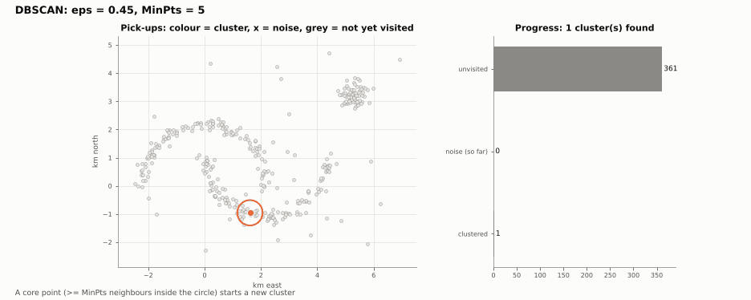
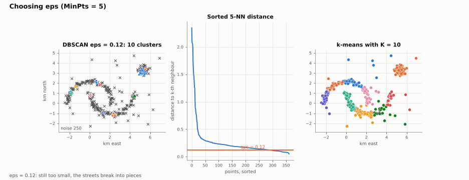

# 24 · DBSCAN (Density-Based Clustering)

> **One line:** a cluster is a region where points are packed densely; start from any dense point and let the cluster spread to every point it can reach through chains of close neighbours, and call whatever is left over *noise*.

## 1. Definition

**DBSCAN** (Density-Based Spatial Clustering of Applications with Noise, Ester et al., 1996) is an *unsupervised* clustering algorithm with two parameters:

- **`eps` (ε)**: the neighbourhood radius.
- **`MinPts`**: the number of points (the point itself included) needed inside that radius to call the region dense.

Every point is one of:

| type | rule | role |
|---|---|---|
| **core** | at least `MinPts` points within `ε` | the dense interior; spreads the cluster |
| **border** | not core, but within `ε` of a core point | the edge; joins a cluster, cannot extend it |
| **noise** | neither | belongs to no cluster (label −1) |

A **cluster** is a maximal set of core points that are *density-connected* (linked by a chain of core points, each within `ε` of the next) plus their border points. The number of clusters is **found**, not chosen.

**Story in the code.** A ride-hailing company logs 362 GPS pick-ups: two curved streets (interlocking crescents), a round plaza, and 32 one-off stray pick-ups scattered over the map. It wants the hot-spots without guessing how many there are, and the strays labelled as noise.

## 2. Intuition

Picture the points as islands seen from a plane. Dense archipelagos are clusters; a lone rock far from anything is noise. DBSCAN walks like an explorer: standing on a point, look at a circle of radius `ε`. If the circle is crowded (≥ `MinPts`), plant a flag, then walk to every neighbour in the circle and repeat. When no crowded circle remains, the territory is complete. Arbitrary shapes come for free because the explorer follows the crowd: a long curved street is just a chain of overlapping crowded circles.

## 3. The math

Let `N_ε(p) = { q : ‖p − q‖ ≤ ε }`.

- `p` is **core** iff `|N_ε(p)| ≥ MinPts`.
- `q` is **directly density-reachable** from `p` iff `q ∈ N_ε(p)` and `p` is core.
- `q` is **density-reachable** from `p` if there is a chain `p = p₁, …, pₘ = q` with each `pᵢ₊₁` directly reachable from `pᵢ` (all but possibly the last are core).
- Two points are **density-connected** if some core point reaches both. Clusters are the equivalence classes of this relation on core points; border points are attached to a reachable core point.

Because reachability is not symmetric for border points, a border point that is reachable from two clusters is assigned to whichever reaches it first: DBSCAN's only order-dependence. Core points and noise are fully deterministic.

**Choosing `MinPts`.** Rule of thumb `MinPts ≥ d + 1`, often `2d`; larger values smooth the density estimate and make more noise. This lesson uses 5 in 2-D.

**Choosing `ε`: the k-distance graph.** For each point compute the distance to its `k`-th nearest neighbour (`k = MinPts`), sort in decreasing order and plot. Points in dense regions have small `k`-distance and form the long flat tail; noise points have large values and form the steep head. Pick `ε` at the **knee**. The code's second animation draws this curve and the chosen `ε` as a horizontal line.

**Cost.** `O(n²)` here (we precompute all distances); `O(n log n)` with a spatial index (k-d tree, ball tree) in low dimensions. In high dimensions distances concentrate (lesson 9) and `ε` becomes hard to choose.

**Relation to others.** Single-linkage clustering (lesson 23) with a cut at `ε` is almost DBSCAN with `MinPts = 1`; **HDBSCAN** removes the single global `ε` by considering all `ε` and picking stable clusters; DBSCAN is also a density-based outlier detector (noise = outliers).

## 4. Algorithm

1. Precompute each point's `ε`-neighbourhood; mark core points.
2. For each unvisited point `p`:
   - if `p` is not core, label it noise (provisionally) and continue;
   - otherwise start a new cluster, put `p` in it, and add `p` to a queue.
3. Pop `q` from the queue; for each neighbour `r` of `q` that is unvisited or labelled noise: give it the cluster label; if `r` is core, push it on the queue (border points are labelled but not expanded).
4. When the queue is empty the cluster is complete; go back to step 2.
5. Points still labelled noise at the end are noise.

## 5. Reading the animations

**`dbscan_expand.gif`** (`ε = 0.45`, `MinPts = 5`)

| Panel | What to watch | What it means |
|---|---|---|
| Map | the orange circle is the `ε`-neighbourhood of the current point; grey = unvisited, coloured = clustered, **x** = noise; big dots are core, small dots border | a cluster starts at one core point and spreads like a wave through the dense chain of the street |
| Bars | clustered grows, unvisited shrinks, noise appears when a sparse point is examined | progress bookkeeping |
| Caption | says whether the point just visited is a seed, a core neighbour, a border point or noise | the three point types in action |

Final result: **3 clusters** (both crescents and the plaza; purity 1.00 against the true hot-spots, no hot-spot point lost to noise) and **20 noise points**. Of the 32 stray points, 20 are isolated enough to be flagged; the other 12 happened to land inside a dense hot-spot and are legitimately absorbed (as border or core points): a reminder that a point is noise only relative to the *density*.

**`dbscan_eps.gif`** (sweeping `ε`; `MinPts = 5`)

| `ε` | clusters | noise | what happens |
|---|---|---|---|
| 0.12 | 10 | 250 | too small: almost every point is noise |
| 0.20 | 16 | 78 | streets shatter into pieces |
| 0.30 | 6 | 26 | still pieces |
| **0.40 - 0.50** | **3** | **19-22** | **the right answer; a plateau, so the result is not fragile** |
| 0.60 | 2 | 18 | the gap between the two crescents is bridged: they merge into one cluster (the plaza is still separate) |
| 1.30 | 2 | 6 | the noise is absorbed |
| 1.80 | 1 | 1 | the plaza joins too: everything is one cluster |

The middle panel marks `ε` on the sorted 5-NN distance curve (the knee is at about 0.3-0.5). The right panel runs **k-means** on the same points with the same number of clusters: it cuts the crescents with straight lines (purity **0.79** even when told the correct `K = 3`) and cannot leave stray points out.

**Verification.** Against scikit-learn's `DBSCAN(eps=0.45, min_samples=5)`: identical noise set, identical core-point flags, and a one-to-one match of cluster labels on core points (the partitions are the same).

## 6. Hyper-parameters & knobs

- **`ε`** (most sensitive; use the k-distance knee, domain knowledge, or a sweep like the second animation) and **`MinPts`** (noise tolerance).
- **Distance metric** (Euclidean, Manhattan, haversine for GPS coordinates, cosine for text).
- **Feature scaling**: a single `ε` applies to all features equally.
- **Neighbour search** structure (brute force, k-d tree, ball tree) for speed.

## 7. Variants & relatives

- **OPTICS**: orders points by reachability distance, giving a plot from which clusters at *all* `ε` can be read.
- **HDBSCAN**: hierarchical DBSCAN with automatic selection of stable clusters and variable density; usually the better default.
- **DENCLUE** (kernel density), **mean shift** (mode seeking), **DBSCAN++**, **GDBSCAN** (generalised neighbourhoods), **ST-DBSCAN** (space-time), **spectral clustering**.
- *Not implemented:* spatial indexes, OPTICS/HDBSCAN.

## 8. Assumptions, strengths & weaknesses

Assumes clusters are regions of **roughly uniform density** separated by lower-density gaps.

**+** Finds clusters of any shape; no `K`; built-in noise/outlier handling; two intuitive parameters; deterministic apart from border ties.
**−** One global `ε`: clusters of very different densities cannot all be found (a sparse cluster is noise, or a dense one swallows its neighbours); sensitive to `ε` (see the table); struggles in high dimensions; a thin bridge of points can merge clusters (the chaining effect); cannot label new points without extra rules.

**Use** for spatial data, anomaly detection, clusters of odd shapes with noise. **Avoid** when densities vary widely (use HDBSCAN / OPTICS) or the data are high-dimensional (reduce first).

## 9. Metrics

Fraction of noise points, number of clusters vs `ε` (plateaus indicate stability), silhouette (poor for non-convex clusters), density-based validity (DBCV), adjusted Rand index / purity when labels exist, stability under resampling.

## 10. Code tour (`dbscan.py`)

- `dbscan(X, eps, min_pts, log=False)` - neighbourhoods, core flags, queue-based expansion; with `log=True` it records a label snapshot after each event for the animation.
- `k_distance`, `kmeans` (comparison), `purity`, `pickups` (the data), `style_points`, `expand_gif`, `eps_gif`, `main`.

Run: `python dbscan.py` (about 4 s).

## 11. Experiments

1. Set `MinPts = 2` and `15`; how do the noise and the sweep table change?
2. Add a very sparse fourth hot-spot. For which `ε` is it found, and what happens to the others?
3. Add a thin line of points between the plaza and a street (a bridge). At which `ε` do they merge? Compare with single linkage (lesson 23).
4. Rescale the east axis by 3 (without rescaling north) and re-run; explain.
5. Implement a grid index so that neighbourhood queries are `O(1)` on average.

## 12. Pitfalls

- Not scaling features, or using Euclidean distance on raw latitude/longitude over large areas.
- Picking `ε` once and trusting it; always sweep and look for a plateau.
- Expecting DBSCAN to handle clusters of different densities.
- Treating "noise" as certain: it only means "not in a dense-enough neighbourhood".
- Using `MinPts` that is too small in high dimensions (everything becomes core).

**Next:** [25 Gaussian mixture models and EM](../25_gmm_em/lesson.md) (soft clusters) and [27 t-SNE](../27_tsne/lesson.md)
