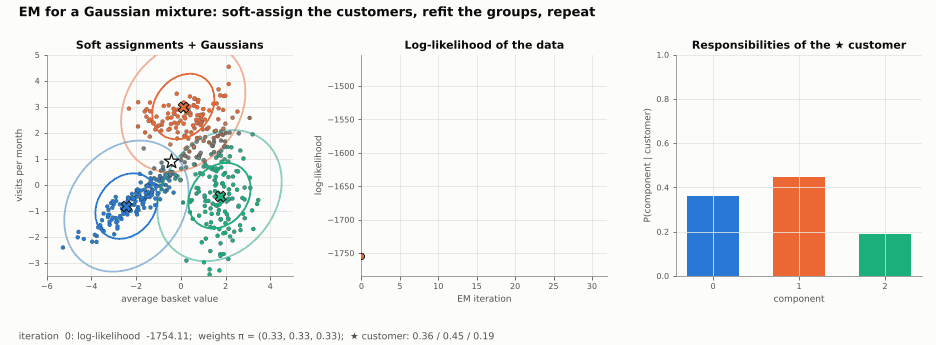
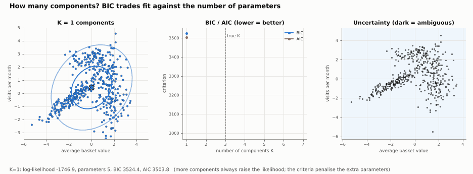

# 25 · Gaussian Mixture Models and the EM Algorithm

> **One line:** model the data as a blend of Gaussian blobs, and fit it by alternating "how responsible is each blob for each point?" (E-step) with "refit each blob to the points it is responsible for" (M-step): soft, probabilistic k-means with elliptical clusters.




## 1. Definition

A **Gaussian mixture model (GMM)** is an *unsupervised* generative model for the density of the data:

```
p(x) = Σ_k π_k · N(x | μ_k, Σ_k)            π_k ≥ 0, Σ π_k = 1
```

Generative story: pick a component `k` with probability `π_k`, then draw `x` from that Gaussian. The component `k` is a **latent (hidden) variable**. Fitting uses **Expectation-Maximisation (EM)**, an iterative maximum-likelihood procedure for models with hidden variables.

**Story in the code.** An online shop has 450 customers, each with *average basket value* and *visits per month*. Three hidden groups (bargain hunters, regulars, big spenders; true weights 0.4 / 0.4 / 0.2) overlap and have different shapes. Nobody recorded who belongs where.

## 2. Intuition

K-means says "every point belongs to exactly one nearest centre, and every cluster is a round ball". A GMM relaxes both:

- **Soft membership**: a customer midway between two groups is 60% one, 40% the other, and the model says so.
- **Shape**: each cluster has its own centre, spread *and* tilt (covariance), so thin diagonal groups are fine.
- **Size**: each cluster has its own weight `π_k`.

EM is a chicken-and-egg loop: if you knew the memberships you could fit the Gaussians (easy); if you knew the Gaussians you could compute memberships (easy). Start with a guess and alternate.

## 3. The math

**Log-likelihood** (what we maximise): `ℓ(θ) = Σ_i log Σ_k π_k N(x_i | μ_k, Σ_k)`. The `log` of a sum has no closed-form maximiser, which is why we need EM.

**E-step.** Responsibilities (Bayes' rule, the posterior of the hidden label):

```
r_ik = π_k N(x_i | μ_k, Σ_k) / Σ_j π_j N(x_i | μ_j, Σ_j)
```

Computed with the **log-sum-exp trick** to avoid underflow.

**M-step.** With `N_k = Σ_i r_ik` (the "effective number of customers" in component k):

```
π_k = N_k / n
μ_k = (1/N_k) Σ_i r_ik x_i
Σ_k = (1/N_k) Σ_i r_ik (x_i − μ_k)(x_i − μ_k)ᵀ
```

These are the ordinary weighted-mean and weighted-covariance formulas: the Gaussian MLE where each point counts `r_ik` times.

**Why it works.** By Jensen's inequality, for any distribution `q(k)` over components, `ℓ(θ) ≥ ELBO(q, θ)`, with equality when `q` is the exact posterior. The E-step makes the bound tight at the current `θ`; the M-step raises the bound by changing `θ`. Hence **the log-likelihood never decreases**. The code asserts this: it rose from −1754.1 to −1483.2 in 32 iterations, with a smallest step of +1.25e-04. EM converges to a *local* maximum (not necessarily global), so initialisation matters.

**Relation to k-means.** Force the covariances to `σ²I`, let `σ → 0` and the responsibilities become 0/1: the E-step becomes "assign to the nearest centre" and the M-step becomes "move to the mean": exactly Lloyd's algorithm (lesson 22).

**Covariance types** (parameters in 2-D with K = 3):

| type | shape | parameters |
|---|---|---|
| `full` | arbitrary ellipse, any tilt | 17 |
| `diag` | axis-aligned ellipse | 14 |
| `spherical` | circle (one variance each) | 11 |

**Choosing `K`.** More components always raise the likelihood, so penalise complexity:

```
BIC = p ln n − 2 ℓ        AIC = 2p − 2 ℓ        (lower is better)
```

`p` is the number of free parameters. BIC penalises harder and tends to pick the true `K` when the model family is right.

**Singularities.** If a component collapses onto a single point, `Σ_k → 0`, its density spikes to infinity and the likelihood is unbounded. Remedy: add a small `reg · I` to each covariance (the code does), set a minimum cluster size, or use a Bayesian prior.

## 4. Algorithm

1. Choose `K` and a covariance type. Initialise means (k-means++ seeding), covariances (scaled data covariance), weights (equal).
2. **E-step:** compute responsibilities `r_ik` for all points.
3. **M-step:** update `π, μ, Σ` from the responsibilities.
4. Compute the log-likelihood; stop when the improvement is below a tolerance.
5. Repeat from several initialisations and keep the best likelihood.
6. Predict: soft `r_ik` for new points (or `argmax` for a hard label); sample new data by the generative story.

## 5. Reading the animations

**`gmm_em.gif`** (K = 3, full covariances)

| Panel | What to watch | What it means |
|---|---|---|
| Left | each dot's colour is the *mix* of the component colours by its responsibility; ellipses (1σ and 2σ) start as three round blobs over the middle and stretch, tilt and slide onto the three groups | the soft clusters sharpen; points between groups stay blended (grey-ish) |
| Middle | log-likelihood climbs steeply at first, then flattens: −1754 → −1483 | monotone ascent, convergence at iteration 32 |
| Right | responsibilities of the ★ customer: at iteration 0 about 0.36 / 0.45 / 0.19, at the end 0.98 for component 0 | one customer's belief going from "no idea" to confident |

Result: recovered weights `[0.392, 0.210, 0.398]` (true 0.4 / 0.4 / 0.2, same components in another order), and **92.0% agreement with the hidden groups versus 84.4% for k-means** (the groups are elongated and overlapping, so round clusters misfit them).

**`gmm_model_selection.gif`** (K = 1..7)

| Panel | What to watch | What it means |
|---|---|---|
| Left | the fitted mixture for each `K`; at K = 7 ellipses chase small clumps | too many components start to model noise |
| Middle | BIC and AIC as `K` grows. BIC is lowest at **K = 3** (3070.3), AIC at **K = 4** (2998.1, almost tied with 5-6 and 7) | BIC found the truth; AIC's weaker penalty is less decisive |
| Right | uncertainty `1 − max_k r_ik` over the plane (dark = ambiguous): thin dark seams run between components; with more components the seams multiply | the soft boundary is where the model hesitates |

Covariance-type comparison (K = 3): full BIC 3070.3 / accuracy 0.920; diagonal 3319.0 / 0.831; spherical 3352.4 / 0.713. The correlated clusters need full covariances.

Our implementation matches scikit-learn: average log-likelihood −3.2960 vs −3.2976, BIC 3070.3 vs 3071.7 (different initialisation, same local optimum).

## 6. Hyper-parameters & knobs

- **`K`**: by BIC/AIC, held-out likelihood or domain knowledge.
- **Covariance type**: full / tied / diagonal / spherical (bias-variance trade-off: full has `K·d(d+1)/2` covariance parameters).
- **Initialisation**: k-means++ or k-means output; **number of restarts**.
- **Regularisation** `reg` on covariances; **tolerance / max iterations**.

## 7. Variants & relatives

- **K-means** (hard, spherical special case), **Fuzzy c-means** (soft memberships without a probability model).
- **Mixtures of other families**: Bernoulli mixtures (binary data), multinomial/topic mixtures (LDA topics), Student-t mixtures (heavy tails), mixtures of experts / regression.
- **Bayesian GMM / Dirichlet-process mixtures**: put priors on parameters and let the data choose the number of components; fitted by variational inference or Gibbs sampling.
- **Hidden Markov models** (lesson 30): EM (Baum-Welch) over a *sequence* of latent states. **Probabilistic PCA / factor analysis**: EM for continuous latents.
- **Online / incremental EM**, **EM for missing data** (impute in the E-step).
- *Not implemented:* tied covariance, Bayesian priors, other mixture families.

## 8. Assumptions, strengths & weaknesses

Assumes the data are a mixture of **Gaussians** (clusters are ellipsoidal and roughly unimodal) and independent samples.

**+** Soft assignments and uncertainty; elliptical clusters of different sizes and orientations; a proper likelihood (model selection, anomaly scoring with `p(x)`, sampling new data); generalises k-means.
**−** Local optima (restarts needed); `K` must be chosen; singularities; fails on non-Gaussian shapes (rings, moons); sensitive to outliers; `O(n K d²)` per iteration and many parameters in high dimensions (use diagonal covariances or PCA first).

**Use** for overlapping, elliptical clusters, density estimation, soft segmentation and as the emission model in HMMs. **Avoid** for arbitrary-shaped clusters (use DBSCAN, lesson 24, or spectral methods).

## 9. Metrics

Held-out log-likelihood; BIC / AIC; agreement with known labels when they exist (adjusted Rand index, purity after matching: the code matches components to labels by permutation); silhouette; stability across restarts; calibration of the responsibilities.

## 10. Code tour (`gmm_em.py`)

- `GMM` - `fit` (E-step with log-sum-exp, closed-form M-step, k-means++ start, `record=True` stores every iteration), `predict_proba`, `score`, `n_params`, `bic`, `aic`; `cov_type` = `full | diag | spherical`.
- `best_of` (restarts), `kmeans` (for comparison), `shop_data`, `match_accuracy`, `draw_ellipses`, `blend`.
- `em_gif`, `selection_gif`, `main` (monotonicity, covariance types and scikit-learn checks).

Run: `python gmm_em.py` (about 6 s).

## 11. Experiments

1. Change the initialisation to a poor one (all means near the centre) and count iterations; then try 10 random restarts and compare final likelihoods.
2. Add a fourth, tiny, tight component and watch BIC choose `K`; make it a single point and watch the singularity.
3. Fit to two-moons data (lesson `make_moons`); look at the ellipses and explain what goes wrong.
4. Implement `cov_type="tied"` (one shared `Σ`): what is the M-step? Compare with LDA (lesson 11).
5. Use the per-point log `p(x)` (from `_log_prob` + weights) as an anomaly detector and compare it with Isolation Forest (lesson 29).

## 12. Pitfalls

- Trusting a single run (local optimum) and over-reading component *indices* (labels are arbitrary).
- Using more components than the data support; the likelihood will always reward you.
- Full covariances in high dimensions with few samples (singular matrices).
- Not scaling features that are in different units.
- Interpreting the responsibilities as calibrated probabilities when the Gaussian assumption is wrong.
- Reading the clusters as "real" groups: a GMM will happily split a non-Gaussian single group into several.

**Next:** [26 PCA](../26_pca/lesson.md)
