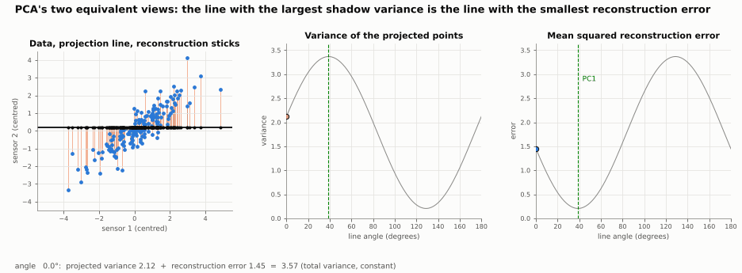
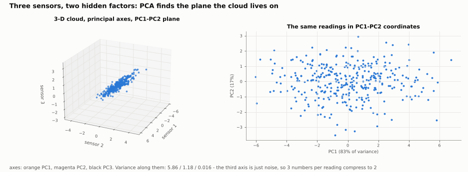
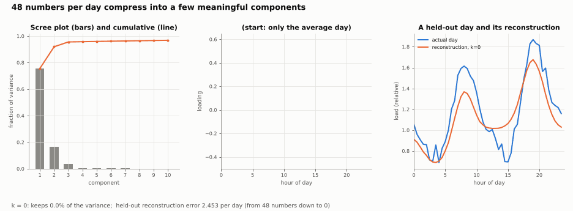

# 26 · Principal Component Analysis (PCA)

> **One line:** rotate the coordinate system to line up with the directions of greatest variance, then keep only the first few; you lose the least information possible for that number of dimensions.

## 1. Definition

**PCA** is an *unsupervised* linear **dimensionality-reduction** method. Given `n` samples of `d` features, it finds orthonormal directions `v₁, v₂, …` (the **principal components**) such that projecting the centred data onto the first `k` of them

1. **maximises the variance** retained, and equivalently
2. **minimises the squared reconstruction error** `Σ ‖x − x̂‖²`.

Scores `z = Vₖᵀ(x − μ)` are the compressed coordinates; `x̂ = μ + Vₖ z` is the reconstruction.

**Stories in the code.** (1) Two correlated sensors. (2) Three sensors driven by two hidden factors (a flat cloud). (3) An electricity utility's **daily load curves**: 48 half-hourly readings per day, generated from a base daily rhythm, a hot-afternoon air-conditioning bump and a weekend effect, plus noise. The 48-dimensional days live near a 3-dimensional surface.

## 2. Intuition

A cloud of points shaped like a flat cigar. Its long axis is the most informative direction (the "shadow" cast on it is the longest); the width is the next; thickness is mostly noise. PCA finds these axes. Projecting onto the long axis is like photographing the cigar from the side that shows it best; projecting onto a poor axis squashes it into a blob.

## 3. The math

Centre the data: `X_c = X − μ`. Covariance matrix `C = X_cᵀ X_c / (n − 1)` (symmetric, positive semi-definite).

**Variance along a unit direction `u`:** `Var(u) = uᵀ C u`.

**Maximising it** subject to `‖u‖ = 1` (Lagrange multiplier) gives `C u = λ u`: `u` must be an **eigenvector** of `C`, and the variance equals the **eigenvalue** `λ`. So `v₁` is the eigenvector of the largest eigenvalue, `v₂` of the second largest (orthogonal automatically, since `C` is symmetric), and so on.

**Why "max variance = min reconstruction error".** For a point `x_c` and unit direction `u`, Pythagoras gives `‖x_c‖² = (uᵀx_c)² + dist²(x_c, line)`. Averaging: `tr(C) = Var(u) + MSE(u)`. The total variance `tr(C)` is constant, so maximising the shadow variance is the same as minimising the distance to the line. The first animation prints this: `3.368 + 0.205 = 3.573` at the optimum, and the sum is constant (to 0.0) at every angle.

**SVD route.** With `X_c = U S Vᵀ`: the rows of `Vᵀ` are the principal directions, `λᵢ = sᵢ² / (n − 1)`, and the scores are `U S`. SVD is numerically more stable than forming `C`. The code implements both; they agree to `4e-16` (variances) and `9e-14` (components), and match scikit-learn's explained-variance ratios to `4e-16`.

**Explained variance ratio** `λᵢ / Σλ`; the **scree plot** shows it per component; choose `k` for a cumulative target (e.g. 95%) or where the curve has an "elbow", or by cross-validated reconstruction error.

**Reconstruction error** with `k` components `= Σ_{i>k} λᵢ` (the discarded variances; Eckart-Young: the best possible rank-`k` approximation).

**Whitening.** Divide each score by `√λᵢ` so the scores have identity covariance (verified: max deviation 8e-15). Useful as pre-processing, but it amplifies noise in low-variance directions.

**Standardisation matters.** PCA is about variance, so a feature in large units dominates. Standardise (correlation-matrix PCA) unless units are comparable.

**Sign and uniqueness.** Components are unique only up to sign (the code fixes it) and are ill-defined when two eigenvalues are equal.

## 4. Algorithm

1. Centre the data (and usually scale to unit variance).
2. Compute the SVD of the centred data (or eigendecompose the covariance).
3. Sort components by variance; pick `k` using the scree plot / explained variance.
4. Project: `Z = X_c Vₖᵀ`. Reconstruct: `X̂ = Z Vₖ + μ`.
5. Apply the *same* mean and components to new data.

## 5. Reading the animations

**`pca_rotation.gif`**

| Panel | What to watch | What it means |
|---|---|---|
| Data + line | the line rotates; black dots are projections, orange sticks are the lost distance | each angle is a candidate 1-D summary |
| Variance of the projection | the curve peaks at **39.0°** (3.37), exactly the dashed PC1 line | PC1 = largest shadow |
| Reconstruction error | a mirror image: minimum at **39.0°** (0.205); the caption shows variance + error = 3.57 always | the two PCA criteria are the same thing |

**`pca_3d.gif`**: three sensors that really only have two degrees of freedom. The rotating 3-D view shows the cloud lying in the green PC1-PC2 plane; the variances along the three axes are `5.86 / 1.18 / 0.016`, so PC3 (noise) can be discarded: 2 components keep **99.8%** of the variance. The right panel shows the readings in PC1-PC2 coordinates.

**`pca_components.gif`** (daily load curves, 220 training days, tested on held-out days)

| Panel | What to watch | What it means |
|---|---|---|
| Scree plot | three tall bars (75.6%, 16.3%, 3.6%) then nothing; cumulative line reaches 95.6% by PC3 | the 48-D data are effectively 3-D |
| Component shape | PC1 is the hot-afternoon bump (cosine similarity 0.98 with the pattern that generated it: it varies most from day to day), PC3 is the weekend effect (0.96), PC2 is a *mixture* (0.84 afternoon bump, 0.44 base rhythm); PC4 onward is wiggly noise | components can be interpretable patterns, but they are forced to be orthogonal, so overlapping real-world patterns get blended (PC2) |
| Reconstruction | `k=0`: the average day; `k=1`: right rhythm, wrong detail; `k=3`: almost indistinguishable from the real day | held-out error per day: 2.45, 0.66, 0.18, 0.11, then flat at ~0.10 (the noise floor) |

## 6. Hyper-parameters & knobs

- **Number of components `k`** (explained-variance threshold, elbow, cross-validation, parallel analysis against random data).
- **Scaling**: standardise or not; **centring** is mandatory.
- **Whitening** on/off; **solver**: full SVD, truncated/randomised SVD for big data, incremental PCA for streaming.

## 7. Variants & relatives

- **Kernel PCA**: PCA in a kernel-induced feature space (non-linear structure like rings); **Sparse PCA** (sparse loadings, more interpretable); **Robust PCA** (low-rank + sparse outliers); **Probabilistic PCA / Factor analysis** (a latent-variable model with noise: `x = Wz + μ + ε`; PCA is the zero-noise limit); **Incremental / randomised PCA**.
- **ICA** (independent components, non-Gaussian sources), **NMF** (non-negative parts-based factors), **SVD / LSA** on sparse matrices, **MDS / Isomap / t-SNE / UMAP** (non-linear embeddings; lesson 27), **autoencoders** (a linear autoencoder spans the PCA subspace: lesson 31), **LDA** (supervised, lesson 11).
- *Not implemented:* kernel, sparse, robust and probabilistic variants.

## 8. Assumptions, strengths & weaknesses

Assumes the structure of interest is **linear** and that **variance = information** (high-variance directions matter).

**+** Closed form, fast, deterministic, no hyper-parameters except `k`; decorrelates features; denoises; good for visualisation and as pre-processing (avoiding collinearity); interpretable loadings.
**−** Linear only (a spiral or ring is not compressed well); sensitive to scale and outliers; variance can be the wrong criterion (a small-variance direction may be the discriminative one); components are mixtures of features, so they can be hard to name.

**Use** for compression, denoising, visualisation, collinearity removal, as a baseline embedding. **Avoid** when the interesting variation is non-linear or lies in low-variance directions (use LDA, kernel methods, or non-linear embeddings).

## 9. Metrics

Explained variance ratio, held-out reconstruction error, downstream-task performance after reduction, stability of components under resampling, and the comparison with a noise level (the flat error floor at `k ≥ 4` equals the noise).

## 10. Code tour (`pca.py`)

- `PCA` - `fit(X, method="eig" | "svd")`, `transform`, `inverse_transform`, `reconstruction_error`, whitening.
- `sensor_pairs`, `sensor_cloud`, `load_curves` - the synthetic datasets.
- `rotation_gif`, `cloud_3d_gif`, `components_gif`, `main` (eig-vs-SVD, whitening and scikit-learn checks).

Run: `python pca.py` (about 15 s).

## 11. Experiments

1. Multiply one sensor by 100 and re-run `rotation_gif`; what happens to PC1? Then standardise first.
2. Raise the noise in `load_curves` to 0.3 and compare the scree plot.
3. Add 5 outlier days with huge afternoon load. How do the components change?
4. Fit PCA on weekdays only and reconstruct weekend days.
5. Use `PCA(2, whiten=True)` on the 3-D cloud and check the covariance of the scores.

## 12. Pitfalls

- Not centring, or centring/scaling the test set with its own statistics instead of the training statistics.
- Choosing `k` by looking only at training reconstruction error.
- Interpreting sign (arbitrary) or reading a component's loadings as causal.
- Running PCA on categorical codes as if they were numbers.
- Assuming PCA preserves class separation.

**Next:** [27 t-SNE](../27_tsne/lesson.md)
