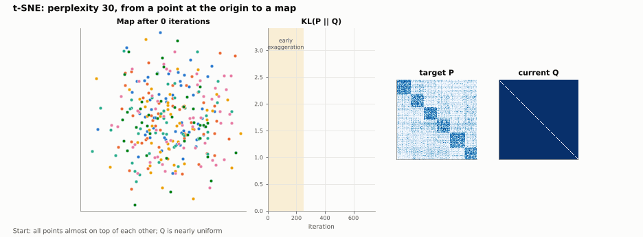
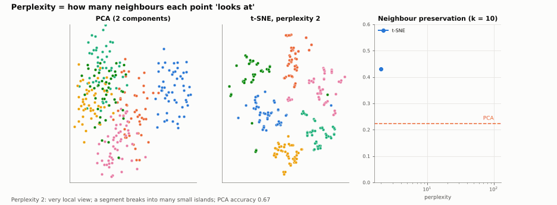

# 27 · t-SNE (t-distributed Stochastic Neighbour Embedding)

> **One line:** turn "who is whose neighbour" in high dimensions into a probability distribution, then move points around in 2-D until their neighbour probabilities match; a map that keeps neighbourhoods together, with a heavy-tailed kernel that lets clusters separate.




## 1. Definition

**t-SNE** (van der Maaten & Hinton, 2008) is an *unsupervised*, **non-linear** dimensionality-reduction method used almost exclusively for **visualisation** in 2-D or 3-D. Given high-dimensional points `x_i` it finds low-dimensional points `y_i` such that points that are close neighbours in the original space are close in the map. It has no explicit mapping function: the embedding is computed for exactly the points you gave it.

**Story in the code.** A streaming service describes 300 subscribers by 30 numbers. They belong to six taste segments that are roughly equally far apart (a configuration that no *linear* 2-D projection can flatten), and six columns are high-variance "volume" measures unrelated to taste. t-SNE should put each segment into its own island.

## 2. Intuition

Each point looks around and says "my neighbours are those, mostly the very near ones, a bit of the farther ones" (a probability over the other points). The map is a second set of points with the same kind of statements. Learning is a tug-of-war: points that *should* be neighbours attract each other, pairs that should not repel, until the two sets of statements agree. Because the map has only 2 dimensions, the repulsion needs more room than a Gaussian would give: hence the Student-t distribution, whose long tails let moderately distant points sit far apart without paying a high price. That is what opens the gaps between clusters.

## 3. The math

**High-dimensional affinities.** For each point `i` a Gaussian over the others:

```
p_{j|i} = exp(−‖x_i − x_j‖² / 2σ_i²) / Σ_{k≠i} exp(−‖x_i − x_k‖² / 2σ_i²)
```

`σ_i` is chosen per point by binary search so that the **perplexity** `Perp = 2^{H(P_i)}` (here with natural logs: `exp(H)`) equals a user value: roughly "the effective number of neighbours". In dense regions `σ_i` is small, in sparse regions large, so every point sees about the same number of neighbours. (The code checks that every row's entropy equals `log 30 = 3.4012` to four decimals.)

**Symmetrise:** `p_ij = (p_{j|i} + p_{i|j}) / 2n`, so that `Σ p_ij = 1` and every point has some influence.

**Low-dimensional affinities.** With map points `y_i`, a Student-t kernel with one degree of freedom (a Cauchy):

```
q_ij = (1 + ‖y_i − y_j‖²)⁻¹ / Σ_{k≠l} (1 + ‖y_k − y_l‖²)⁻¹
```

**Objective.** Minimise the Kullback-Leibler divergence

```
KL(P ‖ Q) = Σ_{i≠j} p_ij log (p_ij / q_ij)
```

**Gradient** (the beautiful part):

```
∂KL/∂y_i = 4 Σ_j (p_ij − q_ij)(y_i − y_j)(1 + ‖y_i − y_j‖²)⁻¹
```

Each pair acts like a spring: attraction if `p_ij > q_ij` (should be closer), repulsion if `p_ij < q_ij`.

**Why the asymmetric KL matters.** `p log(p/q)` is large when two *near* points (big `p`) are placed *far* apart (small `q`), and small when far points (small `p`) are placed close. So t-SNE strongly preserves **local** neighbourhoods and says little about global distances.

**Why the heavy tail.** In 10 dimensions there is a lot of room at moderate distances; in 2-D there is not. Using the same Gaussian kernel in the map crowds those points together (**the crowding problem**). The t kernel decays polynomially, so moderate distances in the original space can become large ones in the map.

**Optimisation tricks (all in the code).** Gradient descent with **momentum** (0.5, then 0.8), **adaptive gains** per coordinate, **early exaggeration** (multiply `P` by 12 for the first 250 iterations so clusters can move around easily), tiny random initialisation.

## 4. Algorithm

1. Choose a perplexity (5-50; default 30).
2. Compute pairwise distances; find `σ_i` by binary search per point; build the symmetric `P`.
3. Initialise `Y` with tiny random numbers (or PCA).
4. For 750-1000 iterations: compute `Q`, the gradient, update `Y` with momentum and gains (early exaggeration for the first 250 iterations).
5. Read the map; try several perplexities and seeds.

**Cost.** Exact t-SNE is `O(n²)` per iteration; Barnes-Hut (`O(n log n)`) and FFT-accelerated variants handle hundreds of thousands of points.

## 5. Reading the animations

**`tsne_optimize.gif`** (perplexity 30; colours are the hidden segments, which the algorithm never sees)

| Panel | What to watch | What it means |
|---|---|---|
| Map | at iteration 0 all points are a cloud of tiny random jitter; during the shaded **early-exaggeration** phase the map is a small, compressed cloud; when the exaggeration is switched off (iteration 250) the cloud expands and six islands appear by about iteration 400 | the map is *unfolded*, not placed |
| KL curve | flat around 3.0 during exaggeration (the shown KL always uses the true `P`), then a sharp drop to **0.51** | the objective being minimised |
| Heat maps | `P` (target) and `Q` (current), points sorted by segment, log colour scale; `Q` starts uniform and ends with the same diagonal blocks as `P` | "make my statements match the target statements" |

Result: 10-NN **segment accuracy 1.00** in the t-SNE map versus **0.67 for PCA**; neighbour preservation (fraction of each point's 10 nearest neighbours kept) **0.58 vs 0.22 for PCA**.

**`tsne_perplexity.gif`** (500 iterations per run)

| perplexity | KL | neighbour preservation | segment accuracy |
|---|---|---|---|
| 2 | 0.86 | 0.43 | 0.98 |
| 5 | 0.75 | 0.52 | 1.00 |
| 10 | 0.70 | 0.55 | 1.00 |
| 20 | 0.57 | 0.57 | 1.00 |
| **30** | **0.52** | **0.58** | 1.00 |
| 50 | 0.55 | 0.57 | 0.99 |
| 100 | 0.95 | 0.37 | 0.87 |
| PCA | - | 0.22 | 0.67 |

Low perplexity: clusters shatter into small islands (the view is too local). High perplexity (comparable to the segment size, about 50): neighbourhoods are no longer local and segments blur and merge. The best range is 5-50 and the map is stable across it; the PCA panel shows the six segments overlapping.

**Verification.** Entropy calibration is exact; the final KL (0.508) and trustworthiness (0.970) match scikit-learn's `TSNE` run on the same data (KL 0.514, trustworthiness 0.973; PCA 0.783).

## 6. Hyper-parameters & knobs

- **Perplexity** (the key knob; must be smaller than the number of points; larger data tolerate larger values).
- **Learning rate** (too low = a compressed blob, too high = a scattered ball; `n/12` or 200 are common), **iterations** (≥ 750), **early exaggeration** factor and length.
- **Initialisation** (PCA initialisation preserves more global structure and is more reproducible), **random seed**, **metric** (Euclidean, cosine...).
- **Barnes-Hut angle** `θ` for large data.

## 7. Variants & relatives

- **UMAP**: graph-based, faster, often better at keeping global structure, can embed new points; **LargeVis**, **openTSNE** (FFT, out-of-sample extension), **parametric t-SNE** (a neural network learns the map).
- **Linear**: PCA (lesson 26), **MDS**, **Isomap**, **LLE**, **Laplacian eigenmaps**; **autoencoders** (lesson 31); **SNE** (the original, with a Gaussian in the map).
- **Barnes-Hut / FFT t-SNE** for big data; **multi-scale** and **dt-SNE** variants.
- *Not implemented:* Barnes-Hut acceleration, out-of-sample mapping, 3-D output.

## 8. Assumptions, strengths & weaknesses

Assumes neighbourhoods carry the structure of interest and that a 2-D map of them exists.

**+** Excellent at revealing cluster structure in high-dimensional data; handles non-linear manifolds; few parameters; a vivid first look at embeddings (images, word vectors, single-cell data).
**−** Only **local** structure is trustworthy: distances between clusters, cluster sizes and densities are **not** meaningful; results depend on perplexity and seed (and can show clusters in pure noise); stochastic and non-convex; no mapping for new points; quadratic cost unless approximated; cannot be used as a general pre-processing step the way PCA can.

**Use** for exploring and communicating structure. **Avoid** for measuring distances, for feeding downstream models as features, and for judgements about "which clusters are close".

## 9. Metrics

Final KL divergence (comparable only for the same data and perplexity), **trustworthiness / continuity**, **neighbour preservation** (used here), k-NN classification accuracy in the map, silhouette on known labels, stability across seeds and perplexities, and comparison with a PCA baseline.

## 10. Code tour (`tsne.py`)

- `conditional_p` (binary search for `σ_i`), `joint_p` (symmetrise), `q_matrix` (Student-t kernel), `kl`.
- `tsne(X, perplexity, ...)` - gradient, momentum, gains, early exaggeration; stores snapshots.
- `pca2`, `neighbour_preservation`, `knn_label_acc`, `subscribers` (the data), `draw_map`, `optimize_gif`, `perplexity_gif`, `main` (scikit-learn check).

Run: `python tsne.py` (about 12 s).

## 11. Experiments

1. Set `exag=1`: does the final map change? Try `lr=10` and `lr=2000`.
2. Run the same perplexity with 5 different seeds; compare maps and KL (which differences are real?).
3. Make two segments much closer than the rest. Does the map show them closer? Make one segment 5× larger: is it larger in the map?
4. Embed pure Gaussian noise at perplexity 5 and 50; read "clusters" in it.
5. Initialise `Y` with the PCA solution (scaled to std 1e-4) and compare with random initialisation.

## 12. Pitfalls

- Reading the **distance between clusters, the cluster sizes or the axes** as meaningful (they are not).
- Using one perplexity and one seed; always compare several.
- Too few iterations (the map looks like a blob or the KL is still falling).
- Running on raw, unscaled, noisy features (pre-reduce with PCA to 30-50 dims first on large data).
- Using t-SNE coordinates as input features for a classifier or clustering without care (they distort density).
- Treating a nice-looking map as evidence that clusters exist.

**Next:** [28 Self-organising map](../28_self_organizing_map/lesson.md)
