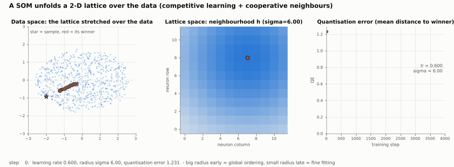
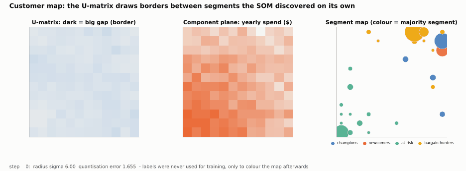

# 28 · Self-Organising Map (Kohonen Map)

> **One line:** a grid of neurons is stretched over the data by competitive learning, so that neighbouring neurons end up representing similar data: a topology-preserving 2-D map of high-dimensional data.




## 1. Definition

A **self-organising map (SOM)**, invented by Teuvo Kohonen, is an *unsupervised* neural model with a fixed 2-D **lattice** of `rows × cols` neurons. Each neuron `i` owns a **weight vector** `wᵢ` living in the *data* space. Training moves these vectors so that

1. the set of neurons approximates the data distribution (like k-means prototypes), and
2. neurons that are neighbours on the lattice end up with similar weight vectors (**topology preservation**).

Two stories in the code:

- **Unfolding.** A 12×12 lattice is stretched over a blob of 2-D points (think GPS pings around a city centre). We watch the grid unfold.
- **Customer map.** 600 customers described by 4 numbers (recency, frequency, spend, tenure) hide 4 segments (*champions, newcomers, at-risk, bargain hunters*). A 12×12 SOM squeezes them onto a 2-D map; the **U-matrix** reveals segment borders.

## 2. Intuition

Imagine a flexible fishing net lying on the floor with a scatter of marbles (the data). Pick a marble; find the knot of the net closest to it (the **winner**, or best-matching unit, BMU); pull that knot toward the marble. Because the knots are tied to their neighbours, the nearby knots get dragged along too (less the farther they are on the net). Repeat with many marbles while the net gets stiffer (smaller neighbourhood) and the pulling gentler (smaller learning rate). The net ends up laid over the cloud, with its shape following the data.

## 3. The math

For each training sample `x` at step `t`:

```
1. Winner:           b = argminᵢ ‖x − wᵢ‖
2. Neighbourhood:    hᵢ(t) = exp( − d_lattice(i, b)² / (2 σ(t)²) )        (Gaussian on the LATTICE distance)
3. Update:           wᵢ ← wᵢ + η(t) · hᵢ(t) · (x − wᵢ)        for every neuron i
4. Decay:            η(t) = η₀ (η₁/η₀)^(t/T),    σ(t) = σ₀ (σ₁/σ₀)^(t/T)       (exponential schedules)
```

Competitive learning (step 1) plus cooperation of neighbours (step 2-3). Early on `σ` is large (about half the lattice), so the entire grid moves together and **global ordering** emerges; late in training `σ < 1`, so only the winner moves and the neurons **fine-tune**.

**Quality measures (implemented):**

- **Quantisation error (QE)** = mean `‖x − w_BMU(x)‖`: how well the prototypes represent the data.
- **Topographic error (TE)** = fraction of samples whose first and second best neurons are *not* adjacent on the lattice: how well topology is preserved.

**U-matrix.** For each neuron, the average distance between its weight vector and those of its lattice neighbours. High values (dark) = a "valley wall" between clusters; low = inside a cluster.

**Component plane.** The map of one feature (e.g. spend) across the lattice: shows which part of the map corresponds to high or low values of that feature.

## 4. Algorithm

1. Choose lattice size, schedules (`η₀=0.5 → η₁=0.02`, `σ₀ = max(rows, cols)/2 → σ₁ = 0.6`). Initialise weights near the data mean (or via PCA).
2. For each iteration, sample a data point, find its BMU.
3. Compute lattice-distance neighbourhood weights and move every neuron toward the point.
4. Decay `η` and `σ`. Repeat for `n_iters` (3000-6000 here).
5. Analyse: map each sample to its BMU, colour neurons by majority label, draw U-matrix, component planes, hit-counts.

## 5. Reading the animations

**`som_unfolding.gif`**

| Panel | What to watch | What it means |
|---|---|---|
| Data space | the orange lattice starts as a crumpled sliver near the centre, then spreads and finally covers the whole ellipse as a smooth grid | the net is stretched over the data |
| Lattice space | the blue patch shows `hᵢ` around the current winner: a huge region at the start (σ=6), a single cell at the end (σ=0.7) | cooperation shrinks into competition |
| Quantisation error | noisy fall from ~1.2 to **0.148**, flattening as the radius shrinks | the decay schedule controls the phase of learning |

**`som_customer_map.gif`**

| Panel | What to watch | What it means |
|---|---|---|
| U-matrix | blank at first, then dark lines separating four rectangular regions | cluster borders discovered without labels |
| Component plane (spend) | a smooth gradient from high (orange, left/top) to low (right) | a feature varies smoothly over the map: topology preserved |
| Segment map | neurons coloured by the majority segment of customers they win (the *labels were never used in training*); dot size = hits | final **segment purity 0.997** |

Numbers from the run: topographic error **0.000** (blob) and **0.015** (customers). QE 0.361 on customers; for comparison k-means with 144 prototypes reaches 0.220 and with 4 prototypes 1.002. A SOM trades some quantisation accuracy for ordering (blob: SOM 0.148 vs k-means 0.096).

## 6. Hyper-parameters & knobs

- **Lattice size / shape** (rectangular or hexagonal; more neurons = finer map, but empty neurons). Rule of thumb: `5√n` neurons.
- **`σ₀`, `σ₁`** - too small at the start gives a twisted, folded map; too large at the end blurs everything.
- **`η₀, η₁`**, **iterations** (several hundred epochs for good convergence).
- **Initialisation** (PCA or data-based is more stable than random).
- **Feature scaling** - the BMU uses Euclidean distance, so standardise.
- **Batch vs online** training; **toroidal** lattices to avoid edge effects.

## 7. Variants & relatives

- **Batch SOM** (each epoch recomputes weights as neighbourhood-weighted means), **hexagonal grids**, **growing SOM / growing neural gas** (add neurons where error is high), **GTM** (a probabilistic, generative version), **supervised SOM / LVQ** (learning vector quantisation, uses labels).
- **k-means** is the `σ → 0` limit of the SOM (no neighbourhood). **t-SNE / UMAP** (lesson 27) also give 2-D maps but without a fixed lattice or prototype vectors. **PCA** gives a linear projection; the SOM is a non-linear "principal surface".
- *Not implemented:* growing/probabilistic variants, hexagonal lattices.

## 8. Assumptions, strengths & weaknesses

Assumes the data lie near a low-dimensional manifold that a 2-D sheet can follow.

**+** Intuitive visualisation, topology-preserving, yields prototypes (usable for quantisation, clustering, anomaly detection by QE), works online, handles many features.
**−** No objective function in the standard algorithm (hard to compare runs); results depend on the schedules and initialisation; fixed lattice size; distances on the map are only qualitatively meaningful; not good for very high dimensions without preprocessing.

**Use** for exploring customer or sensor data, visual cluster discovery, colour/vector quantisation. **Avoid** when you need exact density estimates or a rigorous probabilistic model (use GMMs or GTM).

## 9. Metrics

Quantisation error, topographic error, hit histogram (dead neurons win nothing), U-matrix structure, label purity (when labels exist, only for validation), stability across seeds.

## 10. Code tour (`som.py`)

- `SOM` - `bmu`, `neighbourhood`, `fit` (with snapshots for the animation), `quantisation_error`, `topographic_error`, `umatrix`, `hits`.
- `kmeans_qe` - baseline for comparison.
- `make_blob`, `make_customers` - the synthetic data.
- `draw_grid`, `animate_unfolding`, `animate_customer_map`, `main`.

Run: `python som.py` (about 10 s).

## 11. Experiments

1. Start with `σ₀ = 1` and see how the map twists.
2. Use a 20×20 lattice and count dead neurons with `hits`.
3. Fit the SOM to a ring-shaped cloud: what does the lattice do at the hole?
4. Remove standardisation from the customer data and look at the U-matrix.
5. Colour the segment map by another feature (component plane of recency) and compare.

## 12. Pitfalls

- Folded or twisted maps from too-fast shrinking of `σ`.
- Interpreting map distances literally; large U-matrix values matter, absolute positions do not.
- Not scaling features.
- Using labels to tune the map and then claiming "unsupervised" discovery.

**Next:** [29 Anomaly detection](../29_anomaly_isolation_forest/lesson.md)
