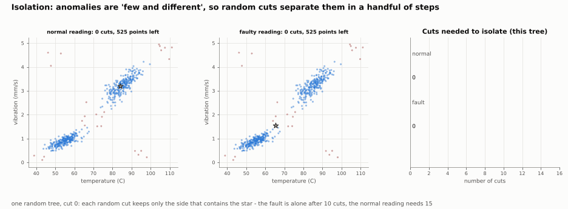
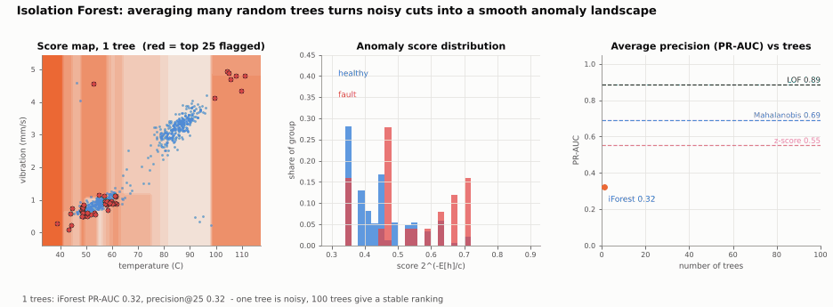

# 29 · Anomaly Detection: Isolation Forest (and friends)

> **One line:** anomalies are few and different, so random cuts of the feature space isolate them in far fewer steps than normal points.




## 1. Definition

**Anomaly (outlier) detection** finds observations that deviate from the bulk of the data, usually *without labels* (unsupervised) because faults are rare and diverse. **Isolation Forest (iForest)** builds many random trees; the average **path length** needed to isolate a point becomes its anomaly score. We also implement three baselines: **z-score**, **Mahalanobis distance** and **Local Outlier Factor (LOF)**.

**Story in the code.** A factory machine logs `(temperature, vibration)` every minute. It runs in two modes: *idle* (cool, quiet) and *under load* (hot, vibrating). 500 readings are healthy; 25 are injected faults: some far outside, some in the **gap between the two modes** (a reading that is "average" for the whole fleet yet impossible for either mode), plus hot-but-silent and cold-but-shaking readings.

## 2. Intuition

Play "twenty questions" with random questions: pick a random feature and a random threshold ("is temperature < 71?"), keep the side that contains your target point. A point in a crowded cluster needs many questions before it is alone; a point far from everyone is alone after a few. The number of questions *is* the anomaly score. The first animation shows this literally, drawing the cuts one after the other for a normal reading (13-15 cuts) and a fault (about 10 here, in one random tree).

## 3. The math

**Isolation tree.** Recursively: choose a random feature `q` and a random split `p` between the min and max of `q` in the node; send points left/right; stop when a node has one point (or a height limit `⌈log₂ ψ⌉` is reached). The tree is trained on a **sub-sample** of size `ψ` (typically 256) which also fights swamping and masking.

**Path length** `h(x)`: number of edges from the root to the leaf where `x` ends, plus a correction `c(size)` when the leaf still holds several points.

**Normalising constant.** Isolation trees behave like binary search trees; the average unsuccessful-search depth is

```
c(n) = 2 H(n−1) − 2(n−1)/n ,     H(i) ≈ ln(i) + 0.5772  (harmonic number)
```

**Anomaly score**

```
s(x, n) = 2 ^ ( − E[h(x)] / c(n) )
```

`s → 1` when `E[h]` is much shorter than `c(n)` (anomaly); `s ≈ 0.5` when `E[h] ≈ c(n)` (nothing special); `s → 0` for points deep in the bulk. In the run: mean score healthy **0.443**, faults **0.680**; mean cuts to isolate: normal ~15.2, faults ~9.7 (reference `c(525) = 11.7`).

**Baselines**

```
z-score:      max_j |x_j − μ_j| / σ_j                    (per-feature, ignores correlation and multi-modality)
Mahalanobis:  √((x−μ)ᵀ Σ⁻¹ (x−μ))                         (accounts for correlation, but assumes ONE Gaussian blob)
LOF:          ratio of the neighbours' local density to the point's own density (reachability distances to its k nearest neighbours)
```

LOF ≈ 1 means "as dense as my neighbours"; ≫ 1 means "much sparser than my neighbours".

## 4. Algorithm (Isolation Forest)

1. For `t = 1..T` (e.g. 100): draw a random sub-sample of `ψ` points; grow an isolation tree with random splits to depth `⌈log₂ ψ⌉`.
2. For a point `x`: compute `h_t(x)` in every tree and average.
3. Score `s = 2^(−E[h]/c(ψ))`.
4. Flag the top `k` scores, or those above a threshold chosen from the expected contamination rate or from a validation set.

Cost: `O(T ψ log ψ)` to train, `O(T log ψ)` per point to score, so it scales to millions of rows.

## 5. Reading the animations

**`isolation_cuts.gif`**

| Panel | What to watch | What it means |
|---|---|---|
| Left: a normal reading (star) | many axis-parallel cuts crowd around it before it is alone | dense region = hard to isolate |
| Middle: a fault | a handful of cuts isolate it (e.g. 10) | sparse region = easy to isolate |
| Right: average cuts over many trees | the running average of normal (≈15.2) and fault (≈9.7) converges; single trees are noisy | averaging many random trees makes a stable score |

**`iforest_scores.gif`**

| Panel | What to watch |
|---|---|
| Score map | with 1 tree the map is blocky; with 100 trees it is a smooth landscape with low scores on the two healthy modes and high scores in the gap between them and far outside |
| Score histogram | healthy (blue) and faulty (red) distributions separate as trees are added |
| PR-AUC vs number of trees | climbs from 0.32 (1 tree) to 0.96, passing the LOF line (0.886) and the Mahalanobis/z-score lines |

**Method comparison (525 readings, 25 faults):**

| method | PR-AUC | precision@25 |
|---|---|---|
| Isolation Forest | **0.963** | 0.88 |
| LOF | 0.886 | 0.84 |
| Mahalanobis | 0.691 | 0.64 |
| z-score | 0.552 | 0.56 |

Why the baselines fail: z-score and Mahalanobis both treat the fleet as one blob, so the **gap faults** look like the "average" machine. iForest and LOF are local/multi-modal methods and catch them. Our implementation agrees with scikit-learn's (PR-AUC 0.963 vs 0.963).

## 6. Hyper-parameters & knobs

- **`n_trees` T** (100-200 is plenty). **Sub-sample `ψ`** (256 default): smaller samples improve isolation of anomalies and reduce cost.
- **Contamination / threshold**: iForest returns scores; deciding "what is anomalous" is a separate business decision (top-k alert budget, expected rate, or a validated threshold).
- **LOF `k`**: neighbours defining "local". **Mahalanobis**: robust covariance (MCD) helps when outliers contaminate the fit.
- **Feature scaling** matters for LOF, not for iForest's axis-parallel random cuts.

## 7. Variants & relatives

- **Extended Isolation Forest** - random *oblique* cuts remove the axis-aligned artefacts visible in the score map. *Not implemented.*
- **One-class SVM / SVDD**, **robust covariance (elliptic envelope)**, **kernel density**, **GMM likelihood** (lesson 25), **DBSCAN noise points** (lesson 24).
- **Reconstruction-based**: autoencoders (lesson 31), PCA residuals. **Deep SVDD**, **isolation-based streaming** (Robust Random Cut Forest). **Time-series** specifics: seasonal decomposition residuals, forecasting errors (lesson 07), HMM likelihood (lesson 30).
- **Supervised** detection when labelled faults exist (treat as imbalanced classification, lesson 02).

## 8. Assumptions, strengths & weaknesses

Assumes anomalies are rare and *feature-space different* (susceptible to isolation); the data are mostly normal.

**+** Fast, scalable, no distance computations, handles high dimensions and multi-modal normal data, few parameters.
**−** Axis-parallel cuts give artefacts; irrelevant features dilute scores; weak for anomalies that hide inside normal ranges in every single feature but differ in *relationships* (use Mahalanobis/oblique cuts/autoencoders there); score threshold needs judgement; "anomaly" ≠ "fault of interest".

**Use** for monitoring, fraud screening, data cleaning, first-pass triage. **Avoid** as the only safeguard in safety-critical systems.

## 9. Metrics

With a few labelled anomalies: **PR-AUC** (preferred under heavy imbalance), **precision@k** (how many of the top-k alerts are real), recall at a fixed alert budget, ROC-AUC (can look optimistic). Without labels: stability of top-k across seeds, expert review of the top alerts, injected synthetic anomalies as a sanity test.

## 10. Code tour (`anomaly_detection.py`)

- `c_factor`, `IsolationTree`, `IsolationForest` - the model (`fit`, `mean_path`, `score`).
- `zscore_score`, `mahalanobis_score`, `lof_score` - baselines.
- `average_precision`, `precision_at_k` - evaluation.
- `make_machine_data`, `isolate_sequence`, `draw_cuts`, `animate_cuts`, `animate_scores`, `main` (with the scikit-learn check).

Run: `python anomaly_detection.py` (about 10 s).

## 11. Experiments

1. Raise `ψ` from 256 to 525 (all data) and watch PR-AUC.
2. Add 5 pure-noise features. Which methods degrade most?
3. Move the "gap" faults closer to one mode so that they become harder; at what distance does iForest fail?
4. Plot the PR curve of each method rather than a single number.
5. Estimate the threshold for a 1% alert budget and check precision.

## 12. Pitfalls

- Treating the iForest score as a probability; it is a ranking.
- Judging by ROC-AUC under extreme imbalance.
- Training on data containing many anomalies (masking).
- Forgetting the covariance check when generating synthetic data (our first version used an invalid covariance matrix; NumPy warned).
- Not defining the cost of false alarms before choosing a threshold.

**Next:** [30 Hidden Markov models](../30_hidden_markov_model/lesson.md)
