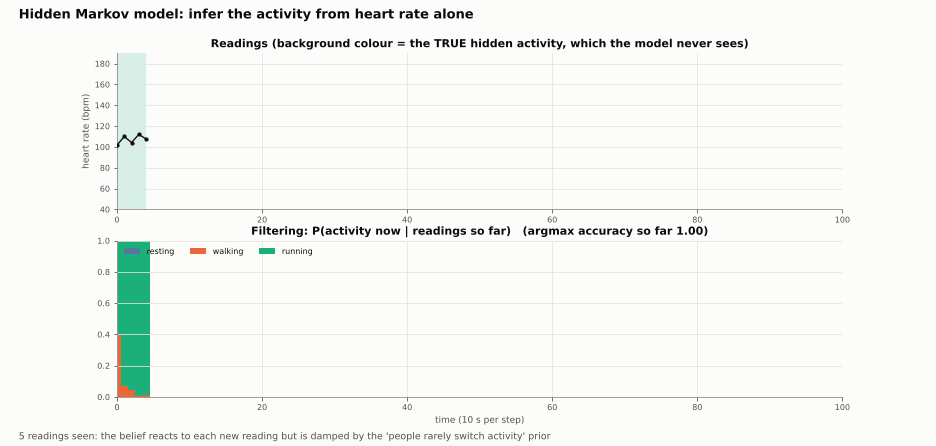
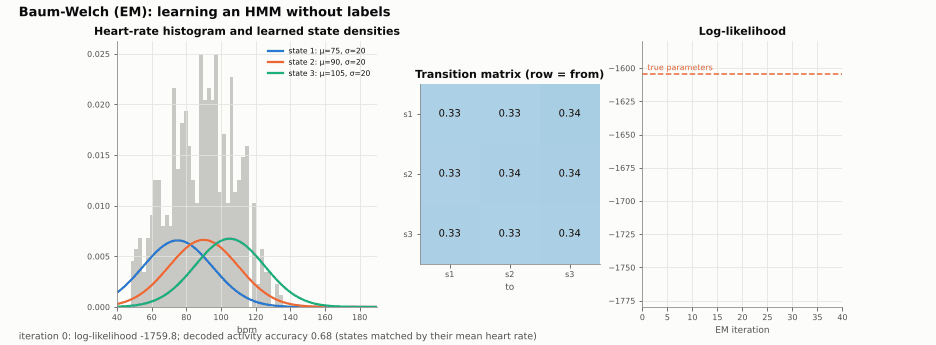

# 30 · Hidden Markov Models

> **One line:** a system hops between hidden states that you cannot see (with a rule that depends only on the current state), and each state emits noisy observations you can see; the HMM algorithms infer the hidden path and learn the rules from the observations alone.




## 1. Definition

A **hidden Markov model (HMM)** is a probabilistic model of a sequence of observations `x₁ … x_T` generated by a hidden state sequence `z₁ … z_T`, `z_t ∈ {1, …, K}`, with:

- **initial distribution** `π_k = P(z₁ = k)`,
- **transition matrix** `A_{ij} = P(z_{t+1} = j | z_t = i)` (the **Markov property**: the next state depends only on the current one),
- **emission model** `P(x_t | z_t = k)`, here a Gaussian `N(μ_k, σ_k²)` (discrete tables, Gaussian mixtures or neural networks are also used).

The joint probability factorises as `P(x, z) = π_{z₁} b_{z₁}(x₁) Π_{t≥2} A_{z_{t−1} z_t} b_{z_t}(x_t)` with `b_k(x) = P(x | k)`.

The four classical problems: **evaluation** (likelihood of an observation sequence), **filtering / smoothing** (state probabilities), **decoding** (best state path) and **learning** (parameters). It is the simplest *latent-variable time-series model* and the discrete cousin of the Kalman filter.

**Story in the code.** A fitness band records heart rate every 10 seconds. The wearer's activity (resting, walking, running) is hidden, changes rarely, and gives a noisy heart rate whose ranges overlap: resting `N(62, 8²)`, walking `N(86, 11²)`, running `N(108, 12²)`. The data are 400 readings with 30 true state switches.

## 2. Intuition

A reading of 95 bpm is ambiguous: it could be a fast-heart resting person, or a walker, or a calm runner. A *single* reading cannot settle it, but a **sequence** can: if the last ten readings were all around 90 the person is probably walking, and one stray 70 in the middle is more likely noise than a quick rest between two walks, because switching is rare. The HMM makes that reasoning exact by combining (1) how well each state explains the reading and (2) how plausible the state *changes* are.

## 3. The math

**Forward algorithm (filtering).** `α_t(k) = P(z_t = k, x_{1:t})` obeys

```
α₁(k) = π_k b_k(x₁),        α_t(k) = b_k(x_t) Σ_i α_{t−1}(i) A_{ik}
```

a sum over `K^T` paths computed in `O(T K²)`. The code uses the **scaled** version: normalise each `α_t` to sum to 1 and keep the normalisers `c_t = P(x_t | x_{1:t−1})`; then `log P(x) = Σ log c_t` (avoids numerical underflow). The normalised `α_t` is the **filtering distribution** `P(z_t | x_{1:t})`.

**Backward algorithm.** `β_t(i) = P(x_{t+1:T} | z_t = i) = Σ_j A_{ij} b_j(x_{t+1}) β_{t+1}(j)`.

**Smoothing.** `γ_t(k) = P(z_t = k | x_{1:T}) ∝ α_t(k) β_t(k)`; uses the future as well as the past. `ξ_t(i, j) = P(z_t = i, z_{t+1} = j | x) ∝ α_t(i) A_{ij} b_j(x_{t+1}) β_{t+1}(j)`.

**Viterbi decoding.** The single most probable *path* `argmax_z P(z | x)` by dynamic programming:

```
δ_t(k) = b_k(x_t) · max_i δ_{t−1}(i) A_{ik},      ψ_t(k) = argmax_i δ_{t−1}(i) A_{ik}
```

then backtrack through `ψ`. (Best path ≠ the sequence of individually most likely states; the code uses log probabilities.)

**Learning: Baum-Welch (EM).** The states are missing data, so alternate:

- **E-step**: compute `γ` and `ξ` with forward-backward under the current parameters.
- **M-step** (expected counts replace counts):

```
π_k = γ₁(k)                          A_{ij} = Σ_t ξ_t(i, j) / Σ_t Σ_j ξ_t(i, j)
μ_k = Σ_t γ_t(k) x_t / Σ_t γ_t(k)     σ_k² = Σ_t γ_t(k)(x_t − μ_k)² / Σ_t γ_t(k)
```

Each iteration cannot lower the likelihood; it converges to a local maximum (so restarts and good initialisation matter). Hidden state labels are arbitrary (**label switching**): we match learned states to true ones by their mean values.

**Relation to other models.** With `A` having identical rows (no memory) an HMM is a **Gaussian mixture** (lesson 25); it is the temporal extension of that model and EM is the same idea. Continuous hidden states with linear-Gaussian dynamics give the **Kalman filter**.

## 4. Algorithm

1. Choose the number of states `K` and the emission family.
2. Initialise `π, A, μ, σ` (e.g. from k-means, spread means, sticky `A`).
3. Repeat: forward-backward (E-step) then re-estimate parameters (M-step) until the log-likelihood stops improving.
4. Use the model: filter for online estimates, smooth or Viterbi for offline segmentation, `log P(x)` to score a sequence (for classification: fit one HMM per class), sample to simulate.
5. Choose `K` by BIC or held-out likelihood.

## 5. Reading the animations

**`hmm_inference.gif`** (true parameters; background colour = the hidden activity, which the model never sees; blue = resting, orange = walking, green = running)

| Frame | What to watch | What it means |
|---|---|---|
| Filtering (first frames) | stacked bars give `P(activity | readings so far)`; they react to each reading but change gently | online inference: the belief at time `t` uses only the past |
| Smoothing | the bars sharpen, especially around state changes | using future readings resolves ambiguity |
| Viterbi | a clean segmentation into runs of one activity | the single best path |

| method (true parameters, 400 readings) | accuracy |
|---|---|
| nearest mean per reading (no memory) | **0.770** |
| filtering (argmax, causal) | 0.900 |
| smoothing (argmax) | **0.950** |
| Viterbi path | 0.943 |

Using the temporal structure raises accuracy from 77% to 94-95% because the state ranges overlap.

**`hmm_baum_welch.gif`** (no labels; starting guess: means 75/90/105 bpm, sds 20, a nearly uniform transition matrix)

| Panel | What to watch | What it means |
|---|---|---|
| Densities | three broad, overlapping Gaussians contract onto the three bumps of the histogram | the emission model is learned |
| Transition matrix | from uniform (0.33 everywhere) to strongly diagonal (0.95, 0.94, 0.93): "people stay put" | the dynamics are learned |
| Log-likelihood | rises from −1759.8 to −1597.3 and flattens by iteration ~20 (monotone), above the value at the true parameters (−1604.5, because the fit adapts slightly to this sample) | EM climbs the likelihood |

Learned: means `63.3 / 86.1 / 106.2` (true 62 / 86 / 108), standard deviations `7.8 / 11.7 / 12.2` (true 8 / 11 / 12); the transition matrix `[[.952 .048 .000], [.020 .935 .045], [.005 .061 .934]]` against the true `[[.95 .04 .01], [.05 .90 .05], [.01 .07 .92]]`. Viterbi accuracy with the **learned** model is **0.945**, the same as with the true parameters (0.943), although no label was ever used.

**Verification.** On 7-reading sequences, exhaustive enumeration of all `3⁷ = 2187` state paths gives exactly the forward log-likelihood (−27.123365 both), the same best path as Viterbi, and the same smoothed marginals (max difference 2e-16). (`hmmlearn` is not installed in the build environment, so no library comparison.)

## 6. Hyper-parameters & knobs

- **Number of states `K`**, **emission family**, **covariance type** (for vector observations).
- **Initialisation** (k-means, random restarts) and **number of EM iterations / tolerance**.
- **Structure constraints**: left-to-right (speech phonemes, no going back), sticky self-transitions, tied parameters.
- **Priors / regularisation** on transitions and variances (avoid zero variance collapse).

## 7. Variants & relatives

- **Emissions**: discrete (part-of-speech tagging, DNA), Gaussian mixtures (speech), neural networks (hybrid models), multivariate Gaussians.
- **Structure**: hidden semi-Markov models (explicit duration distributions), factorial HMMs, hierarchical HMMs, input-output HMMs, **conditional random fields** (discriminative cousin), **dynamic Bayesian networks**.
- **Continuous latent states**: Kalman filter / linear dynamical systems, particle filters.
- **Bayesian / non-parametric**: sticky HDP-HMM (number of states inferred), variational HMMs.
- **Neural alternatives**: RNN/LSTM (lesson 20), transformers (lesson 21).
- *Not implemented:* discrete emissions, left-to-right topologies, multiple sequences, scaling in log-space for very long sequences, Bayesian versions.

## 8. Assumptions, strengths & weaknesses

Assumes first-order Markov hidden dynamics (the future depends on the past only through the current state), observations conditionally independent given the state, a *finite* number of states and time-homogeneous (fixed) transition probabilities.

**+** Exact, efficient inference (`O(TK²)`); interpretable states and transitions; works with unlabeled data via EM; principled uncertainty; handles variable-length sequences; small parameter count.
**−** The geometric state-duration implied by a self-transition `a` (mean `1/(1−a)`) is often unrealistic; EM finds local optima; `K` must be chosen; observation independence is restrictive; limited memory compared with RNNs; fails if states are not discrete.

**Use** for segmentation (activity, regimes in finance, gene finding), speech/handwriting recognition (classically), part-of-speech tagging, anomaly detection (low `log P(x)`). **Avoid** when long-range dependencies matter or when states are continuous (Kalman filter) or numerous and unlabeled with rich emissions (neural sequence models).

## 9. Metrics

Log-likelihood (train and held-out), BIC/AIC for choosing `K`, state-sequence accuracy / confusion matrix when labels exist (after matching states), segmentation F-scores and boundary tolerance, perplexity for generative use, stability across EM restarts, expected state durations versus data.

## 10. Code tour (`hmm.py`)

- `HMM` - `sample`; `forward` (scaled), `backward`, `smooth` (γ), `loglik`, `viterbi` (log space), `em_step` (Baum-Welch with Gaussian emissions).
- `brute_force` (exhaustive check), `stationary`, `accuracy`, `gauss`.
- `inference_gif`, `bw_gif`, `main`.

Run: `python hmm.py` (about 6 s).

## 11. Experiments

1. Reduce the separation (running mean 95) or increase the noise; how do filtering, smoothing and "no memory" accuracy change?
2. Fit `K = 2` and `K = 4` models by EM and compare BIC.
3. Make the state very sticky (`A_ii = 0.99`) and then not sticky (`0.6`); how does Viterbi differ from nearest-mean?
4. Implement discrete emissions (a table `B_{k,v}`) and apply it to a coin-switching problem.
5. Run Baum-Welch from five random starts and compare the final log-likelihoods.

## 12. Pitfalls

- Underflow when multiplying many probabilities (use scaling or log-sum-exp).
- Reading hidden-state labels as meaningful across runs (label switching).
- Local optima in EM; zero-variance collapse of a state sitting on a single point.
- Using too many states and fitting noise.
- Confusing the best *path* (Viterbi) with the most likely state at each time (smoothing); they can differ.
- Assuming the learned self-transition probabilities describe true durations when the real durations are not geometric.

**Next:** [31 Autoencoders](../31_autoencoder/lesson.md)
