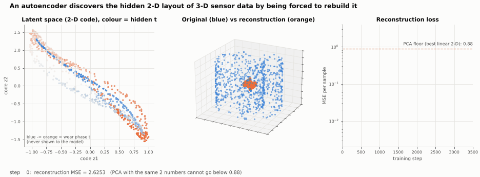
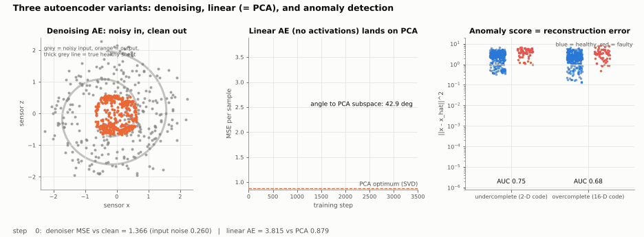

# 31 · Autoencoders

> **One line:** train a network to copy its input through a narrow bottleneck; to succeed it must discover the compact hidden structure of the data.




## 1. Definition

An **autoencoder (AE)** is a neural network trained to reconstruct its own input. It has two halves:

```
encoder  f:  x ∈ ℝᵈ  →  z ∈ ℝᵏ        (the code / latent representation, k small)
decoder  g:  z       →  x̂ ∈ ℝᵈ
loss     L = mean ‖x − g(f(x))‖²       (reconstruction error)
```

It is trained with **no labels** (unsupervised / self-supervised): the target is the input. Used for dimensionality reduction, denoising, anomaly detection and as a building block of generative models (VAE, lesson 32).

**Story in the code.** A fleet of machines reports 3 sensor values. Healthy readings do not fill 3-D space; they lie on a rolled-up 2-D sheet (a *swiss roll*) whose hidden coordinate `t` is the wear-cycle phase. The AE squeezes every reading through **2 numbers** and tries to rebuild all 3, so it must discover the sheet's own 2-D coordinates, without ever seeing `t`.

## 2. Intuition

Imagine describing a photo to a friend over a phone line that only carries two numbers, and the friend must redraw it. You will invent the best two-number description you can: a *summary that keeps what matters and drops what doesn't*. The encoder is the describer, the decoder is the friend, the loss is how bad the redraw is. If the data really lie on a low-dimensional surface, a good two-number description exists and the AE can find it.

## 3. The math

**Linear AE = PCA.** With linear layers and squared loss, the optimal decoder spans the top-`k` principal subspace (lesson 26) of the data. The code prints it: a linear AE converges to reconstruction MSE **0.880** versus the exact PCA optimum **0.879**, and the GIF shows the angle between its subspace and PCA's shrinking from 51° at the start to about 8° at the end.

**Non-linear AE ⊃ PCA.** With non-linear activations (here `tanh`) the encoder can bend. On the swiss roll, the best *linear* 2-D reconstruction cannot do better than MSE 0.88, while the non-linear AE reaches **0.10 (train) / 0.14 (test)**: it learns to "unroll" the sheet.

**Gradient.** Backpropagation through the decoder then the encoder (chain rule, lesson 18). With `x̂ = g(z)`, `dL/dx̂ = 2(x̂ − x)/n`; the decoder's input-gradient `dL/dz` becomes the output-gradient of the encoder. The code uses the MLP kit from `common/nn.py` and chains the two networks exactly this way.

**Variants as modified losses:**

```
Denoising AE:   encoder sees x + ε,  loss compares to the CLEAN x      (learns the data manifold, removes noise)
Sparse AE:      L + λ · mean ‖z‖₁                                      (few active code units per input)
Contractive AE: L + λ ‖∂z/∂x‖²_F                                       (code insensitive to small input changes)
```

**Anomaly detection.** After training on healthy data, `score(x) = ‖x − x̂‖²`. Points off the learned manifold reconstruct badly.

## 4. Algorithm

1. Standardise inputs. Choose code size `k`, depth, activation (`tanh`), optimiser (Adam).
2. Sample a mini-batch (400 readings from a training set of 2400).
3. Forward: `z = f(x)`, `x̂ = g(z)`; loss.
4. Backward through decoder, then encoder; Adam step.
5. Repeat; monitor reconstruction error on **held-out** data.
6. Use `f` for features or compression, `g` for generation (weak without a prior: see the VAE), or `‖x − x̂‖` for anomaly scores.

## 5. Reading the animations

**`autoencoder.gif`**

| Panel | What to watch | What it means |
|---|---|---|
| Latent space, coloured by hidden `t` | at step 0 a collapsed streak; then it spreads out and the colour gradient (blue→orange) organises along the sheet | the AE recovers an ordering of wear phase it was never shown |
| Original (blue) vs reconstruction (orange) in 3-D | orange starts as a lump at the centre, then expands to cover the whole rolled sheet | the decoder learns the 3-D shape from 2 numbers |
| Reconstruction loss (log) | falls well below the dashed PCA floor | non-linearity buys what linear compression cannot |

The latent map is not a perfectly clean unrolled rectangle: the roll's outer turns are hard to flatten and the learned map has some folds. Real autoencoders only approximate the manifold coordinates.

**`autoencoder_variants.gif`**

| Panel | What to watch |
|---|---|
| Denoising | grey = noisy input (σ=0.3), orange = output; the points collapse back onto the grey spiral ring. MSE vs the clean signal: **0.195 vs 0.260** for the raw noisy input (a 25% reduction) |
| Linear AE | loss descends to PCA's floor; the angle to the PCA subspace falls |
| Anomaly score | reconstruction error of healthy (blue) vs faulty (red) readings for an undercomplete (2-D code, AUC 0.82) and an overcomplete (16-D code, AUC 0.95) AE |

Printed extras: the **sparse AE** has 20% active code units with the L1 penalty versus 43% without (reconstruction MSE 0.013 vs 0.001, the price of sparsity).

Caveat on the last panel: textbook advice says an *overcomplete* AE can learn near-identity and reconstruct anomalies too, which hurts detection. Here the overcomplete net does better because the faults are off the sheet and it has enough capacity to learn the sheet precisely; with less regularisation or a different kind of anomaly the ranking can flip. Always validate on your own data.

## 6. Hyper-parameters & knobs

- **Code size `k`** - the bottleneck. Too small = blurry reconstructions; too large (no other constraint) = identity function.
- **Depth/width, activation**; **learning rate**; **batch size**; **training-set size** (with only 800 points the model memorised: train MSE 0.03 vs test 0.18; with 2400 points the gap shrank to 0.10 vs 0.14).
- **Noise level** (denoising), **sparsity weight λ**, **weight decay**, **early stopping**.

## 7. Variants & relatives

- **Undercomplete vs overcomplete** (implemented), **denoising, sparse** (implemented), **contractive** (formula only).
- **Variational AE** (lesson 32): probabilistic latent, can generate. **Adversarial AE, VQ-VAE** (discrete codebook), **masked autoencoders** (BERT, MAE) - reconstruct hidden parts of the input.
- **Convolutional / recurrent AEs** for images and sequences; **stacked AEs** for deep pre-training (historical); **U-Net** is an AE with skip connections.
- **Classical relatives**: PCA, kernel PCA, t-SNE (lesson 27), self-organising maps (lesson 28).

## 8. Assumptions, strengths & weaknesses

Assumes data concentrate near a low-dimensional manifold and that reconstruction error is a meaningful objective.

**+** Learns non-linear compression without labels; flexible; useful for anomaly detection and pre-training; scales with data.
**−** No guarantee the code is meaningful or smooth; can overfit or learn the identity; blurry reconstructions with MSE; no probabilistic model, so sampling random codes often gives garbage; sensitive to architecture and training.

## 9. Metrics

Reconstruction MSE (train **and** held-out), comparison with PCA of the same code size, ROC-AUC / PR-AUC for anomaly detection, downstream task performance of the code, latent-space visualisations coloured by known factors.

## 10. Code tour (`autoencoder.py`)

- `make_sensor_roll`, `make_anomalies` - healthy swiss roll and off-sheet faults.
- `Autoencoder` - wraps two `MLP`s from `common/nn.py`; `step(X, noise, l1)` is one training update; `encode / decode / reconstruct / errors`.
- `pca_fit`, `subspace_angle`, `auc` - baselines and metrics.
- `main` - trains the five models (bottleneck, denoising, linear, overcomplete, sparse) and writes both GIFs. It checks PCA against scikit-learn (0.8788 vs 0.8788).

Run: `python autoencoder.py` (about 1 minute).

## 11. Experiments

1. Change `d_code` from 2 to 1 and to 3. How does test MSE behave? Why is 3 enough to reach near zero?
2. Train with 300 points instead of 2400 and compare train vs test MSE.
3. Add outliers to the training set and see how the anomaly AUC degrades.
4. Replace `tanh` by `relu` and compare the latent map.
5. Increase the denoising noise to 0.6; where does the denoiser fail?

## 12. Pitfalls

- A big code layer with no regularisation learns the identity: perfect reconstruction, no insight.
- Training on data that contains anomalies lets the model reconstruct them.
- Reading latent coordinates as interpretable without checking.
- Comparing losses measured on different data (mini-batch vs full set): the first version of this lesson's linear-AE plot did exactly that and appeared to beat PCA.

**Next:** [32 Variational autoencoder](../32_vae/lesson.md)
