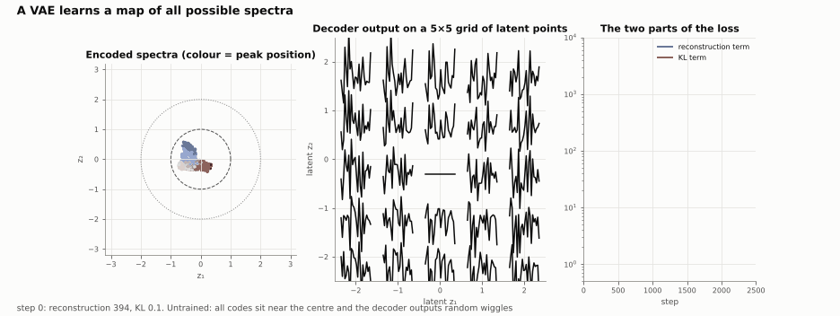
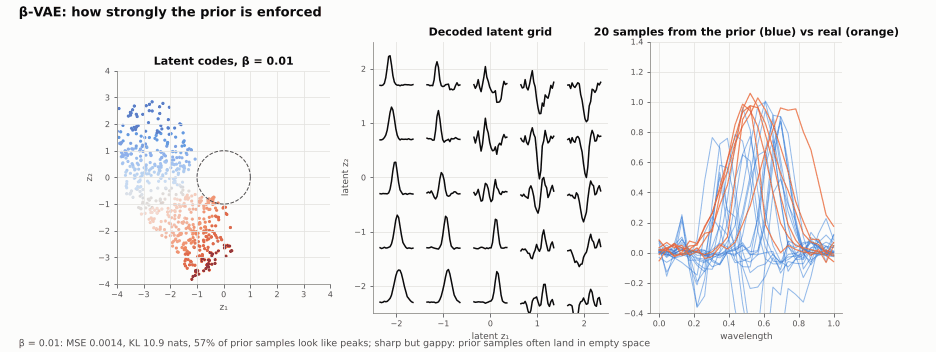

# 32 · Variational Autoencoder (VAE)

> **One line:** an autoencoder whose code is a *probability distribution* pushed toward a simple prior, so that the latent space becomes a smooth, gap-free map you can sample from to generate new data.




## 1. Definition

A **variational autoencoder** (Kingma & Welling, 2013) is a *generative latent-variable model* `p(x) = ∫ p(x|z) p(z) dz` with a simple prior `p(z) = N(0, I)` and a neural-network **decoder** `p(x|z)`. Because the integral is intractable, an **encoder** `q(z|x) = N(μ(x), diag σ²(x))` approximates the posterior, and both networks are trained together by maximising the **evidence lower bound (ELBO)**:

```
ELBO(x) = E_{q(z|x)}[ log p(x|z) ]  −  β · KL( q(z|x) ‖ p(z) )        (β = 1 is the true bound)
          └── reconstruction ──┘      └── regulariser: stay close to the prior ──┘
```

**Story in the code.** A lab measures spectra at 24 wavelengths. Every spectrum is a single smooth peak whose **position** `c ∈ [0.25, 0.75]` and **width** `w ∈ [0.05, 0.16]` vary from sample to sample, plus noise (sd 0.03). 24 numbers, but really 2 degrees of freedom. A VAE with a 2-D latent space should find a map of all possible peaks, and invent new realistic spectra from random latent points.

## 2. Intuition

A plain autoencoder (lesson 31) assigns every input a single point in latent space, and nothing says what lies *between* the points: the decoder may output garbage there. The VAE instead encodes each input as a small *cloud* (a Gaussian), samples a point from it, and asks the decoder to reconstruct the input from that sample. Clouds must overlap (so every point in between is also decoded sensibly) and must together fill the standard normal prior (the KL term). The result is a latent space where nearby points decode to similar outputs and where *random draws from the prior decode to plausible data*.

Two forces: **reconstruction** wants sharp, separate, informative codes; **KL** wants everything to look like `N(0, I)`. `β` sets the exchange rate.

## 3. The math

**ELBO.** For any `q(z|x)`: `log p(x) = ELBO + KL(q(z|x) ‖ p(z|x)) ≥ ELBO`, so maximising the ELBO both fits the data and drives `q` toward the true posterior.

**Reconstruction term** with a Gaussian decoder of fixed variance `s²`: `−log p(x|z) = ‖x − x̂‖²/(2s²) + const`. (Here `s = 0.1`; a Bernoulli decoder gives binary cross-entropy for images.)

**KL term, closed form** for diagonal Gaussians against `N(0, I)`:

```
KL = −½ Σ_d ( 1 + log σ_d² − μ_d² − σ_d² )
```

(The code checks it against a Monte-Carlo estimate: 0.4032 vs 0.4043.)

**Reparameterisation trick.** Sampling `z ~ N(μ, σ²)` is not differentiable, so write `z = μ + σ ⊙ ε`, `ε ~ N(0, I)`; the randomness is now an input and gradients flow to `μ` and `σ` through `z`:

```
dz  = decoder.backward(dx̂)
dμ  = dz + β μ
d(log σ²) = dz ⊙ ε ⊙ ½σ + β · ½ (σ² − 1)
```

**Verification.** Finite-difference gradient check of the whole loss (fixed `ε`): worst relative error 4e-5 over random weights in both networks.

**Why a probabilistic code matters.** The noise in `z` forces the decoder to be smooth around each code (it must reconstruct from any point in the cloud), and the KL term prevents the clouds from shrinking to points or drifting apart. Without KL (`β → 0`) the model becomes a (noisy) autoencoder with gaps; with a huge `β` it ignores the input (**posterior collapse**).

**Generation.** Draw `z ~ N(0, I)` and decode. **Interpolation / traversal**: decode points along a path in latent space.

**Relation to other models.** A linear VAE is probabilistic PCA (lesson 26); a GMM (lesson 25) has a discrete latent variable; GANs (lesson 33) and diffusion models (lesson 34) are alternative generative models that give up the tractable bound, or the single-step decoder.

## 4. Algorithm

1. Encode a mini-batch: `μ(x), log σ²(x)`.
2. Sample `ε ~ N(0, I)`; set `z = μ + σ ⊙ ε`.
3. Decode `x̂ = dec(z)`; compute loss `‖x − x̂‖²/(2s²) + β KL`.
4. Back-propagate through the decoder, the reparameterisation and the encoder; Adam step.
5. After training: sample `z ~ N(0, I)` and decode to generate; encode for compression/representation.

## 5. Reading the animations

**`vae_training.gif`** (β = 1, 2000 training spectra, 2500 steps)

| Panel | What to watch | What it means |
|---|---|---|
| Latent codes | colour = true peak position; at step 0 all codes cluster at the centre; later they spread into a smooth curved sheet that fills the dashed unit circle of the prior | the model discovered the hidden factors; colour changes gradually along the sheet |
| Decoded grid | a 5×5 grid of latent points decoded to spectra: random wiggles at step 0, then clean single peaks whose position and width change smoothly across the grid | the latent space is a continuous map of possible spectra |
| Loss | reconstruction term falls from ~390 to ~3, the KL term rises from 0.1 to ~5 nats and settles | the model "pays" about 5 nats of information to describe each spectrum |

**`vae_beta.gif`** (five VAEs, β = 0.01 to 16; 1000 fresh test spectra; 1000 prior samples)

| β | reconstruction MSE | KL (nats) | prior samples that look like real peaks | what you see |
|---|---|---|---|---|
| 0.01 | 0.0014 | 10.9 | 57% | accurate but codes are scattered; gaps in the grid decode to wiggles |
| 0.3 | 0.0014 | 6.8 | 82% | |
| **1** | 0.0015 | 5.1 | **92%** | codes fill the prior; samples look like data |
| 4 | 0.0019 | 3.2 | 100% | slightly blurrier |
| 16 | 0.0093 | 1.6 | 100% | codes squeezed together; reconstructions lose detail |

("Looks like a real peak" = estimated centre in 0.2-0.8 and width in 0.04-0.19.) The trade-off is plain: more weight on the prior gives a more regular latent space but a lossier reconstruction. For comparison PCA with 2 components reconstructs with MSE 0.016 (the data are not linear: a peak's shape is a non-linear function of its position and width), 10× worse than the VAE; the noise floor is 0.0009.

## 6. Hyper-parameters & knobs

- **Latent dimension** (here 2, matching the true factors), **encoder/decoder size**, **learning rate**, **batch size**.
- **β** (KL weight; β-VAE for disentanglement) and **KL annealing** (start at 0, increase to avoid collapse); "free bits".
- **Decoder variance `s²`** (the balance between reconstruction and KL; learned or fixed) and decoder family (Gaussian, Bernoulli, categorical).
- **Prior** (standard normal, mixture, learned/VampPrior), **posterior family** (diagonal Gaussian, normalising flows).

## 7. Variants & relatives

- **β-VAE, FactorVAE, β-TCVAE** (disentangled factors), **conditional VAE** (condition on labels), **VQ-VAE** (discrete latent codes, basis of image/audio tokenisers), **hierarchical VAEs** (NVAE, VDVAE), **importance-weighted AE (IWAE)** (tighter bound), **adversarial AEs**, **Wasserstein AE**.
- **Latent-diffusion models** use a VAE to compress images before diffusion; **Normalising flows** and **autoregressive models** give exact likelihoods instead.
- **Related**: autoencoders (lesson 31), PCA (lesson 26), GANs (lesson 33), diffusion (lesson 34).
- *Not implemented:* convolutional VAEs, conditional or discrete versions, learned decoder variance.

## 8. Assumptions, strengths & weaknesses

Assumes the data are generated from a few latent factors through a smooth function and noise, that the diagonal-Gaussian posterior is a good enough approximation, and that the prior is appropriate.

**+** Stable training; a principled objective and likelihood bound; a smooth, interpretable latent space (interpolation, traversal); an encoder as well as a generator; works for anomaly detection (low ELBO).
**−** Samples tend to be blurry on complex data (Gaussian decoders average modes); posterior collapse with powerful decoders; the diagonal Gaussian posterior limits fidelity; the ELBO is only a bound; the β trade-off is delicate.

**Use** for representation learning, generation with a controllable latent space, compression, anomaly detection, as the first stage of latent diffusion. **Avoid** when photorealistic sample sharpness is the priority (GANs or diffusion) or exact likelihoods are needed (flows).

## 9. Metrics

ELBO / negative log-likelihood bounds (train and test), reconstruction error, KL per dimension (which latent dimensions are "active"), sample quality (FID, precision/recall for images; here the fraction of valid peaks), latent-space smoothness (interpolations), downstream accuracy of the latent features.

## 10. Code tour (`vae.py`)

- `VAE` - `encode`, `loss_and_grads` (reparameterisation, closed-form KL, manual backprop through both MLPs), `step`, `decode`.
- `spectra` (data), `peak_stats` (centre and width of a spectrum), `grad_check`, `train`, `restore`, `grid_panel`.
- `training_gif`, `beta_gif`, `main` (KL check, β sweep, PCA baseline).

Run: `python vae.py` (about 18 s).

## 11. Experiments

1. Set the latent size to 1 and 4; with 4 dimensions look at the per-dimension KL: do two of them collapse to the prior?
2. Train with `SIGMA_X = 0.03` and `0.3`: how does the decoder variance shift the balance?
3. Interpolate between two spectra in latent space and compare with linear interpolation in data space.
4. Implement KL annealing (β from 0 to 1 over the first 500 steps).
5. Use the per-sample ELBO as an anomaly score on spectra with two peaks.

## 12. Pitfalls

- Posterior collapse (KL → 0, decoder ignores `z`), especially with a strong decoder and β ≥ 1.
- Treating the KL value as a quality measure by itself; read it with the reconstruction.
- Forgetting the reparameterisation (the gradient to the encoder would vanish).
- Clipping or unbounded `log σ²` leading to NaNs (the code clips to [−8, 4]).
- Expecting sharp images from a plain Gaussian decoder.
- Reading latent coordinates as disentangled without testing for it.

**Next:** [33 Generative adversarial networks](../33_gan/lesson.md)
