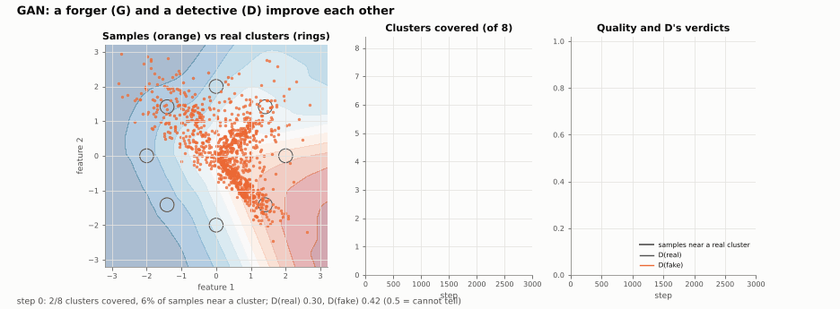
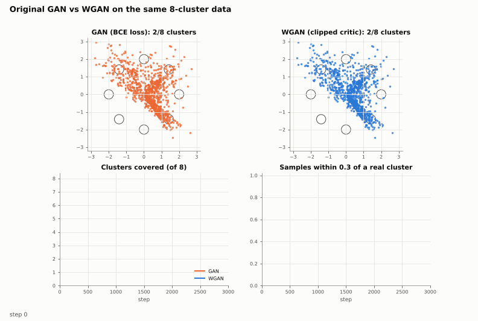

# 33 · Generative Adversarial Networks (GAN and WGAN)

> **One line:** train a *generator* to forge data and a *discriminator* to catch forgeries; each improves by competing with the other, and at the end the generator's output is hard to tell from the real thing.




## 1. Definition

A **generative adversarial network** (Goodfellow et al., 2014) has two neural networks:

- the **generator** `G(z)` maps random noise `z ~ N(0, I)` to a fake data point;
- the **discriminator** `D(x)` outputs the probability that `x` is real rather than generated.

They play a two-player minimax game:

```
min_G max_D   E_{x~data}[ log D(x) ]  +  E_{z~noise}[ log(1 − D(G(z))) ]
```

There is no likelihood and no explicit density: the generator is only ever judged by whether the discriminator can distinguish its samples. This makes GANs *implicit* generative models that can produce very sharp samples (the basis of realistic image synthesis before diffusion models).

**Story in the code.** A bank wants synthetic customer records to test fraud software without sharing real data. In a 2-D toy version the real customers form **eight tight clusters on a ring** (eight segments, cluster sd 0.08, ring radius 2). A good generator must reproduce *all eight* clusters, not just the easiest few.

## 2. Intuition

A counterfeiter and a detective. The forger starts with scribbles; the detective easily spots them and, by *how* he spots them, tells the forger which way to improve (the discriminator's gradient is the generator's teacher). As the forgeries improve, the detective must look at finer details; he improves, and so on. In equilibrium the forger's distribution equals the real distribution and the detective can do no better than a coin flip (`D = ½` everywhere). In the animation the background shows what the detective currently believes is real (blue = fake-looking, red = real-looking) and you can watch it carve out the eight clusters while the orange samples migrate into them.

## 3. The math

**Optimal discriminator.** For a fixed generator with sample density `p_g`, the best discriminator is `D*(x) = p_data(x) / (p_data(x) + p_g(x))`. Plugging in gives the generator objective `2·JS(p_data ‖ p_g) − log 4`, the **Jensen-Shannon divergence**: the minimum is reached iff `p_g = p_data`, where `D* = ½`.

**Non-saturating generator loss.** Early in training `D` easily rejects fakes, so `log(1 − D(G(z)))` is flat (tiny gradients). The standard fix trains `G` to maximise `log D(G(z))` instead. Gradient flow (the code does exactly this): back-propagate `−log D` through `D` to obtain `∂/∂x` at the fake sample, then through `G`:

```
d(loss)/d(logit) = σ(logit) − 1   →   D.backward(...) returns d(loss)/d(x_fake)   →   G.backward(that)
```

**Training loop.** Alternate: (1) update `D` on a batch of real (label 1) and fake (label 0) points with binary cross-entropy; (2) update `G` (with `D` fixed) so that `D(G(z)) → 1`. Adam with `β₁ = 0.5` is conventional.

**Why GANs are hard.** The game is not a minimisation; gradient descent on a minimax game can oscillate or diverge. Failure modes: **mode collapse** (`G` outputs only a few modes that fool `D`), **vanishing gradients** when `D` is too good (when the real and fake supports barely overlap, JS is constant), **non-convergence** (cycling), **sensitivity** to architecture and learning rates; and the loss values do not measure sample quality.

**Wasserstein GAN.** Replace the probabilistic `D` by a **critic** `f` (no sigmoid) and minimise the Earth-mover (Wasserstein-1) distance

```
W(p_data, p_g) = sup_{‖f‖_L ≤ 1} E_data[f(x)] − E_g[f(x)]
```

The critic loss is `E[f(fake)] − E[f(real)]`, the generator minimises `−E[f(G(z))]`. The Lipschitz constraint is enforced in the original paper by **weight clipping** (used here, `±0.05`) and later by a **gradient penalty** (WGAN-GP) or spectral normalisation. The critic is trained several steps (5) per generator step and the optimiser is RMSprop. The critic's estimated gap is meaningful as a training signal.

## 4. Algorithm

1. Initialise `G` and `D` (or critic).
2. Repeat for each step: sample a batch of real data and a batch of noise.
3. Update `D` to separate real from fake (WGAN: 5 critic updates with clipping).
4. Sample fresh noise; update `G` to fool the (fixed) `D` using the non-saturating loss.
5. Monitor samples (not just the loss!) and, for images, FID; stop when quality plateaus; keep several checkpoints.

## 5. Reading the animations

**`gan_training.gif`** (MLP generator and discriminator, 64×64 hidden units, Adam lr 1e-3, batch 128, 3000 steps; each frame shows 1000 samples)

| Panel | What to watch | What it means |
|---|---|---|
| Samples and map | step 0: a blob (an untrained generator covers 2 of 8 clusters, 6% of samples near a cluster); step 500: a smear with a few streaks; step 3000: samples sit on the eight clusters. The background (D's belief) turns from a smooth gradient into eight red islands | D teaches G where real data live |
| Clusters covered | rises to 8 within about 900 steps | the generator finds all modes |
| Quality | fraction of samples within 0.3 of a real cluster rises from 6% to **88%** | sharper samples (12% still lie between clusters, joining them along the ring) |
| D(real), D(fake) | start apart (0.30 vs 0.42 at step 0, D is not yet trained), end at **0.52 / 0.47** | the discriminator is nearly fooled: close to the equilibrium value ½ |

**`gan_vs_wgan.gif`** (same data and architecture; three seeds each)

| | clusters covered | samples within 0.3 of a cluster |
|---|---|---|
| GAN, seeds 0/1/2 | 8 / 8 / 8 | 0.88 / 0.90 / 0.92 |
| WGAN (clipped critic), seeds 0/1/2 | 8 / 8 / 8 | 0.73 / 0.73 / 0.72 |

On this easy 2-D problem the original GAN is stable (no mode collapse in any of our seeds), and it is *sharper* than the weight-clipped WGAN, whose coarse Lipschitz constraint (clip ±0.05) yields a smoother, blurrier critic. We do not claim WGAN "wins" here. Its advantage is elsewhere: the critic gap `E[f(real)] − E[f(fake)]` is a meaningful training curve. For seed 0 it falls from 0.019 (step 500) to 0.001 (step 3000) as quality rises, with correlation **−0.89** with sample quality; the GAN's loss tells you almost nothing, since a balanced game keeps it near `2 log 2` regardless of quality. On harder problems (images, more modes) mode collapse and vanishing gradients appear in the original formulation and the Wasserstein variants become important; to see mode collapse here, try the experiments below.

## 6. Hyper-parameters & knobs

- **Architectures** of `G` and `D` (balance their capacity), **latent dimension**, **batch size**.
- **Learning rates** (often equal or two-time-scale: `D` faster), **Adam β₁ = 0.5**, number of `D` updates per `G` update (1 for the standard GAN, 5 for WGAN).
- **Loss**: non-saturating, least-squares, hinge, Wasserstein (+ gradient penalty), **regularisation**: spectral norm, R1 penalty, instance noise, label smoothing.
- **Tricks**: minibatch discrimination, feature matching, exponential moving average of `G`'s weights, progressive growing, truncation at sampling.

## 7. Variants & relatives

- **DCGAN** (convolutional), **Conditional GAN / cGAN, AC-GAN** (labels), **Pix2Pix, CycleGAN** (image translation), **StyleGAN** (style-based generator), **BigGAN**, **WGAN-GP**, **LSGAN**, **SN-GAN**, **BEGAN**, **InfoGAN** (interpretable codes), **GAN inversion**.
- **Other generative families**: VAEs (lesson 32; stable, blurrier), diffusion models (lesson 34; best quality, slower), normalising flows, autoregressive models.
- *Not implemented:* convolutional GANs, conditional GANs, gradient penalty, spectral normalisation.

## 8. Assumptions, strengths & weaknesses

Assumes the real data lie near a low-dimensional manifold the generator can reach, and that the discriminator has enough capacity to give useful feedback.

**+** Sharp, realistic samples; fast one-step sampling; no likelihood or explicit density assumptions; flexible architectures; learned loss adapts to the data.
**−** Unstable training; mode collapse; no likelihood or encoder (no direct way to evaluate a data point or encode it); evaluation is hard (FID, precision/recall); sensitive to hyper-parameters and architecture; needs monitoring of samples.

**Use** for image-to-image translation, super-resolution, style transfer, data augmentation, synthetic tabular/time-series data where sample sharpness matters. **Avoid** when stable training or exact likelihood is essential (VAE, flows) or when the best sample quality and diversity matter more than speed (diffusion).

## 9. Metrics

Visual inspection of samples, **FID** (Fréchet inception distance), **Inception score**, **precision / recall for distributions** (quality vs coverage), mode coverage (here: clusters covered; fraction of samples near a real cluster), downstream usefulness of the synthetic data (train-on-synthetic, test-on-real), discriminator accuracy near 50% as a (weak) convergence hint.

## 10. Code tour (`gan.py`)

- `real_batch`, `CENTERS` (the eight-cluster data), `coverage` (metrics).
- `train(kind="gan" | "wgan", ...)` - both game loops with manual back-propagation through `D` into `G`; `RMSprop`; weight clipping.
- `gan_gif`, `compare_gif`, `main`.

Run: `python gan.py` (about 1 minute).

## 11. Experiments

1. Train `D` five steps per `G` step with a 10× larger discriminator learning rate: look for oscillation or collapse.
2. Use the original saturating loss `log(1 − D(G(z)))` and compare early progress.
3. Reduce the generator to hidden size 8 and the cluster std to 0.03; count the clusters covered.
4. Replace weight clipping by a gradient penalty (needs the gradient of `‖∇_x f‖`; derive it for a small MLP).
5. Remove `β₁ = 0.5` (use 0.9) and compare stability.

## 12. Pitfalls

- Judging progress by the loss curves; always look at samples or a quality metric.
- Letting the discriminator win too fast (vanishing gradients).
- Reading "8/8 clusters" as perfect: coverage by a loose tolerance does not guarantee correct cluster weights.
- Not seeding or checkpointing: runs vary a lot.
- Using the discriminator's output as a calibrated probability.
- Evaluating with samples the discriminator has already seen as real (overfitting of `D`).

**Next:** [34 Diffusion models](../34_diffusion/lesson.md)
