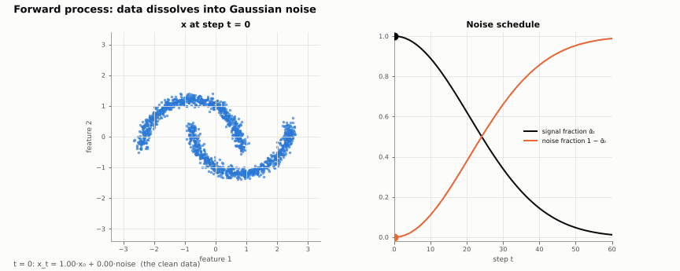
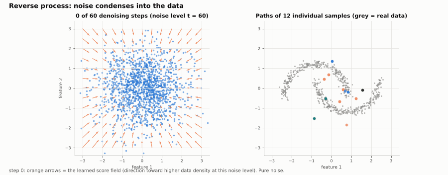
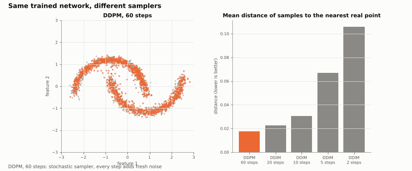

# 34 · Diffusion Models (DDPM and DDIM)

> **One line:** destroy data by adding a little Gaussian noise many times, train a network to undo one noising step, then generate new data by starting from pure noise and denoising it step by step.





## 1. Definition

A **denoising diffusion probabilistic model** (DDPM; Sohl-Dickstein et al. 2015, Ho et al. 2020) is a generative model with two processes over `T` steps:

- **Forward (noising) process**, fixed: `q(x_t | x_{t−1}) = N(√(1−β_t) x_{t−1}, β_t I)`. After enough steps `x_T` is almost pure Gaussian noise.
- **Reverse (denoising) process**, learned: `p_θ(x_{t−1} | x_t) = N(μ_θ(x_t, t), σ_t² I)`. Start from `x_T ~ N(0, I)` and apply it `T` times to get a sample `x_0` from (an approximation of) the data distribution.

In practice the network does not output `μ_θ` directly but **predicts the noise** `ε_θ(x_t, t)` that was added. Diffusion models (with their score-based, continuous-time and latent variants) now power the leading image, audio and video generators.

**Story in the code.** A lab wants to generate new, realistic readings of a machine that operates in two regimes, which form two interlocking crescents in a 2-D feature space (a stand-in for any complicated distribution). 60 steps, `β` rising linearly from 0.001 to 0.14, so that only `ᾱ_T = 1.2%` of the signal variance is left at the end.

## 2. Intuition

Drop ink into water: the ink spreads until the glass is a uniform grey. Physics runs this in one direction only; a diffusion model learns to run the film backwards. Reversing a *whole* diffusion at once is impossible, but reversing one tiny step is easy, because a tiny bit of noise is nearly Gaussian and removing it just means "nudge the point toward where the data are denser". The network learns that nudge at every noise level: at high noise it knows only the rough shape of the data (the large-scale structure appears first); at low noise it polishes fine details.

## 3. The math

**Forward closed form.** With `α_t = 1 − β_t` and `ᾱ_t = Π_{s≤t} α_s`:

```
q(x_t | x_0) = N( √ᾱ_t x_0 ,  (1 − ᾱ_t) I )        i.e.   x_t = √ᾱ_t x_0 + √(1 − ᾱ_t) ε,   ε ~ N(0, I)
```

so any noise level can be produced in one shot (verified: after 20 steps the step-by-step simulation has mean 0.7875, variance 0.3781; the formula says 0.7886, 0.3782).

**Training (the "simple loss").** Pick a random clean sample `x_0`, a random step `t`, a random noise `ε`; build `x_t`; train the network to recover the noise:

```
L = E_{x_0, t, ε} ‖ ε − ε_θ(x_t, t) ‖²
```

This is a re-weighted form of the variational lower bound. One network is shared across all `t` through a time embedding (here sinusoidal features of `t/T`).

**Sampling (DDPM).** For `t = T … 1`:

```
x_{t−1} = (1/√α_t) · ( x_t − β_t/√(1−ᾱ_t) · ε_θ(x_t, t) )  +  σ_t z,        z ~ N(0, I)  (z = 0 at the last step)
```

with `σ_t² = β_t (1 − ᾱ_{t−1}) / (1 − ᾱ_t)`, the variance of the true posterior `q(x_{t−1}|x_t, x_0)`.

**Link to score matching.** The optimal noise predictor satisfies `ε*(x_t, t) = −√(1 − ᾱ_t) ∇_x log p_t(x_t)`: predicting the noise is the same as estimating the **score** (the gradient of the log density of the noised data). The arrows in the reverse animation are `−ε_θ/√(1−ᾱ_t)`: they point toward higher density. Sampling is a noisy ascent on that field (Langevin-like) that is gradually refined as the noise level falls. Continuous-time version: forward and reverse **stochastic differential equations**, with a deterministic **probability-flow ODE**.

**DDIM (deterministic, fewer steps).** Use the noise prediction to estimate the clean sample `x̂_0 = (x_t − √(1−ᾱ_t) ε_θ)/√ᾱ_t` and jump directly to a coarser earlier step:

```
x_{s} = √ᾱ_s · x̂_0 + √(1 − ᾱ_s) · ε_θ(x_t, t)        (s < t; no fresh noise)
```

Sampling with 5-20 well-chosen steps instead of 60-1000 is the basis of fast samplers.

**Exact check of the sampler.** For data `N(0, 0.5²)` the exact denoiser is known, `ε* = √(1−ᾱ) x / (ᾱ s² + 1 − ᾱ)`. Sampling with it gives std **0.467** (DDPM, 60 steps) and 0.412 (DDIM, 10 steps) against the true 0.5. The gap is the **discretisation error** of large steps (β up to 0.14): the same test with 240 or 1000 steps gives 0.491 and 0.493. (Quick check outside the script.) The learned model faces the same limitation.

## 4. Algorithm

*Training:* repeat: sample a batch `x_0`; sample `t ~ U{1..T}`, `ε ~ N(0, I)`; form `x_t`; gradient step on `‖ε − ε_θ(x_t, t)‖²`.

*Sampling:* draw `x_T ~ N(0, I)`; for `t = T … 1`: predict `ε_θ(x_t, t)`, take the reverse step (add `σ_t z` for DDPM, none for DDIM); return `x_0`.

*Variants of use:* **conditional / classifier-free guidance** (feed a label or text embedding; mix conditional and unconditional predictions to trade diversity for fidelity), **inpainting** (replace the known part at each step), **image-to-image** (start sampling from a partially noised image).

## 5. Reading the animations

**`diffusion_forward.gif`** (4000 crescent points, 9 noise levels)

| Panel | What to watch | What it means |
|---|---|---|
| Points | at `t = 0` two crisp crescents; `t = 10` blurred but recognisable; `t = 60` an isotropic cloud | information is destroyed gradually; the early steps remove detail, the later ones the global shape |
| Schedule | `ᾱ_t` (signal) falls from 1 to 0.012, `1 − ᾱ_t` (noise) rises | a signal-to-noise ratio that decays smoothly |

**`diffusion_reverse.gif`** (network: 3 hidden layers × 128 units, SiLU, 8000 Adam steps, batch 256)

| Panel | What to watch | What it means |
|---|---|---|
| Left | blue = 1500 samples being denoised; orange arrows = the learned score field at the current noise level. At first the arrows point to the centre (the data are a compact blob at this noise level), later they point along the crescents | the score field changes with the noise level: coarse to fine |
| Right | paths of 12 individual samples (grey = real data): they jitter (stochastic steps) while drifting toward the crescents | each sample is one stochastic trajectory from noise to data |

Quality: the mean distance from a generated point to its nearest real point is **0.017**, against **0.016** between two independent *real* samples; a few outliers remain (maximum 0.40). Training loss falls from 0.435 (first 100 steps) to 0.357; it cannot approach 0 because the noise is partly unpredictable. Held-out loss by noise level: `t = 1`: **0.968** (almost no noise: the network cannot tell what is noise and what is data detail), `t = 10`: 0.64, `t = 30`: 0.35, `t = 60`: **0.018** (the input is almost pure noise, so predicting it is nearly trivial).

**`diffusion_samplers.gif`** (same trained network)

| sampler | mean distance to nearest real point |
|---|---|
| DDPM, 60 steps | 0.017 |
| DDIM, 20 steps | 0.023 |
| DDIM, 10 steps | 0.030 |
| DDIM, 5 steps | 0.067 |
| DDIM, 2 steps | 0.106 (a blurry blob between the crescents) |

Even 10 deterministic steps give a result close to the 60-step sampler; two steps are far too few.

## 6. Hyper-parameters & knobs

- **Number of steps `T`** and **noise schedule** (linear here; cosine schedules work better for images), **prediction target** (noise `ε`, clean data `x_0`, or velocity `v`), **loss weighting**.
- **Network**: MLP here; U-Net or transformer (DiT) for images; **time (and condition) embedding**; EMA of weights.
- **Sampler**: DDPM, DDIM, DPM-Solver, number of sampling steps, stochasticity `η`; **guidance scale**.
- **Latent diffusion**: run the process in the latent space of a VAE (lesson 32) to cut cost.

## 7. Variants & relatives

- **Score-based models / SDE view** (Song & Ermon, Song et al.), **Improved DDPM**, **EDM**, **flow matching and rectified flows** (straight paths between noise and data), **consistency models** (one-step generation), **latent diffusion / Stable Diffusion**, **Imagen, DALL·E 2/3, Sora** (text-, image-, video-conditioned).
- **Related generative models**: VAEs (lesson 32, single-step decoder, tractable bound), GANs (lesson 33, one-step, adversarial), normalising flows, autoregressive models (lesson 21).
- *Not implemented:* conditioning/guidance, convolutional U-Nets, learned variances, SDE solvers, latent diffusion.

## 8. Assumptions, strengths & weaknesses

Assumes the data distribution can be smoothly connected to a Gaussian by adding noise, and that the denoiser network has enough capacity at every noise level.

**+** Very high sample quality and diversity; stable, simple training (a regression loss, no adversary); covers all modes; flexible conditioning; a tractable training objective; the score field is useful on its own (e.g. inpainting, editing).
**−** Slow sampling (tens to thousands of network evaluations; mitigated by DDIM, distillation, consistency models); training needs a lot of compute at scale; fixed-length noise schedule choices matter; likelihoods are only bounds.

**Use** for image/audio/video/molecule/3-D generation, super-resolution, inpainting, data synthesis when quality and coverage matter. **Avoid** when real-time single-pass generation is required with limited compute (GAN / distilled models), or for tiny data sets where a simple density model suffices.

## 9. Metrics

FID / sFID / precision-recall for images, negative log-likelihood bounds (bits per dimension), CLIP score for text-conditioning, human preference studies, samples per second / number of function evaluations; in this lesson: the nearest-real-point distance and visual coverage of both crescents.

## 10. Code tour (`diffusion.py`)

- Schedule: `BETAS`, `ALPHAS`, `ABAR`; `data` (crescents), `time_features`.
- `Denoiser` - an MLP over `[x_t, time features]` predicting `ε`; `train_step` (the simple loss, manual backprop).
- `sample(model, n, r, steps="ddpm" | k)` - ancestral DDPM or DDIM, returns trajectories if asked; `quality`.
- `forward_gif`, `reverse_gif`, `samplers_gif`, `main` (forward closed-form check, analytic sampler test, loss by noise level).

Run: `python diffusion.py` (about 25 s).

## 11. Experiments

1. Change the schedule to `β` from 1e-4 to 0.02 with `T = 200` and compare the analytic Gaussian test and sample quality.
2. Train the network to predict `x_0` instead of `ε` and compare.
3. Add a class label (which crescent) as a network input and generate only one crescent (conditional sampling).
4. Implement inpainting: fix `x₁` and sample `x₂` only (replace the known coordinate by a noised copy of it at each step).
5. Use fewer training steps (1000, 3000) and watch the quality metric.

## 12. Pitfalls

- Too few noising steps or a schedule that leaves residual signal: the generator is initialised with `N(0, I)` that does not match `x_T`.
- Time embedding missing or weak (one network cannot serve all noise levels).
- Discretisation error with large `β_t`; judging the model by a loss that has an irreducible floor.
- Comparing samplers at different numbers of network evaluations without stating it.
- Forgetting that DDIM is deterministic: the same noise gives the same sample (useful for interpolation, but less diverse than stochastic sampling).

**Next:** [35 Multi-armed bandits](../35_multi_armed_bandits/lesson.md)
