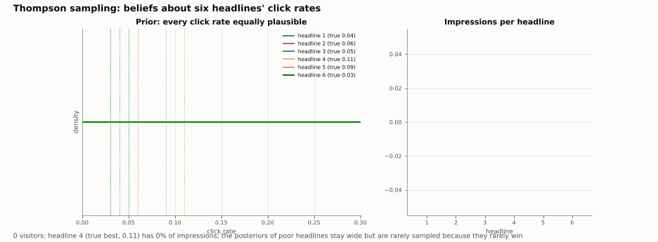
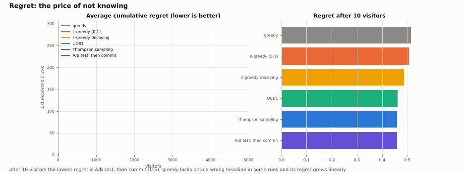
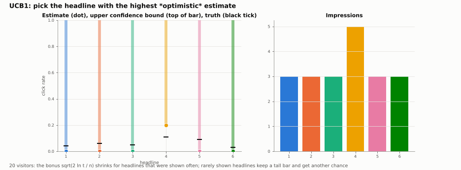

# 35 · Multi-Armed Bandits: Exploration versus Exploitation

> **One line:** you must repeatedly choose among options with unknown payoffs; every choice both earns reward and teaches you something, so the art is balancing *trying new things* against *using what already works*.





## 1. Definition

A **multi-armed bandit** (named after slot machines, "one-armed bandits") has `K` actions ("arms"). Pulling arm `a` at time `t` gives a random reward `r_t` from an unknown distribution with mean `μ_a`. A **policy** chooses the arm at each step using the history of actions and rewards. The goal is to maximise the total reward over `T` steps or, equivalently, to minimise the **regret**

```
Regret(T) = T · μ* − Σ_t μ_{a_t}        where μ* = max_a μ_a
```

(the expected reward lost compared with always playing the best arm). Bandits are the simplest *reinforcement-learning* problem: there are actions, rewards and a trade-off between exploring and exploiting, but no state (and no delayed consequences; those come in lesson 36).

**Story in the code.** A news site has six candidate headlines. Each visitor sees one and clicks (1) or not (0). True click rates are `0.04, 0.06, 0.05, 0.11, 0.09, 0.03` (unknown to the policies); headline 4 is best. We simulate 5000 visitors, averaged over 300 independent runs.

## 2. Intuition

You are in a new town choosing a restaurant for each of the next 100 nights. The first night you have no information. If you always return to the best place you have found *so far*, you may lock onto a mediocre place after one lucky visit and never learn about the great one (**pure exploitation fails**). If you keep trying random places forever you waste evenings on bad ones (**pure exploration fails**). Good policies explore in proportion to how uncertain they are: little by little less as the evidence accumulates.

## 3. The math

Let `n_a` be the number of pulls of arm `a` and `μ̂_a` the average reward from it.

**Greedy.** `a_t = argmax μ̂_a`. No exploration: with unlucky early data it can stay on a bad arm forever, so regret grows *linearly*.

**ε-greedy.** With probability `ε` play a random arm, otherwise the greedy arm. Simple and robust, but the exploration never stops: regret is linear (`ε Σ_a Δ_a / K` per step) unless `ε` decays (decaying `ε_t ∝ 1/t` gives logarithmic regret if tuned with knowledge of the gaps). `Δ_a = μ* − μ_a`.

**UCB1 (optimism in the face of uncertainty).** Play the arm with the highest *upper confidence bound*

```
UCB_a(t) = μ̂_a + sqrt( 2 ln t / n_a )
```

The bonus is large for arms that have been tried little; it comes from Hoeffding's inequality, so with high probability `μ_a ≤ UCB_a`. The regret is logarithmic: `E[Regret(T)] ≤ Σ_{a: Δ_a>0} (8 ln T / Δ_a) + O(1)`.

**Thompson sampling (Bayesian).** Keep a posterior over each arm's mean. For Bernoulli rewards with a uniform prior, arm `a` has `Beta(1 + clicks_a, 1 + misses_a)`. Each round draw one sample from every posterior and play the arm with the largest sample: an arm is chosen with exactly the posterior probability that it is the best. It explores when the posteriors overlap, and stops when they separate. It matches the Lai-Robbins asymptotic lower bound (see below) for Bernoulli bandits and usually performs very well in practice.

**A/B test then commit.** Show each headline equally for a fixed number of impressions (here 600), then lock in the best average. Regret is linear if the test is too short to find the best (or too long, wasting traffic).

**Lower bound.** For any policy that is "consistent" (does well on all problems) Lai & Robbins (1985) showed regret grows at least like `Σ_a Δ_a ln T / KL(μ_a ‖ μ*)`: logarithmic growth cannot be beaten asymptotically. (This is an asymptotic statement: at finite `T`, such as our 5000 visitors, it does not forbid doing better than the formula, and policies can look better or worse for a long time.)

## 4. Algorithm (Thompson sampling)

1. Initialise `α_a = β_a = 1` for each arm.
2. For `t = 1, 2, …`: draw `θ_a ~ Beta(α_a, β_a)` for every arm; play `a_t = argmax θ_a`; observe the reward `r ∈ {0, 1}`.
3. Update `α_{a_t} += r`, `β_{a_t} += 1 − r`.

(UCB: compute the bound for each arm, play the argmax, update counts. ε-greedy: flip a coin for exploration.)

## 5. Reading the animations

**`bandit_posteriors.gif`** (one Thompson run, 3000 visitors)

| Panel | What to watch | What it means |
|---|---|---|
| Beta curves | frame 0: flat (prior); after 150 visitors wide overlapping humps; after 3000 a tall narrow spike near 0.11 for headline 4 and low, broad curves for the rest. Dotted lines = true rates | uncertainty shrinks where data accumulate |
| Impressions | all headlines get about equal counts early; later headline 4 dominates (82% of the impressions in this run) | exploration fades automatically |

After 5000 visitors in a separate run the posterior means are `0.027, 0.070, 0.051, 0.109, 0.095, 0.039` (true `0.04, 0.06, 0.05, 0.11, 0.09, 0.03`) with `72 / 225 / 175 / 3363 / 1065 / 100` impressions: accurate where it matters (the top two), vague for the clearly bad ones because it stopped showing them: the price and the point of Thompson sampling.

**`bandit_regret.gif`** (average of 300 runs)

| policy | regret after 5000 visitors | share of impressions on the best headline |
|---|---|---|
| greedy | 292.2 | 0.11 |
| ε-greedy (ε = 0.1) | 70.8 | 0.62 |
| ε-greedy, decaying | 82.0 | 0.52 |
| UCB1 | 173.7 | 0.30 |
| **Thompson sampling** | **51.6** | **0.73** |
| A/B test (600), then commit | 53.2 | 0.66 |

Greedy's regret is a straight line: in most runs it locks onto a wrong headline early and never leaves it (only 11% of its impressions, on average, go to the best one). Thompson sampling has the lowest regret of all the policies tried. UCB1 is the most *cautious*: with click rates around 0.05-0.1 its bonus (derived for rewards that may be anywhere in [0, 1]) is much larger than the real noise, so it keeps exploring for thousands of impressions; tuned variants (UCB-tuned, KL-UCB, scaling the bonus down) do much better. The A/B test does well here *because* 600 impressions happen to be about the right length for this particular problem; it is not adaptive and would fail if the gaps were smaller or larger.

**`bandit_ucb.gif`**: for each headline the dot is the average estimate, the top of the faded bar is the upper confidence bound and the black tick is the true rate. At first the bars are tall and all headlines are tried; as headlines are shown more often their bars shrink toward the truth; the best arm's bound stays highest and attracts most impressions, while rarely shown arms keep a tall bar until their turn comes.

## 6. Hyper-parameters & knobs

- **ε** (and its decay schedule) for ε-greedy; **exploration constant** in UCB; **prior** (`Beta(α₀, β₀)`) for Thompson sampling; **length of the exploration phase** for A/B-then-commit.
- **Horizon `T`** (known or unknown), **batching** of decisions (delayed feedback), **non-stationarity** handling (sliding windows, discounting).
- **Reward model** (Bernoulli, Gaussian, Poisson...).

## 7. Variants & relatives

- **Contextual bandits**: the best arm depends on a context `x` (user, time): LinUCB, linear Thompson sampling, neural bandits. The step to **full reinforcement learning** (Q-learning, lesson 36) adds states and delayed rewards.
- **Non-stationary** and **adversarial** bandits (EXP3), **dueling** bandits (pairwise preferences), **combinatorial** and **cascading** bandits (slates of items), **best-arm identification** (pure exploration), **Bayesian optimisation** (a bandit over a continuous space with a Gaussian process, lesson 6), **Gittins index** (optimal discounted solution), **KL-UCB**, **Bayes-UCB**.
- **Applications**: A/B/n testing, ad and content recommendation, clinical trials, dynamic pricing, hyper-parameter search.
- *Not implemented:* contextual bandits, non-stationary rewards, Gaussian arms.

## 8. Assumptions, strengths & weaknesses

Assumes stationary reward distributions, independent pulls, immediate and observable rewards, and no effect of an action on future states.

**+** Simple and cheap; learns *while* serving, so it wastes far less traffic than a fixed A/B test; strong theory (logarithmic regret); easily extended with context.
**−** Needs fast reward feedback; breaks under drift (e.g., a headline's appeal changes); optimises the chosen metric only (click rate, not long-term value); the estimates for poor arms stay uncertain by design (less suitable if you need a clean estimate of every arm); delayed or batched feedback complicates matters.

**Use** for continuous experimentation on content, offers and layouts where the cost of showing a poor option is real. **Avoid** (use classical A/B tests and statistics) when you need unbiased effect estimates for every variant, or the metric arrives weeks later.

## 9. Metrics

Cumulative **regret** (and its growth rate: linear vs logarithmic), reward per round, fraction of pulls of the best arm, probability of identifying the best arm (for pure exploration), confidence-interval coverage of the final estimates, and in practice *business metrics* with off-policy evaluation.

## 10. Code tour (`bandits.py`)

- `Agent` base class (counts, sums) and the policies `Greedy`, `EpsGreedy`, `DecayEps`, `UCB` (with `bounds`), `Thompson` (with `post`), `ABCommit`.
- `run(agent_cls, T, seed)` - simulation returning cumulative regret and pull counts; `lai_robbins` (the asymptotic bound, for reference).
- `posteriors_gif`, `regret_gif`, `ucb_gif`, `main`.

Run: `python bandits.py` (about 50 s, dominated by 1800 simulated runs).

## 11. Experiments

1. Make the best two headlines closer (0.11 and 0.105): how do the policies' regrets change? Does the A/B test still look good?
2. Scale UCB's bonus by 0.25 and re-run.
3. Let the click rates drift slowly (a random walk) and add a sliding-window Thompson sampler.
4. Implement a Gaussian bandit with unknown variance (use a Normal-Inverse-Gamma posterior).
5. Add a context (mobile vs desktop) where the best headline differs; implement one Thompson sampler per context and compare with a single global one.

## 12. Pitfalls

- Judging a policy from one run; regret is noisy (average many runs and look at the spread).
- Greedy initialisation after only one pull per arm.
- Optimising clicks when what you care about is later purchase or satisfaction.
- Assuming stationarity (seasonality, novelty effects).
- Forgetting the delay in feedback.
- Treating a policy's final posterior as an unbiased estimate for all arms (adaptive sampling biases the estimates of rarely shown arms).

**Next:** [36 Q-learning](../36_q_learning/lesson.md)
