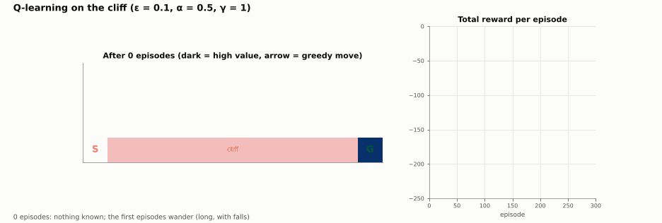
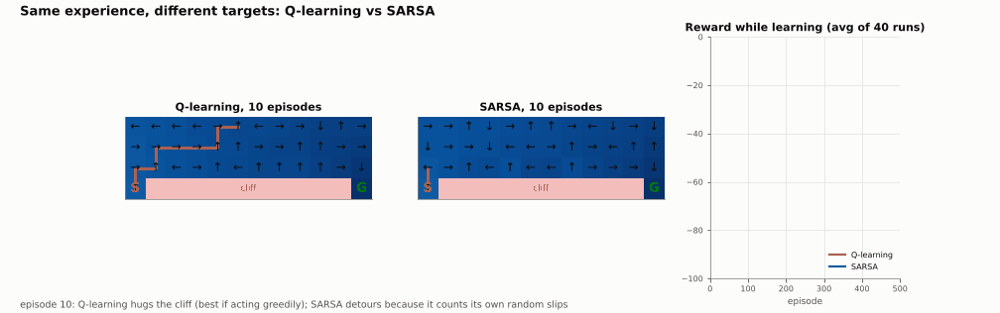

# 36 · Q-learning and SARSA: Learning from Rewards and Delayed Consequences

> **One line:** an agent in a world with *states* learns, purely by trying actions and seeing rewards, a table `Q(s, a)` of how good each action is in each state, by repeatedly nudging each estimate toward "reward now + value of where I end up".




## 1. Definition

**Reinforcement learning (RL)** studies an agent that interacts with an environment: at each step it observes a state `s`, chooses an action `a`, receives a reward `r` and lands in a new state `s'`. The aim is a **policy** `π(a|s)` that maximises the expected discounted **return** `G = r₁ + γ r₂ + γ² r₃ + …` (`γ ∈ [0, 1]` is the discount; here `γ = 1` because episodes end). Unlike supervised learning nobody tells the agent the right action, and unlike the bandit (lesson 35) actions change the *future state*, so a decision can have delayed consequences.

The **action-value function** `Q^π(s, a)` is the expected return after taking `a` in `s` and following `π` afterwards. The optimal `Q*` satisfies the **Bellman optimality equation**

```
Q*(s, a) = E[ r + γ · max_{a'} Q*(s', a') ]
```

and the optimal policy is `π*(s) = argmax_a Q*(s, a)`.

**Story in the code.** A warehouse robot drives on a 4 × 12 grid from the charging dock **S** (bottom left) to the packing station **G** (bottom right). Every move costs −1 (battery). The bottom row between them is a loading-bay drop (the "cliff"): stepping into it costs −100 and the robot is put back at S. While learning the robot also takes a random move 10% of the time (`ε = 0.1`), as real steering and exploration are imperfect.

## 2. Intuition

Imagine a maze with a treasure and no map. At first the only information is "I got a reward here". Every time you reach a square that leads to a known good square, you learn that the first square is good too, and the good news travels **backwards**, one step per visit, from the goal toward the start. After many trips, every square carries an estimate of "how many moves of battery until I am done", and following the best neighbour at every square is the best route. In the animation the dark colour (high value, i.e. close to −13 rather than −40) creeps outward from G, and the arrows turn from nothing into a field pointing toward the goal.

The twist is **what you do while learning**. Q-learning always learns about the *best* action in the next state, even if it does not take it. SARSA learns about the action it *actually* takes next, including its random slips. Near a cliff those are different problems.

## 3. The math

Define the **temporal-difference (TD) error** for an observed transition `(s, a, r, s')`: how much better or worse reality was than the current estimate.

```
Q-learning (off-policy):  Q(s,a) ← Q(s,a) + α [ r + γ max_{a'} Q(s',a')  − Q(s,a) ]
SARSA      (on-policy):   Q(s,a) ← Q(s,a) + α [ r + γ Q(s',a')            − Q(s,a) ]     a' ~ the policy actually followed
```

The only difference is the **target**: the best next action (Q-learning) versus the next action actually chosen (SARSA). Both are *bootstrapping* methods: they update an estimate from another estimate, unlike Monte-Carlo methods that wait for the whole return.

- **Exploration:** ε-greedy: with probability `ε` a random action, otherwise the greedy one (ties broken at random).
- **Convergence:** Q-learning converges to `Q*` (Watkins & Dayan, 1992) if every state-action pair is visited infinitely often and the step sizes `α_t` satisfy `Σα_t = ∞`, `Σα_t² < ∞`. SARSA converges to `Q^π` for the ε-greedy policy it follows (and to `Q*` if `ε` decays to 0 while every pair is still visited).
- **Off-policy vs on-policy:** Q-learning can learn the optimal policy while behaving differently (e.g. from stored or somebody else's experience); SARSA evaluates and improves the very policy that generates the data, including its exploration noise.
- **Model-based reference:** if the transition model is known, **value iteration** applies the Bellman equation directly as an update, `Q(s,a) ← r + γ max Q(s',·)`, with no sampling; the code uses it to get the exact `Q*`.

## 4. Algorithm (Q-learning)

1. Initialise `Q(s, a) = 0` for all non-terminal pairs.
2. For each episode: start at `s = S`.
3. Choose `a` ε-greedily from `Q(s, ·)`; take it; observe `r` and `s'`.
4. Update `Q(s, a)` toward `r + γ max Q(s', ·)` (target `r` if `s'` is terminal).
5. `s ← s'`; stop the episode at the goal (or after a step limit).
6. Repeat; optionally decay `ε` and `α` over time.

SARSA is identical except that `a'` is chosen *before* the update with the same ε-greedy rule, and the target is `r + γ Q(s', a')`.

## 5. Reading the animations

**`qlearning_learning.gif`** (one learner, ε = 0.1, α = 0.5, γ = 1; frames at 0, 1, 2, 3, 5, 8, 12, 20, 40, 80, 150, 300 episodes)

| Panel | What to watch | What it means |
|---|---|---|
| Grid | frame 0: nothing is known (grey cells = never updated); after a few episodes the orange route of the last episode is a random-looking wander; later arrows appear and point toward G; by 300 episodes the grid is a smooth gradient | information travels backward from the goal |
| Greedy path | in the early frames the caption says "does not reach the goal yet"; at 300 episodes it reaches the goal in **13 steps** | the learned policy becomes the shortest path |
| Reward curve | the episode reward starts in the hundreds of negative points (long wandering, repeated falls) and climbs to about −45 on average, with occasional spikes down to −100 or lower | the learner improves, but *while exploring* it still sometimes falls |

**`qlearning_vs_sarsa.gif`** (average of 40 runs; ε = 0.1, α = 0.5; frames at 10, 50, 100, 200, 350, 500 episodes)

| | Q-learning | SARSA |
|---|---|---|
| Greedy path found | 13 steps along the cliff edge (the shortest) | 19 steps: up to the top rows, across, and down |
| Online reward per episode (episodes 100-500) | **−48.8** | **−27.2** |
| Falls per episode when following the policy with ε = 0.1 (200 episodes) | **0.34** | **0.04** |

This is the classic result (Sutton & Barto, Example 6.6). Q-learning's targets assume the next action will be the best one, so the edge looks great; but the robot still makes a random slip 10% of the time, and on the edge a slip means −100. SARSA's targets include those slips, so squares next to the cliff are valued lower and the learned path stays away from it. Neither is "wrong": Q-learning learns the optimal *greedy* route (its greedy policy is the optimum), SARSA learns the best route *given that the robot will keep exploring*. If `ε` is decayed to 0, SARSA also converges to the shortest path.

**Verification.** Value iteration on the known model gives the exact optimum: start-state value **−13** and an optimal path of 13 moves. Q-learning with decaying `ε` and `α` (6000 episodes) matches it exactly along the optimal path (error 0.00) and with a maximum error of 1.10 over all visited states (rarely visited corner states are not yet converged); its greedy policy again takes 13 steps.

## 6. Hyper-parameters & knobs

- **Learning rate α**: too large gives noisy estimates, too small slow learning (with random transitions it should decay).
- **Discount γ**: 1 here (finite episodes); smaller values prefer fast rewards and make infinite tasks well-defined.
- **Exploration ε** (constant, decaying, or replaced by softmax/Boltzmann, UCB-style bonuses or optimistic initial values).
- **Initial Q-values** (optimistic initialisation encourages exploration), **number of episodes**, **step limit**, **reward shaping**.

## 7. Variants & relatives

- **Tabular methods:** Expected SARSA (average over the policy instead of sampling `a'`), **Double Q-learning** (removes the maximisation bias), **n-step methods and TD(λ)** with eligibility traces, **Dyna-Q** (learn a model and plan), **prioritised sweeping**, Monte-Carlo control.
- **Function approximation:** deep Q-networks (lesson 38), actor-critic and policy gradients (lesson 37), PPO, SAC.
- **Planning with a model:** value iteration, policy iteration (dynamic programming), Monte-Carlo tree search.
- *Not implemented:* function approximation, eligibility traces, Double Q-learning, continuous states.

## 8. Assumptions, strengths & weaknesses

Assumes a **Markov decision process**: the next state and reward depend only on the current state and action; states and actions are few enough for a table; rewards are observed.

**+** Model-free (needs no transition model); simple; provably convergent in the tabular case; Q-learning is off-policy so it can learn from any experience; works with delayed rewards.
**−** Slow (many samples are needed); the table does not scale to large or continuous state spaces; the max operator makes Q-learning overestimate values under noise; the exploration problem is hard when rewards are sparse; sensitive to reward design; the online performance of the exploring Q-learning agent can be worse than SARSA's, as seen here.

**Use** for small, discrete decision problems (control of simple systems, games, scheduling, learning in a simulator) and as the foundation to understand modern deep RL. **Avoid** the tabular form when the state space is large (use function approximation) or when you have a good model (use dynamic programming) or logged data only (use offline RL / off-policy evaluation).

## 9. Metrics

Return per episode (online and for the greedy policy evaluated separately), **learning curves** averaged over many seeds, steps to goal, number of failures (falls), gap to the optimal value `|V − V*|` when it is known, sample efficiency (episodes needed to reach a level), and stability across seeds.

## 10. Code tour (`q_learning.py`)

- Environment: `step(s, a)` (moves, walls, the cliff), `CLIFF`, `START`, `GOAL`.
- `eps_greedy`, `run_episode(Q, algo, ...)` (both Q-learning and SARSA; returns total reward, path and number of falls), `new_Q`, `greedy_path`.
- `value_iteration` (exact `Q*`), `draw_grid` (heat-map of `max Q` plus arrows).
- `learning_gif`, `compare_gif`, `main`.

Run: `python q_learning.py` (about 10 s).

## 11. Experiments

1. Set `ε = 0.01` and re-compare Q-learning and SARSA: does the gap shrink? Then try `ε = 0.3`.
2. Decay `ε` towards 0 for SARSA and check that it eventually finds the 13-step route.
3. Add a "windy" column that pushes the robot up or down with probability 0.3 (a stochastic environment) and compare with value iteration on the true model.
4. Implement Expected SARSA and Double Q-learning and compare their learning curves.
5. Give a +1 reward for reaching G and 0 per step (a sparse reward) with `γ = 0.95`: how much slower is learning?

## 12. Pitfalls

- Comparing algorithms on a single run (use many seeds and averages).
- Confusing **online** reward (including exploration) with the quality of the **greedy** policy.
- Not breaking ties randomly: always choosing the first action stalls exploration.
- Treating the terminal state as non-terminal (the target must not bootstrap from it).
- Rewards that can be exploited in unintended ways (reward hacking).
- Forgetting that Q-learning's maximisation overestimates values in noisy settings.
- Assuming the tabular method scales: a table over 10⁶ states is already infeasible to explore.

**Next:** [37 Policy gradient](../37_policy_gradient/lesson.md)
