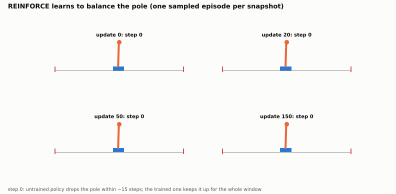
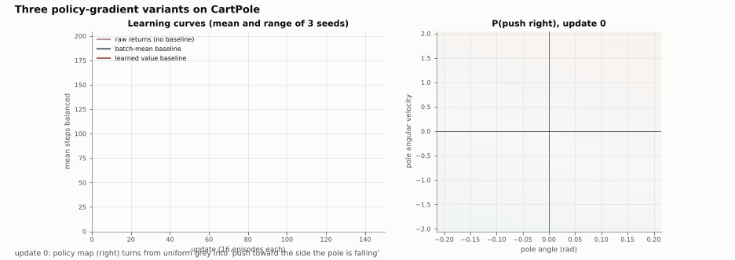

# 37 · Policy Gradient (REINFORCE and Baselines)

> **One line:** instead of learning how good each action is and then picking the best, learn the *policy itself*: make actions that were followed by high return more probable and actions followed by low return less probable.




## 1. Definition

A **policy-gradient method** parameterises the policy `π_θ(a|s)` (here a small neural network ending in a softmax over two actions) and performs gradient *ascent* on the expected return

```
J(θ) = E_{τ ~ π_θ}[ G(τ) ]            G_t = r_t + γ r_{t+1} + γ² r_{t+2} + …
```

where `τ` is a trajectory (states, actions, rewards). The **policy-gradient theorem** gives a gradient that needs no model of the environment:

```
∇_θ J = E[ Σ_t ∇_θ log π_θ(a_t | s_t) · G_t ]
```

**REINFORCE** (Williams, 1992) estimates it by sampling episodes with the current policy.

**Story in the code.** CartPole: a motorised cart must keep a pole upright by pushing left or right. The observation is `(cart position, cart velocity, pole angle, pole angular velocity)`, the reward is +1 per step while the pole is within 12° and the cart within 2.4 m, and an episode ends when either limit is broken or after 200 steps. A random policy keeps the pole up for about 22-25 steps.

## 2. Intuition

Value-based methods (lesson 36) ask "how good is each action?" and pick the argmax; that is awkward when actions are continuous, when the best behaviour is stochastic or when the value function is hard to represent. Policy gradient is trial and error on the behaviour itself: run some episodes; for each action taken, ask "did the episode turn out better than I expected?"; if yes, turn up the probability of that action in that state, otherwise turn it down. Good actions are reinforced even though nobody labelled them; the *return* is the only teacher. The trouble is **noise**: a single return depends on many random events, so the update direction is noisy, and the whole art of the method (baselines, critics, advantage estimates) is reducing that noise without adding bias.

## 3. The math

**Score-function (log-derivative) trick.** `∇_θ p_θ(τ) = p_θ(τ) ∇_θ log p_θ(τ)`. Since `p_θ(τ) = p(s₀) Π π_θ(a_t|s_t) p(s_{t+1}|s_t,a_t)` and the environment terms do not depend on `θ`:

```
∇_θ J = E[ G(τ) Σ_t ∇_θ log π_θ(a_t|s_t) ]  =  E[ Σ_t ∇_θ log π_θ(a_t|s_t) · G_t ]
```

(The second form uses *reward-to-go* `G_t`: an action cannot influence rewards received before it, which removes irrelevant noise.)

**Softmax policy.** For logits `z` and `π = softmax(z)`, `∂ log π(a)/∂z = onehot(a) − π`. The code back-propagates `adv · (π − onehot(a))` (the negative, because the optimiser minimises) through the network.

**Baselines.** For any function `b(s)` that does not depend on the action,

```
E[ ∇_θ log π_θ(a|s) · b(s) ] = b(s) Σ_a ∇_θ π_θ(a|s) = b(s) ∇_θ 1 = 0
```

so subtracting it leaves the gradient *unbiased* but can reduce its variance. The natural choice is the state value `V(s)`, giving the **advantage** `A_t = G_t − V(s_t)` ("better or worse than usual from here?"). Three variants are run here:

| variant | weight on `∇ log π` |
|---|---|
| `raw` | `G_t` (no baseline) |
| `mean` | `G_t − mean(G)` over the batch (and divided by its standard deviation) |
| `critic` | `G_t − V_φ(s_t)` with a second network `V_φ` regressed on `G_t` (and standardised) |

The `critic` variant is the first step toward **actor-critic** methods, which also bootstrap the return from `V` instead of using the full Monte-Carlo `G_t` (lower variance, some bias).

**Verification of the estimator.** On a 3-armed softmax bandit with mean rewards 1, 2, 3 (noise sd 1) the exact gradient is `[−0.3644, −0.0096, 0.3740]`; the score-function estimate from 200 000 samples is `[−0.3655, −0.0059, 0.3714]` without a baseline and `[−0.3651, −0.0087, 0.3737]` with the mean-reward baseline: the same expectation (unbiased), but the per-sample standard deviation falls from `0.90 / 1.01 / 1.27` to `0.55 / 0.49 / 0.54`.

## 4. Algorithm (REINFORCE with a learned baseline)

1. Initialise the policy network `π_θ` (and optionally the critic `V_φ`).
2. Repeat for each update: run the current policy in 16 environments for one episode each; record states, actions, rewards.
3. Compute the discounted reward-to-go `G_t` (`γ = 0.99`) for every step.
4. Compute advantages `A_t = G_t − V_φ(s_t)` (or the other baselines) and standardise them.
5. Gradient step on the policy with `−mean(A_t · log π_θ(a_t|s_t))`; regress `V_φ` toward `G_t`.
6. Go to 2. Data from the old policy are thrown away: the method is **on-policy**.

## 5. Reading the animations

**`pg_cartpole.gif`**: four snapshots of the *same training run* (the critic variant, seed 0) at updates 0, 20, 50 and 150, each shown on its own sampled episode (the first 100 steps).

| snapshot | steps before the pole fell (sampled episode) |
|---|---|
| update 0 | **15** (the pole tips over almost immediately) |
| update 20 | **46** |
| update 50 | **140** |
| update 150 | **200** (the maximum) |

The policy never saw a demonstration: the only signal was "+1 per step survived".

**`pg_curves.gif`** (3 seeds per variant; 150 updates of 16 episodes each)

| Panel | What to watch | What it means |
|---|---|---|
| Learning curves | all three variants start near 24 steps, bend upward after ~40 updates and reach ~195 | learning is noisy but steady |
| Policy map (right) | the probability of pushing right as a function of pole angle (x) and angular velocity (y), with cart centred and at rest: uniform grey at update 0, finally red above and blue below the line `angular velocity ≈ 0` | the learned rule is "push toward the side the pole is falling toward", a PD-controller-like behaviour discovered from reward alone |

| variant | mean steps balanced, updates 0-9 | updates 40-49 | last 10 updates (per seed) |
|---|---|---|---|
| raw returns | 23.7 | 61.1 | 196.0 (194.9 / 196.3 / 196.7) |
| batch-mean baseline | 25.1 | 54.9 | 194.0 (190.8 / 194.8 / 196.3) |
| learned value baseline | 25.0 | 54.8 | 193.5 (194.5 / 195.5 / 190.3) |

**An honest finding: here the baseline barely speeds up learning.** All three variants reach about the same performance at about the same time (in a side run of 6 seeds with the same settings the first update at which the 5-update average exceeded 150 steps was 66-92 for raw, 77-97 for mean-baseline and 73-95 for the learned baseline, i.e. no meaningful difference). CartPole is an easy problem, the batch of 16 episodes is large, and Adam normalises the step size, which hides part of the noise. The baseline *does* reduce the noise of the gradient estimate; we measured that directly at the policy reached after 30 updates, using 30 fresh batches of 16 episodes and the same samples for every variant (raw scale, without the standardisation used in training):

| variant | norm of the mean gradient | total standard deviation of one estimate | noise / signal |
|---|---|---|---|
| raw returns | 0.0177 | 0.0179 | **1.01** |
| batch-mean baseline | 0.0172 | 0.0123 | **0.71** |
| learned value baseline | 0.0173 | 0.0145 | **0.84** |

The mean gradient (the signal) is the same, confirming that the baselines are unbiased; the noise falls by roughly 30% (mean baseline) and 20% (critic, here fitted from only 400 optimiser steps on 30 batches so it is a rough baseline). On harder tasks, with small batches and long episodes, this variance reduction is what decides whether learning works at all.

## 6. Hyper-parameters & knobs

- **Learning rate** (1e-3 here, with Adam), **batch size** (episodes per update: 16), **discount γ** (0.99), **network size** (two hidden layers of 32 tanh units).
- **Baseline / advantage estimator**: none, batch mean, learned `V(s)`, GAE(λ) (a generalised advantage that trades bias for variance).
- **Entropy bonus** (keeps the policy stochastic, helps exploration), **advantage standardisation**, **gradient clipping**.
- **Trust region / clipping** (TRPO, PPO) to limit how far one update can move the policy.

## 7. Variants & relatives

- **Actor-critic** (A2C/A3C): critic bootstraps returns, updates every few steps; **GAE**.
- **TRPO**, **PPO** (clipped objective, the workhorse of modern RL and of RLHF for language models), **natural policy gradient**, **DDPG / TD3 / SAC** (continuous control with deterministic or entropy-regularised policies), **GRPO** (group-relative baselines).
- **Black-box alternatives**: evolution strategies, cross-entropy method.
- **Related**: Q-learning (lesson 36) and DQN (lesson 38) learn values instead of policies; bandits (lesson 35) are the one-step case (`G_t = r`).
- *Not implemented:* continuous actions (Gaussian policy), GAE, entropy bonus, PPO.

## 8. Assumptions, strengths & weaknesses

Assumes a differentiable policy, an environment that can be sampled (episodes can be repeated), and a return that is a meaningful signal of quality.

**+** Works with continuous and high-dimensional actions; can learn stochastic policies; directly optimises what you care about; simple and model-free; converges (at least to a local optimum) under smooth parameterisations; the basis of RLHF.
**−** High variance and sample inefficiency (each batch of data is used once); sensitive to learning rate; can collapse to a poor deterministic policy; local optima; credit assignment over long horizons is hard; needs many episodes.

**Use** for continuous control, robotics, games, fine-tuning generative models from feedback, whenever the action space is not a small discrete set. **Avoid** the plain form when interaction is expensive (use off-policy value methods or model-based RL) or when you have demonstration data (imitation learning first).

## 9. Metrics

Average return (with confidence bands over seeds), episode length, **sample efficiency** (episodes to reach a target), **gradient variance** and signal-to-noise ratio, policy entropy (is it collapsing?), KL divergence between successive policies (PPO monitors it), explained variance of the critic, stability across seeds.

## 10. Code tour (`policy_gradient.py` and `common/envs.py`)

- `common/envs.py` - `CartPole` (vectorised over many environments, auto-reset, the classic dynamics) and a `rollout` helper.
- `probs` (softmax policy), `collect` (one episode per environment, finished ones masked), `returns_to_go`.
- `train(variant, seed)` - the three variants; the policy gradient is `adv · (π − onehot)` back-propagated by `MLP.backward`.
- `bandit_check` (exact vs sampled gradient), `grad_variance` (noise at a fixed policy), `cartpole_gif`, `curves_gif`, `main`.

Run: `python policy_gradient.py` (about 30 s).

## 11. Experiments

1. Reduce the batch to 2 environments and `lr` to 1e-2: does the baseline now make a visible difference in speed and stability?
2. Add an entropy bonus `+0.01·H(π)` and look at the policy entropy curve.
3. Use the full-episode return `G_0` for every step instead of reward-to-go and compare the gradient variance.
4. Replace `γ = 0.99` by 0.9 and 1.0.
5. Implement GAE(λ = 0.95) with the critic and compare with the Monte-Carlo advantage.

## 12. Pitfalls

- Forgetting that the sign of the loss is the *negative* of the objective.
- Using the return of the whole episode for every step instead of the reward-to-go (more noise).
- A baseline that depends on the *action* (it biases the gradient).
- Fitting the critic on the same samples used for the advantage, which hides noise.
- Evaluating on the training episodes only; with a stochastic policy the performance of the sampled policy and of the greedy policy can differ.
- Reporting a single seed: policy-gradient curves vary a lot between runs.
- Letting the policy become deterministic too early (no exploration left).

**Next:** [38 Deep Q-network](../38_deep_q_network/lesson.md)
