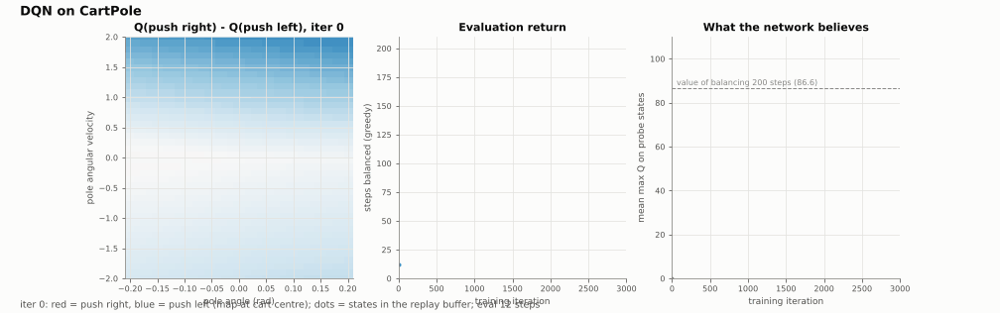
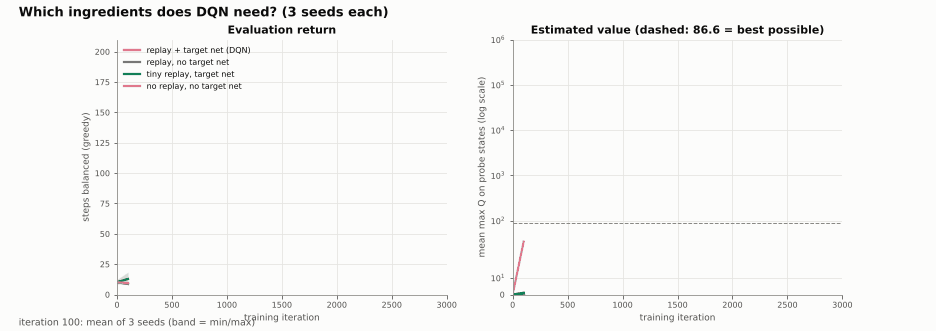

# 38 · Deep Q-Network (DQN)

> **One line:** Q-learning (lesson 36) with a neural network instead of a table, made stable by two tricks: learn from a *shuffled memory* of past experience (replay) and compute the learning target with a *slowly changing copy* of the network (target network).




## 1. Definition

A **deep Q-network** (Mnih et al., 2013/2015) approximates the action-value function `Q(s, a; θ)` with a neural network, and acts ε-greedily on it. It minimises the squared (here Huber) **temporal-difference error**

```
L(θ) = E_{(s,a,r,s') ~ replay}  [ ( r + γ (1 − done) · max_{a'} Q(s', a'; θ⁻)  −  Q(s, a; θ) )² ]
```

where `θ⁻` are the weights of a **target network**, a periodically refreshed copy of `θ`. It is the method that learned to play Atari games from pixels.

**Story in the code.** The CartPole of lesson 37, but the agent now learns *values*: a network `[4 → 64 → 64 → 2]` outputs, for the current state, the expected discounted return of pushing left and of pushing right. The policy is "push where the number is larger". 4 environments run in parallel, `γ = 0.99`, exploration `ε` falls from 1.0 to 0.05 over 1000 iterations; 3000 iterations = 12 000 environment steps and about 5 700 gradient steps.

## 2. Intuition

A table cannot hold a continuous 4-D state, so the network *generalises*: similar states get similar values. That brings two dangers, both visible in the animations.

1. **Correlated data.** Consecutive CartPole states are nearly identical, so learning from the latest transitions alone makes the network fit the current stretch of the trajectory and forget the rest. Replay stores the last 20 000 transitions and trains on random mini-batches (the dots in the left panel are the states stored in the buffer).
2. **A moving target.** The label `r + γ max Q(s', ·)` is produced by the network that is being trained. Change the weights a little and the labels of *all* states move, with positive feedback: an overestimate at `s'` raises the target at `s`, which (through generalisation) raises `s'` again. Freezing the label-making copy for a while turns this into a series of ordinary supervised regression problems.

## 3. The math

- **Bellman optimality target** (as in lesson 36): `y = r + γ max_{a'} Q(s', a'; θ⁻)`, with `y = r` at a true terminal state (the pole fell) and bootstrapping through a time-limit cut-off (the 200-step cap, which is not a failure).
- **Gradient.** Only the output for the action actually taken is trained: `∂L/∂Q(s,a) = clip(Q(s,a) − y, −1, 1)` (the Huber loss: quadratic for small errors, linear for large ones, which limits the damage of outliers), zero for the other output. The code feeds this into `MLP.backward`; a finite-difference check of the Q-network gives a maximum relative error of 4.9e-9.
- **Target updates.** Hard copy every 100 iterations here (`θ⁻ ← θ`); some implementations use a soft update `θ⁻ ← (1−τ)θ⁻ + τθ`.
- **The deadly triad** (Sutton & Barto): function approximation + bootstrapping + off-policy data can make value learning diverge; replay and target networks are practical defences, not guarantees.
- **Overestimation bias.** `max` over noisy estimates is biased upward; **Double DQN** picks the action with `θ` and evaluates it with `θ⁻`.
- **Upper bound on the true value.** With reward +1 per step, `γ = 0.99` and 200 steps the largest possible value is `(1 − 0.99²⁰⁰)/(1 − 0.99) = 86.6`, a useful sanity check: Q-estimates far above it mean divergence.

## 4. Algorithm

1. Initialise `Q_θ`, copy it to `Q_θ⁻`; empty replay buffer.
2. At each iteration: choose actions ε-greedily from `Q_θ`; step the environments; store `(s, a, r, s', done)`.
3. Once the buffer holds 500 transitions: take 2 mini-batches of 64 random transitions; build targets with `Q_θ⁻`; one Adam step on the Huber loss each.
4. Every 100 iterations: `θ⁻ ← θ`.
5. Repeat. Periodically evaluate the *greedy* policy (10 episodes) without exploration.

## 5. Reading the animations

**`dqn_training.gif`** (one run of the full DQN, frames every 300 iterations)

| Panel | What to watch | What it means |
|---|---|---|
| Left | colour = `Q(right) − Q(left)` for a centred, resting cart, as a function of pole angle and angular velocity (red: push right); black dots = states in the replay buffer. At iteration 0 the map is blank; at 1500 a red/blue division appears along the "pole is falling" direction; the buffer concentrates around the upright state | the value network has learned that pushing toward the lean helps; it learns best where it has data |
| Middle | greedy evaluation return: about 10 steps for the first 400 iterations, then a rapid rise to ≈165 around iteration 1000 | learning starts when ε has fallen and the buffer holds good and bad examples |
| Right | the average of `max Q` over 200 fixed near-upright probe states keeps rising (27 at the end), while the best possible value is 86.6 | the network is still *under*-estimating, yet the greedy policy is already good: for control only the ranking of the two actions matters, not the calibration |

Results (3 seeds, `dqn.py`; random policy: 22.4 steps):

| variant | evaluation at iteration 1500 | mean of the last 5 evaluations | best evaluation per seed | final mean `max Q` on probe states |
|---|---|---|---|---|
| **DQN: replay + target net** | 163.3 | 144.8 | 190 / 200 / 196 | **27.4** |
| replay, **no target net** | 9.5 | 9.3 | 12 / 10 / 10 | **553 609** |
| tiny replay (64), target net | 156.4 | 132.6 | 200 / 200 / 178 | 26.9 |
| tiny replay, **no target net** | 9.5 | 9.3 | 12 / 10 / 10 | **570 181** |

**`dqn_ablation.gif`** shows the same four variants with a logarithmic value axis. What the experiment says:

- **The target network is decisive.** Without it the value estimates run away (the true maximum is 86.6, the estimates reach half a million) and the policy never leaves ≈9-10 steps, in all three seeds. A side run with a five times smaller learning rate (2e-4) diverged more slowly (mean `max Q` ≈ 5 800 at iteration 3000), but still diverged.
- **Replay was *not* shown to be important here.** The "tiny replay" variant keeps only the 64 most recent transitions, but those come from 4 independent environments and about 16 different time steps, which already decorrelates the batch, so it learns almost as fast as full DQN (it is noisier: one seed ended at 84). On image-based problems with one environment the effect of replay is far larger; we do not claim to have demonstrated it here, and a test of "no replay" in the strict sense (a batch of the single latest transition) is left as an experiment.
- **DQN is not stable even when it works.** The evaluation return peaks near 200 and then oscillates between about 140 and 190 (see the middle panel of the first animation): "catastrophic forgetting" and policy changes caused by small Q changes, a known weakness. The evaluation uses only 10 episodes per point, so part of this is measurement noise.

## 6. Hyper-parameters & knobs

- **Network size, learning rate** (1e-3, Adam with gradient clipping), **batch size** (64), **updates per environment step**.
- **Replay**: capacity (20 000), warm-up (500), prioritisation. **Target update**: period (100 iterations) or `τ`.
- **Exploration schedule** (1.0 → 0.05 in 1000 iterations), **discount γ**, **reward clipping/scaling**, **Huber threshold**.
- **Time-limit handling**: bootstrap on truncation, not on failure.

## 7. Variants & relatives

- **Double DQN** (reduces overestimation), **Dueling DQN** (separate value and advantage heads), **Prioritised experience replay**, **Noisy nets** (learned exploration), **n-step returns**, **Distributional RL (C51, QR-DQN)**, **Rainbow** (combines these), **R2D2** (recurrent), **DRQN**.
- **Continuous actions**: DDPG, TD3, SAC (actor-critic with replay).
- **Policy-based**: lesson 37; **tabular**: lesson 36; **offline RL**: CQL, IQL (learn from a fixed dataset).
- *Not implemented:* convolutional networks for pixels, Double/Dueling/prioritised variants, soft target updates.

## 8. Assumptions, strengths & weaknesses

Assumes a (nearly) Markov state, a **discrete** and small action set, a reward signal that is informative, and enough exploration.

**+** Off-policy, so each experience is reused many times (far more sample-efficient than REINFORCE); works from raw observations; relatively simple; one network gives values for all actions; the idea scales to images (Atari).
**−** Unstable and hyper-parameter sensitive (as shown); overestimation bias; discrete actions only; exploration by ε is crude; the replay buffer needs memory; values are not calibrated; can forget old situations.

**Use** for discrete-action control and games with cheap simulators and moderate sample budgets. **Avoid** for continuous actions (use actor-critic methods), when stable monotone improvement is required (PPO is often easier to tune), or when only a fixed dataset exists (offline RL).

## 9. Metrics

Evaluation return of the *greedy* policy (separate from exploration), averaged over many episodes and seeds; sample efficiency (steps to reach a target); value-estimate statistics (mean max Q, compared with returns actually obtained: overestimation check); TD-error magnitude; fraction of random actions; stability (variance across seeds and over time).

## 10. Code tour (`dqn.py`)

- `Replay` (circular buffer, `sample`), `evaluate` (greedy episodes in 10 environments), `PROBE` (fixed states for tracking Q).
- `train(variant, seed)` - action selection, buffer, Huber-gradient update, target-network copy; variants `dqn`, `no_target`, `tiny_replay`, `neither`.
- `policy_map`, `training_gif`, `ablation_gif`, `main`.

Run: `python dqn.py` (about 30 s).

## 11. Experiments

1. Use a soft target update (`tq.soft_update(q, 0.01)` every iteration) and compare with the hard copy.
2. Implement Double DQN (`argmax` from `q`, value from `tq`) and watch the `max Q` curve.
3. Make the "no replay" variant strict: one environment, batch = the latest transition only. Does it fail?
4. Change the target period to 10, 1000 and 5000 iterations.
5. Scale rewards by 0.01 or 10 and look at how the Huber loss and learning respond.
6. Add prioritised replay (sample proportional to |TD error|^0.6).

## 12. Pitfalls

- Bootstrapping through true terminal states (the pole fell) or *not* bootstrapping through time-limit truncations.
- Judging the agent by training returns (which include exploration) rather than greedy evaluation.
- Taking the Q-value scale at face value (both under- and over-estimation occur).
- Reporting one seed or a single 10-episode evaluation.
- Updating the target network too often (diverges) or too rarely (learning is slow).
- Starting to learn before the buffer holds enough diverse data.
- Reading `max Q` blow-up as "high reward": values above the theoretical maximum signal divergence.

**Next:** back to the [course overview](../../README.md) - for the models *not* covered here (and why), see its "What is not covered" section.
