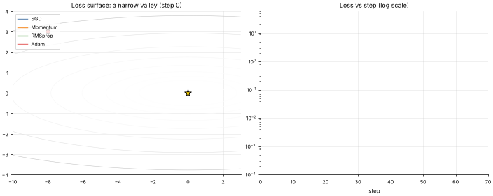

# 00 · Gradient Descent & Optimizers
**Family:** Foundations · Optimization

## Definition
Nearly every model in this course learns by *minimizing a loss function* L(θ) that measures how wrong the model is.
**Gradient descent** repeatedly nudges the parameters θ in the direction that reduces the loss fastest (the negative gradient).
Optimizers are different rules for *how big* and *in which direction* each nudge is.

## Intuition
Picture a hiker in thick fog on a hillside who can only feel the slope under their feet. Plain gradient descent takes a
step straight downhill. In a long narrow valley the slope mostly points at the valley *walls*, so the hiker zig-zags.
Momentum remembers where it has been heading and glides along the valley floor. RMSprop/Adam rescale each direction
so steep directions take small steps and flat directions take big ones.

## The math
    SGD       θ ← θ − η·g
    Momentum  v ← β·v + g          θ ← θ − η·v
    RMSprop   s ← ρ·s + (1−ρ)·g²  θ ← θ − η·g / (√s + ε)
    Adam      m ← β1·m + (1−β1)·g ;  v ← β2·v + (1−β2)·g²
              θ ← θ − η · m̂ / (√v̂ + ε)      (m̂, v̂ are bias-corrected)
    g = ∇L(θ) (+ noise when computed on a mini-batch)

## When to use what
- **SGD (+momentum)**: the workhorse for CNNs; generalizes very well, needs a tuned learning rate schedule.
- **Adam / AdamW**: the default for transformers, RNNs, GANs, anything noisy or badly scaled.
- **Learning rate η** is the most important hyper-parameter in deep learning: too big diverges, too small crawls.

## What the animation shows
Four optimizers start at the same point on the loss surface f(x,y) = x²/20 + y² (a narrow valley, 20× flatter along x),
all receiving the same noisy gradients (like random mini-batches). Right: loss vs step on a log scale.

## Try this
- Change SGD's learning rate to 1.05 and watch it diverge (η·curvature > 2).
- Remove the noise and compare. Which optimizers are most robust to it?
- Replace the surface with the Rosenbrock function f = (1−x)² + 100(y−x²)².

## Formats
- **Interactive Notebook:** [`notebooks/00_gradient_descent_optimizers.ipynb`](../notebooks/00_gradient_descent_optimizers.ipynb)
- **Standalone Python Script:** [`lessons/00_gradient_descent_optimizers.py`](../lessons/00_gradient_descent_optimizers.py)

