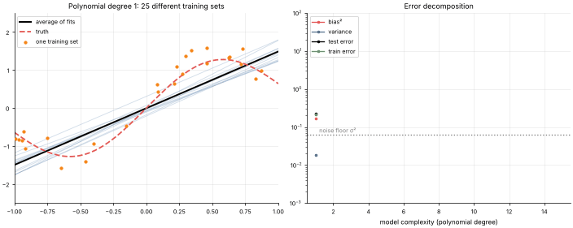

# 01 · Bias, Variance & Overfitting
**Family:** Foundations · Generalization

## Definition
A model's expected test error decomposes into three parts:
**bias²** (error from wrong assumptions: the model is too simple to capture the truth),
**variance** (error from sensitivity to the particular training sample: the model is too flexible) and
**irreducible noise**. *Overfitting* = low training error but high test error (variance too high);
*underfitting* = both errors high (bias too high).

## Intuition
Fit a straight line to a wavy signal: every training set gives nearly the same wrong line (high bias, low variance).
Fit a degree-15 polynomial to 25 noisy points: it threads every point, and a *different* training set gives a wildly
different curve (low bias, high variance). The sweet spot is in between.

## The math
    E[(y − f̂(x))²] = Bias²[f̂(x)] + Var[f̂(x)] + σ²
    Bias[f̂(x)] = E[f̂(x)] − f(x)          Var[f̂(x)] = E[(f̂(x) − E[f̂(x)])²]

## How to fight each problem
- **High variance:** more data, regularization (lesson 04), simpler model, bagging (lesson 12), early stopping, dropout.
- **High bias:** richer features, more flexible model, boosting (lesson 14), less regularization.
- **Always** measure on data the model has not seen (hold-out set or k-fold cross-validation).

## What the animation shows
We draw many different training sets from the same noisy process and fit polynomials of growing degree to each.
Left: thin lines = individual fits (their spread is *variance*), thick line = their average, dashed = truth
(the gap is *bias*). Right: the measured bias², variance and test error as complexity grows (log scale).

## Try this
- Make the training sets bigger (`data.curve(100, ...)`): how does the best degree change?
- Increase `noise`. Why does the noise floor (dotted) rise but the bias/variance curves keep their shape?

## Formats
- **Interactive Notebook:** [`notebooks/01_bias_variance_overfitting.ipynb`](../notebooks/01_bias_variance_overfitting.ipynb)
- **Standalone Python Script:** [`lessons/01_bias_variance_overfitting.py`](../lessons/01_bias_variance_overfitting.py)

