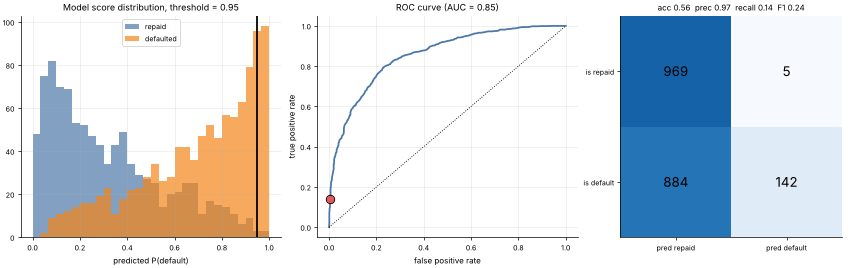

# 02 · Classification Metrics, Thresholds & ROC
**Family:** Foundations · Evaluation

## Definition
A probabilistic classifier outputs a *score* per example. Turning scores into decisions needs a **threshold**, and every
threshold produces a different **confusion matrix** (TP, FP, FN, TN). Metrics summarize it; the **ROC curve** shows all
thresholds at once and **AUC** is the probability that a random positive is scored above a random negative.

## Intuition
Loan officer: lower the approval-risk threshold and you catch more true defaulters (recall ↑) but flag more good
customers (precision ↓). There is no free lunch; you pick the trade-off that matches the *cost* of each mistake.

## The math
    accuracy  = (TP+TN)/N                precision = TP/(TP+FP)
    recall (TPR) = TP/(TP+FN)            specificity = TN/(TN+FP)
    FPR = FP/(FP+TN) = 1 − specificity   F1 = 2·precision·recall/(precision+recall)
    ROC: plot TPR against FPR as the threshold sweeps from 1 to 0.   AUC = area under it (0.5 = coin flip, 1 = perfect)

## Practical tips
- With imbalanced classes accuracy lies; use precision/recall, PR-AUC or cost-weighted metrics.
- Choose the threshold on a validation set, using real business costs.
- Always cross-validate: split into k folds, train on k−1, test on the held-out fold, average.

## What the animation shows
A logistic-regression model (trained inside this file) scores 2000 synthetic loan applicants. As the decision threshold
slides from strict to lenient: the score histograms with the cut line, the moving point on the ROC curve, and the live
confusion matrix with all metrics.

## Try this
- Make the classes more imbalanced (change the default rate) and compare accuracy to F1.
- Add a cost matrix (a missed default costs 10× a false alarm) and find the cost-minimizing threshold.

## Formats
- **Interactive Notebook:** [`notebooks/02_classification_metrics_roc.ipynb`](../notebooks/02_classification_metrics_roc.ipynb)
- **Standalone Python Script:** [`lessons/02_classification_metrics_roc.py`](../lessons/02_classification_metrics_roc.py)

