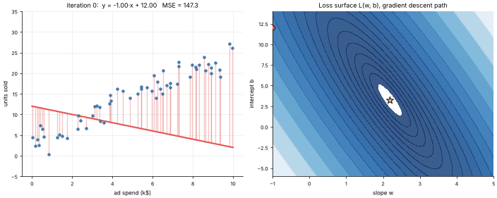

# 03 · Linear Regression
**Family:** Supervised · Regression

## Definition
Linear regression models a numeric target as a weighted sum of the input features plus a bias:
ŷ = w·x + b. Training finds the weights that minimize the mean squared error between predictions and truth.

## Intuition
Draw the straight line that passes as close as possible to all the points, where "close" means the *sum of squared
vertical distances (residuals)* is as small as it can be. Squaring punishes big misses and makes the math smooth.

## The math
    Loss      L(w,b) = 1/(2n) Σ (w·xᵢ + b − yᵢ)²
    Gradient  ∂L/∂w = 1/n Σ (ŷᵢ − yᵢ)·xᵢ        ∂L/∂b = 1/n Σ (ŷᵢ − yᵢ)
    Update    w ← w − η ∂L/∂w ,  b ← b − η ∂L/∂b
    Closed form (normal equation): w = (XᵀX)⁻¹ Xᵀ y

## Assumptions & pitfalls
- Linear relationship; independent errors with constant variance; no extreme multicollinearity.
- Sensitive to outliers (squared error). Scale features before gradient descent.
- Coefficients are only interpretable when features are not heavily correlated.

## What the animation shows
Left: the line rotating and shifting toward the data, red segments are the residuals being squared. Right: the loss
surface over (w,b) with the optimizer's path sliding down the elongated valley. Afterwards the script fits a
4-feature *house price* model both ways (gradient descent vs normal equation) and prints the coefficients.

## Try this
- Standardize x before descending: the valley becomes round and convergence is far faster.
- Add one huge outlier to the data and watch the line get dragged toward it.

## Formats
- **Interactive Notebook:** [`notebooks/03_linear_regression.ipynb`](../notebooks/03_linear_regression.ipynb)
- **Standalone Python Script:** [`lessons/03_linear_regression.py`](../lessons/03_linear_regression.py)

