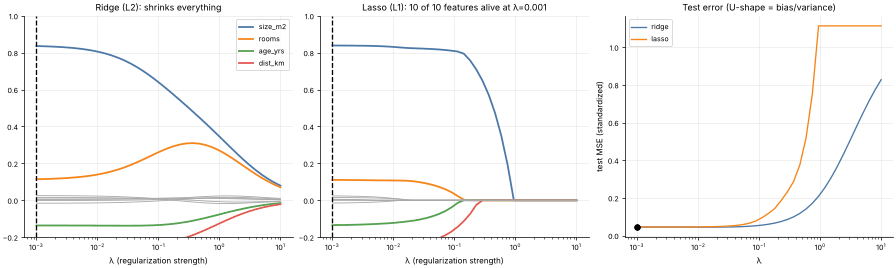

# 04 · Regularization: Ridge, Lasso & Elastic Net
**Family:** Supervised · Regression (penalized linear models)

## Definition
Regularization adds a penalty on the size of the weights to the loss so the model cannot over-use any feature.
**Ridge (L2)** shrinks all weights smoothly toward zero; **Lasso (L1)** can set weights *exactly* to zero (automatic
feature selection); **Elastic Net** mixes both.

## Intuition
With many correlated or noisy features, unpenalized regression happily assigns large opposing weights that fit noise.
The penalty is a budget: weights must "pay" for being large, so only features that truly help earn a big weight. The L1 penalty
has corners on the axes, so the optimum often lands exactly on a corner, which means a zero weight.

## The math
    minimize   1/(2n) ||y − Xw||²  +  λ [ α·||w||₁ + (1−α)/2·||w||₂² ]
    Ridge (α=0): w = (XᵀX/n + λI)⁻¹ Xᵀy/n
    Lasso/Elastic Net via coordinate descent:  wⱼ ← S(ρⱼ, λα) / (1 + λ(1−α)),
    ρⱼ = 1/n Xⱼᵀ(residual + Xⱼwⱼ),  S(r,t) = sign(r)·max(|r|−t, 0)   (soft-thresholding)

## Practical tips
- **Always standardize features** first, otherwise the penalty is unfair across units.
- Choose λ by cross-validation (the U-shaped test-error curve on the right).
- Lasso arbitrarily picks one of several correlated features; Elastic Net keeps groups together.

## What the animation shows
We use the 4 real house-price features plus 6 pure-noise columns. As λ grows: left, ridge paths shrink gradually;
middle, lasso paths hit zero one by one, noise features first; right, test error forms a U shape.

## Try this
- Change `alpha` for the elastic net and see how the path shape morphs between ridge and lasso.
- Make training smaller (50 rows) and see how much more regularization helps.

## Formats
- **Interactive Notebook:** [`notebooks/04_regularization_ridge_lasso.ipynb`](../notebooks/04_regularization_ridge_lasso.ipynb)
- **Standalone Python Script:** [`lessons/04_regularization_ridge_lasso.py`](../lessons/04_regularization_ridge_lasso.py)

