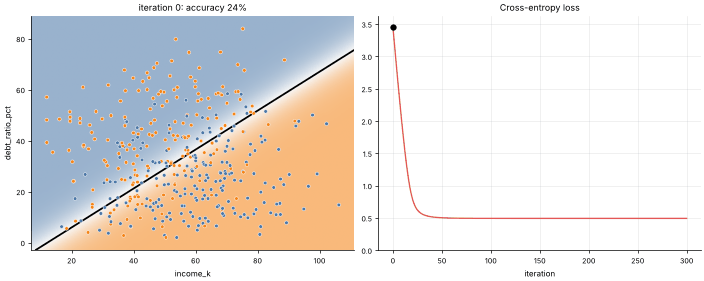

# 05 · Logistic Regression
**Family:** Supervised · Classification (linear)

## Definition
Despite the name, logistic regression is a *classifier*. It computes a linear score z = w·x + b and squashes it through
the sigmoid σ(z) = 1/(1+e⁻ᶻ) to get a probability P(y=1 | x). The decision boundary (P = 0.5) is the straight line w·x + b = 0.

## Intuition
Linear regression extended to probabilities. Far on one side of the line the model is confident (P≈0 or 1); near
the line it is unsure (P≈0.5). Training pushes the line to put defaulters on one side and good borrowers on the other,
punishing *confident mistakes* very hard.

## The math
    P(y=1|x) = σ(w·x + b)
    Loss (binary cross-entropy / negative log-likelihood):  L = −1/n Σ [ y log p + (1−y) log(1−p) ]
    Gradient (beautifully simple):  ∂L/∂w = 1/n Σ (pᵢ − yᵢ) xᵢ ,   ∂L/∂b = 1/n Σ (pᵢ − yᵢ)
    Multi-class: softmax instead of sigmoid.  Regularize with an L2/L1 penalty exactly like lesson 04.

## Strengths & weaknesses
- Fast, convex (a single global optimum), well-calibrated probabilities, interpretable (odds ratio = e^w).
- Only linear boundaries unless you add polynomial/interaction features; needs scaled inputs for gradient descent.

## What the animation shows
Loan-default data (income vs debt ratio). Watch the probability map (blue = repay, orange = default) and the black
P=0.5 decision line rotate from a random starting guess to the best separator; right: loss falls, accuracy rises.

## Try this
- Add `debt_ratio**2` as a third feature (needs a 3-D weight vector) and see a curved boundary appear in the original space.
- Change the learning rate: where does training become unstable?

## Formats
- **Interactive Notebook:** [`notebooks/05_logistic_regression.ipynb`](../notebooks/05_logistic_regression.ipynb)
- **Standalone Python Script:** [`lessons/05_logistic_regression.py`](../lessons/05_logistic_regression.py)

