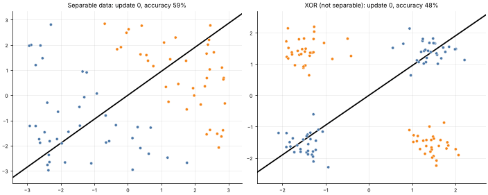

# 06 · The Perceptron
**Family:** Supervised · Classification (linear), the ancestor of neural networks

## Definition
The perceptron (Rosenblatt, 1958) is a single artificial neuron: ŷ = sign(w·x + b). It learns by looking at one example
at a time and, **only when it makes a mistake**, nudging the boundary toward classifying that example correctly.

## Intuition
If a point is on the wrong side of the line, pull the line toward it (add the point's vector to w if it is a positive
example, subtract if it is negative). Repeat. If the classes can be separated by a line, this is *guaranteed* to stop.

## The math
    ŷ = sign(w·x + b)           labels y ∈ {−1, +1}
    if y (w·x + b) ≤ 0 :        w ← w + η y x ,   b ← b + η y        (otherwise do nothing)
    Perceptron convergence theorem: if a separating margin γ exists and ||x|| ≤ R, at most (R/γ)² mistakes are ever made.

## Limitations (and why they matter)
- If the data is **not** linearly separable (like XOR) it never converges and keeps oscillating.
  That failure (Minsky & Papert, 1969) motivated multi-layer networks (lesson 15).
- No probabilities, and the final line is just *some* separator, not the best one (SVMs, lesson 10, fix that).

## What the animation shows
One frame per weight update. Left: linearly separable customers; the circled point is the mistake being fixed and the
boundary jumps until it separates the classes. Right: XOR data, where no line works and the boundary keeps flailing.

## Try this
- Run with a very small and a very large η: does the number of mistakes change? (Hint: with b=0 start, η is just a scale!)
- Add the feature x₁·x₂ to the XOR data and watch the perceptron suddenly succeed (feature engineering!).

## Formats
- **Interactive Notebook:** [`notebooks/06_perceptron.ipynb`](../notebooks/06_perceptron.ipynb)
- **Standalone Python Script:** [`lessons/06_perceptron.py`](../lessons/06_perceptron.py)

